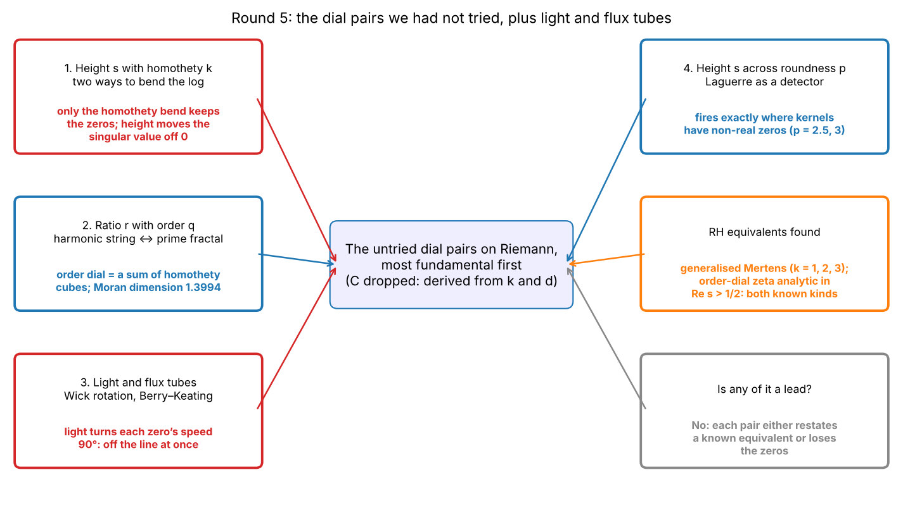
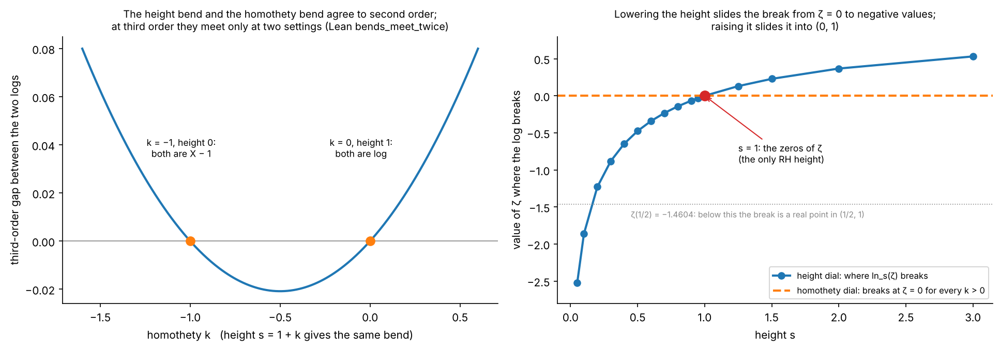
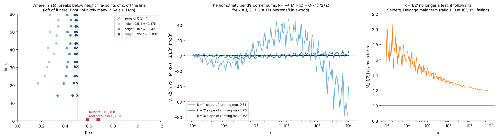
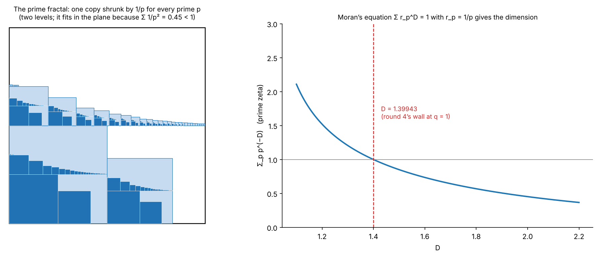
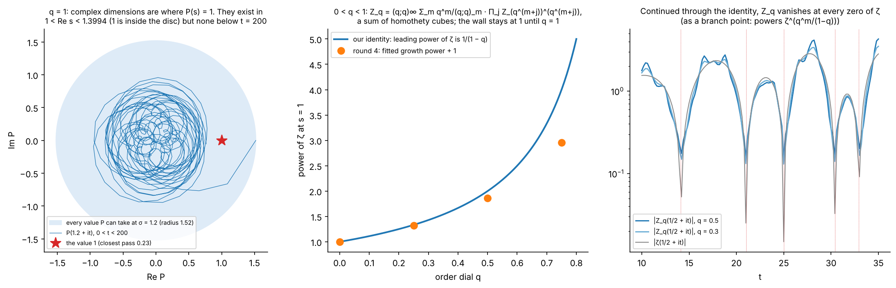
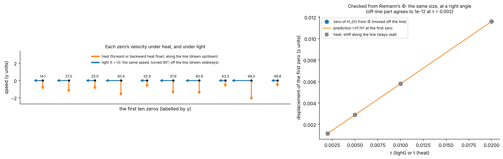
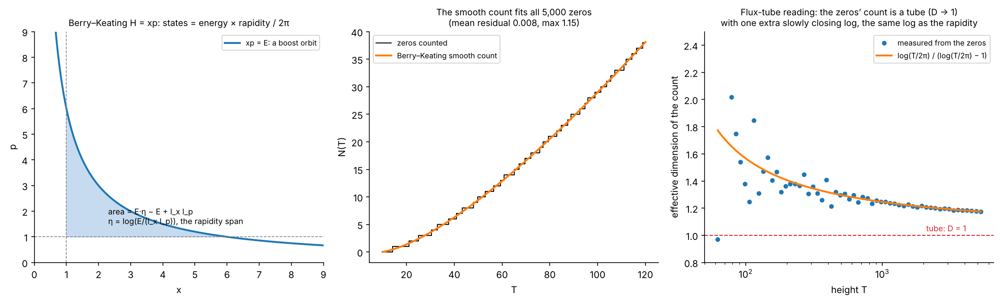
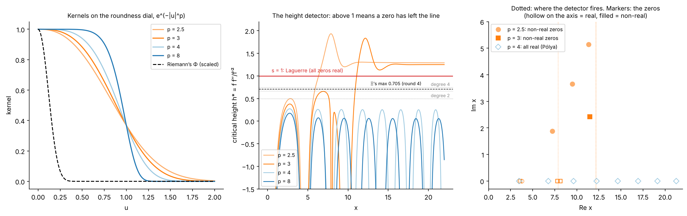

# Riemann, round 5: the dial pairs we had not tried, plus light and flux tubes (DRAFT)

*Affine Composition Theory, built on Fused Hyperoperation Algebra. DRAFT, Nov 26 2026. Earlier rounds: [round 1](../README.md), [the elliptic object](../elliptic-object/README.md), [round 3](../round3/README.md), [round 4](../round4/README.md).*

## The answer

**We ran the four untried pairs, most fundamental first. Not a lead.** Each pair either lands on an RH equivalent of a kind already known, or moves the zeros of ζ out of view.

**The order, and why.**

1. **Height s with homothety k.** Both bend the logarithm itself, the base operation of the theory, so they come first.
2. **Similarity ratio r with order q.** One level up: how the pieces of a factorisation scale (r) and in what order they compose (q).
3. **Light and flux tubes.** These are physical readings of the heat flow on the zeros, which rests on the two pairs above.
4. **Height s with roundness p.** Roundness is the shape of a kernel, the outermost layer.

**C is not a dial.** As you said, the cubic form C is derived from k and d, and it is zero on our quadric family. So the pair "C with d" is dropped.

**What each pair gave.**

- **s with k: two ways to bend the log, and they part.** The homothety bend keeps ζ's zeros as its singularities. Its RH test is the generalized Mertens bound, Σ μ(n)k^ω(n) = O(x^(1/2+ε)), a known kind (Littlewood at k = 1). The height bend slides the break off ζ = 0 onto other values of ζ (a-points), which sit off the line. So height 1 is the only RH height.
- **r with q: the order dial is a sum of homothety cubes.** Our exact identity writes it that way, so its RH test is again of the known kind. At q = 1 the dial gives the prime fractal: one copy shrunk by 1/p for every prime p. Its dimension is 1.39943, and its complex dimensions sit in 1 < Re s < 1.39943 (none below height 200), nowhere near the critical line.
- **Light: every zero leaves the line at once.** Rotating heat time into light time (a Wick rotation) turns each zero's speed by 90°. Checked from Riemann's Φ. Berry–Keating's xp model counts the zeros as energy × rapidity / 2π, which is already known.
- **Flux tubes: a reading, not a tool.** The zeros' count grows like a tube (dimension → 1) with one slowly closing log, the same log as the rapidity. That is the Riemann–von Mangoldt formula, restated.
- **s with p: a detector, not a lead.** The critical height h* = f f″/f′² goes above 1 exactly where a kernel on the roundness dial has non-real zeros (p = 2.5 and 3), and stays below 0.28 for p = 4, 6, 8. For Ξ it stays at 0.705 (round 4). It can only see pairs near the line.

---

## Pass 1: our own tools

### 1. Height s with homothety k: two ways to bend the log

There are two dials that bend the logarithm:

- **The homothety log** ℓ_k(X) = (1 − X^(−k))/k. It turns × into the circle operation at −k, and it undoes each prime factor of the prime cube exactly: ℓ_k(Z_k) = (1 − ∏(1 − k p^(−s)))/k.
- **The hypernatural log at height s**, ln_s(X) = E^(−s)(X − 1) with E(x) = e^x − 1. It turns × into the fused operation at height 1 − s: ln_s(XY) = B_(1−s)(ln_s X, ln_s Y).

Height s = 1 + k gives the same bend at second order. At third order they differ by k(k + 1)/12, so the two bends meet only at k = 0 (both are log) and k = −1 (both are X − 1).

**What ζ sees.**

- **The homothety bend keeps the zeros.** ℓ_k(ζ) breaks where ζ = 0 for every k > 0. Its coefficients are the generalized Möbius sums M_k(x) = Σ_(n≤x) μ(n)k^ω(n), and RH ⇔ M_k(x) = O(x^(1/2+ε)) for k = 1, 2, 3. To x = 10⁷ the growth slope is 0.51 at k = 1. It is 0.62 and 0.63 at k = 2 and 3, where the order-k poles add a log factor. At k = 1/2 the sum is no longer a test: it follows its Selberg–Delange main term x(log x)^(−3/2), with a ratio of 1.19 at 10⁷ that is still falling toward 1.
- **The height bend loses them.** ln_s(ζ) breaks where ζ hits one value X_s. For s < 1 that value is negative (−2.52 at s = 0.05, rising to −0.0062 at s = 0.99). Above 1 it lies in (0, 1); at s = 2 it is 1/e. Those points are a-points of ζ, and they sit off the line. Below ζ(1/2) = −1.4604 they are real points in (1/2, 1): σ = 0.6748 at s = 0.05 and 0.5846 at s = 0.1. Otherwise every one we found in 0 < t < 60 is left of the line, and Bohr's theorem gives infinitely many in Re s > 1 as well.

**Verdict: not a lead.** The homothety bend gives RH equivalents of a known kind. The height bend gives an RH equivalent only at s = 1, where it is the ordinary log.

### 2. Similarity ratio r with order q: the harmonic string and the prime fractal

The order dial weights each ordering of a factorisation by q^(inversions):

- **Weights.** Z_q(s) = Σ W_q(n) n^(−s), with W_q(n) the q-multinomial (q;q)_Ω/∏(q;q)_(e_i). Checked against brute force over orderings.
- **q = 0.** One ordering per n, so Z_0 = ζ: the harmonic string, lengths 1/n.
- **q = 1.** Every ordering, so Z_1 = 1/(1 − P(s)) with P the prime zeta. This is a self-similar set with one copy for each prime, ratio r_p = 1/p.

**The prime fractal.** Moran's equation Σ r_p^D = 1 gives its dimension D = 1.39943 (where P(D) = 1). Its complex dimensions are the roots of P(s) = 1. In Re s > 1 the only real one is D. Every complex dimension has real part below D, because |P(σ + it)| < P(σ) when t ≠ 0. They do exist: for each σ between 1 and 1.39943 the values of P(σ + it) fill a disc of radius P(σ) > 1, so by Bohr's almost-periodicity argument P takes the value 1 infinitely often in every such strip (a standard argument, not computed here). But they sit high up, where 2^(−it), 3^(−it), 5^(−it), ... nearly line up: a Newton search from 597 starts found none with 0 < t < 200, and at σ = 1.2 the path of P stays at least 0.23 away from 1 there.

**In between (0 < q < 1): our exact identity.** Using Euler's q-exponential twice,

Z_q(s) = (q;q)_∞ · Σ_m q^m/(q;q)_m · ∏_(j≥0) Z_(q^(m+j))(s)^(q^(m+j)),

where Z_c = ∏_p (1 − c p^(−s))^(−1/c) is the homothety cube at k = c. Each cube is ζ(s)^c times a factor analytic and non-zero in Re s > 1/2 (the necklace step: Z_c^c = ζ(s)^c ∏_(N≥2) ζ(Ns)^(M(c,N)), with N·M(c,N) = Σ_(d|N) μ(N/d)c^d). So:

- **The leading power of ζ is 1/(1 − q).** Round 4's fitted growth exponents fall on this curve at small q and undershoot at q = 0.5, 0.75, where a finite range can't see the full log power.
- **The wall stays at Re s = 1 until q = 1**, where it jumps to 1.39943.
- **RH ⇔ Z_q is analytic in Re s > 1/2 off cuts from the zeros.** On the line, |Z_q| dips at every zero of ζ (branch points, powers ζ^(q^m/(1−q))).
- **Checked at s = 2** for q = 0.3, 0.6, 0.9: the direct Dirichlet sum climbs to the identity's value as more terms are added, and the gap halves each time the range doubles.

**Verdict: not a lead.** The order dial is the homothety dial summed, so it adds no new RH test. At q = 1 the singularities move to 1 < Re s ≤ 1.39943, far from the line. The prime fractal is a nice object, but the theory of complex dimensions for such sets is already in place (Lapidus–van Frankenhuysen).

### 3. Light and flux tubes

**Heat versus light.** Under the heat flow (forward, or the backward heat flow we call the rewind), each zero moves with speed dz/dt = H″/H′, along the line. Rotating heat time into light time, t = iτ, multiplies that speed by i:

- **The same size, turned 90°.** Every zero leaves the line at once, with no merger needed.
- **Checked from Φ.** For the first zero, v = −0.57963 in z units, and the zero of H_(iτ) found from Φ moves off the line by exactly vτ (the off-line part agrees to 1e-12 at τ = 0.002). Under heat it stays real and slides by vt.

So light is the wrong rotation: the reversibility we want has to keep zeros on the line, and light moves all of them off.

**Berry–Keating H = xp.** A boost orbit xp = E has area E·η − E + l_x l_p, with η = log(E/(l_x l_p)) the rapidity span (sympy). Dividing by 2π gives the smooth zero count, and it fits all 5,000 zeros (mean residual 0.008). This is Berry–Keating (1999).

**Flux tubes.** Read the count as a tube: its local dimension d log N / d log T = log(T/2π)/(log(T/2π) − 1) falls toward 1, like a flux tube, with one slowly closing log, the same log as the rapidity. Measured from the zeros it tracks this within 0.1 above T = 200 and reaches 1.18 at T = 5,243.

**Two different s.** The flux-tube page's dial s is the flux exponent (Pagels–Tomboulis). It is not the hypernatural height s of pass 1.

**Verdict: not a lead.** Light moves every zero off the line, so it breaks what we need. The Berry–Keating count and the tube reading restate the Riemann–von Mangoldt formula.

### 4. Height s across the roundness dial: Laguerre as a detector

Take the kernels e^(−|u|^p) on the roundness dial and their cosine transforms F_p(x) = (2/p) Σ (−1)^n Γ((2n+1)/p) x^(2n)/(2n)!. Read each with the critical height h* = f f″/f′², the height at which the hypernatural log stops bending the right way (round 4). Two real zeros give h* = 1 − 1/N_eff; above 1 means a pair has left the line.

- **p = 2.5 and 3: the detector fires.** h* reaches 1.93 and 1.83. The peaks sit next to the non-real zeros: 7.89 by the pair at 7.21 ± 1.88i (p = 2.5), and 12.16 by the pair at 11.47 ± 2.42i (p = 3).
- **p = 4, 6, 8: it stays quiet**, below 0.28. These are Pólya's kernels, with all zeros real.
- **Ξ:** 0.705, below the line (round 4).

**Verdict: a detector, not a lead.** h* > 1 is Laguerre's inequality failing, which is known to flag non-real zeros (Laguerre–Pólya class). It sees a pair only near where it sits, so it can't rule out a pair far up the line.

---

## Pass 2: the literature

| Our reading | Already known | Where |
|---|---|---|
| Homothety bend's RH test, M_k(x) = O(x^(1/2+ε)) | Yes, k = 1 is Mertens; general k by the same contour argument | Littlewood (1912); Titchmarsh, ch. 14 |
| k = 1/2 main term x(log x)^(−3/2) | Yes | Selberg (1954), Delange (1959); Tenenbaum, part II ch. 5 |
| Height bend breaks at a-points, off the line | Yes, the a-points of ζ | Bohr–Landau; Levinson (1975); Garunkštis–Steuding (2014) |
| q-multinomial = q^(inversions) over orderings | Yes | MacMahon (1916) |
| Prime fractal dimension from Σ p^(−D) = 1 | Yes, Moran's equation; P(s) = 1 at 1.39943 | Moran (1946); Fröberg (1968) on P(s) |
| Complex dimensions of self-similar sets | Yes, the general theory | Lapidus–van Frankenhuysen (2013); Lapidus–Maier (1995) |
| Order dial as a sum of homothety cubes | Not found in this form | ours |
| Zero speed H″/H′ under the heat flow | Yes | Csordas–Smith–Varga (1994); Rodgers–Tao (2018) |
| Light (t = iτ) moves zeros off the line | The same ODE times i; standard for the Schrödinger flow | ours as a check |
| xp count = energy × rapidity / 2π | Yes | Berry–Keating (1999); Connes (1999) |
| Count's dimension → 1 with one log | Yes, Riemann–von Mangoldt | Titchmarsh, ch. 9 |
| e^(−u^p) kernels: real zeros for even p, not for some others | Yes | Pólya (1918, 1926) |
| h* > 1 flags non-real zeros | Yes, Laguerre inequalities | Laguerre; Csordas–Varga (1990) |

## What's new here

- **The two bends of the log compared exactly:** tangent to second order, a third-order gap of k(k + 1)/12, meeting only at k = 0 and k = −1.
- **Where the height log of ζ breaks, as a function of height:** at ζ = 0 only at s = 1, at a-points off the line otherwise.
- **The order-dial identity:** Z_q as (q;q)_∞ times a sum of homothety cubes, giving the leading power 1/(1 − q) and the wall at 1 for q < 1.
- **The prime fractal as the q = 1 end of the order dial**, with its dimension 1.39943 tied to round 4's wall.
- **Light measured on the zeros:** the same speed, turned 90°, checked from Φ.
- **The critical height as a detector across the roundness dial**, with each peak next to its non-real pair.

## Is it a lead?

**No.** The homothety and order dials only re-express RH as growth bounds of a known kind. The height dial and light both move the zeros of ζ out of view. The flux-tube reading restates the zero count, and the roundness detector is Laguerre's inequality, which sees a pair only locally.

**Suggested line for "Where it unifies":** *The order dial is the homothety dial summed: Z_q = (q;q)_∞ Σ q^m/(q;q)_m ∏ Z_(q^(m+j))^(q^(m+j)).* No Promising-leads entry.

## Lean

`lean/RiemannRound5.lean`: **10 theorems**, core Lean 4 with `grind`, importing FusedAlgebra.Base. compiled in the shared library as `FusedAlgebra.Topics.RiemannRound5` (namespace `CircleOp.RiemannRound5`; no proof changed). Each statement is a ring identity:

- **Two bends:** `lk_product`, `lk_factor`, `bends_meet_twice`.
- **Order dial:** `qmulti_11`, `qmulti_21`, `necklace_two`.
- **Light:** `boost_keeps_xp`, `light_same_speed`.
- **Detector:** `pair_offline_detected`, `neff_two`.

## Checks

`checks.py` → `checks_output.txt`: **23 of 23 pass** (math checks C1 to C16, polish P1 to P7).

## Files

- `pair1_height_homothety.py` → `pair1.json`: the two bends, Abel function, break points, a-points, generalized Mertens.
- `pair2_ratio_order.py` → `pair2.json`: Moran dimension, q-multinomials, the order-dial identity, Z_q on the line.
- `pair2_complexdims.py` → `pair2_complexdims.json`: the search for complex dimensions.
- `pair2_valueset.py` → `pair2_valueset.json`: the path of P(1.2 + it).
- `pair2_tail.py` → `pair2_tail.json`: the direct sum at s = 2 as the range grows.
- `pass_light_flux.py` → `pass_light_flux.json`: heat and light from Φ, Berry–Keating, the tube dimension.
- `pair3_height_roundness.py`, `pair3_nonreal.py` → `pair3.json`: the kernels, h*, the non-real zeros.
- `figures.py` → `figures/` (8 pictures).
- `checks.py`.
- `lean/RiemannRound5.lean`.

## Conventions

- **Flow:** H_t(z) = ∫ e^(tu²) Φ(u) cos(zu) du. At t = 0 the zeros are at z = 2γ. Backward heat flow is t decreasing; as a picture we call it the rewind.
- **Light:** t = iτ.
- **Heights:** ln_s(X) = E^(−s)(X − 1), E(x) = e^x − 1; s = 1 is the ordinary log.
- **Picture colours:** blue ours, orange known, grey reference, red where a road stops.
