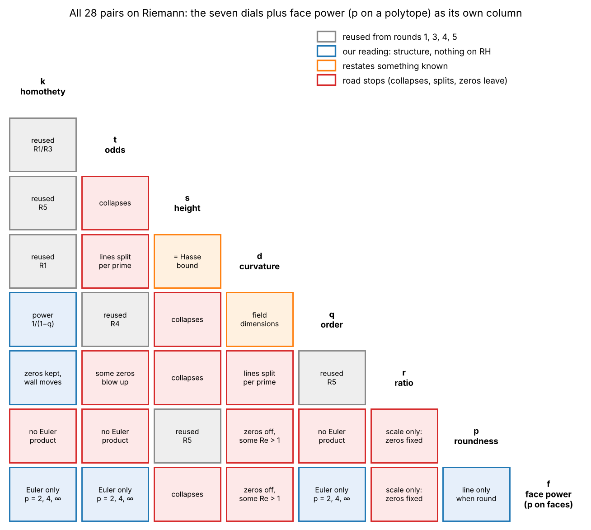
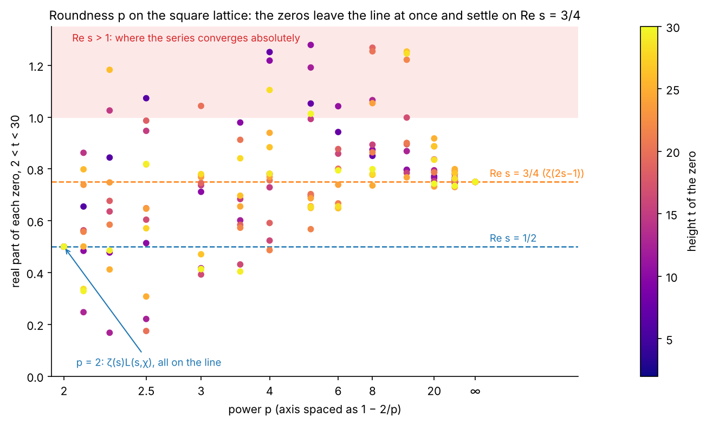
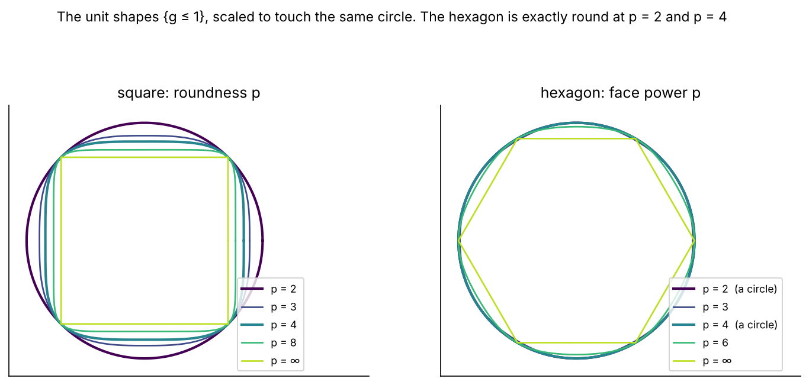
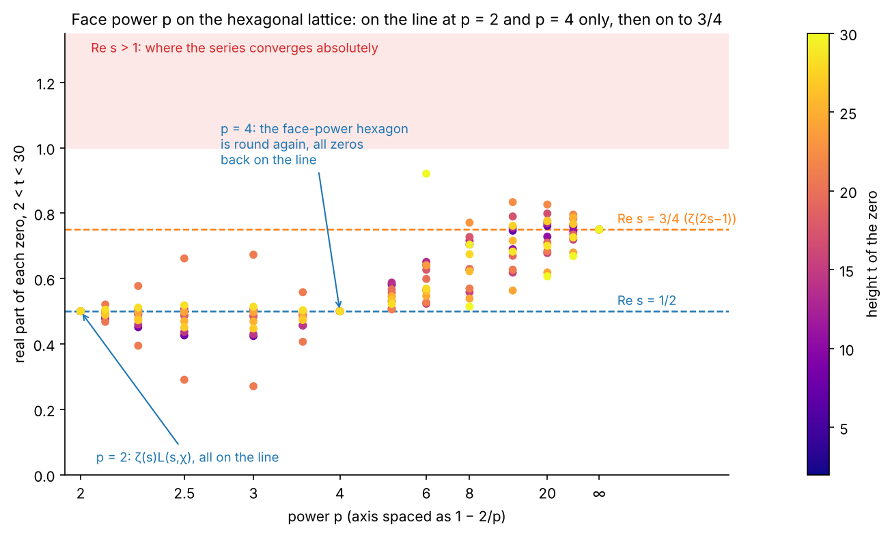
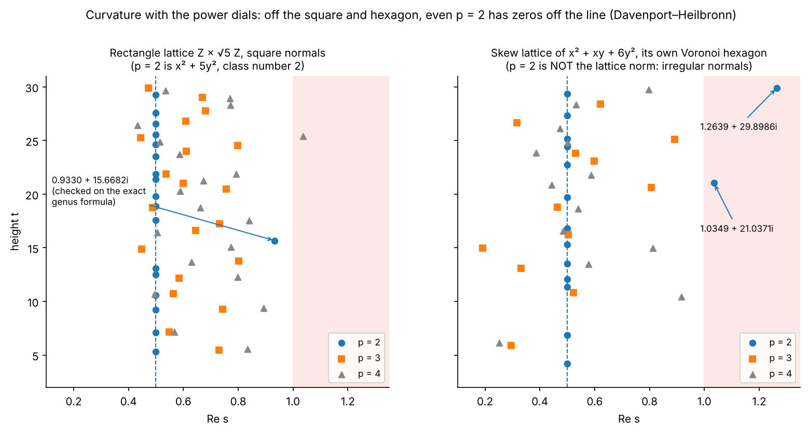
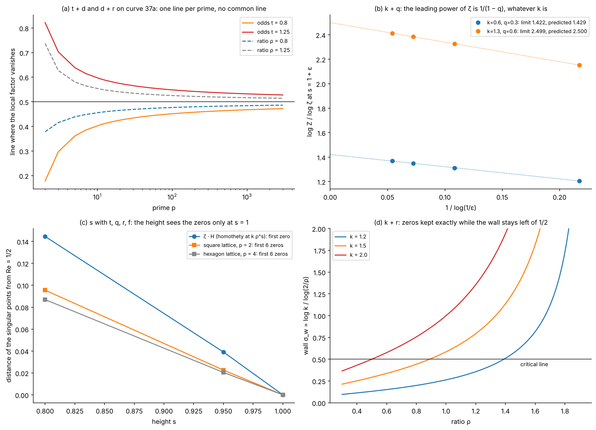
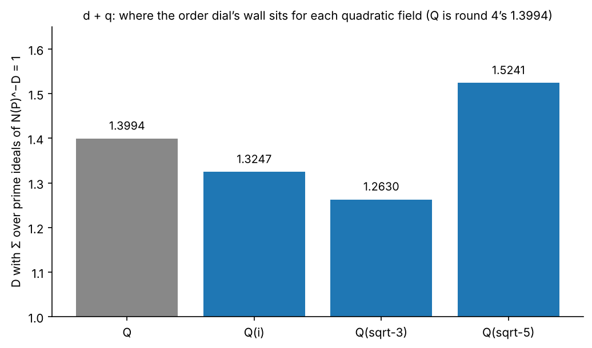
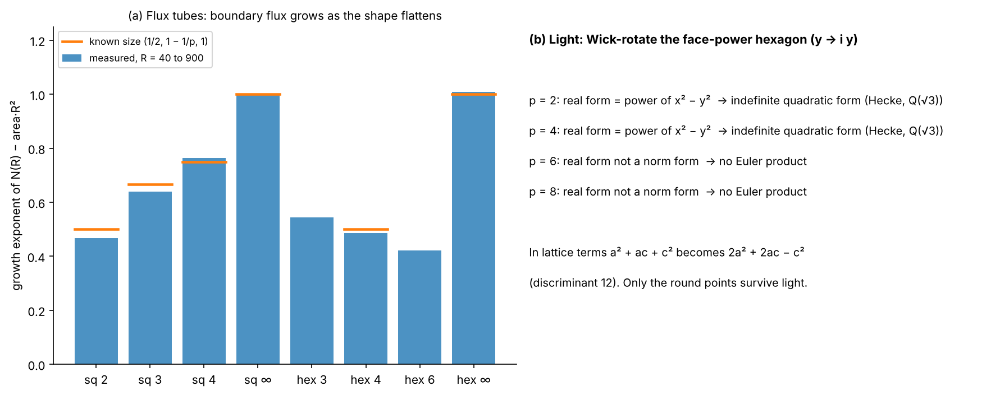

# Riemann, round 6: every pair of dials, with face power (DRAFT)

*Affine Composition Theory, built on Fused Hyperoperation Algebra. DRAFT, Nov 26 2026. Earlier rounds: [round 1](../README.md), [the elliptic object](../elliptic-object/README.md), [round 3](../round3/README.md), [round 4](../round4/README.md), [round 5](../round5/README.md).*

## The answer

**We ran every pair of the seven dials against Riemann, with face power (roundness aimed at a polytope's faces) given its own runs. Not a lead.** No pair puts zeros on a line that was not already there. The face-power dial gives the clearest picture of why: its zeros sit on Re s = 1/2 only where the shape is exactly round. That happens at p = 2 and, on the hexagon, again at p = 4. Its zeros sit on Re s = 3/4 at p = ∞. At every other setting they scatter, some past Re s = 1.

**The dials, fundamental first.** k (homothety), t (odds), s (height), d (curvature), q (order), r (similarity ratio), p (roundness). C is derived from k and d, so it is not a dial. Face power is the roundness dial aimed at a polytope's face normals, g(x) = (mean over facets of |⟨n_i, x⟩|^p)^(1/p), as in topics/shape-dials. On the square it is exactly the ℓp roundness; on the hexagon it behaves differently, so we gave it its own column, written f below. That makes 28 pairs: the 21 pairs of the seven dials plus face power with each.

**Which pairs were reused.** 6 of the 28 pairs were done in earlier rounds, so we took their results as they stand:

| pair | round | result there |
|---|---|---|
| k + d | 1 | dial plane |
| k + t | 1, 3 | corner weights, Euler product |
| q + t | 4 | order dial, wall 1.39943 |
| s + k | 5 | homothety keeps the zeros, height loses them |
| r + q | 5 | prime fractal |
| s + p | 5 | height as a detector |

The other 22 were run here in the order of the first dial, then the second: t+s, t+d, k+q, k+r, s+d, k+p, t+r, s+q, k+f, t+p, s+r, d+q, t+f, d+r, s+f, d+p, d+f, q+p, q+f, r+p, r+f, p+f.

**Two bases.** The Euler-side dials (k, t, s, d, q, r) act on the local factor of each prime, with u = p^(−s). The power dials (p, f) act on a lattice: Z(s) = Σ over nonzero lattice points m of g(m)^(−2s). At p = 2 the square lattice gives 2^s · 4ζ(s)L(s, χ₋₄) and the hexagonal lattice gives (3/2)^s · 6ζ(s)L(s, χ₋₃), both with an Euler product. At p = ∞ both give a multiple of ζ(2s − 1), whose zeros sit on Re s = 3/4.

**What the pairs gave, in six groups.**

- **The height dial collapses (t+s, s+q, s+r, s+f).** ln_s(F) breaks where F hits one value X_s, and X_s = 0 only at s = 1 (round 5). So at every height but 1 the dial sees other values of F, not its zeros. We checked this on three functions: the break points close on the zeros only as s → 1.
- **Scaling a prime splits the line (t+d, d+r).** Odds or ratio scaling moves the dial-plane point along its parabola and keeps the sign of Δ. On a genus-1 L-function (curve 37a) the line where each local factor vanishes moves to 1/2 + log t / log p, which is a different line for every prime. So there is no common line.
- **Order and ratio with homothety keep the zeros of ζ (k+q, k+r).** In k+q the leading power of ζ is 1/(1 − q), whatever k is. In k+r the homothety runs at the complex value kρ^s, and ζ's zeros stay exactly while the wall log k / log(2/ρ) stays left of 1/2. With odds instead (t+r) the leading exponent tρ^s is complex, and at some zeros it makes the function blow up instead of vanish.
- **The power dials have no Euler product except at the round and polytope ends (k, t, q with p and f).** The point counts for a⁴ + b⁴ are not multiplicative (2 and 17 are sums of two fourth powers, 34 is not), so homothety, odds and order have nothing to act on. On the hexagon an Euler product returns at p = 4, because there the gauge is round again.
- **Curvature, ratio and face power on the lattice (d+p, d+f, r+p, r+f, p+f).** Ratio is a rescaling, so the zeros do not move. Curvature, meaning the lattice's shape, breaks the line even at p = 2 once the class number exceeds 1: x² + 5y² has a zero at 0.93297 + 15.66825i. The face power map is the picture of this round.
- **Height with curvature (s+d) and order with curvature (d+q) restate known facts.** The height detector on a degree-2 local factor fires exactly when Δ < 0, which on a curve is Hasse's bound. The order dial's wall for a quadratic field is its prime-fractal dimension, Lapidus's kind of number.

**Triples.** No pair showed anything on RH, so the only triple worth a look was the one behind the round points: curvature with both power dials (d+p+f). The round point at p = 4 needs the regular hexagon. On the skew lattice of x² + xy + 6y² with its own (irregular) Voronoi hexagon, p = 4 is not round and its zeros scatter (figure 4).

---

## Pass 1: our own tools

### Face power and roundness: where the zeros sit

The engine continues Z(s) into the strip by Riemann's split of the theta sum Θ(x) = Σ exp(−πx g(m)²). The contour is turned to arg x = 1.25, so that the large gamma factor does not eat the precision. It needs no functional equation, which the power dials do not have off p = 2.

**Checks on the engine.**

- **At the ends it reproduces the known functions.** At p = 2 and p = ∞ it matches mpmath to 1e-9 and 1e-7.
- **It matches the exact formulas.** On x² + 5y² the zeros agree with the exact genus formula ζL(χ₋₂₀) + L(χ₋₄)L(χ₅) to 2.4e-7. On the skew lattice they agree with Epstein's exact theta inversion, at 45 digits, to 2.9e-7.
- **The zeros are stable.** Changing the small-x fit and its start moves no zero by more than 2e-7.

**The square: off the line at once.** As soon as p leaves 2 (already at p = 2.1) the zeros leave the line. Between 2.25 and 12 some pass Re s = 1, where the series converges absolutely. They settle onto Re s = 3/4 as p → ∞.

**The hexagon: on the line twice.** The face-power hexagon is exactly round at p = 2 and at p = 4. The mean of |⟨n_i, x⟩|^p over the three directions is a constant times |x|^p for even p up to 4, because the directions form a 5-design on the circle. So Z at p = 4 is Z at p = 2 up to scale. Every zero is back on Re s = 1/2, matching to 1e-6. Between 2 and 4 the zeros drift left of the line, from 4 to ∞ they drift right and settle on 3/4, and none passes Re s = 1.

**The rule behind it.** A regular 2n-gon's face power is round at every even p ≤ 2n − 2: p = 2 for the square, p = 2 and 4 for the hexagon, p = 2, 4 and 6 for the octagon. That is the spherical-design property of the normals (Delsarte–Goethals–Seidel). Only the square and the hexagon tile a lattice, so the hexagon at p = 4 is the one new point where the line returns. It is the same function as p = 2, so it adds no RH information.

**Verdict on p + f: not a lead.** The face-power dial puts the zeros on a line only where it is round (1/2) or a polytope (3/4). Between those, a sum with no Euler product scatters its zeros, just as Davenport and Heilbronn found for Epstein's zeta.

### Curvature with the power dials (d+p, d+f, and the triple d+p+f)

Curvature on the lattice side is the lattice's shape.

- **Rectangle lattice ℤ × √5ℤ with the square's normals.** At p = 2 this is x² + 5y², class number 2. Its zeros sit on the line except 0.93297 + 15.66825i, which we checked on the exact genus formula.
- **Skew lattice of x² + xy + 6y² (discriminant −23) with its own Voronoi hexagon.** The hexagon is irregular, so its normals are not even a 2-design. At p = 2 the gauge is the form a² + ab + 2.0616b², not the lattice's own norm. Its zeros include 1.03488 + 21.03709i and 1.26388 + 29.89857i, both past Re s = 1.
- **At p = 3 and 4 both lattices scatter.** The zeros are stable to 2e-4 under a refit. At p = ∞ these two runs are not stable (the small-x fit cannot follow the flat sides of a non-square box), so we set them aside.

**Verdict: not a lead.** These are Davenport–Heilbronn zeros, a known kind.

### The Euler-side pairs

- **t + d and d + r.** Under odds t, the local factor 1 + k(tu) + d(tu)² has Δ = t²(k² − 4d). On curve 37a the line where it vanishes runs from 0.18 (p = 2) to 0.47 (p = 2999) for t = 0.8, and from 0.82 to 0.53 for t = 1.25. Under ratio ρ it runs 1/2 · log p / log(p/ρ). Only t = 1 or ρ = 1 gives one line.
- **s + d.** On L = 1 + ku + du² the height detector is h* = L L″/L′² = 1/2 − w²/(2x²) (x = u + k/2d, w² = Δ/4d²). It goes above 1/2 exactly when Δ < 0, checked on 1640 grid points. On 37a it fires at all 429 good primes below 3000, which is Hasse's bound |a_p| < 2√p.
- **k + q.** The identity Z_{k,q} = [(q;q)_∞ Σ_m q^m/(q;q)_m ∏_j Odds_(kq^(m+j))]^(1/k) holds at s = 2. The direct sum closes on it, its gap halving with each doubling of N, for (k, q) = (0.6, 0.3), (1.3, 0.3), (1.3, 0.6). Near s = 1, log Z / log ζ extrapolates to 1.422 and 2.499 against 1/(1 − q) = 1.429 and 2.500. The wall is log₂ k.
- **k + r and t + r.** Z_{k,r} = ζ(s) · H(s), with H a product of ζ(Ns)^(M(c,N)/c) at c = kρ^s (necklace polynomials M). At the first zero |Z| matches |ζ′H| to 1e-3 for (k, ρ) = (0.8, 1.1) and (1.2, 0.9). For (1.5, 1.3) the wall is at 0.94, so the zeros sit behind it. With odds the exponent of ζ is tρ^s: where its real part is negative the function blows up instead of vanishing: at ρ = 1.1 that happens at 8 of the first 20 zeros, and at ρ = 2 at 13 of them.
- **Height collapse.** On ζ·H the break point near the first zero is 0.145 off the line at height 0.8 and 0.039 at 0.95. On the square lattice (p = 2) and the round hexagon (p = 4) it is 0.096 and 0.023, then 0.087 and 0.020, over the first six zeros. All three close only at s = 1.
- **d + q.** The order dial at q = 1 on a quadratic field walls at the D where the sum of N𝔭^(−D) over prime ideals equals 1. This D is 1.32465 for ℚ(i), 1.26304 for ℚ(√−3) and 1.52405 for ℚ(√−5). The same sum over primes gives 1.39943 for ℚ, as in round 4.

**Verdict: not a lead.** Each pair either keeps ζ's zeros exactly, collapses to s = 1, splits the line prime by prime, or restates a known bound.

### Light and flux tubes on face power

- **Light.** Wick-rotate the face-power hexagon (y → iy). Its form is real at every even p. At p = 2 and 4 it is a power of x² − y². In lattice terms that is 2a² + 2ac − c², discriminant 12, an indefinite form of ℚ(√3), where Hecke's theory applies. At p = 6 and 8 it is not a norm form, so there is no Euler product. Only the round points survive light.
- **Flux tubes.** The boundary flux, N(R) − area·R², grows like R^0.47 for the circle and R^0.64 and R^0.76 for the square at p = 3 and 4, against the known sizes 1/2, 2/3 and 3/4. For the polytope it grows like R^1.00. It tracks how flat the shape is, which is what the lattice-point problem already says. We found no link to the zero line.

---

## Pass 2: the literature

- **Epstein zeta (1903)** is the p = 2 lattice zeta of any positive definite form. For class number 1 it is a multiple of a Dedekind zeta, with an Euler product.
- **Davenport and Heilbronn (1936)** showed that for class number above 1 there are infinitely many zeros in Re s > 1. Potter and Titchmarsh (1935) gave infinitely many on the line and exhibited one off it. Voronin and later Lee counted the off-line zeros. Our curvature runs are this phenomenon. For the rectangle lattice, McPhedran and coauthors ("Zeros of Lattice Sums", [arXiv 1601.01724](https://arxiv.org/abs/1601.01724)) find off-line zeros as soon as the sides differ.
- **Non-quadratic gauges.** We found no paper on the zeros of Σ (|a|^p + |b|^p)^(−s), or of face-power sums, for p strictly between 2 and ∞. Our square and hexagon runs may be new as data. They are what Davenport–Heilbronn leads one to expect, so they are not a lead.
- **Lattice points in |x|^p + |y|^p ≤ R^p.** Krätzel's work (*Lattice Points*, 1988; see [arXiv 2411.10850](https://arxiv.org/abs/2411.10850) for the Bessel-series form) gives the boundary term behind our flux exponents. We did not confirm the exact exponent statement against the monograph.
- **Spherical designs** (Delsarte, Goethals and Seidel, 1977) are the reason the hexagon is round at p = 4.
- **The rest is standard.** Hasse's bound is the s + d detector. Hecke's theory covers the indefinite forms that light produces. Prime-fractal dimensions are the kind of number in Lapidus and van Frankenhuysen's fractal strings. Necklace polynomials (Moreau; Metropolis and Rota) give the odds factorisation.

## Files

- `lattice_engine.py`: the lattice zeta for any gauge, continued by the turned Mellin split.
- `lattice_zeros.py` → `lattice_zeros.json`: zero runs for the square and hexagon (14 values of p), curvature and scale.
- `robustness.py` → `robustness.json`: the exact checks (genus formula, Epstein theta inversion) and the refits.
- `euler_pairs.py` → `euler_pairs.json`: every Euler-side pair, plus multiplicativity, the design rule and light.
- `lattice_pairs.py` → `lattice_pairs.json`: height on the lattice zeta, and flux.
- `checks.py` → `checks_output.txt`: 24 of 24 pass.
- `figures.py` → `figures/`: 8 pictures.
- `lean/RiemannRound6.lean`: 15 statements (Δ scaling, the height detector, the hexagon's moments at p = 2, 4, 6, Wick rotation, the order dial's leading power, and the a⁴ + b⁴ counterexample). Compiled in the shared library as `FusedAlgebra.Topics.RiemannRound6` (namespace `CircleOp.RiemannRound6`; no proof changed, no sorry).
