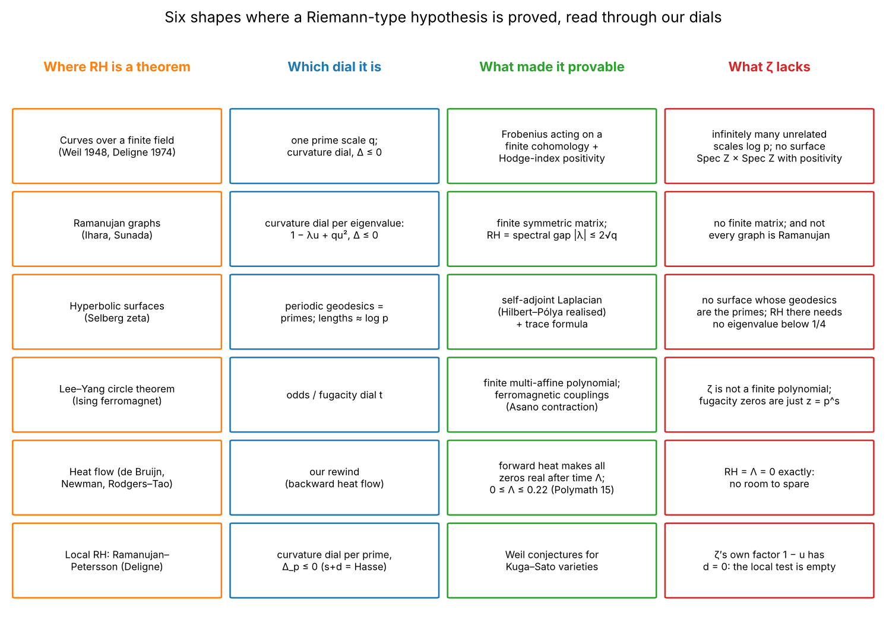
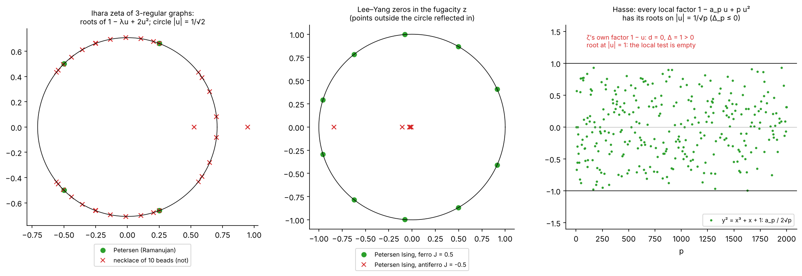
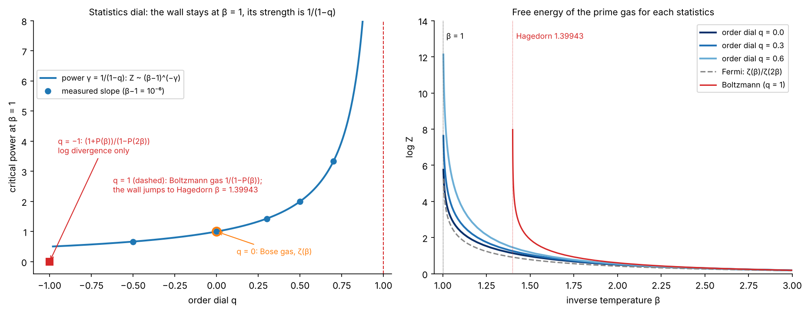
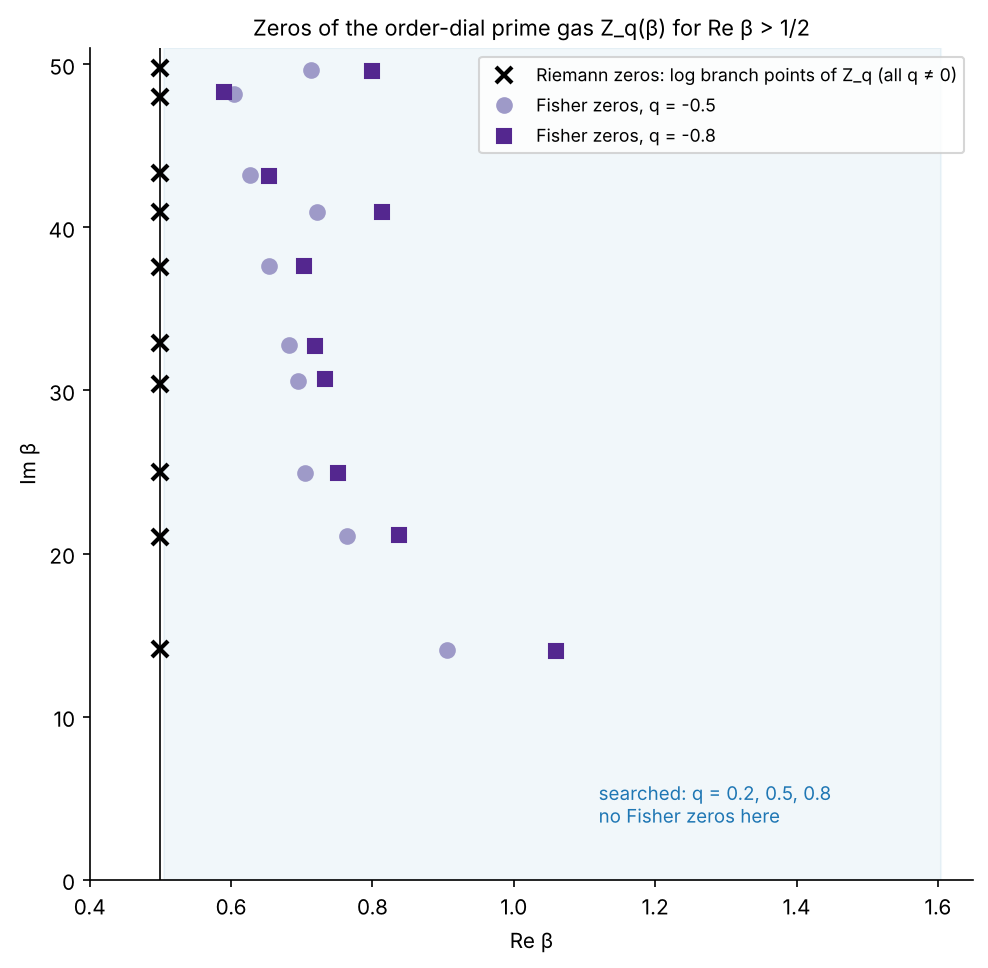
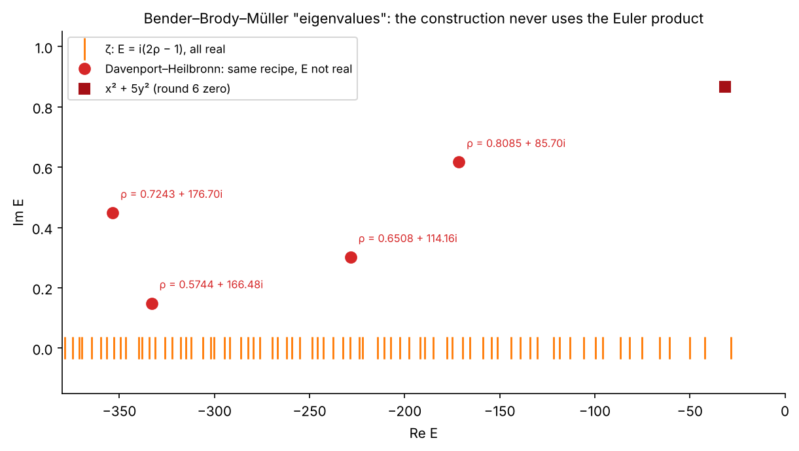
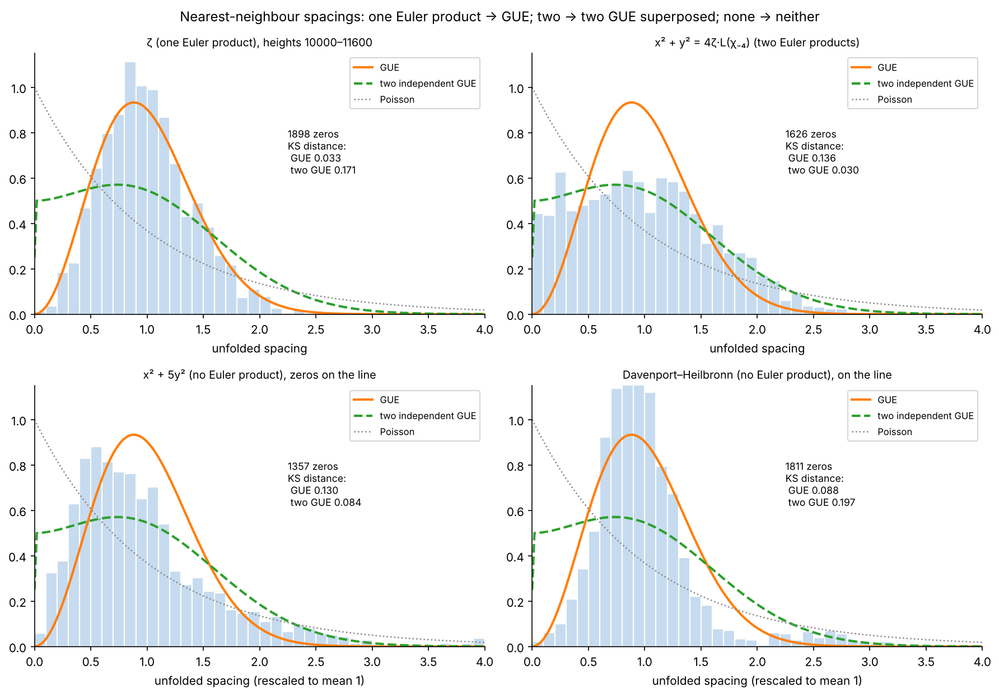
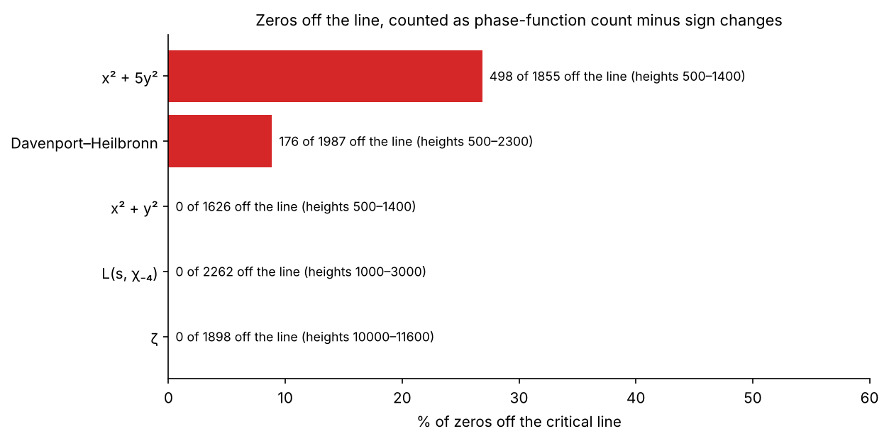
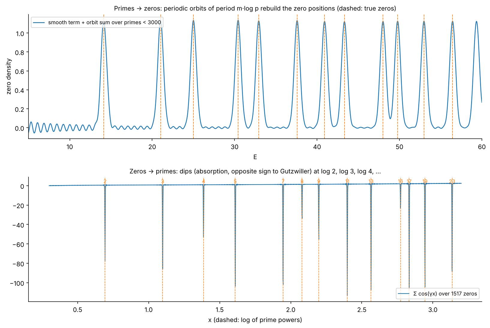
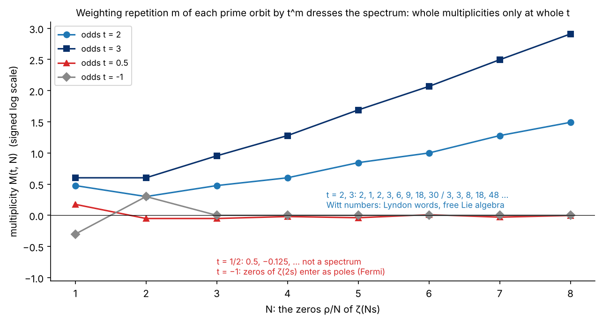

# Riemann, round 7: the quantum toolkit, solved shapes, and the hypothesis restated for sixteen fields (DRAFT)

> **Names:** some words or symbols on this page (wall) also mean something else in standard math, physics or computing, or inside this project. [NAMING-COLLISIONS.md](../../../NAMING-COLLISIONS.md) says which meaning is in play.

*Affine Composition Theory, built on Fused Hyperoperation Algebra. DRAFT, Nov 26 2026. Earlier rounds: [round 1](../README.md), [the elliptic object](../elliptic-object/README.md), [round 3](../round3/README.md), [round 4](../round4/README.md), [round 5](../round5/README.md), [round 6](../round6/README.md).*

## The answer

**Not a lead.** This round did three things.

- **Brought the quantum toolkit to bear.** That meant the prime gas, Hilbert–Pólya operators, random matrices and the trace formula, each run with our dials. Each one restates known mathematics. Three of them are clean negative tests: their recipe works just as well for functions where the hypothesis is false.
- **Mapped the hypothesis onto shapes already solved elsewhere.** Those are curves over finite fields, Ramanujan graphs, hyperbolic surfaces, Lee–Yang and heat flow. This produced the one useful picture of the round. Our curvature dial d is exactly the *local* Riemann hypothesis (Hasse, Ramanujan–Petersson, Ramanujan graphs). ζ's own local factor 1 − u has d = 0, so for ζ the local test is empty, and the hypothesis is purely *global*. Every proved case gets its global statement from something ζ lacks: one prime scale, a finite matrix, or a Laplacian.
- **Wrote the hypothesis out for sixteen fields**, each in its own language, and used each version's terms as new literature searches. The searches found the known literature in each field. They found no route that the field's experts have not already tried. Two search terms came back empty and are worth noting as open ground, not as leads: a q-deformed primon gas, and a Calogero–Moser reading of the backward heat flow.

---

## Part A. The hypothesis itself, and its main equivalent forms

**The statement.** Every zero of ζ(s) in the strip 0 < Re s < 1 has Re s = 1/2.

The equivalent forms fall into seven shapes. Each shape is the doorway one field uses.

| shape | equivalent form | field it opens |
|---|---|---|
| **where the zeros are** | zeros of ξ(1/2 + iz) are all real | complex analysis |
| **a growth bound** | π(x) = li(x) + O(√x log x); M(x) = Σ_{n≤x} μ(n) = O(x^{1/2+ε}); Robin: σ(n) < e^γ n log log n for every n > 5040 | number theory, probability |
| **positivity** | Weil: Σ_ρ ĝ(ρ) ≥ 0 for every g = f ∗ f̃; Li: λ_n ≥ 0 for every n ≥ 1 | harmonic analysis, algebraic geometry |
| **density in a Hilbert space** | Nyman–Beurling: the indicator of (0, 1) lies in the closed span of x ↦ {θ/x}, 0 < θ ≤ 1, in L²(0, ∞); Báez-Duarte: θ = 1/k for whole k is enough | operator theory |
| **real-rootedness** | Pólya: every Jensen polynomial of ξ is hyperbolic; de Bruijn–Newman: Λ = 0 | complex analysis, control theory, heat flow |
| **a spectrum** | Hilbert–Pólya: the zero heights are the eigenvalues of a self-adjoint operator (a hope, not a proved equivalence) | quantum mechanics |
| **a matrix** | det of the Redheffer matrix A_n (A_ij = 1 if i divides j or j = 1) equals M(n), so RH ⇔ det A_n = O(n^{1/2+ε}) | linear algebra |

---

## Part B. The hypothesis restated for sixteen fields

Each entry below is written for someone who knows everything in their own field and nothing about ζ. Under each one are its search keywords, followed by what the search found. "Searched" means the search ran this round, or in earlier rounds where noted.

**1. Number theory.** For each ε > 0, the primes up to x number li(x) + O(x^{1/2+ε}). The error is as small as square-root cancellation allows. In the language of automorphic forms, the standard L-function of the trivial representation of GL(1) over Q has all its nontrivial zeros on the central line. The generalised hypothesis says the same for every automorphic L-function.
*Keywords:* zero-free region, zero-density estimate, Mertens bound, Robin inequality, GRH for GL(n), linear combinations of L-functions.
*Searched:* the Bombieri–Hejhal theorem: a combination of L-functions with one shared functional equation has almost all its zeros on the line, yet infinitely many off it ([2010.10490](https://arxiv.org/pdf/2010.10490), [2501.00551](https://arxiv.org/pdf/2501.00551)). Epstein zetas off the line ([Rezvyakova](https://arxiv.org/pdf/2411.18492), [1811.01613](https://arxiv.org/pdf/1811.01613), [1601.01724](https://arxiv.org/pdf/1601.01724)). Our numbers agree with both (figures 4 and 5).

**2. Complex analysis.** The function Ξ(z) = ξ(1/2 + iz) is entire, real, even, and of order 1. The hypothesis says it lies in the Laguerre–Pólya class: it is a locally uniform limit of real polynomials with only real zeros. In the same terms: every Jensen polynomial built from its Taylor coefficients is hyperbolic.
*Keywords:* Laguerre–Pólya class, Jensen polynomials, hyperbolicity, de Bruijn–Newman constant.
*Searched:* Griffin–Ono–Rolen–Zagier proved hyperbolicity for each fixed degree once the shift is large enough, and for all shifts in degrees up to 8 ([1902.07321](https://arxiv.org/abs/1902.07321v2)). Farmer argues that this family cannot reach the hypothesis ([2008.07206](https://arxiv.org/pdf/2008.07206)).

**3. Operator and spectral theory.** Take the fractional-part functions ρ_θ(x) = {θ/x} for 0 < θ ≤ 1, which are dilates of one another. The hypothesis says their closed linear span in L²(0, ∞) contains the indicator of (0, 1) (Nyman–Beurling). A second form uses de Branges spaces: under the hypothesis, E(z) = ξ(1/2 − iz) + ξ′(1/2 − iz) is a Hermite–Biehler function, and the hypothesis becomes a structure statement about the space H(E).
*Keywords:* Nyman–Beurling, Báez-Duarte, de Branges space, model space, canonical system.
*Searched:* Suzuki identifies the Hilbert space built from the Weil distribution with a de Branges space ([2301.00421](https://arxiv.org/html/2301.00421v3)). Conrey–Li showed that de Branges' own positivity condition fails for ζ ([math/9812166](https://arxiv.org/pdf/math/9812166)).

**4. Quantum chaos.** Suppose there is a classically chaotic system without time-reversal symmetry whose primitive periodic orbits have periods log p. The Riemann zeros would be its energy levels, and the hypothesis says that Hamiltonian is self-adjoint, so the spectrum is real. The level statistics are those of GUE (Montgomery, Odlyzko), which fits.
*Keywords:* Hilbert–Pólya, Berry–Keating xp, Gutzwiller trace formula, absorption spectrum.
*Searched:* the Schumayer–Hutchinson survey ([1101.3116](https://arxiv.org/pdf/1101.3116)), and the Bender–Brody–Müller operator with Bellissard's comment and the reply ([1608.03679](https://arxiv.org/pdf/1608.03679), [1704.02644](https://arxiv.org/pdf/1704.02644), [1705.06767](https://arxiv.org/pdf/1705.06767)). Part D shows that the BBM recipe never uses the Euler product.

**5. Statistical mechanics.** A gas of free bosons with one mode of energy log p for each prime has partition function Z(β) = ζ(β). The hypothesis says that the analytically continued free energy has its Fisher zeros (complex-temperature zeros) in 0 < Re β < 1 only on Re β = 1/2. In Lee–Yang terms, it is a circle theorem for a gas with infinitely many incommensurable modes.
*Keywords:* primon gas, Fisher zeros, Lee–Yang circle theorem, Knauf number-theoretic spin chain, Hagedorn temperature.
*Searched:* [Primon gas](https://en.wikipedia.org/wiki/Primon_gas), Chair's Euler–Riemann gases ([1306.5415](https://arxiv.org/pdf/1306.5415)), Knauf's spin chain with Z = ζ(β−1)/ζ(β) and its transition at β = 2 ([Contucci–Knauf](https://projecteuclid.org/download/pdfview_1/euclid.cmp/1104252597), [mp_arc 95-287](https://web.ma.utexas.edu/mp_arc-bin/mpa?yn=95-287)). *No q-deformed primon gas turned up.* Our order dial builds one (Part D). It is new as a construction but gives nothing on the hypothesis.

**6. Probability.** Flip a fair coin for each squarefree n to get μ(n) = ±1, and set μ(n) = 0 otherwise. The partial sums M(x) then form a random walk and grow like √x. The hypothesis says the real Möbius sequence is random enough for this: M(x) = O(x^{1/2+ε}). Denjoy put it as "the hypothesis holds with probability one". The stronger |M(x)| ≤ √x (the Mertens conjecture) is false.
*Keywords:* Denjoy random walk, random multiplicative functions, Mertens conjecture, Möbius randomness.
*Searched (new this round):* Abrarov–Abrarov's coin-flip statistics ([1002.1682](https://arxiv.org/pdf/1002.1682)), LeClair–Mussardo's Brownian-motion argument ([2101.10336](https://arxiv.org/pdf/2101.10336)), and a 2026 expository preprint on smoothing and Denjoy ([2607.25002](https://arxiv.org/pdf/2607.25002), not checked further). All of these are heuristics. Beurling's generalised primes show that randomness alone is not enough: there are prime systems with the same density law where the hypothesis fails ([DMV 2006](https://deepblue.lib.umich.edu/bitstream/handle/2027.42/46253/208_2005_Article_638.pdf;sequence=1), [2004.11501](https://arxiv.org/pdf/2004.11501)).

**7. Random matrices.** Unfold the zero heights near T by the mean density (1/2π) log(T/2π). Their local statistics then match the eigenangles of large Haar-random unitary matrices. Montgomery proved this for pair correlation on a restricted range of test functions, assuming the hypothesis. The hypothesis says the matching runs all the way down: the "eigenvalues" really lie on the unit circle.
*Keywords:* Montgomery pair correlation, Keating–Snaith moments, n-level density, Gaudin distribution.
*Searched (earlier rounds):* the standard literature. Our own spacing numbers are in figure 4.

**8. Signal processing.** Take the train of spikes Σ Λ(n) δ(t − log n) and subtract its smooth trend. The explicit formula says what is left is a sum of tones, one at each zero height γ. The hypothesis says every tone is pure: none grows or decays. A zero at β + iγ with β ≠ 1/2 would make the tone at γ grow like e^{(β − 1/2)t}. Equivalently, the error signal e^{−t/2}(ψ(e^t) − e^t) has no exponential envelope.
*Keywords:* Weil explicit formula, Fourier duality, almost-periodic function, line spectrum.
*Searched (new this round):* Watkins' notes on Fourier analysis and number theory ([Exeter](https://empslocal.ex.ac.uk/people/staff/mrwatkin/zeta/NTfourier.htm)), Burnol's distributional explicit formula ([math/9810169](https://arxiv.org/pdf/math/9810169)) and [Explicit formulae for L-functions](https://en.wikipedia.org/wiki/Explicit_formulae_for_L-functions). This is the restatement our trace-formula pictures use (figure 6). It restates the problem; it does not give a tool.

**9. Dynamical systems.** ζ has the form of a Ruelle zeta function for a flow whose primitive periodic orbits have lengths log p. A Lefschetz trace formula with the right positivity would give the hypothesis. Connes builds the space as the adele class space, with the idele class group acting as the flow.
*Keywords:* Ruelle zeta, Selberg zeta, Deninger foliated dynamical systems, adele class space, Lefschetz trace formula.
*Searched (new this round):* Connes' trace-formula paper ([NYU copy](https://math.nyu.edu/~tschinke/.manin/final/connes/connes.pdf)), a 2025 paper relating Deninger's systems to Connes–Consani's adelic spaces ([2508.15971](https://arxiv.org/pdf/2508.15971)), and Anosov flows and dynamical zeta functions ([1203.0904](https://arxiv.org/pdf/1203.0904)). No source identifies the Ruelle zeta of the idele flow with ζ outright.

**10. Algebraic geometry.** For a curve C over F_q, the hypothesis is Weil's theorem. It follows from the Hodge index theorem on the surface C × C, with the graph of Frobenius as the key divisor. For ζ the curve would be Spec Z over a "field with one element", and the missing piece is a surface Spec Z × Spec Z with a Hodge index theorem. The scaling flow would play Frobenius.
*Keywords:* field with one element, arithmetic site, scaling site, Hodge index theorem.
*Searched:* Connes–Consani ([1805.10501](https://arxiv.org/abs/1805.10501), [1507.05818](https://ar5iv.labs.arxiv.org/html/1507.05818)).

**11. Harmonic analysis.** The Weil functional W(g) = Σ_ρ ĝ(ρ) is a distribution on the idele class group. The hypothesis says it is positive definite: W(f ∗ f̃) ≥ 0 for every test function f. Li's criterion is the special case of a countable family of test functions: λ_n ≥ 0.
*Keywords:* Weil positivity, Li coefficients, positive-definite distribution.
*Searched:* covered by the Suzuki and Burnol papers above.

**12. Combinatorics and linear algebra.** Build the n × n 0/1 matrix with a 1 wherever i divides j, plus a first column of 1s (the Redheffer matrix). Its determinant is the Mertens function M(n). The hypothesis says this determinant grows no faster than n^{1/2+ε}.
*Keywords:* Redheffer matrix, divisibility poset, Möbius inversion, spectral radius.
*Searched:* [Redheffer matrix](https://en.wikipedia.org/wiki/Redheffer_matrix), [0811.3701](https://arxiv.org/pdf/0811.3701). The matrix's spectrum is understood; its determinant is still the hard part.

**13. Control theory.** A linear system is stable when every pole lies in the left half-plane. Hermite–Biehler and Routh–Hurwitz turn this into interlacing of the real zeros of a polynomial's even and odd parts. The hypothesis has exactly this shape. Pólya's form asks whether every Jensen polynomial of ξ is real-rooted. Lagarias's form says E = ξ(1/2 − iz) + ξ′(1/2 − iz) is Hermite–Biehler, meaning its zeros all lie in one half-plane.
*Keywords:* Hermite–Biehler, Routh–Hurwitz, Hurwitz stability, interlacing, total positivity.
*Searched (new this round):* Holtz–Tyaglov tie Hermite–Biehler, Routh–Hurwitz and total positivity together ([math/0512591](https://arxiv.org/pdf/math/0512591)). That paper is the bridge from stability tests to real-rootedness. No paper found sets up the hypothesis as a stability test in control terms. The bridge only reaches finite polynomials, which is the Jensen route again.

**14. Crystallography and quasicrystals.** A Fourier quasicrystal is a discrete measure whose Fourier transform is also discrete. The explicit formula pairs the zero heights with the logs of prime powers, up to a smooth term. Dyson suggested that classifying one-dimensional quasicrystals might reach the hypothesis.
*Keywords:* Fourier quasicrystal, crystalline measure, Kurasov–Sarnak, Dyson's proposal.
*Searched:* the recent classifications ([2312.11185](https://arxiv.org/pdf/2312.11185), [Bourbaki 1194, Meyer](https://www.bourbaki.fr/TEXTES/Exp1194-Meyer.pdf)). They do not cover ζ's zeros.

**15. PDE and interacting particles.** Run the heat equation on Ξ, giving H_t. Its zeros move like charged particles pushing on one another, and forward in time they become real and spread out. The de Bruijn–Newman constant Λ is the first time from which all zeros are real. Λ ≥ 0 is proved (Rodgers–Tao), and Λ ≤ 0.22 is verified (Polymath 15). The hypothesis is Λ = 0: ζ sits exactly at the critical time. In our words, rewinding by any amount (backward heat flow) would push zeros off the line.
*Keywords:* de Bruijn–Newman, backward heat flow, zero dynamics, Dyson Brownian motion, Calogero–Moser.
*Searched:* Rodgers–Tao ([1801.05914](https://arxiv.org/abs/1801.05914v2)), Polymath 15 ([1904.12438](https://www.arxiv.org/pdf/1904.12438)). *New this round:* a search for a Calogero–Moser reading of the zero motion found nothing. The repulsion argument behind the lower bounds is the nearest thing.

**16. Computer science.** Under the generalised hypothesis, Miller's primality test becomes deterministic: checking bases up to 2(ln n)² suffices (Bach). Many other algorithms get explicit bounds, such as the least quadratic non-residue and the smallest prime in a progression. The hypothesis is the guarantee that a polynomial-size search never misses its witness.
*Keywords:* Miller test, Bach bound, least non-residue, derandomisation.
*Not searched this round.* These are standard consequences, and they flow out of the hypothesis rather than into it.

**What the restatements bought.** Each search term landed in a literature that already exists. In each field, the closest thing to a tool reduces to one of the seven shapes in Part A: a finite polynomial (Jensen, stability), a positivity statement (Weil, Hodge), or a spectrum (Hilbert–Pólya, dynamics). The two empty searches (a q-deformed primon gas and a Calogero–Moser picture) are empty because nobody has written them, not because they lead anywhere.

---

## Part C. Solved shapes through the dials: local against global

Figure 0, at the top, lists six shapes where a Riemann-type hypothesis is a theorem. Figure 8 checks four of them by computation.

- **Ramanujan graphs.** Each eigenvalue λ of a (q+1)-regular graph gives a local factor 1 − λu + qu². On our curvature dial that factor has k = −λ and d = q, so Δ = λ² − 4q. The graph's "Riemann hypothesis" (every root on |u| = 1/√q) is Δ ≤ 0 for every nontrivial λ. The Petersen graph passes: its roots sit on |u| = 1/√2. A ring of ten bottleneck beads fails, with root moduli spread from 0.527 to 0.948.
- **Curves.** For y² = x³ + x + 1, each prime's factor 1 − a_p u + p u² is again a curvature-dial point. Hasse's bound is Δ_p ≤ 0. It holds at all 301 good primes below 2000. The closest is p = 1627, at |a_p|/(2√p) = 0.9917.
- **Lee–Yang.** Lee–Yang is our fugacity dial t. On the Petersen graph and a three-bead necklace, the ferromagnet's zeros lie on |z| = 1 and the antiferromagnet's do not. The circle theorem needs ferromagnetic signs and a finite multi-affine polynomial.
- **Heat flow.** This is our rewind. The hypothesis is Λ = 0, and 0 ≤ Λ ≤ 0.22 is what is known.

**The point of the atlas.** The curvature dial is the *local* Riemann hypothesis: one prime, one quadratic, one discriminant. Wherever the local factor has degree 2 (curves, modular forms, graphs), the dial has something to test, and Deligne's theorem says it passes. ζ's own factor is 1 − u, a degree-1 factor with d = 0, so the local test is empty. The whole of RH for ζ is the *global* question of how infinitely many unrelated scales log p fit together. In every proved case the global statement comes from one of three things:

1. all primes collapse onto one scale (curves over F_q, through Frobenius and Hodge positivity);
2. the zeta is a finite determinant (graphs);
3. the zeros come from a self-adjoint Laplacian (Selberg).

ζ has none of the three. That is a known fact. The dials show it as a single picture.

---

## Part D. The quantum toolkit, item by item

### D1. The prime gas, with the order dial as a statistics dial

The order dial q weights words in the primes by q^(inversions). At q = 0 that gives Bose statistics and ζ(β). At q = 1 it gives Boltzmann statistics and 1/(1 − P(β)), where P is the prime zeta function. Boltzmann has a Hagedorn wall at β = 1.3994333. Round 5's ladder identity, Z_q = (q;q)_∞ Σ_k q^k/(q;q)_k · G_k, checks out at β = 2 for q = 0.3, −0.5 and 0.7. At q = −1 the gas closes up as (1 + P(β))/(1 − P(2β)). Its coefficient rule (nonzero exactly when at most one exponent is odd) has no mismatch for n < 3000.

Near β = 1, Z_q grows like (β − 1)^(−1/(1−q)). The measured local slopes are 0.6665, 1.0000, 1.4286, 2.0000 and 3.3333 for q = −0.5, 0, 0.3, 0.5 and 0.7, against the predicted 1/(1 − q). So the wall stays at β = 1, its strength is 1/(1 − q), and both ends of the dial jump: to β = 1.399 at q = 1 and to a pole at β = 0.6997 at q = −1.

**Fisher zeros.** We scanned 0.51 < Re β < 1.61, 1 < Im β < 50 by phase winding. There were none for q = 0.2, 0.5 or 0.8. For q = −0.5 and q = −0.8 there are ten each, one beside each Riemann zero, pushed right to Re β between 0.60 and 1.06. The Riemann zeros themselves become logarithmic branch points of Z_q rather than zeros.

*Verdict:* the q-gas does not appear in the literature (Part B, item 5), but it moves the zeros *off* the line, not onto it. Not a lead.

### D2. Hilbert–Pólya: the Bender–Brody–Müller recipe ignores the Euler product

BBM's eigenfunctions are ψ_s(x) = −Σ a_n (n + x)^(−s), and the operator's symbol is −1/A(t). For any periodic coefficients a_n the same algebra goes through: ψ(x) − ψ(x + m) = −Σ_r a_r (x + r)^(−s). So the recipe builds an "eigenvalue" E = i(2s − 1) for **any** periodic Dirichlet series. The Davenport–Heilbronn function has the right functional equation and no Euler product, and it has zeros off the line. We refined four of them:

- 0.808517 + 85.699348i, E = −171.3987 + 0.6170i
- 0.650830 + 114.163343i
- 0.574356 + 166.479306i
- 0.724258 + 176.702461i

Each gives a non-real "eigenvalue". The Epstein zeta of x² + 5y² does the same. We checked its genus formula against the direct sum at s = 2 (2.50242224134866), and its zero at 0.932970 + 15.668250i gives E = −31.3365 + 0.8659i.

*Verdict:* the recipe cannot tell a function that satisfies the hypothesis from one that does not, so it cannot prove it. This is the substance of Bellissard's objection, now with explicit counterexamples. Not a lead; a clean negative test.

### D3. Random matrices: one Euler product gives GUE, two give two GUEs, none gives neither

We unfolded by the phase θ(t)/π and compared against Gaudin's GUE law, computed with Bornemann's Fredholm determinant. For a function with off-line zeros we counted the zeros on the line by sign changes and the total by the argument principle.

| family | height window | KS distance to GUE | KS distance to two GUEs | zeros off the line |
|---|---|---|---|---|
| ζ | 10000–11600 | 0.033 | 0.171 | none |
| L(s, χ₋₄) | 1000–3000 | 0.048 | — | none |
| x² + y² = 4ζ·L(χ₋₄) | 500–1400 | 0.136 | 0.030 | none |
| x² + 5y² | 500–1400 | 0.130 (rescaled) | 0.084 (rescaled) | 498 of 1855 |
| Davenport–Heilbronn | 500–2300 | 0.088 (rescaled) | 0.197 (rescaled) | 176 of 1987 |

The argument-principle check matches the deficit window by window. For example, x² + 5y² on [500, 520] has 37 zeros, 27 of them on the line.

*Verdict:* this agrees with Bombieri–Hejhal and Davenport–Heilbronn. Spacing statistics measure how many Euler products are present. They do not test the hypothesis. Not a lead.

### D4. The trace formula, with orbit weights from the odds dial

The primes act as periodic orbits of period m log p with amplitude log p · p^(−m/2). The sign is that of an absorption spectrum, opposite to Gutzwiller's. Primes below 3000 rebuild the first ten zeros to within 0.02. Going the other way, 1517 zeros show dips at the logs of the prime powers up to 23.

Weighting the m-th repetition of each orbit by t^m (our odds dial) turns the spectrum into the union of the scaled sets ρ/N. The multiplicities are the necklace (Witt) numbers M(t, N), by the cyclotomic identity. We checked that identity at s = 3 for t = 0.5, 2, 3 and −1. At t = 2 the multiplicities are 2, 1, 2, 3, 6, 9, 18, 30, which count Lyndon words in two letters. They are whole numbers exactly when t is a whole number. On the homothety dial they are whole only at k = ±1; at k = 2 they start 1, 1/2, …

*Verdict:* a clean restatement of the cyclotomic identity and free Lie algebras. Not a lead.

---

## Files

All in this folder.

- [prime_gas.py](prime_gas.py), [fisher.py](fisher.py): the q-deformed prime gas and its Fisher zeros.
- [hilbert_polya.py](hilbert_polya.py): the BBM identity, the Davenport–Heilbronn zeros, and x² + 5y².
- [rmt.py](rmt.py), [count_check.py](count_check.py): spacing statistics and argument-principle counts.
- [trace.py](trace.py): the explicit formula and the Witt multiplicities.
- [solved_shapes.py](solved_shapes.py): Ihara zetas, Hasse, Lee–Yang.
- [fastl.py](fastl.py): vectorised Hurwitz and Dirichlet L-functions, agreeing with mpmath to about 1e-9.
- [figures.py](figures.py) and [figures/](figures/).
- Each script has its `_output.txt` and `.json` beside it.

**Checks.** [checks.py](checks.py) runs 46 checks, and all 46 pass ([checks_output.txt](checks_output.txt)).

**Lean.** [lean/RiemannRound7.lean](lean/RiemannRound7.lean) has 18 small theorems in core Lean with `grind`. Among them: the Fermi local factor, the Gaussian coefficients at q = −1, the ladder's geometric step, the cyclotomic identity at degree 6, the Ihara factorisation and spread, the Lee–Yang bond, the BBM real and imaginary parts, and the Witt numbers at t = 1/2, 2 and 3. It compiles in the shared library as `FusedAlgebra.Topics.RiemannRound7` (namespace `CircleOp.RiemannRound7`): all 18 theorems, no proof changed, no sorry.

## Literature

Every link is cited where it is used above. Also: [Ihara zeta function](https://en.wikipedia.org/wiki/Ihara_zeta_function), [1702.05452](https://arxiv.org/pdf/1702.05452), and the BBM follow-up [2309.00405](https://arxiv.org/html/2309.00405v3).
