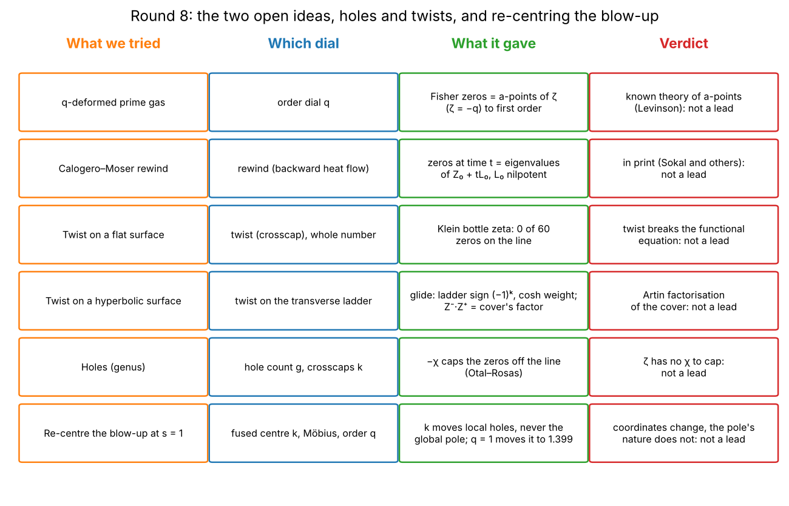
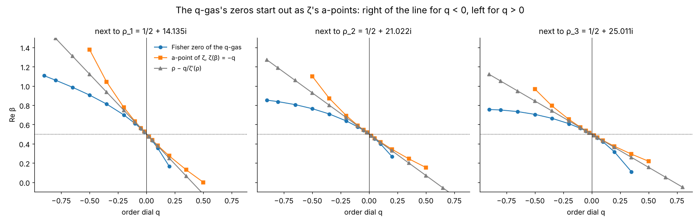
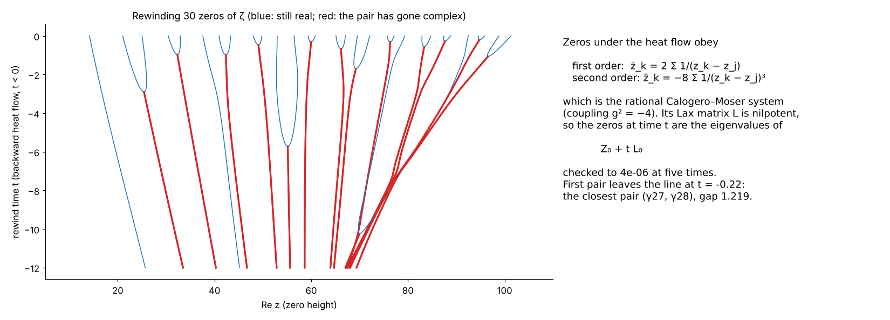
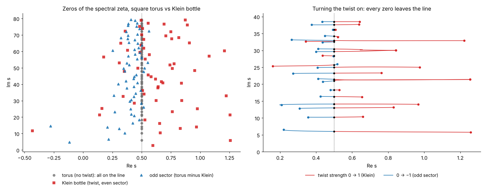
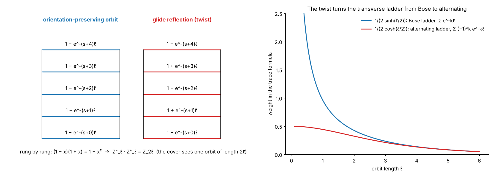
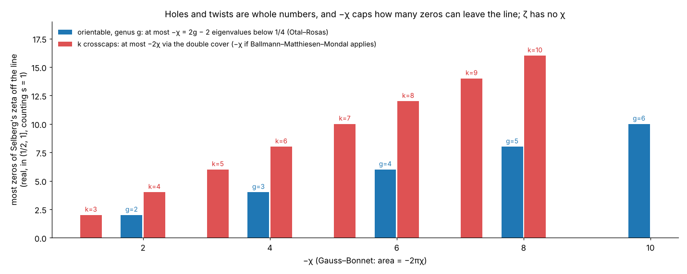
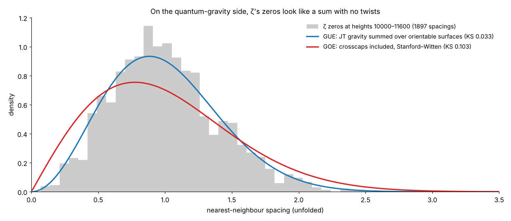
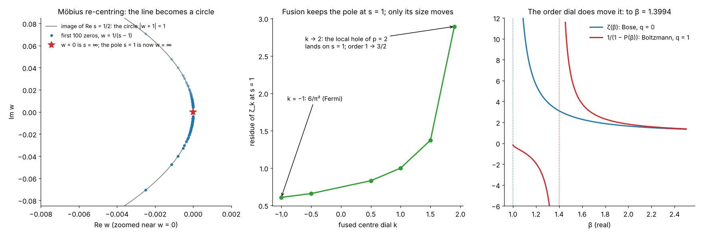
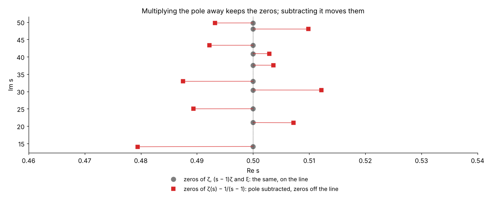

# Riemann, round 8: the two open ideas, holes and twists, and re-centring the blow-up (DRAFT)

> **Names:** some words or symbols on this page (fused, rung, wall, twist) also mean something else in standard math, physics or computing, or inside this project. [NAMING-COLLISIONS.md](../../../NAMING-COLLISIONS.md) says which meaning is in play.

*Affine Composition Theory, built on Fused Hyperoperation Algebra. DRAFT, Nov 26 2026. Earlier rounds: [round 1](../README.md), [the elliptic object](../elliptic-object/README.md), [round 3](../round3/README.md), [round 4](../round4/README.md), [round 5](../round5/README.md), [round 6](../round6/README.md), [round 7](../round7/README.md).*

## The answer

**Not a lead.** Round 7 left two searches empty and this round followed both up. It also brought in the newest shape-dial pieces, holes (genus) and twists (crosscaps), and tried re-centring ζ's blow-up at s = 1.

- **The q-deformed prime gas.** Its complex-temperature (Fisher) zeros start out as ζ's **a-points**, the points where ζ(β) = −q. That holds to first order in q, and we checked it next to the first three zeros. So they sit right of the line for q < 0 and left of it for q > 0. That explains why round 7 found none for positive q: the search only covered the right half. The behaviour of a-points is known theory (Landau, Levinson), so this explains the gas but does not open anything new.
- **A Calogero–Moser reading of the rewind (backward heat flow).** This is in print. Round 7's search missed it. Zeros under the heat flow follow the first-order rational Calogero–Moser system (Sokal, and others). We checked that they also follow the second-order system with an inverse-cube force (coupling g² = −4). The Lax matrix is nilpotent, so the zeros at time t are the eigenvalues of one straight-line matrix path, Z₀ + tL₀. That is a clean restatement, not a tool.
- **Twists.** On a flat square torus, all 58 zeros of the spectral zeta sit on the line. On the Klein bottle, made by putting one twist on that torus, none of the 60 do. On hyperbolic surfaces the twist flips the sign of every other rung of an orbit's transverse ladder: its weight goes from sinh to cosh, which is Bose to alternating. The cover's factor splits exactly as Z⁻·Z⁺. That is the standard factorisation of a double cover.
- **Holes.** On a hyperbolic surface, −χ caps how many zeros of Selberg's zeta can leave the line (Otal–Rosas; Ballmann–Matthiesen–Mondal). ζ has no Euler characteristic to do the capping, which is round 7's local-versus-global point again.
- **Re-centring the blow-up.** Re-centring changes coordinates, not the nature of the pole: it is a simple pole with residue 1 whatever coordinates you use. The fused centre k moves each prime's local hole to Re s = log|k|/log p. It never moves the global pole at s = 1; it only rescales the residue. The one dial that does move the blow-up is the order dial. At q = 1 the blow-up moves to β = 1.3994, the Hagedorn wall, and s = 1 turns into a zero.
- **Quantum gravity.** In JT gravity, including twists (crosscaps) in the sum gives GOE statistics (Stanford–Witten). ζ's zeros fit GUE (KS distance 0.033) far better than GOE (0.103). So on that dictionary, ζ looks like a sum with no twists.

---

## 1. The q-deformed prime gas: its zeros are ζ's a-points

The order dial q interpolates Bose (q = 0, Z = ζ) and Boltzmann (q = 1) statistics for the prime gas (rounds 5 and 7). Near a Riemann zero ρ, write w = ζ(β). The terms of the gas's ladder behave like w^(q^k/(1−q)), and the two leading terms balance when w + q·w^q ≈ 0, that is w^(1−q) = −q. To first order this is **ζ(β) = −q**, an a-point of ζ, at β ≈ ρ − q/ζ′(ρ).

We tracked the true Fisher zeros of Z_q next to ρ₁, ρ₂ and ρ₃ for q from −0.9 to +0.35, using a local logarithm that is exact near ρ. At |q| = 0.02 each Fisher zero lies within 4% (of its distance from ρ) of the a-point. The gap grows at second order in q. For large |q| the gas's zeros stay much closer to the line than the a-points do.

**Literature check.** We still find no q-deformed primon gas in print. Searches covered primon gas with quons, q-boson arithmetic gas and q-deformed Riemann gas. The nearest hits are the undeformed gas ([Schumayer–Hutchinson](https://arxiv.org/pdf/1101.3116)) and quon gases with no primes ([math-ph/0209067](https://arxiv.org/pdf/math-ph/0209067)). The a-points themselves are classical. Landau counted them, and Levinson proved that almost all of them lie within (log log T)²/log T of the line ([Garunkštis–Steuding-era survey](https://arxiv.org/pdf/1405.1553), [Sourmelidis–Steuding–Suriajaya](https://arxiv.org/pdf/2204.13887)).

*Verdict:* the q-gas is new as a construction. Its zeros reduce to a-points, which are well understood. Not a lead.

## 2. The rewind as a Calogero–Moser system

In de Bruijn's convention, ∂H/∂t = −∂²H/∂z². Increasing t is forward heat flow, under which zeros become real. Decreasing t is the rewind. At a simple zero:

- **first order:** ż_k = 2 Σ_{j≠k} 1/(z_k − z_j);
- **second order (checked symbolically for 3 and 4 zeros):** z̈_k = −8 Σ_{j≠k} 1/(z_k − z_j)³.

The second line is the rational Calogero–Moser system with an inverse-square potential and coupling g² = −4. Its Lax matrix (L_kk = ż_k, L_jk = 2/(z_j − z_k)) is nilpotent: for 24 zeros, ‖L²⁴‖ ≈ 2·10⁻¹⁰. So the zeros at time t are the eigenvalues of **Z₀ + tL₀**, which we checked to 4·10⁻⁶ at five times.

In a 30-zero window of ζ, the first pair to leave the line on the rewind is the closest pair, γ₂₇ and γ₂₈, at t = −0.22. For an isolated pair at gap d the estimate is d²/8 = 0.19. Because the window is finite, its edge zeros spread outward, so the times are illustrative only.

**Literature check: it is in print.** Sokal describes the zeros of polynomial heat-equation solutions as a first-order rational Calogero–Moser system ([UCL talk](https://mediacentral.ucl.ac.uk/Play/95003)). The same link appears for heat-flowed Gaussian analytic functions ([2304.06665](https://arxiv.org/pdf/2304.06665)), for KPI lumps ([2111.05519](https://arxiv.org/pdf/2111.05519)), and for frozen Calogero–Moser–Sutherland models, where it is credited to Riemann-hypothesis work ([2312.02685](https://arxiv.org/pdf/2312.02685)). Pole dynamics with an inverse-cube force are in [2011.05714](https://arxiv.org/html/2011.05714). Round 7's empty search was a gap in our search terms, not a gap in the literature. The Rodgers–Tao proof that Λ ≥ 0 uses this same zero dynamics ([1801.05914](https://arxiv.org/abs/1801.05914v2)).

*Verdict:* RH becomes "the non-normal matrix Z_{0.22} − 0.22·L_{0.22} has a real spectrum", where 0.22 is Polymath 15's verified bound. That is a restatement, not a tool. Not a lead.

## 3. Twists

### 3a. On a flat surface: the Klein bottle

The square torus R²/Z² has spectral zeta (2π)^(−2s)·4ζ(s)L(s, χ₋₄). That function has an Euler product and a functional equation, and all 58 of its zeros up to height 80 lie on Re s = 1/2. Take the glide g(x, y) = (x + 1/2, −y). The functions that g leaves unchanged are the Klein bottle's spectrum. Dropping the (2π)^(−2s) factor:

- **Klein bottle (even sector):** 2ζ(s)L(s, χ₋₄) − (1 − 2^(1−2s))ζ(2s)
- **odd sector:** 2ζ(s)L(s, χ₋₄) + (1 − 2^(1−2s))ζ(2s)

The two sectors add up to the torus. We checked both formulas against direct lattice sums at s = 2. The twist adds a ζ(2s) term whose symmetry is s ↔ 1/2 − s, not s ↔ 1 − s, so the sum has no functional equation at all. **None of the 60 Klein-bottle zeros is on the line.** Their real parts run from −0.43 to 1.26. Turning the twist on gradually, Z_ε = 2ζL − ε(1 − 2^(1−2s))ζ(2s), every zero leaves the line as ε moves away from 0.

Follow-up (Nov 27): [`../klein-gram/`](../klein-gram/README.md) runs the Gram test and the prime drift on these three zetas. Gram's law doesn't see the zeros leave the line (the odd sector passes it more often than the torus); the drift shows only in the prime count.

### 3b. On a hyperbolic surface: the twist flips the transverse ladder

For a closed geodesic of length ℓ that preserves orientation, Selberg's factor is ∏_k (1 − e^(−(s+k)ℓ)), and its trace-formula weight is 1/(2 sinh(ℓ/2)) = e^(−ℓ/2) Σ_k e^(−kℓ). For a glide reflection, which is the twist, the transverse directions flip. The linearised return map then has eigenvalues −e^(±ℓ), so |det(1 − P)|^(1/2) = 2 cosh(ℓ/2), and the ladder picks up the sign (−1)^k:

  Z⁻_ℓ(s) = ∏_k (1 − (−1)^k e^(−(s+k)ℓ)),   with weight 1/(2 cosh(ℓ/2)) = e^(−ℓ/2) Σ_k (−1)^k e^(−kℓ).

The orientation double cover sees the glide as a single geodesic of length 2ℓ. Rung by rung, (1 − x)(1 + x) = 1 − x², so **Z⁻_ℓ · Z⁺_ℓ = Z_{2ℓ}**. The cover's zeta is the product of its even and odd parts. In dial language, the twist turns the transverse ladder from Bose to alternating, which is the fugacity −1 end. We checked the ladder identity to 10⁻¹⁵ and the sinh/cosh orbit weights against the log-derivative. The flat version of the same principle is exact: on the Klein bottle each glide of length |j + 1/2| enters the heat trace with weight 1/|1 − (−1)| = 1/2, which we checked at four times.

**Literature check.** Several facts are standard: a non-orientable surface's Laplace spectrum is the even part of its orientation cover's spectrum, and a cover's zeta factors by characters. Trace formulas for groups that contain glide reflections exist (for example Doyle–Rossetti on non-orientable isospectrality, and work on reflection groups). We did not find the cosh weight written out in a quick search, so it is derived here by the linearisation argument above, not quoted.

*Verdict:* this is the double cover's factorisation, read through our dials. Not a lead.

## 4. Holes: −χ caps the zeros that can leave the line

Holes and twists are whole numbers: genus g gives χ = 2 − 2g, and k crosscaps give χ = 2 − k. By Gauss–Bonnet at curvature −1, area = −2πχ, and that area is the identity term of the trace formula (the Weyl term). A zero of Selberg's zeta can leave the line only as a real zero in (1/2, 1], one for each Laplace eigenvalue below 1/4, with s = 1 always among them.

- **Orientable surfaces:** Otal–Rosas proved λ_(−χ) > 1/4, so at most −χ = 2g − 2 eigenvalues lie below 1/4 ([JDG](https://projecteuclid.org/journals/journal-of-differential-geometry/volume-103/issue-1/Small-eigenvalues-of-closed-surfaces/10.4310/jdg/1460463561.pdf)).
- **Any closed surface with χ < 0:** Ballmann–Matthiesen–Mondal prove λ_(−χ) > Λ(S) without assuming orientability ([1406.5836](https://arxiv.org/pdf/1406.5836), [1506.06541](https://arxiv.org/pdf/1506.06541)). Their comparison with 1/4 is stated for orientable hyperbolic surfaces.
- **Crosscaps:** for k crosscaps we can be sure of at most −2χ, by passing to the double cover.

*Verdict:* topology controls exactly how many zeros can leave the line, but only because the surface has a χ. ζ has no such integer. Its smooth counting term, (T/2π) log(T/2πe), is not an area. Not a lead.

## 5. Quantum gravity

In JT gravity, summing over orientable surfaces gives a GUE-type matrix integral. Time-reversal symmetry forces crosscaps into the sum and gives GOE (or GSE) instead ([Stanford–Witten](https://arxiv.org/abs/1907.03363); later work: [Mind the crosscap](https://arxiv.org/pdf/2509.20448)). For 1897 ζ spacings at heights 10000–11600, the KS distance is 0.033 to GUE and 0.103 to GOE. Spacings below 0.25 make up 1.05% of the sample, against 1.64% for GUE and 4.99% for GOE. On that dictionary, ζ's zeros look like an orientable sum with no twists, which matches the known absence of time-reversal symmetry (Berry). For the GOE curve we used the Fredholm determinant of the even sine kernel, and checked that E₊·E₋ reproduces GUE to 10⁻¹⁵.

The other new facts this round, tried on quantum gravity:

- **Re-centring.** The order dial's moved blow-up at β = 1.3994 is a Hagedorn temperature: exponential degeneracy, as in string theory's density of states.
- **Calogero–Moser.** The path Z₀ + tL₀ is a matrix model's eigenvalue flow. That is Dyson's log gas at zero temperature, the same gas behind the GUE match.

## 6. Re-centring the blow-up at s = 1

**Re-centring changes coordinates, not the nature of the pole.** It is a simple pole of residue 1, and every conformal re-centring keeps it a simple pole. RH is unchanged: the zeros sit on the image of the line, wherever that ends up.

- **Möbius, w = 1/(s − 1).** The pole goes to w = ∞, and the critical line becomes the circle |w + 1| = 1. All of the first 100 zeros sit on that circle to 10⁻²⁶ and pile up at w = 0, which is s = ∞.
- **Fused centre.** a ∘ₖ b = a + b + kab is multiplication after the shift a ↦ 1 + ka, and its absorbing centre is −1/k. The fused Euler factor (1 − kp^(−s))^(−1/k) has its local hole at Re s = log|k|/log p, a different place for every prime. The global pole of ζ_k(s) = ∏_p (1 − kp^(−s))^(−1/k) stays at s = 1 for every k, because the first term of the logarithm does not depend on k. Only the residue moves: C_k = ∏_p (1 − k/p)^(−1/k)(1 − 1/p). That gives 6/π² = 0.6079 at k = −1 (Fermi), 0.831 at k = 1/2, 1 at k = 1 and 2.894 at k = 1.9. **At k = 2 the local hole of p = 2 lands on s = 1**, and the blow-up order goes from 1 to 3/2 (measured log-log slope −1.5000). This is the only way fusion changes the pole's nature: by stacking a local hole on top of it. Its zeros in Re s > 1/2 are ζ's own for |k| < √2 (round 5).
- **The order dial does move it.** At q = 1 (Boltzmann), Z = 1/(1 − P(β)). The point β = 1 becomes a zero, because P(β) → ∞ logarithmically there. A new simple pole appears at β = 1.3994333, with residue 0.578.

**Compared with the standard ways of removing the pole:**

- **(s − 1)ζ(s) and the completed ξ(s):** these multiply the pole away and keep exactly the same zeros.
- **ζ(s) − 1/(s − 1), the Stieltjes-constant series:** this subtracts the pole, and its zeros move off the line on both sides, by 0.003 to 0.02 near the first ten zeros. Those zeros are where ζ = 1/(s − 1), a moving a-point, the same story as section 1.
- **Hurwitz ζ(s, a):** the pole stays at s = 1 with residue 1 for every a. Only the zeros move.

So the fused version adds two things. It shows the global pole is a property of the prime density, not of any single prime's factor. And it gives one exact way to stack a local hole onto the pole, at k = a prime. It does not move the pole, and it does not change where the zeros sit relative to it.

---

## Files

All in this folder.

- [qgas.py](qgas.py): Fisher zeros against a-points.
- [calogero.py](calogero.py): the Calogero–Moser identities, the Lax matrix and the rewind.
- [klein.py](klein.py): torus and Klein bottle spectral zetas.
- [topology.py](topology.py): the ladder identity, the flat glide check, GOE against GUE and the χ table.
- [recentre.py](recentre.py): Möbius, the fused residues, Stieltjes, Hurwitz and Boltzmann.
- [figures.py](figures.py), [fastl.py](fastl.py) (copied from round 7) and [figures/](figures/).
- Each script has its `_output.txt` and `.json` beside it.

**Checks.** [checks.py](checks.py): 33 of 33 pass ([checks_output.txt](checks_output.txt)).

**Lean.** [lean/RiemannRound8.lean](lean/RiemannRound8.lean) has 12 small identities in core Lean with `grind`: the twisted rung, the cover's χ, the area from genus, the Klein sectors, two-body Calogero–Moser, the 2×2 nilpotent Lax matrix, the pair-collision time, the fused shift, the fused absorbing centre, the Fermi residue, the Möbius circle and the glide determinant. It compiles in the shared library as `FusedAlgebra.Topics.RiemannRound8` (namespace `CircleOp.RiemannRound8`): all 12 theorems, no proof changed, no sorry.
