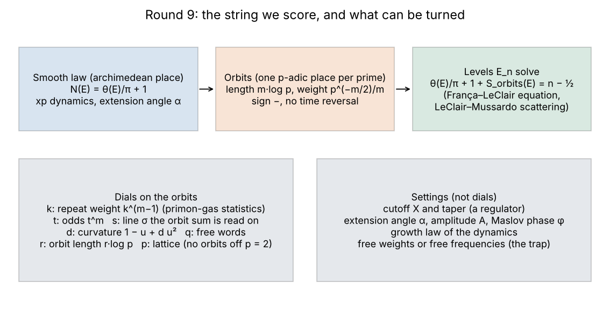
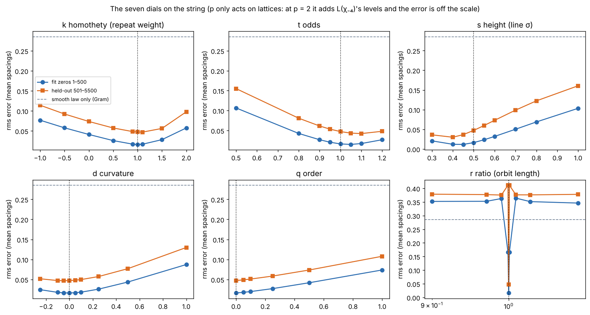
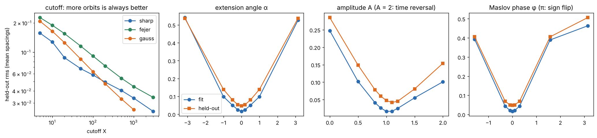
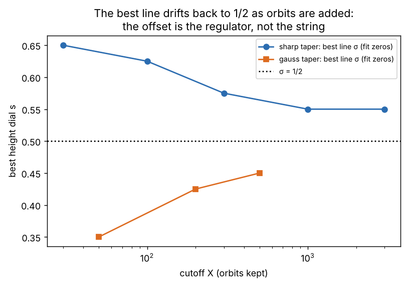
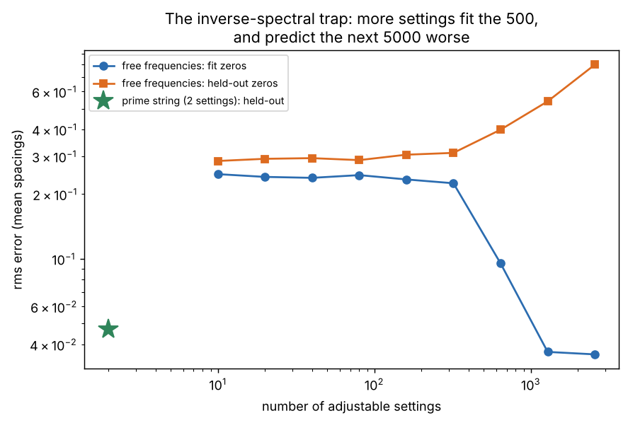
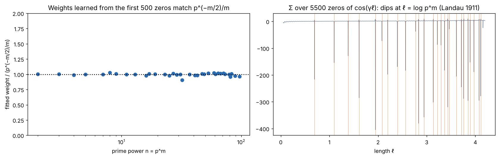
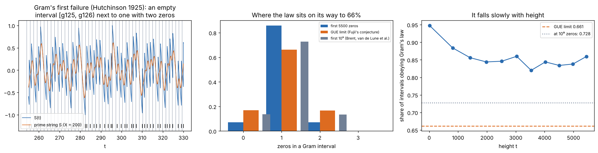
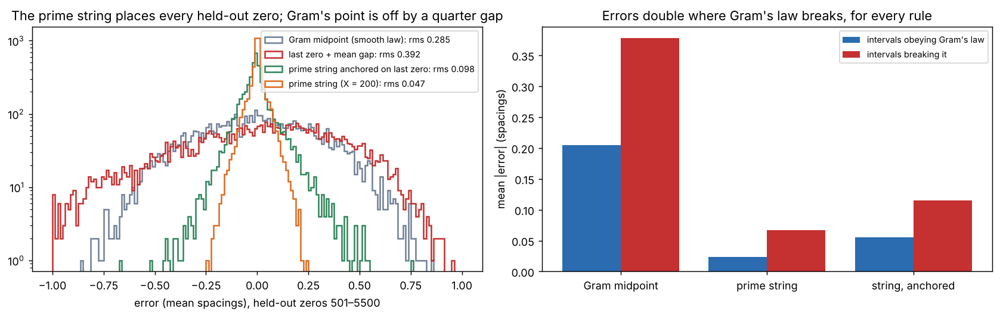
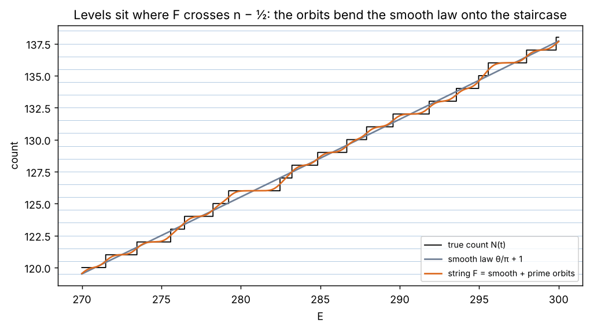
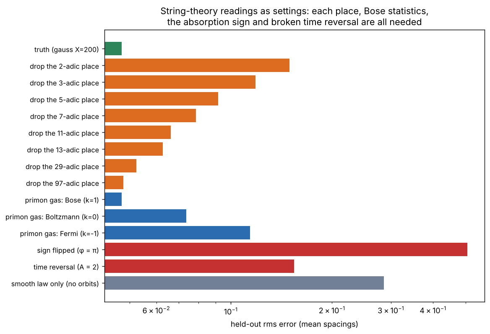

# Riemann, round 9: the Hilbert–Pólya string probe (DRAFT)

*Affine Composition Theory, built on Fused Hyperoperation Algebra. DRAFT, Nov 26 2026. Earlier rounds: [round 1](../README.md), [the elliptic object](../elliptic-object/README.md), [round 3](../round3/README.md), [round 4](../round4/README.md), [round 5](../round5/README.md), [round 6](../round6/README.md), [round 7](../round7/README.md), [round 8](../round8/README.md). Companion: [who has studied where and why Gram's law fails](gram-literature.md).*

## The answer

**Not a lead, but a sharp list of what the right string must have.** We built candidate "strings" (quantum systems whose levels should be the zeros), scored each one on the first 500 zeros, and tested it on the next 5000 zeros it never saw. The score is a probe, not a target: every setting that only improved the fit and then got worse on the unseen zeros was thrown out.

The best string is the known one: the smooth zero count plus one orbit per prime power, read on the half line. It places every one of zeros 501–5500 in its own slot, with a typical error of 0.025 of a gap. Everything we varied away from it made the unseen zeros worse.

### Properties the right string needs

Each item says whether it was already known or is new from this probe.

1. **The smooth law θ(E)/π + 1, from xp-type dynamics.** Known (Berry–Keating 1999; it's the archimedean place). Oscillator, box, billiard and Γ-only growth laws all fail by whole gaps.
2. **One orbit per prime power, of length exactly m·log p.** Known in form (the explicit formula). **New as a measured tolerance:** at these heights the lengths must be log p to about 3 parts in 10⁵. A shift of 10⁻⁴ already triples the error.
3. **Weights p^(−m/2)/m.** Known. **New as a check:** fitting free weights to the first 500 zeros alone gives these weights back to within 1–3% for every prime power up to 100.
4. **Bose statistics (repeat weight k = 1).** Known (Julia, Spector: the primon gas). Fermi (k = −1) and Boltzmann (k = 0) are both clearly worse.
5. **The minus sign on the orbit sum.** Known (Connes' absorption picture). Flipping it gives an error of half a gap.
6. **No time reversal.** Known (GUE statistics, Montgomery–Odlyzko). Adding the reversed orbit (amplitude 2) triples the error.
7. **An Euler product (order dial q = 0) and every p-adic place.** Known (Freund–Witten's adelic product). Dropping the 2-adic place triples the error; dropping the 97-adic one still shows.
8. **Extension angle α = 0.** New as a measured fact about this string: the U(1) family of boundary conditions has its best point at 0 on fit and on unseen zeros alike.

### Properties the probe rules out

1. **A line other than σ = ½.** New as a demonstration: the best line on the fit zeros is never ½ at a finite cutoff, but it drifts to ½ from above (sharp cutoff) and from below (Gaussian cutoff) as more orbits are kept. The offset belongs to the cutoff, not the string.
2. **Free frequencies (Wu–Sprung-style inverse fits).** Known in spirit (the inverse-spectral trap). Measured here: past 320 settings the fit improves and the unseen error doubles; at 2560 settings half the unseen levels go missing.
3. **Every non-xp growth law.** Known.
4. **Curvature d ≠ 0 and the lattice dial p = 2.** New as measurements: d moves the error up on both sides; p = 2 adds L(χ₋₄)'s levels and doubles the density.

---

## 1. The string we score

Levels E_n solve

  θ(E)/π + 1 + S_orbits(E) = n − ½,  S_orbits(E) = −(1/π) Σ over prime powers p^m of w(p^m) · sin(m·r·E·log p + φ).

With the true weights and all prime powers this is the França–LeClair equation (arXiv 1502.06003). LeClair and Mussardo (JHEP 04 (2024) 062) recast it as scattering off impurities, with Bethe equations whose solutions are the zeros, and showed that GRH is equivalent to completeness of those solutions. **So the string itself is in print.** What this round adds is the probe: which pieces can be turned, how far, and which turns survive on unseen zeros.

**Score.** For each candidate we measured: the error in placing each zero (in mean gaps), the smooth part of the counting error and the oscillating part, the share of zeros in the right Gram slot, spacing distribution (KS distance), pair correlation, number variance, whether the levels exist and are real (self-adjointness), and all of these on zeros 1–500 (fit) and 501–5500 (held out). 5500 zeros were computed with mpmath and agree with the earlier table to 10⁻¹³.

## 2. The seven dials

"Dials" means only the model's seven: k, t, s, d, q, r, p.

| Dial | What it does on the string | Truth | Best on fit zeros | Effect on unseen zeros | Verdict |
|---|---|---|---|---|---|
| **k** homothety | repeat weight k^(m−1): Bose 1, Boltzmann 0, Fermi −1 | 1 | 1.0 | 0.047 at k = 1; 0.074 at 0; 0.114 at −1 | needed at 1 |
| **t** odds | weight t^m on each orbit | 1 | 1.05 | 0.042 at 1.1 (slightly better) | the shift is cutoff compensation (§4) |
| **s** height | the line σ the orbit sum is read on | ½ | 0.40–0.65, depends on cutoff | best 0.030 at 0.4 with this cutoff | drifts to ½ as orbits are added (§4) |
| **d** curvature | local factor 1 − u + d u² | 0 | ≈ 0 | worse on both sides | needed at 0 |
| **q** order | log-linear mix of log ζ and the free-word gas | 0 | 0 | 0.108 at q = 1 | needed at 0 |
| **r** ratio | orbit length r·log p | 1 | 1 | 0.41 at r = 1 ± 0.001 | needed at 1, to 3·10⁻⁵ |
| **p** roundness | acts only on lattices; p = 2 gives ζ·L(χ₋₄) | none | none | off the scale (doubles the density) | not a dial for ζ |

*Figure 1. Each dial turned alone, with the others at the truth (Gaussian cutoff, X = 200). The dashed line is the smooth law with no orbits, which is Gram's rule.*

## 3. The other settings

Settings are the string's adjustable parameters that aren't one of the seven dials.

| Setting | Best value | Candidate new dial, or derived? |
|---|---|---|
| cutoff X and taper (sharp, Fejér, Gauss) | as large as possible | **derived**: a regulator. Error falls steadily with X for all three tapers |
| extension angle α (boundary condition) | 0 | **candidate new dial**: a genuine U(1) family of self-adjoint extensions, not one of the seven |
| amplitude A | 1 (A = 2 is time reversal) | **derived** from the symmetry class |
| Maslov phase φ | 0 (π flips the sign) | **derived** from the sign |
| symmetry class (GUE / GOE) | GUE | **candidate new dial**, but discrete (two or three values), not a continuous dial |
| growth law of the dynamics | xp | **derived**: fixed by the smooth count |
| free weights | equal p^(−m/2)/m | **derived**: the data return the truth |
| free frequencies | none | ruled out: the trap (§5) |

*Figure 2. Left: more orbits is always better, for every taper. The other three panels each have their best point at the truth (α = 0, A ≈ 1, φ = 0).*

## 4. The best next adjustment, and which settings only fit

Gradient descent on the fit zeros, over s, A, α, φ, t and k together, starting from the truth:

| step | fit error | unseen error | s | A | t | k |
|---|---|---|---|---|---|---|
| start | 0.0163 | 0.0473 | 0.500 | 1.000 | 1.000 | 1.000 |
| 0 | 0.0140 | 0.0418 | 0.486 | 1.026 | 1.007 | 1.000 |
| 1 | 0.0127 | 0.0351 | 0.446 | 1.025 | 1.005 | 0.996 |
| 3 | 0.0111 | 0.0348 | 0.438 | 0.995 | 0.997 | 0.994 |
| 5 | 0.0102 | 0.0331 | 0.420 | 0.975 | 0.991 | 0.992 |

The steepest direction is almost entirely the line s, moving below ½, with small changes in A and t. It also helps the unseen zeros, so on its face it "generalises". It doesn't survive a check: the best s depends on the cutoff, and it heads back to ½ as orbits are added.

| cutoff | best s (sharp taper) | best s (Gaussian taper) |
|---|---|---|
| X = 30 / 50 | 0.650 | 0.350 |
| X = 100 / 200 | 0.625 | 0.425 |
| X = 300 / 500 | 0.575 | 0.450 |
| X = 1000 | 0.550 | |
| X = 3000 | 0.550 | |

*Figure 3. The sharp cutoff wants the line above ½ and the Gaussian cutoff wants it below; both come back toward ½ as X grows. The "best adjustment" is the string making up for its missing orbits.*

**So the honest best next adjustment is "keep more orbits".** Every other move only fits. The same holds for A (sharp taper: 0.85 → 1.0 as X grows) and t.

**Which settings generalise:** the cutoff (always), the true weights, the true lengths. **Which only fit:** small shifts in s, A, t and k (cutoff compensation), and free frequencies (the trap).

## 5. The inverse-spectral trap, made explicit

Any finite list of zeros can be fitted exactly by some potential or some list of frequencies (Wu and Sprung, PRE 1993, fitted a fractal potential to the first 500 zeros). Fitting is not evidence. We tested it: replace the prime orbits by K free frequencies, each with a free weight, fitted to S(t) on the first 500 zeros.

| free settings | fit error | unseen error | unseen levels missing |
|---|---|---|---|
| 10 | 0.248 | 0.285 | 0% |
| 320 | 0.225 | 0.311 | 0% |
| 640 | 0.095 | 0.399 | 0% |
| 1280 | 0.037 | 0.540 | 14% |
| 2560 | 0.036 | 0.800 | 50% |
| prime string (2 settings: cutoff, taper) | 0.016 | **0.047** | 0% |

The other direction works. Keep the frequencies at log p^m and leave only the weights free: the fit returns p^(−m/2)/m (within 1–3%), and the unseen error is 0.0583, the same as the true weights' 0.0582. Landau's 1911 theorem says why the frequencies can be read off: sums over zeros peak at log p^m. The first 500 zeros alone show dips at log 3, log 5, log 7, log 11, …; all 5500 add log 2.

## 6. Gram's law, Gram blocks and Rosser's rule

Gram points g_m are where θ(g_m) = mπ. Three facts do all the work:

- S(g_m) = N(g_m) − m − 1 is a whole number.
- The number of zeros in [g_m, g_{m+1}) is exactly 1 + (jump in S).
- g_m is "good" exactly when S(g_m) is even (checked against Z(t) at 40 points).

On the first 5500 zeros:

| | count |
|---|---|
| Gram intervals with 0 / 1 / 2 / 3 zeros | 393 / 4715 / 387 / 3 |
| Gram's law holds | 85.8% (falls from 94.8% in the first 500 to about 84%) |
| first failure | [g125, g126) empty, [g126, g127) has two (Hutchinson 1925) |
| S at Gram points | −1: 203, 0: 5100, +1: 196 |
| Gram blocks of length 1 / 2 / 3 | 4709 / 381 / 9 (first length-3 block at m = 2144) |
| commonest block types | (0, 2): 196, (2, 0): 185 |
| Rosser's rule failures | 0 (Brent 1979: the first is at Gram point 13,999,525) |
| failure after a failure | 53.5%, against 14.2% overall |
| an empty interval sits next to a two-zero one | 96.9% |

**Pattern.** Failures come in pairs: S jumps up and straight back down, so an empty interval sits beside a double one. That's the (0, 2) and (2, 0) blocks. S(t) stays within ±1.35 here, so a block never needs more than 3 intervals yet.

**Who proved what** (full table in [gram-literature.md](gram-literature.md)): Hutchinson found and named it (1925). Titchmarsh proved failures happen infinitely often (1935) and the weak law holds infinitely often (1934). Selberg stated positive proportions (1946, no proof). Rosser, Yohe and Schoenfeld proposed Rosser's rule (1969). Lehman proved it fails infinitely often (1970). Brent found the first failure (1979). Brent, van de Lune, te Riele and Winter measured about 72.6% at 1.5 billion zeros. Fujii's GUE model predicts about 66% in the limit. Trudgian (Acta Arith. 2011) proved positive proportions of failure for Gram's law and Rosser's rule. **Whether Gram's law or Rosser's rule holds infinitely often is still open.**

*Figure 6. Left: S(t) (blue) and the prime string's S (orange) across Hutchinson's failure. Middle: our 5500 zeros, the GUE limit, and 1.5 billion zeros. Right: the share obeying the law by height.*

## 7. Does anything predict the next zero better than Gram or Rosser?

On held-out zeros 501–5500, error in mean gaps:

| rule | typical error | in the right Gram slot |
|---|---|---|
| Gram midpoint (smooth law only) | 0.285 | 92.3% |
| last zero + mean gap | 0.392 | |
| prime string anchored on the last zero | 0.098 | |
| prime string, Gaussian cutoff X = 200 | 0.047 | 96.8% |
| prime string, sharp cutoff X = 3000 | **0.025** | **98.5%** |

Rosser's block count is right 100% of the time in this range; the prime string's block count is right 99.0–100%.

**Yes, the prime string is 6 to 12 times better than Gram's point.** But be clear about what it is: it computes arg ζ(½ + it) from the primes and reads the zero off. It's the explicit formula, not a new rule. Errors double for every rule where Gram's law breaks, because that is where S jumps.

Predicting good versus bad Gram points from the string alone: 92.7% at small cutoffs (no better than "always good"), rising to 96.9% at X = 3000, which catches 57% of the bad points.

## 8. Why a perfect rule would be a proof (Turing's method)

Turing (1953) showed how to certify that every zero up to height T is on the line: count sign changes of Z(t) at Gram points (adjusting with Rosser blocks), and use Littlewood's bound on the integral of S(t) to show there are no others. Every large verification since uses it (Platt–Trudgian 2021: up to 3·10¹²).

So a rule that, for every height, puts one sign change of Z(t) in each slot, with the slots counted by the smooth law, would give N(T) zeros on the line for every T. That's RH (with simple zeros). Gram's law for all n would be such a rule, but it's false (Titchmarsh 1935). Rosser's rule is false too (Lehman 1970). On the string side, França and LeClair note that a unique solution of their equation for every n goes with RH, and LeClair and Mussardo prove GRH is equivalent to completeness of their Bethe solutions. **So a perfect rule is exactly as hard as RH; no finite table can stand in for it.**

## 9. String-theory candidates

| Candidate | What it says | Testable constraint, or restatement? | Our check |
|---|---|---|---|
| Freund–Witten adelic product (PLB 199, 1987) | the product over all places (real and p-adic) of local amplitudes equals 1, which is the functional equation | **adds a constraint**: every p-adic place must be present | dropping the 2-adic place triples the error; dropping 97 still shows |
| He–Jejjala–Minic (IJMPA 31, 2016) | RH restated as integral criteria from p-adic strings | **restatement** | none possible |
| JT gravity and random matrices (Saad–Shenker–Stanford; Stanford–Witten) | spectra as matrix-model sums; twists (crosscaps) give GOE | **adds a constraint**: no time reversal (GUE) | A = 2 triples the error |
| Connes–Marcolli / Connes' absorption spectrum | zeros as missing lines | **adds a constraint**: the minus sign | sign flip gives half a gap |
| Primon gas / Bost–Connes (Julia 1990, Spector 1990, Bost–Connes 1995) | Tr e^(−βH) = ζ(β); Bose gas of primes | **adds a constraint**: Bose statistics (k = 1) | Fermi and Boltzmann both worse |

All the constraints these readings add were already known from the explicit formula and random-matrix theory. None picks out a new operator.

## 10. Quantum gravity

In JT gravity, putting crosscaps in the sum over surfaces gives GOE statistics, and leaving them out gives GUE. The probe says ζ's string needs broken time reversal (A = 1, not 2), which on that dictionary means a sum with no crosscaps. That agrees with round 8's spacing check. It adds nothing new.

## 11. Verdict

**Not a lead.** The probe recovers the known string and measures how tightly each piece is pinned. Two small new facts: the orbit lengths must equal log p to about 3·10⁻⁵ at these heights, and the "best line" at any finite cutoff is offset from ½ in the direction the taper dictates, then drifts back. The extension angle α is the one candidate new continuous dial, and its best value is 0.

## Files

- `zeros.py` → `zeros.json`: the first 5500 zeros.
- `stringlib.py`: the string, Gram points, scores.
- `probe.py` → `probe.json`, `probe_output.txt`: cutoffs, settings, growth laws, dials, sensitivities, descent, string-theory checks.
- `learn.py` → `learn.json`: Landau dips, free weights, the trap.
- `gram.py` → `gram.json`: Gram intervals, blocks, Rosser.
- `predict.py` → `predict.json`: next-zero rules.
- `drift.py` → `drift.json`; `rwidth.py` → `rwidth.json`.
- `figures.py` → `figures/`; `checks.py` → `checks_output.txt` (34 of 34 pass).
- `lean/RiemannRound9.lean`: 12 theorems (Gram counting, Rosser blocks, Turing's squeeze, Fermi factor, curvature roots), core Lean with omega and grind, importing FusedAlgebra.Base. It compiles in the shared library as `FusedAlgebra.Topics.RiemannRound9` (namespace `CircleOp.RiemannRound9`): all 12 theorems, no proof changed, no sorry.
- `gram-literature.md`: who proved what about Gram's law.
