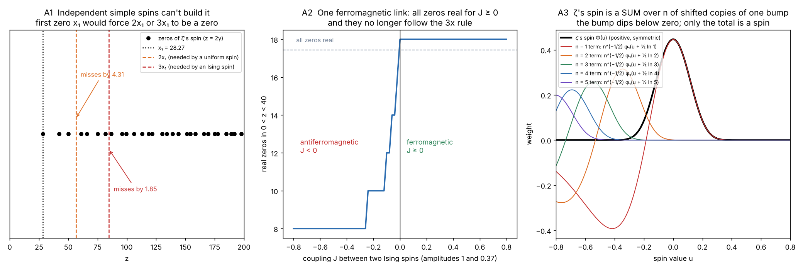
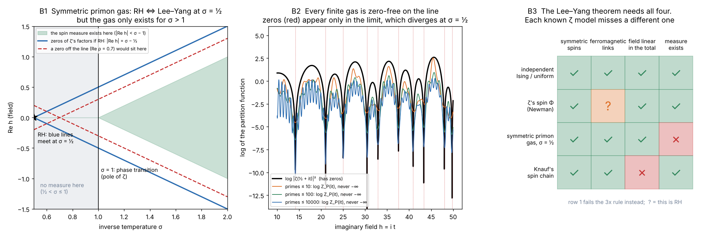

# Spin-build: building ζ's spin from simple Lee–Yang spins with ferromagnetic links (DRAFT)

**Result.** It can be built in one exact way, and that build shows precisely what is missing.

The Lee–Yang theorem forces zeros onto the line when four things hold together:
1. symmetric spins;
2. ferromagnetic (or no) links;
3. a field that couples linearly to the total spin;
4. a spin system that actually exists (finite total weight, or a limit of finite systems).

Each model of ζ we know of gets three of the four, and each misses a different one:
- **Independent simple spins** (Ising, uniform, Gaussian) have all four but can't reproduce ζ. They force a "3x rule" that ζ breaks at its first zero.
- **ζ's own spin Φ** (Newman) has 1, 3 and 4. Whether it also has 2 is the open question: it is RH.
- **A symmetric "primon gas"** (each prime a symmetric spin, no links) has 1, 2 and 3 exactly, and RH ⇔ it is Lee–Yang at temperature σ = ½. But the gas only exists for σ > 1. Its phase transition sits at σ = 1 (the pole of ζ), and at σ = ½ there is no measure for the theorem to act on.
- **Knauf's number-theoretic spin chain** has 1, 2 and 4 (ferromagnetic is proved), but ζ enters through temperature, not through the field, so condition 3 fails.

**Graded two ways.**
- **Worth following: yes.** It names one exact target: a family of finite systems with symmetric spins, ferromagnetic links and a linear field, whose limit carries the primon gas below its phase transition to σ = ½. Knauf's chain is the nearest existing try, and it misses only the field condition.
- **Could reach a proof: only through that bridge.** Nobody has built it. Knauf (1998) reduced his version to a spectral question about Ramanujan-type graphs, and that question is open.

9/9 checks pass (`checks.py`, output in `checks_output.txt`).

---

## 1. Independent simple spins can't do it (Figure A1)

A spin of ±a has Fourier transform cos(az). Its zeros are π/(2a) × (1, 3, 5, …). A uniform spin on [−a, a] gives sin(az)/(az), with zeros π/a × (1, 2, 3, …). A Gaussian has no zeros. Any number of these, independent, multiply. So the smallest zero x₁ of the product must be the first zero of one factor, and then 3x₁ (Ising) or 2x₁ (uniform) must be a zero too.

ζ's first zero is x₁ = 2γ₁ = 28.27. Its double, 56.54, misses the nearest zero by 4.31. Its triple, 84.81, misses by 1.85 (S1). So no collection of independent simple spins, of any size or amplitudes, builds ζ's spin. Links are needed.

## 2. One ferromagnetic link escapes the rule (Figure A2)

Take two Ising spins with amplitudes 1 and 0.37 and a coupling J. The transform is e^J cos(1.37 z) + e^{−J} cos(0.63 z). All its zeros are real exactly when J ≥ 0 (S2: 18 of 18 zeros real up to z = 40). Real zeros are lost in pairs as soon as J < 0. With J > 0 the zeros no longer follow the 3x rule (S3). This is the Lee–Yang theorem in miniature, and it is why linked spins can reach zero patterns like ζ's.

**A1.** ζ's zeros (dots) and the multiples of the first zero that a simple spin would need (dashed): both miss. **A2.** Real zeros of two linked Ising spins against the coupling J: all real for ferromagnetic J ≥ 0, real zeros lost for antiferromagnetic J < 0. **A3.** ζ's spin Φ (black) is an exact sum over n of copies of one bump φ₁, shifted by ½ ln n and weighted by n^{−1/2} (S4, error 3e-15). The bump itself dips below zero (minimum −0.39, S6), so it is not a spin. Only the total is positive and symmetric (S5). That is the first obstacle: Lee–Yang survives products and ferromagnetic links, but **not sums (mixtures)**, and Φ is a sum.

## 3. The symmetric primon gas: an exact build, and the missing condition (Figure B)

The sum over n in A3 is the Dirichlet series, so by Euler's product it is a product over primes. Make each prime a **symmetric** spin: value k·ln p for k = …, −1, 0, 1, …, with weight p^{−σ|k|}. Couple a field h to the total. The total spin is ln(a/b) for a reduced fraction a/b, with weight (ab)^{−σ}, so

  Z(h) = Σ over coprime a, b of a^{−(σ−h)} b^{−(σ+h)} = ζ(σ − h) ζ(σ + h) / ζ(2σ)  (S7, a classical identity).

- **Conditions 1–3 hold exactly:** symmetric spins, no links (J = 0 counts as ferromagnetic), a linear field.
- **Each prime spin is Lee–Yang, trivially.** Its partition function has no zeros, only poles on Re h = ±σ.
- **The equivalence.** With the gamma factors restored (ξ in place of ζ, which removes the trivial zeros), the zeros in h sit at h = ±(ρ − ½) at σ = ½. They are imaginary exactly when Re ρ = ½. So **RH ⇔ the symmetric primon gas at σ = ½ is Lee–Yang.**
- **Condition 4 fails.** The total weight ζ(σ)²/ζ(2σ) is finite only for σ > 1. It is 5.7 at σ = 1.5, 22.6 at 1.2 and 271 at 1.05 (S8), and it blows up at σ = 1.
- **Every finite gas is zero-free.** With primes up to P only, the gas is zero-free on the imaginary field axis for every P (B2, S9). Its log tracks log|ζ(½ + it)|² ever better (correlation 0.78 at P = 10, 0.90 at P = 10⁴), dipping at each zero but never reaching it. The zeros appear only in a limit that diverges at σ = ½. Lee–Yang's theorem says nothing there, because a limit of zero-free functions that does not converge controls nothing.

**B1.** The (temperature σ, field Re h) plane. The gas exists only in the green wedge |Re h| < σ − 1, which closes at the phase transition σ = 1. Under RH the zero lines |Re h| = σ − ½ (blue) meet on the field axis exactly at σ = ½, in the grey band where no gas exists. A zero off the line (red dashed, Re ρ = 0.7) would meet the axis at σ = 0.7 instead and miss it at σ = ½. **B2.** Finite gases (primes ≤ 10, 100, 10⁴) against log|ζ(½ + it)|²: they dip at every zero (red lines) but stay finite. **B3.** The four conditions against the four models: each known model misses one, and a different one.

## 4. What would make it a proof

A family of **finite** systems with:
- symmetric spins,
- ferromagnetic links,
- a field coupled linearly to the total,

whose partition functions converge to ξ(½ + h) **at σ = ½**, i.e. below the free gas's phase transition. Each finite member would then be Lee–Yang by the theorem, and Hurwitz's theorem would carry "zeros on the imaginary axis" to the limit, which is RH.

- **The free gas** has the right symmetry and field, but its finite members have no zeros at all and its limit diverges at σ = ½.
- **Knauf's chain** is ferromagnetic and exists at finite size, and empirically its partition functions approximate ζ inside the critical strip. Proving that convergence would imply RH (Knauf 1998). But ζ's variable is its temperature, so the Lee–Yang theorem doesn't touch those zeros.

The target in our terms: a dial setting that turns Knauf's temperature into a field (condition 3) while keeping its links ferromagnetic (2). This is the place to try next.

## Known vs ours

**Known (tools applied):**
- Lee–Yang theorem (Lee & Yang 1952), extended to general single spins (Newman, Comm. Pure Appl. Math. 27 (1974)).
- ζ's spin Lee–Yang ⇔ RH (Newman, Proc. AMS 61 (1976); survey Newman & Wu, Bull. AMS 57 (2020)).
- Φ as a sum over n and Pólya's work on its first term (Pólya 1926).
- The primon gas with partition function ζ (B. Julia, "Statistical theory of numbers", 1990; D. Spector 1990), and the Bost–Connes system with phase transition at β = 1 (1995).
- The coprime identity Σ a^{−x}b^{−y} = ζ(x)ζ(y)/ζ(x + y), classical.
- Knauf's ferromagnetic number-theoretic spin chain, Z = ζ(s − 1)/ζ(s) with s the inverse temperature (CMP 153 (1993) 77–115). Its approximation of ζ in the strip implies RH if proved, reduced to Ramanujan-graph spectra (CMP 196 (1998) 703–731).
- Hurwitz's theorem.

**Ours:**
- The 3x/2x rule ruling out every collection of independent simple spins at ζ's first zero (immediate).
- The symmetric (two-sided) prime spins as a Lee–Yang reading of RH, with RH ⇔ "Lee–Yang at σ = ½".
- The four-condition table showing that each known model misses a different condition.
- The observation that every finite symmetric gas is zero-free, so Lee–Yang has nothing to grip.
- Naming the bridge (field-linear, ferromagnetic, finite, converging at σ = ½) as the target.

We did not find the two-sided gas stated this way, but it is a short step from the primon gas and may be known.

## Files

- `spinbuild.py`: all computations, writing `spinbuild.json`, `mixture.npz` and `primon.npz`.
- `figs.py`: the two figures. `checks.py`: 9 checks, with output in `checks_output.txt`.
