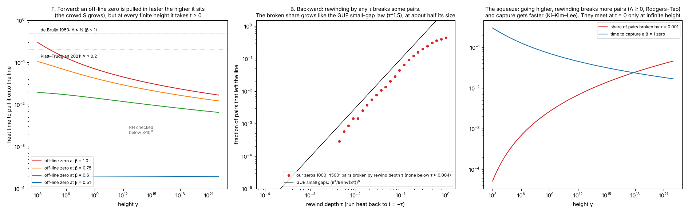

# DRAFT · Can the zeros-as-spins picture force Λ ≤ 0? (Nov 27, 2026)

Asked for by Brennan on a voice call ("Okay, so let's investigate that."), following the spin–orbit page
(`README.md` here). Script: `squeeze.py` → `squeeze.json`, `figures/fig_squeeze.png`. Uses the rewind snapshots
from `../known-tools/`. Checks: `checks.py` S1–S4 (added to this folder's checks).

## Result

**No.** The two-family locking squeezes the Riemann hypothesis from both sides, but it never reaches t = 0. Going
forward, an off-line zero gets pulled onto the line faster the higher it sits, but at every finite height that
still takes some positive heat time. Going backward, any rewind at all breaks some pairs off the line, and more
of them the higher you go. The two sides meet at t = 0 only at infinite height. Closing the gap needs a fact about
ζ itself at t = 0 (no off-line zero at any finite height). That fact is the Riemann hypothesis, and the flow
can't supply it.

**Is it a lead?** Not toward Λ = 0. Everything it shows is known: de Bruijn 1950, Ki–Kim–Lee 2009 forward,
Csordas–Smith–Varga 1994 and Rodgers–Tao 2018 backward. One by-product is worth keeping as a measuring tool, and
it is heuristic only. Above the height where RH has been checked (3·10¹²), a mean-field estimate says a worst-case
off-line zero would be captured within heat time 0.025 to 0.057, depending on the crowd estimate. The proved bound
is 0.2 (Platt–Trudgian 2021).

*F. Forward: time to pull an off-line zero onto the line, by height and by how far off it starts (β). The crowd
term uses half the gap-midpoint mean field. Our measured crowd at gap midpoints is 0.21 of that mean field
(median), so the curves are estimates, not bounds. B. Backward: the share of our zeros 1000–4500 knocked off the
line by rewinding to t = −τ. It grows like τ^1.5, the GUE small-gap law, at about half its size. Nothing breaks
below τ ≈ 0.004 for these zeros. C. Both effects against height. Rewinding by 0.001 breaks 5·10⁻⁵ of pairs at
height 10³ and 5% at 10²². Capture time falls, but neither curve reaches t = 0 at any finite height.*

## What the locking says about rewinding from t = 0

- The two families on the spin–orbit page are split by the crowd number S·d₀² = 2 (gap d₀, crowd pull S). Pairs
  below 2 rewind into a collision. Pairs above 2 rewind apart. Our zeros split 51.4% / 48.6%.
- So any rewind τ > 0 breaks the closest pairs. Their share grows like τ^1.5 (panel B), and at fixed τ it grows
  with height, because zeros crowd together like log γ. That is Newman's conjecture (Λ ≥ 0, proved by Rodgers–Tao).
  The picture reproduces it. It adds nothing past it.

## Forward from t = 0

- An off-line pair x ± iy closes as y′ = −1/y − 2Sy, captured by t = ln(1 + 2Sy²)/(4S) ≤ y²/2. The bound y²/2 is
  de Bruijn's, and it gives Λ ≤ ½. The crowd S grows with height, so the time falls to 0 as height grows. That is
  the mechanism behind Ki–Kim–Lee: for each t > 0 only finitely many zeros of H_t are off the line.

## Beyond Csordas–Smith–Varga, Rodgers–Tao and Newman?

No new content. The locking picture is a way to see those results, not a stronger one.

## Exactly where an argument for Λ = 0 runs out

Λ ≤ 0 is the statement that H₀ = Ξ itself has every zero real. The flow moves zeros. It cannot decide where they
start. The forward side says off-line zeros at t = 0 could only sit at heights where capture is not yet instant.
That is any finite height, so no contradiction arises. The backward side says t = 0 is the edge or later. To make
the edge exactly t = 0, you need to rule out an off-line zero of ζ at some finite height. That is a statement about
the primes (through the explicit formula). The spin picture has no slot for it.

## Known work used

de Bruijn 1950; Newman 1976; Csordas–Smith–Varga 1994; Ki–Kim–Lee 2009; Rodgers–Tao 2018 (Forum Math. Pi 2020);
Polymath 15 2019; Platt–Trudgian 2021; Montgomery 1973 (pair correlation, GUE small gaps).
