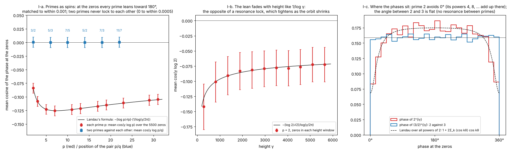
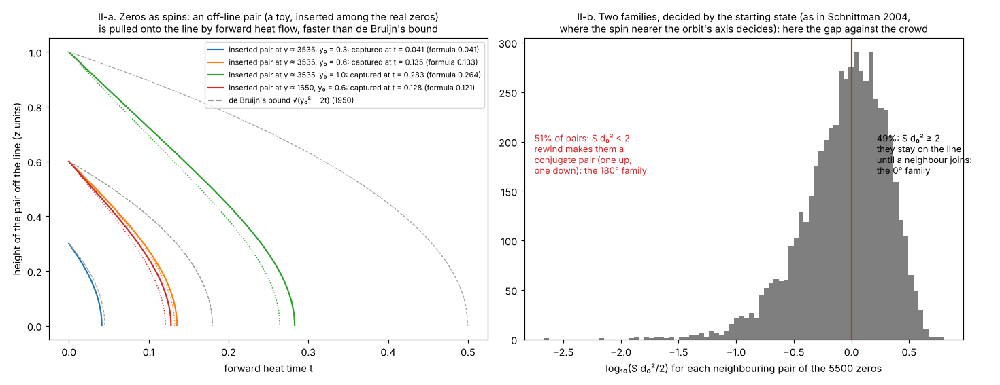

# DRAFT: Spin–orbit resonance applied to the Riemann hypothesis (Nov 27, 2026)

**Applied to the zeros themselves, spin–orbit resonance fits every piece except the last one, and the last one is RH
itself. Applied to the primes, it breaks at the coupling.** Under the heat flow the zeros act like spins: they really
do pull on each other, a slow drift pulls off-line pairs onto the line, and pairs sort into two families decided by
how they start. But that capture only happens at heat time t > 0, and RH asks for every zero to be on the line at
t = 0, with no drift at all. The primes, taken as spins, never lock to each other, because nothing couples them. At
the zeros each prime does lean toward 180°, exactly as Landau's formula says, but the lean fades with height instead
of tightening.

A correction to the earlier answer (my own words in the project chat): "the pull isn't one-signed" is not why primes
fail. Spin–orbit locking doesn't need a one-signed pull; Schnittman's couplings aren't ferromagnetic. Between primes
the pull is exactly zero. Between zeros there is a pull, and it is one-signed (they repel).

Task (Brennan, Nov 27): "Why not? Try applying spin orbit resonance to rh and tell me where it doesn't fit."

## The mechanism being applied

From the spinning river page, Part 8, and Schnittman (2004): two spins S₁, S₂ precess about the orbit's axis while
the orbit slowly shrinks (radiation reaction). Configurations where both spins and the orbit lie in one plane and
precess at the same rate are resonances. As the orbit shrinks, binaries are captured into them: the angle between the
spins' shadows on the orbit plane locks near 0° or 180°, and which one is decided by which spin starts nearer the
orbit's axis. Our 80-pair run: medians 41° and 138°.

The pieces: two spins; an axis; a coupling; precession rates that can become equal; a slow drift; locking into 0° or
180°; and what the locked state says.

## The map, piece by piece

| spin–orbit piece | I. primes as spins | II. zeros as spins under heat flow |
|---|---|---|
| two spins | two Euler factors p^{−it}, q^{−it}, each a unit arrow turning at rate log p. **Fits.** | two neighbouring zeros, or an off-line pair x ± iy. **Fits.** |
| the axis | the critical line, with the height t as the clock. **Fits loosely.** | the real line of z = 2γ (the critical line). **Fits.** |
| coupling | none: log ζ = Σ_p (one term per prime, no cross terms; the prime cube's coupling is 0). **Breaks.** | dz_j/dt = 2Σ 1/(z_j − z_k): every zero pulls on every other, real and one-signed. **Fits.** |
| rates that can match | the rates log p are fixed, and log p/log q is never rational (unique factorisation), so they never match. **Breaks.** | the rates depend on where the zeros sit, so the line itself is a stable state. **Fits.** |
| slow drift | only log t (the density of zeros), which changes no prime's rate. **Breaks.** | the heat time t, a slow sweep like the shrinking orbit. **Fits.** |
| locking at 0° or 180° | each prime leans toward 180° at the zeros, matched to Landau's formula; no two primes lock. **Half fits:** the lean fades like 1/log t, a lock would tighten. | real pairs (both on the line, the 0° family) and conjugate pairs (one above, one below, the 180° family); which one comes from S d₀² against 2. **Fits.** |
| what the locked state says | the lean is the explicit formula over again; it says nothing about Re ρ. **Breaks.** | forward drift puts every zero on the line once t ≥ Λ; RH is every zero on the line at t = 0, with no drift. **Breaks, and this is RH itself.** |

## I. Primes as spins

At a zero γ the Euler factor of p points at angle −γ log p. Landau's formula (1912; Gonek 1993 made it uniform)
gives the average over zeros:

> mean of cos(γ log p) ≈ −(log p/√p) / log(γ/2π).

That is a real lean toward 180°, strongest near p = e² ≈ 7. Over our 5500 zeros it matches for every prime from 2 to
31 to within 0.001 (p = 2: −0.0838 measured, −0.0837 predicted). At random heights there is no lean. This is the
lower-order term in the distribution of αγ mod 1 found by Ford and Zaharescu (2005; Hlawka 1975 proved the leading
uniform distribution; Rademacher first raised it).

Where it breaks:
- **No locking between primes.** For two primes, the angle between their arrows at the zeros is γ log(p/q), and its
  mean cosine is 0 to within 0.0005 for all six pairs tried (3/2, 5/3, 7/5, 5/2, 7/3, 11/7). Landau's formula only
  spikes at prime powers, and p/q is never one. Two primes have no coupling to lock through (the joint version is
  Ford, Meng and Zaharescu).
- **The lean fades.** It scales like 1/log γ (I-b), so it weakens with height. A resonance lock tightens as the orbit
  shrinks.
- **One family, not two.** Every prime leans to 180°; none leans to 0°. In fact prime 2's phase avoids 0° sharply
  (I-c), because 2, 4, 8, … all add their leans there.

*I-a: lean of each prime (red) and of each pair of primes against each other (blue). I-b: the lean of 2 fades with
height. I-c: where the phase of 2^{iγ} sits at the zeros (red, with Landau's formula over all powers of 2, dashed),
and the angle between 2 and 3 (blue, flat).*

## II. Zeros as spins under the heat flow

Here every piece of the mechanism has a counterpart.

- **Capture onto the line.** A pair off the line at x ± iy, among the other zeros (background S = Σ 1/(x − z_k)²),
  obeys y′ = −1/y − 2Sy under forward heat flow. So it reaches the line at
  t = ln(1 + 2Sy₀²)/(4S), which is always before de Bruijn's bound y₀²/2 (1950). We tested this by inserting
  an artificial off-line pair among the real zeros (a toy, no longer ζ) and running the full flow: captured at
  t = 0.041, 0.135, 0.283 for y₀ = 0.3, 0.6, 1.0 near γ ≈ 3535 (formula 0.041, 0.133, 0.264), and at 0.128 near
  γ ≈ 1650 (formula 0.121). This is the "pull into line" the Lee–Yang question asked for, and it exists.
- **Two families decided by the start.** Under rewind a neighbouring pair either becomes a conjugate pair on its own
  (S d₀² < 2) or stays on the line until a neighbour joins. Among our 5500 zeros the split is 51% / 49%. This is the
  counterpart of Schnittman's rule that the spin nearer the axis decides the family: here the deciding quantity is
  the pair's gap against the crowd around it.
- **The drift goes the wrong way for RH.** Capture needs forward heat time. Every zero is on the line once t ≥ Λ, and
  Λ ≤ 0.2 is proved. RH says Λ = 0: every zero is already captured with no drift at all. Nothing in the mechanism acts
  at t = 0, so it cannot say whether that is so. Running it backward (the rewind, known-tools section A) only gives
  lower bounds, and Λ ≥ 0 is already proved.

*II-a: an inserted off-line pair (toy) pulled onto the line by forward heat flow (solid), the two-zero formula
(dotted) and de Bruijn's bound (grey dashed). II-b: the deciding quantity S d₀²/2 for every neighbouring pair; left
of the red line the rewind makes the pair conjugate (180° family), right of it the pair stays on the line (0° family).*

## Where it fits better than expected

The zero picture (II) fits more closely than the coordinator's "not a lead" suggested: a real coupling, a slow sweep,
capture, and two families set by the starting state are all there, with formulas that match the full flow within 1 to
7%. It is still not a route to RH, because the one step it cannot take, capture at zero drift, is exactly the
statement Λ ≤ 0.

## Quantum gravity

Spin–orbit resonance is itself gravity (radiation reaction). In picture II the zeros are captured onto the line the way
spins are captured into resonance as the orbit radiates, and RH would be the statement that ζ's zeros need no
radiation at all. That is a restatement, with nothing new to compute.

## Verdict

Not a route to RH. Primes as spins break at the coupling (zero), the rates (never commensurate) and the drift (none).
Zeros as spins fit every piece, and the one piece that fails is RH itself.

Follow-up: [LAMBDA.md](LAMBDA.md) asks whether the two-family locking forces Λ ≤ 0. It doesn't. It squeezes RH from
both sides, but the squeeze closes at t = 0 only at infinite height.

## Files

- `spinorbit.py`, `spinorbit.json`, `spinorbit_traj.npz`: leans of primes and pairs at the zeros, height windows, the
  capture runs.
- `figs.py`: `fig_primes_as_spins.png`, `fig_zeros_as_spins.png` (II-b reads `../known-tools/rewind_snaps.npz`).
- `squeeze.py`, `squeeze.json`, `figures/fig_squeeze.png`: forward capture against backward breaking (LAMBDA.md).
- `checks.py`, `checks_output.txt`: 16 of 16 pass (S1–S4 cover the squeeze).
- No Lean: the statements are about flows and sums over zeros.

Uses `../round9/zeros.json` and `../known-tools/rewind_snaps.npz`.

## References

- J. D. Schnittman, "Spin-orbit resonance and the evolution of compact binary systems", Phys. Rev. D 70 (2004).
- E. Landau, the sum of x^ρ over zeros (1912); S. M. Gonek, "An explicit formula of Landau and its applications to
  the theory of the zeta-function", Contemp. Math. 143 (1993).
- E. Hlawka, uniform distribution of αγ mod 1 (1975); H. Rademacher, Fourier analysis in number theory (1956).
- K. Ford and A. Zaharescu, "On the distribution of imaginary parts of zeros of the Riemann zeta function",
  J. reine angew. Math. 579 (2005); K. Ford, K. Soundararajan, A. Zaharescu, part II (2009); K. Ford, X. Meng,
  A. Zaharescu, the simultaneous version.
- N. G. de Bruijn, "The roots of trigonometric integrals", Duke Math. J. 17 (1950).
- The spinning river page, Part 8 (gravity-from-theory/spinning-river).

Page numbers left out where not checked.
