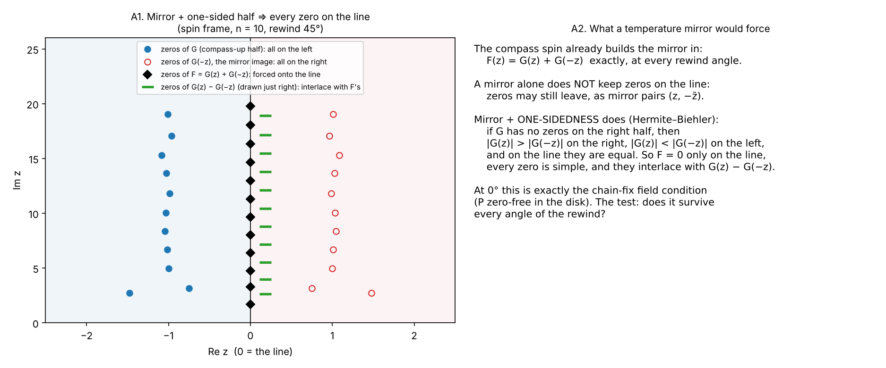
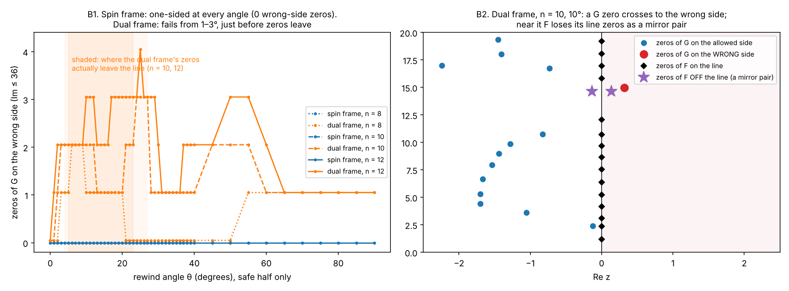
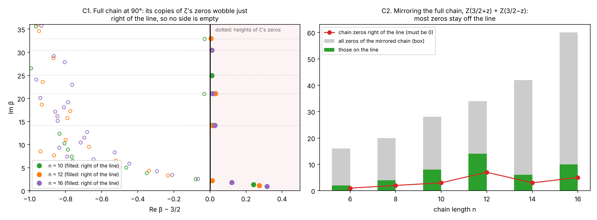

# Temperature mirror: can a mirror close the small-angle gap?  (DRAFT)

**Plain result.** The chain's safe-half rewind already has a perfect temperature mirror: the compass
spin splits the sum into two mirror halves, F(z) = G(z) + G(−z), at every angle. So the mirror
was never the missing piece. A mirror only pairs zeros up; they can still leave the line two at a
time. What forces them onto the line is the mirror **plus one-sidedness**: one half, G, keeps all
its zeros on one side of the line. That is a classical theorem (Hermite–Biehler), and at 0° it is
exactly the field condition from chain-fix.

Tested along the whole rewind:
- **Spin frame:** G stays one-sided at every angle (n = 8, 10, 12 every degree to 40°, then every 5°;
  n = 14 at 13 angles). That is *why* the spin frame's safe half never left the line.
- **Dual frame (the gap):** one-sidedness breaks at 1–3°, a few degrees before zeros actually leave
  (4–5°). In that gap the zeros really are off the line, so **no mirror can close it**: any
  one-sided mirror split would forbid exactly what happens. The fix for the safe half is simply
  to use the spin frame.
- **Far end, full chain (the even half):** to mirror the whole chain we'd need Knauf's zeros all on
  one side of Re β = 3/2. They aren't, at any length tried (6 to 16). The chain's own copies of
  ζ's zeros (heights 14.13, 21.02, 25.01, 30.42, 32.94) sit 0.005–0.03 to the *right* of the line,
  and the mirrored chain keeps under half its zeros on the line.

## What the mirror would force, if it worked

If F = G(z) + G(−z) with real weights and G has no zeros with Re z ≥ 0 (and is lopsided the right
way at the far edges), then |G(z)| > |G(−z)| on the right, the reverse on the left, and they are
equal on the line. So:
1. every zero of F lies on the line;
2. every zero is simple;
3. F's zeros interlace with the zeros of G(z) − G(−z).

Checked numerically for the spin frame (Fig A, checks 12 to 14).

## Grades

| piece | worth following? | could reach a proof? |
|---|---|---|
| Mirror + one-sidedness along the rewind | **Yes.** It turns "the line held" into a reason, explains the clean spin frame and the failing dual frame, and gives the even half a sharp target: split the full chain into a mirror pair with one half zero-free on one side. | Not with this construction. The gap can't be closed by any mirror (its zeros really leave). At the far end the full chain's copies of ζ's zeros straddle the line at every finite length, so the side we need is never empty. Asking for it in the limit is as hard as RH, and the split view of RH is already known (de Branges, Lagarias). |

So: a real tool and a clear diagnosis, but no new route to a proof yet. The spin-frame result is
numerical on Im ≤ 36 and small n; turning it into a theorem for each n needs the full height range.

## Pictures

**A1** Spin frame, n = 10, rewind 45°. Blue: zeros of G (the compass-up half), all on the left.
Red rings: their mirror images. Black: F's zeros, all on the line. Green: zeros of G(z) − G(−z),
alternating with F's. **A2** The rule in words.

**B1** Zeros of G on the wrong side, along the rewind. Spin frame (blue): none, at every angle.
Dual frame (orange): they appear from 1–3°. Shaded: where the dual frame's zeros actually leave
the line (n = 10, 12). Note n = 8 also loses one-sidedness although its zeros never leave:
one-sidedness is sufficient, not necessary. **B2** Dual frame, n = 10, 10°: one zero of G (red)
has crossed to the wrong side, and right beside it F has lost two line zeros as a mirror pair
(purple stars).

**C1** The full chain at the far end (90°), zeros in β. Filled dots are right of the line. The
right-side ones near ζ's heights (dotted) sit within about 0.03 of the line and swap sides as n grows,
the "wobble" seen in knauf-field. One low zero drifts right as n grows, apparently toward β = 2,
where the limit ζ(β−1)/ζ(β) has its pole (a finite-length effect). **C2** Mirroring the full chain,
Z(3/2 + z) + Z(3/2 − z): only a minority of zeros lands on the line, because the chain has zeros
on both sides.

## Known vs ours

**Known.** Hermite–Biehler theorem and Pólya's work on real zeros of exponential sums; de Branges
spaces; Lagarias (2005–06) on de Branges spaces and differenced ξ-functions; Griffiths' ghost
spin (1967); Montgomery (1983): partial sums of ζ have zeros to the right of where ζ has none,
the same kind of failure as C1.

**Ours (small n, numerical).**
- Noticing that the compass spin makes the safe-half rewind an exact mirror pair at every angle,
  so the only open question is one-sidedness.
- The rewind-wide one-sidedness test: the spin frame passes at every angle (n = 8 to 14), the dual
  frame fails just before its zeros leave, and that failure is the whole gap.
- Reading the chain-fix field condition as the 0° case of the same test.
- The far-end diagnosis: the full chain's copies of ζ's zeros sit 0.005–0.03 right of the line,
  so no finite chain can carry a one-sided mirror.

## Files

- `mirror.py`: the split F = G(z) + G(−z); counts G's wrong-side zeros by winding → `mz_*.jsonl`.
- `farend.py` → `farend.json`; `farend_pos.py` → `farend_pos.json`: the full chain at 90°.
- `figs.py`: pictures. `checks.py`: 17 checks (run `python3 checks.py`; reads ../pendulum-swap and
  ../knauf-field).

Dial used: p (its Wick turn is the rewind's far end). The rewind angle, the frame and the split
are settings, not dials.
