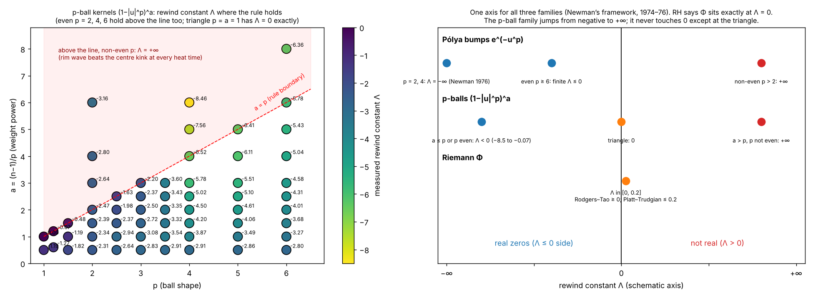
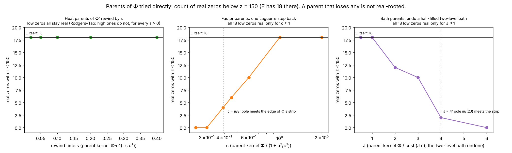
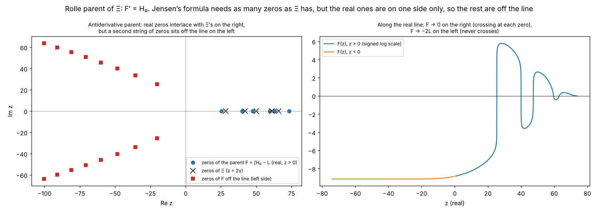
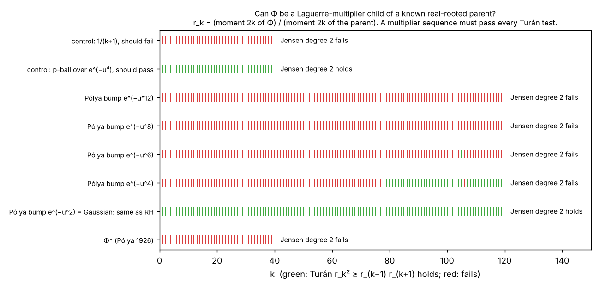
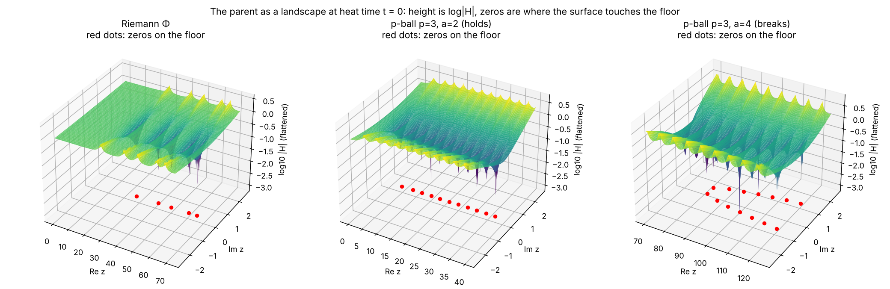
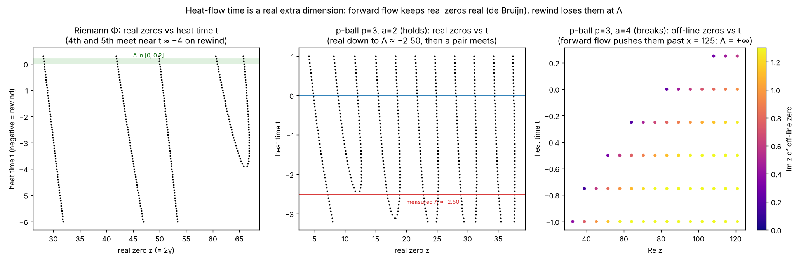
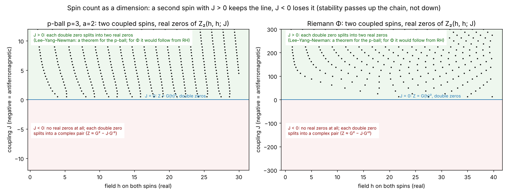
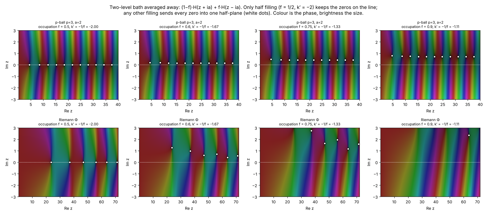
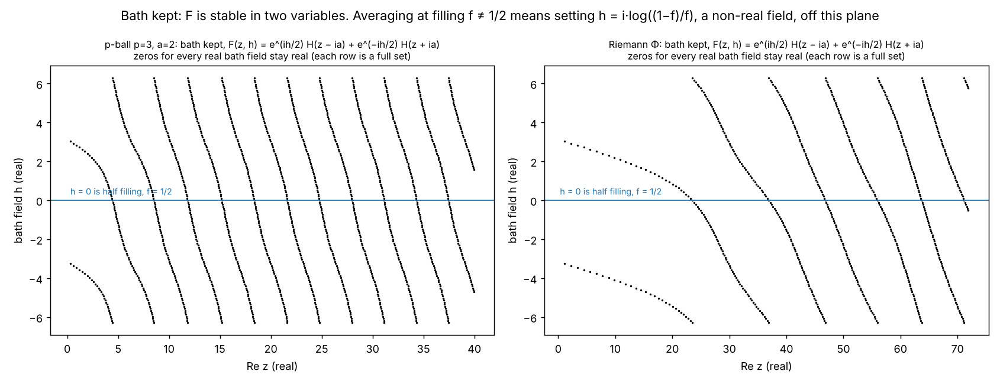
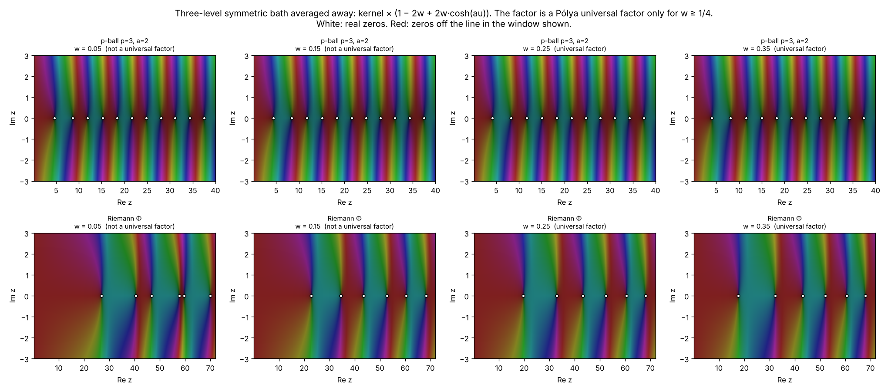

# Riemann: one hypothesis for the Lee–Yang p-ball rule and RH, and the hunt for a real-rooted parent (DRAFT)

> **Names:** some words or symbols on this page (fused) also mean something else in standard math, physics or computing, or inside this project. [NAMING-COLLISIONS.md](../../../NAMING-COLLISIONS.md) says which meaning is in play.

**Not a lead.** The unified statement holds up, but it is Newman's framework (1974–76), not something new: every kernel gets one number, the rewind constant Λ, and "all zeros real" means Λ ≤ 0. The p-ball kernels sit strictly below 0 (from −8.5 to −0.07) where the rule holds and jump straight to +∞ where it breaks. Riemann's Φ sits somewhere in [0, 0.2], and RH says exactly 0. Every real-rooted parent we tried for Φ either loses real zeros or turns out to be RH restated. The 5D space needs three inputs (Re z, Im z and heat time), plus the number of coupled spins as a genuine fourth. The spin field turns out to be z itself, and pressure is the height, not an input. A bath keeps the zeros on the line only at half filling, k′ = −2.

Everything here is numerical evidence or a short derivation unless a named proof is cited. Where a result is someone else's, it says who.

## Properties: what is needed, what is ruled out

| Property | Status | Source |
|---|---|---|
| Real zeros ⇔ Λ ≤ 0, for every even positive kernel | True by definition plus de Bruijn's forward-flow theorem and Hurwitz (real zeros survive the limit at Λ) | de Bruijn 1950; Newman 1976 |
| Λ_Φ ≥ 0 | Proved | Rodgers–Tao, Forum Math. Pi 2020 |
| Λ_Φ ≤ 0.2 | Proved | Platt–Trudgian 2021 (Polymath15: 0.22) |
| p-ball Λ < 0 where a ≤ p or p even | Measured at 58 points (§2); the rule itself proved earlier in shape-dial-survey | this work; shape-dial-survey N3 |
| p-ball Λ = +∞ where a > p, p not even | Derived (the heat factor scales the rim wave by e^λ and leaves the kink alone) | this work |
| A class test that separates holds from breaks | **Ruled out** for log-concavity, decay rate and finite Turán/Jensen tests (§3) | this work |
| A real-rooted parent of Φ, proved | **None found.** Each candidate fails or is RH itself (§4) | this work |
| Lee–Yang stability passes *down* to a slice | **Ruled out** in every case tried; every known transfer goes up (§4, §5) | Lee–Yang 1952; Newman 1974; Borcea–Brändén 2009 |

## 1. The unified statement, corrected

The coordinator's draft was: even positive kernel K, transform G(z) = ∫K(t)cos(zt)dt, "the class gives real zeros ⇔ Λ_K ≤ 0", Lee–Yang is the p-ball kernel, Pólya 1923 is e^(−t^p) for even p, RH is K = Φ, and RH ⇔ Λ_Φ = 0.

What holds:

- **The equivalence needs no class.** For any even positive kernel with enough decay, H_λ(z) = ∫e^(λu²)K(u)cos(zu)du has real zeros at λ = 0 exactly when Λ_K ≤ 0. Forward flow keeps real zeros real (de Bruijn 1950). At λ = Λ itself the zeros are still real, as a limit of real-rooted functions. So the content is never "real ⇔ Λ ≤ 0" but the *value* of Λ for each kernel.
- **RH ⇔ Λ_Φ = 0**, because Rodgers–Tao proved Λ_Φ ≥ 0. Newman conjectured Λ ≥ 0 in 1976.
- **Newman already framed Lee–Yang and RH together** (Newman 1974, 1976; Newman–Wu, arXiv 1901.06596). His Theorem 10 says Λ = −∞ only for kernels of the form t^(2m)·exp(−αt⁴ − βt²) times a product of (1 + t²/a²)e^(−t²/a²) factors, or two point masses. Newman–Wu do not state a single conjecture covering the p-balls.

What needed correcting in the draft:

1. **The p-ball boundary is not a Λ = 0 boundary.** Crossing a = p at non-even p, Λ jumps from a negative number straight to +∞. It never passes through 0 (§2).
2. **The p-ball kernel is compactly supported**, not fast-decaying. Newman's theorem then rules out Λ = −∞ for every p-ball, so the even-p p-balls have finite negative Λ, unlike the Pólya bumps e^(−t⁴).
3. **The rule holds at every p with a ≤ p**, not only even p. Even p holds for every a. (The Lee–Yang strip thread reports a proof for every even p and every a via a Laguerre multiplier sequence. That is its result, not this one's; see §4.)
4. **The only p-ball with Λ = 0 is the triangle** p = a = 1, whose transform ∝ sin²(s/2)/s² has double zeros. That is the one p-ball that looks like Φ on this axis.
5. **Pólya's even-p result for e^(−t^p) is 1918–1926** (Pólya, including Acta Math. 48 (1926) 305–317 for Ξ*). Lee–Yang is 1952.

The statement with content, as one hypothesis: **"Λ_K ≤ 0 for K = Φ and for the p-balls with a ≤ p or p even, and Λ_K = +∞ for the other p-balls."** The p-ball half is now established (rule proved; Λ measured). The Φ half is RH. What would make it one hypothesis rather than two facts on one axis is a feature of K that predicts the sign of Λ for both families. §3 shows that none of the obvious features does.

## 2. The Λ map

*Left: measured Λ for p-ball kernels (1−|u|^p)^a (colour and label). Every measured point where the rule holds has Λ < 0. Right: schematic of where the three families sit.*

- **Pólya bumps e^(−t^p):** Λ = −∞ at p = 2 and 4 (Newman's Theorem 10); finite Λ ≤ 0 for even p ≥ 6; +∞ for non-even p > 2 (the transform has order p/(p−1), not an integer, so infinitely many zeros of which only finitely many are real).
- **p-balls:** Λ between −8.46 (p = 4, a = 6) and −0.07 (p = 1.2, a = 1.2) where the rule holds. At a = p, Λ sits just above the far-field threshold log|B| with B = sin(πp/2)/p^(p−1) (for example p = 3: Λ = −2.20, log(1/9) = −2.197; p = 5: −6.41 against −6.44). Above the line at non-even p, Λ = +∞.
- **Riemann Φ:** Λ in [0, 0.2].

Method: Gauss–Jacobi quadrature (1200 nodes) and the argument principle on [0, R]×[−4, 4] with R near 150, bisecting λ on [−14, 0] to a tolerance of 0.05 (`lam_pball.py`, `lam_pball.json`).

## 3. Candidate classes: none separates

| Candidate "class" | Holds on the real-rooted kernels? | Fails on the broken ones? | Verdict |
|---|---|---|---|
| Log-concave kernel | Yes for every p-ball (p ≥ 1, any a ≥ 0) and for Φ (Csordas: Φ(√t) strictly log-concave) | **No**: the broken p-balls are log-concave too; e^(−t⁴ + βt²) is real-rooted but not log-concave | Neither necessary nor sufficient |
| Pólya universal factor / de Bruijn's criterion | It is a *method* for building real-rooted kernels, not a test on a given kernel | n/a | Not a class |
| Turán inequalities | Hold for all | Hold for nearly all broken ones too (fail only at Pólya p = 1.5) | Does not separate |
| Jensen polynomials, finite degree | Hold for all tested | Failures found only at p = 1.5 (p-ball a = 2.25, 3, 4.5) and Pólya p = 2.5, 3; none at p = 3.5 or 5 up to degree 16, nor at p-ball p = 2.5, 3, 3.5 even with a up to 3p | Does not separate. Hyperbolicity for **all** degrees is equivalent to real zeros (Pólya; GORZ, PNAS 2019), so the full test is a restatement |
| Decay rate | Compact support, e^(−t^p) and Φ's doubly exponential tail all occur on both sides | Same | Does not separate |

Files: `jensen.py`, `jensen.json`.

## 4. The real-rooted parent hunt

**The idea.** If Ξ is a derivative, or a limit of derivatives, of a real-rooted P, then Rolle passes the real zeros down and RH follows. It works one way only: a real-rooted Ξ does not make P real-rooted.

**The framework.** On the kernel side, a parent is K_P = K/U where U(t) = φ(it) and φ is an even Laguerre–Pólya function, a Pólya universal factor (Pólya 1927). Applying φ(D) to the parent's transform multiplies its kernel by φ(it) and gives back the child. The cases:

| Parent | U | Who proved the step works |
|---|---|---|
| Rolle (antiderivative) | t² | Rolle; Laguerre–Pólya closure under differentiation |
| Heat (rewind by s) | e^(st²) | de Bruijn 1950 |
| One Laguerre factor | 1 + t²/c² | Laguerre |
| Half-filled two-level bath | cosh(Jt) | Pólya 1927 (cos is a universal factor) |
| Moment ratio (multiplier sequence) | coefficient-wise r_k | Laguerre; Pólya–Schur 1914 |

**Results.**

*Real zeros below z = 150 for each parent; Ξ has 18 there. A parent that loses any zero is not real-rooted.*

- **Heat parents** Φ·e^(−su²): all 18 low zeros stay real for s up to 0.4, but Rodgers–Tao proved that for every s > 0 some zeros high up leave the line. So the heat parent exists for the p-balls (their Λ < 0 gives a real-rooted rewind) and **does not exist for Φ**.
- **Factor parents** Φ/(1 + u²/c²): all 18 kept for c ≥ 1; zeros lost for c ≤ 0.6; none at all for c < π/8, where the pole at u = ±ic sits inside Φ's strip and the transform stops oscillating. Keeping the low zeros is not evidence for the high ones. Far up, the factor acts like an ever-shorter rewind, of size about 32/(log z)², and the small-gap pairs that random-matrix statistics predict (normalised gaps that shrink like a power of the height) beat any such logarithmic size. So this parent is expected to fail high up, by the same mechanism as Rodgers–Tao. That is a heuristic, not a proof.
- **Bath parents** Φ/cosh(Ju), the half-filled two-level bath undone: all 18 kept for J ≤ 1, lost for J ≥ 2, almost all gone at J = 4, where the pole iπ/(2J) meets the strip. High up, dividing by cosh rotates the phase of the leading saddle term by Jπ/8. Whether small J survives at every height is the same kind of question as RH, and nothing here settles it.
- **Three-level children** Φ·(1 − 2w + 2w·cosh u): all 18 low zeros real for every w tried, including w < 1/4 where the factor is not universal. The 1/4 threshold is what *guarantees* real zeros for every kernel, not what these two kernels need.

*Left: zeros of F = ∫₀^z H₀ − L. The real ones (blue) interlace with Ξ's (crosses), but a second string (red) sits off the line on the left, at −20.35 ± 25.42i, −35.58 ± 33.69i, and so on. Right: F crosses zero on the right and stays at −2L on the left.*

- **Antiderivative (Rolle) parent.** F = ∫H₀ − L has real zeros interlacing Ξ's on the positive side and none on the negative side. Jensen's formula needs F to have about as many zeros as Ξ in each disc, so the missing half must be off the line. We found 8 of them; the first three agree to 40 digits with mpmath. Every other constant shift fails too, since a primitive has different limits ±L at ±∞. **Not real-rooted.** For the p-balls the same obstruction follows from Levinson's density theorem (Cartwright class).
- **Fused parents** (e^(kF) − 1)/k and ∏(1 + k·h_i) − 1)/k: the value-side fused integral has zeros where kF = 2πim, and those with m ≠ 0 are non-real (Picard). The discrete version had 1 to 3 zeros in the box where Ξ has 17. **Never real-rooted.** The Lee–Yang strip thread found the same (its figure 28 E/F): the value-side fused integral only reparametrises G and adds off-line zeros. The coefficient-side version is the multiplier route below.

*Green: the Turán test r_k² ≥ r_(k−1)·r_(k+1) holds; red: it fails. Any multiplier sequence must pass every one. Controls on top behave as they should.*

- **Multiplier parents (the Lee–Yang strip thread's suggestion).** That thread reports that every even-p p-ball is real-rooted because its moments are Pólya's e^(−y^p) moments times 1/Γ(2k/p + a + 1 + 1/p). That is a Laguerre multiplier sequence (1/Γ(αk + β) is f(k) with f in the Laguerre–Pólya class and only negative zeros). The proof rests on Laguerre's theorem and Pólya's even-p result; the assembly is that thread's. Here the same test was run with Φ as the child:
  - **Pólya's Φ\*** (Acta Math. 48 (1926) 305–317; Ξ\* has only real zeros, proved through the zeros of K_(iz)(2π)): the ratio r_k = m_2k(Φ)/m_2k(Φ\*) is log-convex. It fails Turán at **every** k from 1 to 39, and the degree-2 Jensen polynomial already has non-real zeros. **Φ\* is ruled out as a multiplier parent.** Rescaling u does not help, since it multiplies r_k by q^k and leaves both tests unchanged.
  - **Pólya bumps e^(−u^p), p = 4, 6, 8, 12:** fail Turán from k = 1. (p = 4 recovers for 78 ≤ k ≤ 119, apart from an isolated flip at k = 106 that looks like quadrature noise; the early failures already rule it out.)
  - **Gaussian e^(−u²):** passes every Turán test to k = 119 and Jensen to degree 40, **but this case is RH itself.** The ratio's exponential generating function is Ξ in the variable −z²/4. Its Turán inequalities are Pólya's 1927 conjecture, proved by Csordas–Norfolk–Varga (Trans. AMS 296 (1986) 521–541). Its Jensen polynomials are GORZ (PNAS 2019).
  - **Why the bumps fail:** Φ's moments are more log-convex than Γ((2k+1)/p) for p ≥ 4, so the ratio comes out log-convex. Only the Gaussian is log-convex enough, and that is the circular case.

**Verdict on parents:** every parent built here either loses real zeros (heat high up, Rolle, fused, Φ\*, the bumps, factor and bath at larger settings) or is RH restated (the Gaussian multiplier). Factor and bath parents at small settings keep all low zeros but cannot be tested high up with these tools, and the heuristic above expects the factor parent to fail there. **Not a lead.**

## 5. The parent in its full space

Brennan asked to put all five dimensions in at once and drop any that turn out unnecessary. The five tracked: Re z, Im z, heat time t, spin, and pressure.

| Dimension | What it turned out to be | Needed? |
|---|---|---|
| Re z, Im z | The plane the zeros live in | Yes |
| Heat time t (de Bruijn–Newman) | A real extra input; forward flow keeps zeros real, rewind loses them at Λ | Yes |
| Spin field | **The same as z.** H(z) is the partition function of one spin with distribution K in imaginary field z | Merges with z |
| Pressure log Z | **The height** over the other inputs (log|H|), not an input | Output |
| Number of spins N, with coupling J | The natural fifth: N coupled copies, each with its own field | Yes, as a fourth input (J sets how they couple) |

*Height log|H| (flattened by its average size along each vertical line) over the plane at t = 0. Zeros are where the surface touches the floor: on the line for Φ and the holding p-ball; in mirror pairs off it for the broken p-ball (from x ≈ 83).*

*Zero curves in (z, t). Φ: the 4th and 5th zeros meet near t ≈ −4 on rewind. Holding p-ball: a pair meets at its measured Λ ≈ −2.50. Broken p-ball: forward flow pushes the off-line zeros outward (first one at x = 33 at t = −1, x = 83 at t = 0, x = 108 at t = 0.25) but never clears them.*

*Two coupled spins with the same field h, Z₂(h, h; J). At J = 0 it is G(h)², with double zeros. For J > 0 each double zero splits into two real ones; for J < 0 into a complex pair, and no real zeros remain at all. Near a zero of G, Z₂ ≈ G² − J·G′², which shows the sign rule directly (Lean: `two_spin_ferro`, `two_spin_antiferro`).*

For the p-ball, J > 0 keeping the line is the Lee–Yang–Newman theorem (Newman 1974; Lieb–Sokal 1981), since the one-spin distribution has the Lee–Yang property. For Φ the same would follow from RH. The slice that freezes the second spin's field at 0 has kernel K(s)·M(Js), where M is K's moment generating function. When G is real-rooted, M is a universal factor, so this slice is a **child** (more real-rooted), never a parent. **Stability passes up the chain of spins, not down.** That is why no higher-dimensional stable parent has Φ as a slice in the useful direction: Borcea–Brändén's stable polynomials and Lee–Yang's multivariate theorem both transfer stability to diagonals and slices of a stable object, and building that object for Φ needs RH as input.

**Which dimensions the result needs:** Re z, Im z, heat time, and spin count. Spin field merges with z; pressure is the height.

## 6. The bath

From topics/probability-entanglement §9: gluing by ∘₋₁ held in every bath state, and k moved only when the bath was forgotten. A two-level bath gives k′ = −(1 + e^(β(Δ−μ−ΩJ))) = −1/f, with f the Fermi occupation.

**Bath averaged away (two-level).** Tracing out the bath gives (1−f)·H(z + ia) + f·H(z − ia).

*Colour is phase, brightness size; white dots are zeros. At f = 1/2 (k′ = −2) they sit on the line. At f = 0.6, 0.75, 0.9 every zero found is in the upper half-plane, higher as f grows.*

- **f = 1/2 (k′ = −2):** this is multiplying the kernel by cosh(au), a universal factor, so real zeros are kept. That is Pólya's theorem.
- **f ≠ 1/2:** no zero is real. On the real line |H(x + ia)| = |H(x − ia)|, so the two terms can only cancel if their weights match; and by Hermite–Biehler all zeros lie in one half-plane. Measured mean Im z: 0.16, 0.42, 0.73 (p-ball) and 0.76, 1.82, 2.36 (Φ) at f = 0.6, 0.75, 0.9.

**Bath kept.** Keep the bath's field h as a variable: F(z, h) = e^(ih/2)·H(z − ia) + e^(−ih/2)·H(z + ia).

*For every real bath field h, all zeros in z are real; each row is a full set. h = 0 is half filling.*

F is stable in both variables (a two-spin Lee–Yang system with a two-point bath spin). **Averaging at filling f is evaluating F at h = i·log((1−f)/f), a non-real field**, where stability gives no protection. That is the whole content of "k moves only when the bath is forgotten": forgetting it at the wrong filling steps off the real slice. Only k′ = −2 stays on it (Lean: `half_filling`).

**Three-level (weights w, 1−2w, w).** The averaged kernel is K·(1 − 2w + 2w·cosh(au)). That factor is a Pólya universal factor exactly when w ≥ 1/4 (Lean: `three_level_threshold`), which guarantees real zeros for every kernel.

*For these two kernels the zeros stayed real even at w = 0.05 and 0.15. Below 1/4 there is simply no guarantee. With unequal weights (an asymmetric three-level bath) the half-plane argument above applies again.* This fits the earlier finding that three or more levels don't settle on one k: there is no single filling that makes the averaged factor symmetric.

**Does the averaged-away k′ land the parent on Φ or a p-ball?** No. Averaging away multiplies the kernel by a cosh-type factor, which makes a **child**. To land *on* Φ the starting kernel would have to be Φ/cosh(Ju), the bath parent of §4. It keeps the low zeros only for J ≤ 1, and nothing here shows it is real-rooted higher up.

## 7. Quantum gravity

Nothing new found. One fact from §6 is worth trying there: tracing out a two-level system keeps the zeros of a partition function on their line only at half filling (k′ = −2), and moves every zero to one side otherwise. That holds for any partition function coupled to one qubit, including black-hole toy models where a probe qubit is traced out (for example a qubit coupled to SYK or JT gravity). It was not tested here.

## 8. Verdict

**Not a lead.**

- The unification is Newman's framework, now with the p-ball family placed on it. The p-balls never touch Λ = 0 except at the triangle, so they don't approach RH's edge the way Φ does.
- No feature tested (log-concavity, decay, finite Turán/Jensen) predicts the sign of Λ across both families.
- No real-rooted parent of Φ was found. The candidates that keep the low zeros (factor c ≥ 1, bath J ≤ 1) are not testable high up with these tools, and the only one that passes every test run (the Gaussian multiplier) is RH itself.
- The 5D picture and the bath give clean statements: spin field is z, stability passes up the spin chain, and only half filling keeps the line. None of them gives a route down to Φ.

What would change this: a parent kernel whose moment ratio to Φ is log-concave (passes Turán), is not the Gaussian, and is known to be real-rooted for another reason. The test in `multiplier.py` takes about a minute for any candidate.

## Files

- `README.md`: this write-up.
- `kern.py`: fast float64 kernels (Φ and p-balls), zero finders.
- `riemann_kernel.py`: high-precision Φ transform (mpmath).
- `lam_pball.py`, `lam_pball.json`: Λ across the p-ball map.
- `jensen.py`, `jensen.json`: Turán and Jensen tests on all three families.
- `parents.py`, `parents.json`: heat, factor, bath, three-level, antiderivative and fused parents of Φ.
- `anti_offaxis.py`, `anti_offaxis_plus.json`: the off-line zeros of the Rolle parent.
- `multiplier.py`, `multiplier.json`, `multiplier2.py`, `multiplier2.json`: Φ\* and Pólya bumps as multiplier parents.
- `landscape.py`, `landscape.json`: the 5D pictures and the bath.
- `parents_figs.py`, `lambda_map.py`: the remaining figures.
- `checks.py`, `checks_output.txt`: 18 of 18 checks pass.
- `lean/RiemannUnified.lean`: small exact facts (Rolle gaps, the zero count behind the Rolle parent, the 1/(k+1) control, the two-spin sign rule, half filling, the three-level threshold). It compiles in the shared library as `FusedAlgebra.Topics.RiemannUnified` (namespace `CircleOp.RiemannUnified`): all 7 theorems, no sorry, statements unchanged. Two proofs changed: `two_spin_ferro` and `two_spin_antiferro` are closed with `Int.mul_pos` (plus `omega`) instead of `grind`, which could not do the nonlinear sign step.
- `figures/`: 10 figures.

## References

- N. G. de Bruijn, The roots of trigonometric integrals, Duke Math. J. 17 (1950) 197–226.
- C. M. Newman, Fourier transforms with only real zeros, Proc. AMS 61 (1976) 245–251; Zeros of the partition function for generalized Ising systems, CPAM 27 (1974).
- C. M. Newman, W. Wu, Constants of de Bruijn–Newman type in analytic number theory and statistical physics, arXiv 1901.06596.
- B. Rodgers, T. Tao, The de Bruijn–Newman constant is non-negative, Forum Math. Pi 8 (2020).
- D. H. J. Polymath, Effective approximation of heat flow evolution of the Riemann ξ function, and a new upper bound for the de Bruijn–Newman constant, Res. Math. Sci. 6 (2019).
- D. Platt, T. Trudgian, The Riemann hypothesis is true up to 3·10¹², Bull. LMS 53 (2021) (Λ ≤ 0.2).
- G. Pólya, Bemerkung über die Integraldarstellung der Riemannschen ξ-Funktion, Acta Math. 48 (1926) 305–317 ([Project Euclid](https://projecteuclid.org/journals/acta-mathematica/volume-48/issue-3-4/Bemerkung-%c3%9cber-die-Integraldarstellung-der-Riemannschen-%ce%be-Funktion/10.1007/BF02565336.pdf); modern proof: Gasper, [arXiv 0801.2996](https://arxiv.org/pdf/0801.2996)).
- G. Pólya, Über trigonometrische Integrale mit nur reellen Nullstellen, J. reine angew. Math. 158 (1927).
- G. Pólya, J. Schur, Über zwei Arten von Faktorenfolgen, J. reine angew. Math. 144 (1914).
- G. Csordas, T. S. Norfolk, R. S. Varga, The Riemann hypothesis and the Turán inequalities, Trans. AMS 296 (1986) 521–541.
- M. Griffin, K. Ono, L. Rolen, D. Zagier, Jensen polynomials for the Riemann zeta function and other sequences, PNAS 116 (2019) 11103–11110.
- T. D. Lee, C. N. Yang, Phys. Rev. 87 (1952) 404–419. E. H. Lieb, A. D. Sokal, CMP 80 (1981) 153–179.
- J. Borcea, P. Brändén, The Lee–Yang and Pólya–Schur programs I, II (Invent. Math. 177 (2009); CPAM 62 (2009)).

Page numbers for Newman 1974 and 1976, Pólya 1927, Pólya–Schur 1914, Lieb–Sokal 1981 and Platt–Trudgian 2021 are from memory and were not rechecked; Pólya 1926 and Csordas–Norfolk–Varga 1986 were checked.
