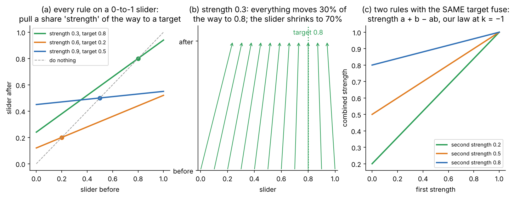
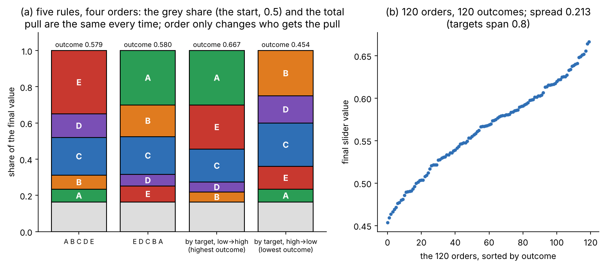
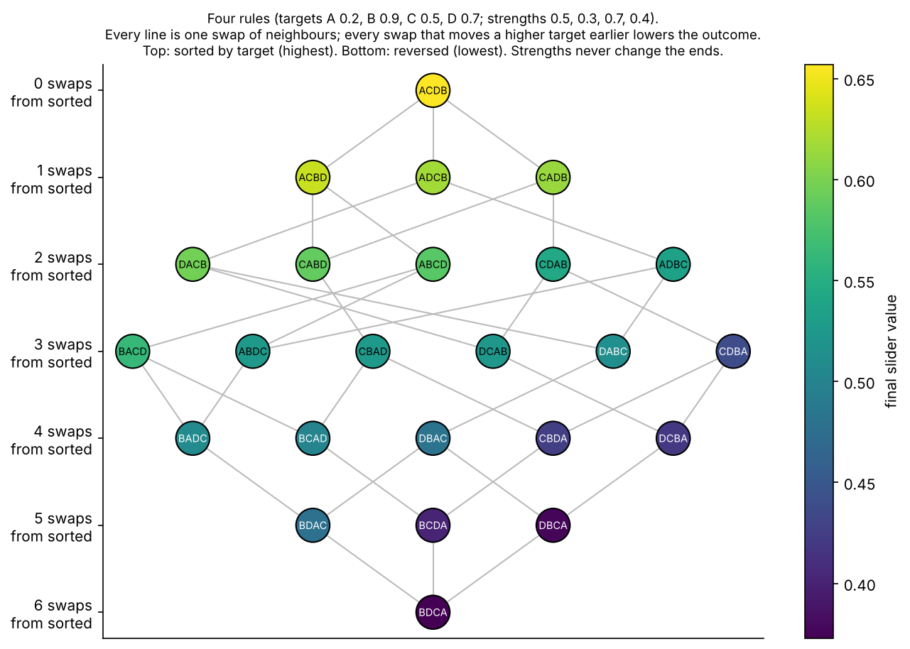
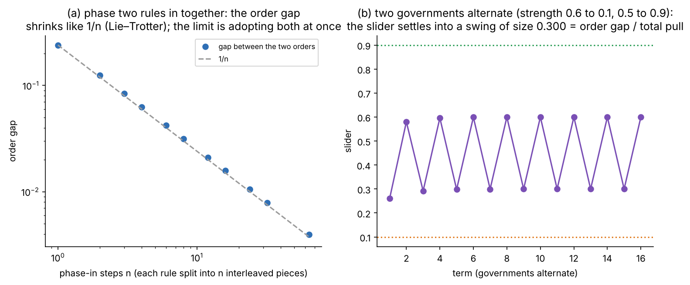
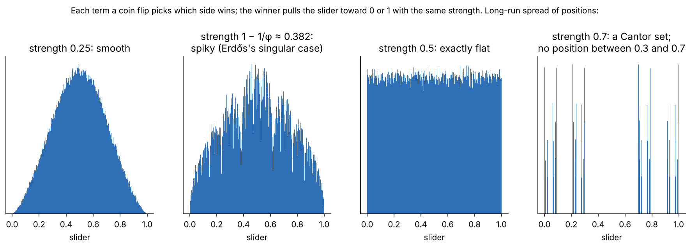
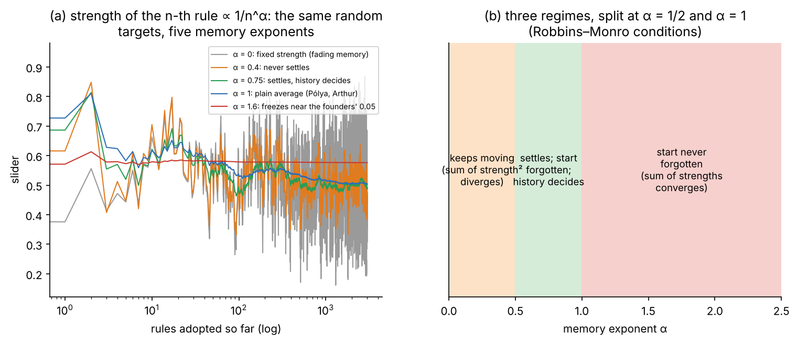
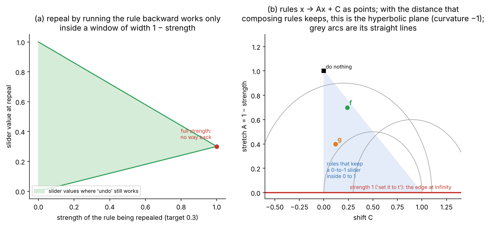
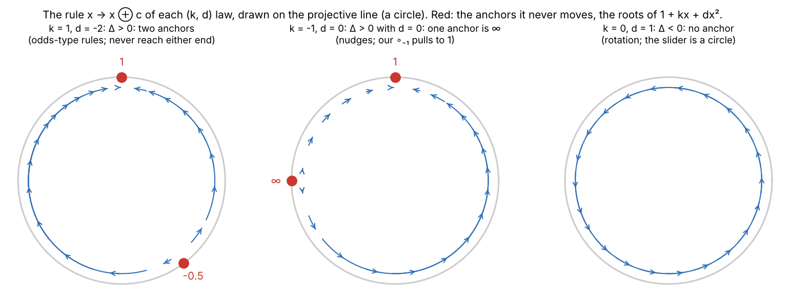

# History in Rulecraft: what the model does when rules come one at a time (DRAFT)

**DRAFT, 26 Nov 2026.** Part of Affine Composition Theory (repo: fused-hyperoperation-algebra). Follows up lead F2 of [`closed-leads-fresh-look/`](../closed-leads-fresh-look/README.md). Checks:
[`checks.py`](checks.py) (24 of 24 pass, [output](checks_output.txt)); polishing pass [`polish.py`](polish.py) (4 of 4,
[output](polish_output.txt)); pictures [`figures.py`](figures.py).

**What Rulecraft is, for this page.** Rulecraft is Brennan's book on designing who decides what. Its society model
describes a society by *sliders*: numeric settings on a 0-to-1 scale with labelled ends (categorical ones are mixes that
add to 1). Rules "nudge" settings (Riverton's congestion charge nudges *regulation*), and the book asks about
*decision gravity* ("institutions accumulate rules that shape later choices"), lock-in, sunsets, points of no return and
the thermostat. The old closure (`rulecraft/`) said "percent reforms on one quantity can never be path-dependent" and
"one-dimensional circle operation is flat" (called mult-add then). Brennan asked for a new kind of pass: play with the model and see what falls out.

**The short version.** On a 0-to-1 slider every rule is exactly two numbers, a **strength** and a **target**. Rules with
the same target fuse by our law at k = −1. Rules with different targets do not commute, and playing with that gives six
clean results. Four are the ones worth following:

1. **Order never changes how much the rules pull, only who gets the pull** (the split is stick-breaking).
2. **The best order is "sort by target", whatever the strengths**; outcomes fall in a ladder over the orders.
3. **A memory exponent α turns decision gravity into three regimes**, split at α = 1/2 and α = 1.
4. **The curvature reading Δ counts the anchors a family of rules respects**: two, one at infinity, or none.

The math under all of it is known (the affine group, stick-breaking, Robbins–Monro, Bernoulli convolutions, Möbius
maps). What is ours is the reading, and the fact that a society applying rules one at a time is running the same
recursion as stochastic gradient descent, so results from machine learning carry straight over to Rulecraft (section 7).

---

## 1. A rule is a strength and a target

**Fig 1.** (a) Three rules as maps from "slider before" to "slider after". Each crosses the dashed do-nothing line at its
target. (b) Strength 0.3 toward 0.8: every value moves 30% of the way to 0.8, so the whole slider shrinks to 70% of its
width. (c) Two rules with the same target combine to strength a + b − ab.

- A stretch-and-shift map x ↦ Ax + C with 0 < A < 1 that keeps a 0-to-1 slider inside 0 to 1 always has its centre
  inside the slider (H1, H1b). So F2's "stretch and shift" is, on a slider, exactly **x ↦ (1 − λ)x + λt**: strength
  λ = 1 − A, target t = the centre. Nothing is lost by writing every Rulecraft rule this way.
- **Same target: strengths fuse by a ∘₋₁ b = a + b − ab** (H2). This is our law at k = −1, and x ⊕ c at k = −1 *is* the
  nudge toward 1 with strength c (H17). The law's own logarithm, −ln(1 − λ), is a "dose" that simply adds.
- Full strength (λ = 1, "set it to t") is the absorbing element of ∘₋₁: anything fused with it stays at full strength.
  It is the old page's event horizon, seen from the k = −1 side.
- **Known versus ours.** Convex combinations and their composition are known. Ours: that every slider rule takes this
  form, and that the same-target family is our law at k = −1, the dial value of `named-functions/` (stick-breaking),
  `bridge-survey/` and the holographic entropy cone.

## 2. Order changes the split, never the total

**Fig 2.** (a) Five rules (targets 0.9, 0.1, 0.6, 0.3, 0.75) in four orders, starting at 0.5. The grey block, the share
of the starting value that survives, is the same in every order, and so is the coloured total. Only the sizes of the
coloured pieces change. (b) All 120 orders give 120 different outcomes, from 0.454 to 0.667.

- After rules 1, …, n, the slider is **(∏(1 − λᵢ))·start + Σ wᵢ tᵢ** with **wᵢ = λᵢ · ∏ over later rules (1 − λⱼ)** (H4a, H4b).
- The total Σ wᵢ is the ∘₋₁ fold of all the strengths, the same in every order (H4c). What order controls is only how
  that total is shared out among the targets.
- The shares are **stick-breaking read backward in time**: the last rule takes its λ of the stick, the one before takes
  its λ of what is left, and so on. Later rules get bigger pieces. That is Rulecraft's "history" with an exact size.
- **Known versus ours.** Stick-breaking (McCloskey 1965; Sethuraman 1994) and exponential smoothing (Brown 1956) are
  known. Ours: the statement "order changes the split, not the total" for rule sequences, and its tie to ∘₋₁.

## 3. The best order is "sort by target", and orders form a ladder

**Fig 3.** All 24 orders of four rules, arranged by how many neighbour swaps they are from "sorted by target, low to high".
Colour is the outcome. Every line goes downhill in colour.

- **Swapping two neighbouring rules moves the outcome by λ₁λ₂(t₂ − t₁)**, times the shrink of everything after them,
  whatever the slider's value (H3). The later rule gets the last word.
- The sign of that move depends only on the targets, never the strengths. So **the highest outcome comes from sorting
  rules by target, low to high; the lowest from the reverse; for any strengths** (H5a; polished at n = 6 with strengths
  from 0.001 to 0.999 and tied targets, P1).
- Stronger: the outcome falls strictly along every downward line in Fig 3 (H5b). In order-theory terms it is strictly
  monotone on the weak order of permutations, whose picture is the permutohedron already met in `boolean-lattice/` and
  `cube-weights/`.
- **How much order matters, at a glance:** to second order in the strengths, the order effect is
  **½ Σ over pairs λᵢλⱼ (t_later − t_earlier)** (H6), a weighted count of how far the order is from sorted. Small rules
  almost commute; the effect grows like strength squared. This is the commutator term of the Baker–Campbell–Hausdorff
  formula, the same term as the order dial's (`order-dial/`).
- **Known versus ours.** The exchange argument is the standard tool of scheduling (Smith 1956). Agenda power is well
  studied (Romer and Rosenthal 1978; Ali, Bernheim, Bloedel and Console Battilana, AER 2023, "Who controls the agenda
  controls the legislature"). The plain result "sort by target, strengths never matter for the ends" we did not find
  stated for policy sequences; it is very likely folklore. **Use for the book:** whoever sets the order of a reform
  package controls the outcome by up to the spread in Fig 2b, and the order that favours a side is simply "its target last".

## 4. Phasing in, and the pendulum

**Fig 4.** (a) Two rules each split into n interleaved pieces: the gap between the two orders falls like 1/n. (b) Two
governments alternate, one pulling to 0.1 with strength 0.6, the other to 0.9 with strength 0.5. The slider settles
into a fixed swing.

- **Phasing in kills order effects.** Interleaving n small pieces shrinks the order gap like 1/n (H7a), and the limit is
  adopting both at once: strengths add as rates, and the target is their rate-weighted average (H7b; 17 digits in P3).
  This is the Lie–Trotter product formula (Trotter 1959), already used in `why-i/`. It gives a sharp version of the
  "big bang versus gradualism" debate (Dewatripont and Roland, AER 1995): gradualism costs nothing in order effects only
  if the reforms are interleaved, not run one after the other.
- **The pendulum.** Two alternating rules end in a 2-cycle whose **swing = λ₁λ₂|t₁ − t₂| / (λ₁ ∘₋₁ λ₂)**: the order gap
  divided by the total pull (H8; P2). Equal strengths λ give λ|t₁ − t₂|/(2 − λ). Policy whiplash has a size.
- **Known versus ours.** Both are known mathematics (limit cycles of cyclic incremental methods; Trotter). The swing
  formula as a measure of policy whiplash is our reading.

## 5. The forbidden middle

**Fig 5.** Each term a coin flip decides which side wins, and the winner pulls toward 0 or 1 with the same strength.
The long-run spread of positions: smooth at 0.25, spiky at 1 − 1/φ ≈ 0.382, flat at 0.5, and a Cantor set at 0.7.

- The long-run spread is a Bernoulli convolution with ratio 1 − λ (definition; H9).
- **Strength above 1/2 leaves a forbidden middle.** No position strictly between 1 − λ and λ can ever occur (H9a, H9b):
  when each win pulls hard, the compromise positions are unreachable, at every level of detail (a Cantor set).
- Below 1/2 the positions fill in, but not always smoothly: at the golden-ratio strength 1 − 1/φ the spread is singular
  (Erdős 1939; cited, not proved here; H9c only shows the overlaps). Which strengths below 1/2 give smooth spreads is
  still a research question (Solomyak 1995; Hochman 2014; Varjú, JAMS 2019).
- **Known versus ours.** This exact model is known in opinion dynamics ("stubborn leaders"; Proskurnikov and Tempo's
  tutorial, arXiv 1801.06719; Cao and Cortez, SIAM J. Appl. Dyn. Syst. 2025) and in machine learning, where constant-step
  SGD on a 1-D quadratic has a Cantor-set spread (Camuto et al., arXiv 2106.04881). The `measure-probability/` page closed
  Bernoulli convolutions as "nothing beyond the generic product"; that stands for the algebra. Ours here is only the
  Rulecraft reading: hard-swinging alternation forbids the middle.

## 6. Decision gravity is a memory exponent

**Fig 6.** (a) The same 3000 random targets, applied with the n-th rule's strength ∝ 1/n^α for five values of α.
(b) The three regimes.

Fixed-strength rules have no gravity: a new rule moves the slider by λ(t − x) however much history came before. Gravity
needs rules to get weaker as the body of rules grows. Let **the n-th rule's strength be ∝ 1/n^α** ("mass" n only grows,
as the notes say of citations and age). Then:

| α | what happens | the book's word |
|---|---|---|
| 0 | fixed strength; the past fades geometrically | thermostat, no gravity |
| 0 < α ≤ 1/2 | keeps moving forever (Σλ² diverges) | drift |
| 1/2 < α ≤ 1 | settles; the starting value is forgotten; the early rules decide where | lock-in, path dependence |
| α > 1 | settles before reaching any target; the founders' setting keeps a fixed share | entrenchment |

- At α = 1 the slider is the plain average of every target so far (H13): the Pólya urn, which is W. Brian Arthur's 1989
  lock-in model, already cited in the book's notes.
- The surviving share of the start is ∏(1 − λₙ) = 1 − (∘₋₁ fold of all strengths); it goes to 0 exactly when Σλₙ
  diverges (H12, P4).
- **A sunset resets the count n**, so it is the one device that moves a society from lock-in back toward a thermostat.
- **Known versus ours.** The thresholds are the Robbins–Monro conditions (1951) of stochastic approximation; the urn is
  Pólya's. Ours: reading decision gravity as this exponent. A pending suggestion in the Rulecraft notes proposes testing
  decision gravity as "a hypothesis with unknown powers"; this gives that power two meaningful thresholds to test
  against. The letter α is Polyak and Juditsky's; it is not added to our dial list.

## 7. Repeal, the curved space of rules, and anchors

**Fig 7.** (a) Running a rule backward (its inverse) keeps the slider inside 0 to 1 only inside a window of width
1 − strength. (b) Rules x ↦ Ax + C as points of the upper half-plane; slider-keeping rules fill the blue triangle, and
full-strength rules sit on the edge at infinity.

- **Repeal is not undo.** Running rule i backward now gives the slider "as if rule i never happened" only if rule i is
  first moved to the end; the mismatch is the sum of its swap gaps with every later rule (H11). And running it backward
  stays on the slider only while the slider sits in [λt, 1 − λ(1 − t)], a window of width 1 − λ (H10). Strong rules
  close their window fast; at full strength there is no way back. This is the rewind tool: the backward flow pushes away
  from the target and hits an end of the slider in finite time.
- **The curved space.** In (dose, target) coordinates the metric that composing rules keeps is
  dD² + (t dD + (e^D − 1) dt)², curvature −1 (H14). Weak rules are all close to "do nothing" whatever their target;
  strong rules with different targets are exponentially far apart. (F2 named the hyperbolic plane; H14 checks it in the
  coordinates Rulecraft would use.)

**Fig 8.** The translations of three (k, d) laws on the projective line. Red dots are the points they never move.

- **The curvature reading counts anchors.** The rule x ↦ x ⊕ c of the (k, d) law fixes exactly the roots of
  1 + kx + dx² (H15): two anchors when Δ = k² − 4d > 0, one of them at infinity when d = 0 (our ∘ₖ nudges), none when
  Δ < 0. Rules sharing anchors commute; rules with different anchors do not (H16).
- So a slider whose rules are all "odds" moves between two fixed ends (Δ > 0, like Bayesian updates, which commute) has
  **no history at all**; history appears exactly when rules with different anchors are mixed. Δ < 0 rules have no anchor
  and cannot keep a bounded slider; they fit a slider that is a circle.
- **Known versus ours.** Möbius maps commute exactly when they share fixed points, and are sorted into hyperbolic,
  parabolic and elliptic by the same discriminant: textbook. Ours: that our curvature reading Δ is the anchor count,
  and what that means for a society's rules.

## 8. The bridge to machine learning

A nudge with strength λ toward t is one gradient step, with step size λ, on the loss ½(x − t)². So a society adopting
rules one at a time is running incremental gradient descent on its stakeholders' targets:

| Rulecraft | machine learning |
|---|---|
| rule = strength and target | one SGD step on one example |
| order effect ½ Σ λᵢλⱼ(t_later − t_earlier), second order in strength | the second-order term that backward error analysis finds for SGD with shuffled examples (Smith, Dherin, Barrett and De, ICLR 2021; the exact match of terms is not checked here) |
| adopt at once | full-batch gradient flow |
| memory exponent α | learning-rate schedule (Robbins–Monro) |
| forbidden middle | Cantor-set stationary law of constant-step SGD (Camuto et al. 2021) |
| pendulum | limit cycle of cyclic incremental gradient |

This is the "useful in other areas" result, though the traffic runs mostly the other way: Rulecraft can borrow a mature
toolbox for each of its questions about order.

## Verdict

**Opens a lead, mainly for the book; two readings are worth carrying into the theory.**

- For Rulecraft, sections 2, 3, 4 and 6 are directly usable: "order changes the split, not the total"; "sort by target";
  "phase in interleaved"; and decision gravity as a memory exponent with thresholds at 1/2 and 1, testable on the
  decision log the book already designs. They answer the old closure: percent reforms on one quantity commute, but any
  rule set that pulls toward different targets has history with a computable size.
- For the theory: the k = −1 law turns out to be the law of same-target rules (adding a third field to the k = −1
  cluster), and Δ gains a plain meaning as the number of anchors a family of rules respects.
- Not a lead: section 5 as mathematics (known, and the open problems there are hard and not ours); section 7's
  hyperbolic plane (known).

**Next steps, if wanted.** Two-slider rules, where a rule's target depends on another slider (coupling, Brennan's
central idea in architecture), which brings real holonomy; and fitting α to a real rule history (for example the
centralization slider of the United States that the notes already sketch).

## Records and corrections

- The old `rulecraft/` line "Percent reforms on one quantity can never be path-dependent; curvature needs more" is right
  for same-target rules only. Suggested correction: "Rules with the same target commute (they fuse by ∘₋₁); rules with
  different targets are path-dependent by λ₁λ₂(t₂ − t₁) per swap; see `rulecraft-history/`."
- "Decision gravity: one-dimensional circle operation is flat" stands for a single number, but the space of rules is curved
  (H14), and gravity has a one-number form (section 6).

## Sources

Brown, *Exponential smoothing for predicting demand* (1956). Erdős, "On a family of symmetric Bernoulli convolutions",
*Amer. J. Math.* (1939). McCloskey (1965) and Sethuraman (1994) on stick-breaking. Robbins and Monro (1951). Polyak and
Juditsky (1992). Arthur, "Competing technologies, increasing returns, and lock-in" (1989). Smith (1956) on sequencing.
Romer and Rosenthal (1978). Ali, Bernheim, Bloedel and Console Battilana, AER 113 (2023). Dewatripont and Roland, AER 85
(1995). Trotter (1959). Smith, Dherin, Barrett and De, "On the origin of implicit regularization in SGD", ICLR 2021
(arXiv 2101.12176). Camuto et al., "Fractal structure and generalization properties of stochastic optimization
algorithms", arXiv 2106.04881. Proskurnikov and Tempo, arXiv 1801.06719. Cao and Cortez, arXiv 2408.01624. Solomyak
(1995); Hochman (2014); Varjú, JAMS (2019).
