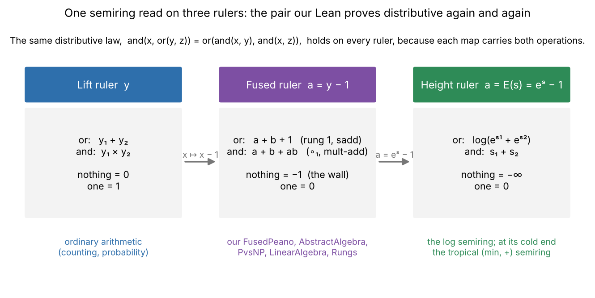
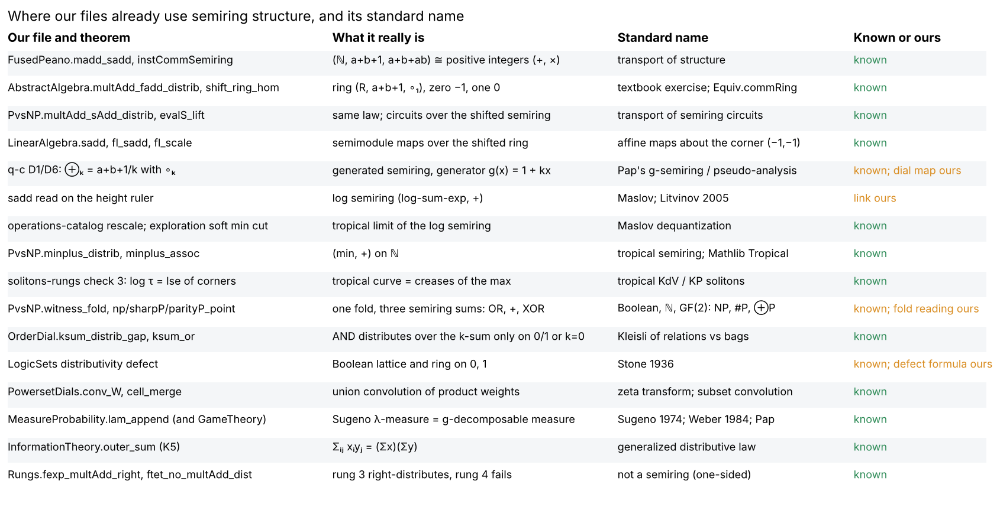
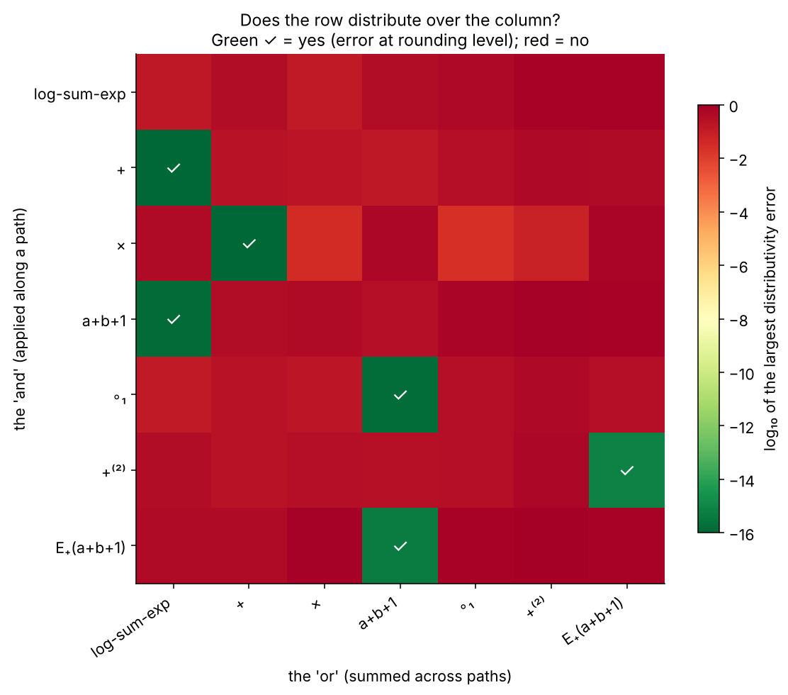
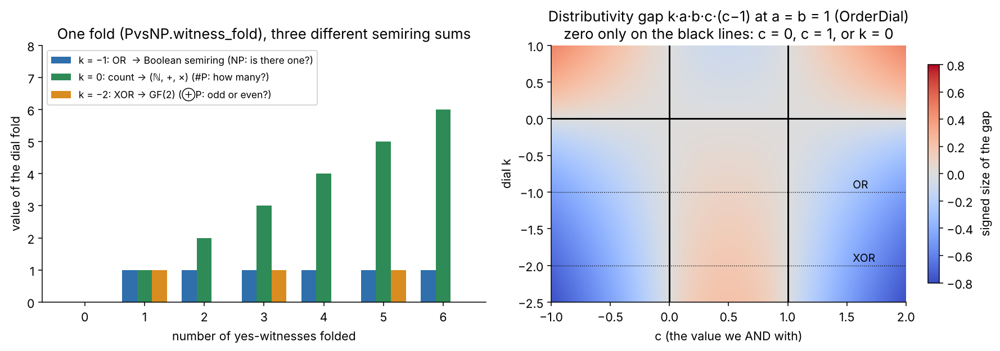
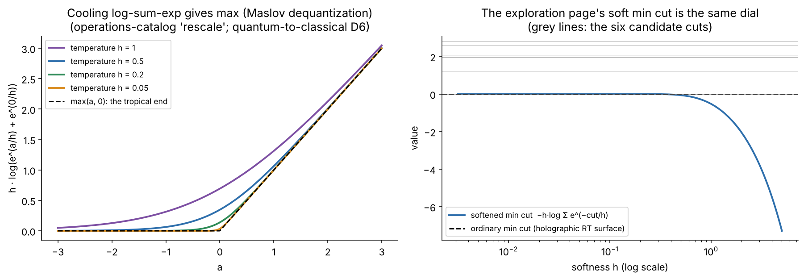

# DRAFT · Semiring audit: where our proofs already use semirings without naming them

Nov 25, 2026. Asked for by Brennan on a voice call: "do any of our proofs rely on these operations? ... we haven't
really talked about them as those operations. We've just used the composite or their component functions."
Checks: `checks.py` → `checks_output.txt`, **33/33 pass** (sympy, numpy). Pictures: `figures.py` → `figures/`.
Nothing in the Lean library was renamed or changed. Every rename below is a proposal. Pushed to the repo Nov 25 as a DRAFT; CI runs `checks.py`. Some Lean names below (such as `multAdd_…`, `madd_…`) are from before the 1.0 rename; [NAMING-COLLISIONS.md](../../NAMING-COLLISIONS.md) maps old names to new.

## The answer in plain words

Yes. About sixteen places in our Lean files and write-ups lean on semiring structure under our own names, and one
semiring does most of the work: **rung 1 (a + b + 1) as the "or" with the circle operation ∘₁ (called mult-add before 1.0) as the "and"**. That pair is
proved distributive in four separate files under four names (`madd_sadd`, `multAdd_fadd_distrib`,
`multAdd_sAdd_distrib`, `fl_sadd`), and it is ordinary (+, ×) seen through x ↦ 1 + x. Read on the height ruler
a = eˢ − 1, the same pair is the **log semiring** (log-sum-exp, +), whose cold end is the **tropical** (min, +)
semiring. So our rung 1, the quantum-to-classical partner ⊕ₖ, the operations catalog's "rescale" and the
exploration page's softened min cut are all one semiring family.

**Leads worth following, on their own merits:**
- **Pap's pseudo-analysis is existing work we can reuse (section 3).** ∘ₖ with its partner a + b + 1/k is exactly a
  *generated semiring* with generator g(x) = 1 + kx. That field already has integrals, derivatives and measures
  built on such pairs, and our Calculus and MeasureProbability files are special cases of it. This matters because
  Brennan prefers existing work over invented names; it gives us a literature to cite and borrow from.
- **Our height ladder differs from Bennett's in one clean way (section 4).** Bennett's exp ladder makes every
  neighbouring pair of rungs a semiring. Ours (climbing by E = eˣ − 1) does not, but every rung +⁽ˢ⁾ has a semiring
  partner, (Eˢ)₊(log-sum-exp). That is a small, true, checkable statement for the 1.0 write-up. It is transport of
  structure, so it is not new physics.

Everything else here is a renaming: the math is known, and the gain is that we can talk about it in standard words.

## 1. One semiring on three rulers

- **Lift ruler y** (y = 1 + a): plain (+, ×). Counting and probability.
- **Fused ruler a**: "or" is a + b + 1, "and" is ∘₁. Its zero ("nothing", absorbing under ∘₁) is the wall −1; its
  one is 0 (checks S1–S4). This is the ring our `AbstractAlgebra` section 5 builds and calls "the fused rung pair".
- **Height ruler s** (a = eˢ − 1): "or" becomes log(eˢ¹ + eˢ²) and "and" becomes + (checks H1–H4). That is the
  log semiring. Cooling it, h·log(e^(a/h) + e^(b/h)) → max, is Maslov dequantization (H5).
- The circle operation does **not** distribute over plain + (S5, `multAdd_not_distrib_add`). Its partner is always the
  shifted add, never +.
- *Known:* all of it. The shifted ring is a common textbook exercise ("show a ⊕ b = a + b + 1, a ⊙ b = a + b + ab
  makes ℤ a ring"); the log semiring and dequantization are Litvinov and Maslov's idempotent mathematics.
  *Ours:* noticing that our rung 1 is the log semiring's "or" on the height ruler.

## 2. The map: each hit, what it really is, and its standard name

| Our file · theorem | What it really is | Standard name and source |
|---|---|---|
| `Foundations/FusedPeano` · `madd_sadd`, `madd_assoc`, `instCommSemiring` | (ℕ, a+b+1, a+b+ab) is the positive integers (ℕ⁺, +, ×) moved by x ↦ x − 1; ⊞ has no zero inside ℕ | transport of structure; Mathlib `Equiv.commSemiring` (the port already uses this route) |
| `Topics/AbstractAlgebra` · `fadd_group`, `multAdd_fadd_distrib`, `fused_zero_absorbs`, `shift_ring_hom` | the commutative ring (R, a+b+1, ∘₁), zero −1, one 0, isomorphic to (R, +, ×) | transport of structure; Mathlib `Equiv.commRing` (port: `Fused.instCommRing`) |
| `Topics/PvsNP` · `sAdd_lift`, `multAdd_sAdd_distrib`, `evalS_lift`, `eval_from_shift`, `shifted_identities` | the same ring, used to move arithmetic circuits gate for gate | circuits over an isomorphic semiring (no size change); transport |
| `Topics/LinearAlgebra` · `sadd`, `fl_sadd`, `fl_scale`, `multAdd_is_zoom` | linear maps of the shifted ring (semimodule maps), i.e. linear maps about the corner (−1, −1) | conjugation of linear maps by a translation |
| `quantum-to-classical` D1, D6 · ⊕ₖ = a+b+1/k with ∘ₖ | a generated semiring with generator g(x) = 1 + kx | Pap's g-semiring, pseudo-analysis (section 3) |
| rung 1 read on the height ruler (this audit, H2) | log semiring (log-sum-exp, +) | Maslov; Litvinov 2005 |
| `operations-catalog` row 13 "rescale"; `exploration` part 2b soft min cut; `rung-shape` tropical floor | the tropical limit of the log semiring | Maslov dequantization; tropical semiring |
| `Topics/PvsNP` · `minplus_distrib`, `minplus_assoc` | (min, +) on ℕ | tropical semiring; Mathlib `Tropical` |
| `solitons-rungs` check 3 · log τ = log-sum-exp of corner heights | the soliton creases are a tropical curve | ultradiscretization (Tokihiro, Takahashi, Matsukidaira, Satsuma 1996), tropical KdV/KP |
| `Topics/PvsNP` · `witness_fold`, `np_point`, `sharpP_point`, `parityP_point`, `modp_period` | one fold that is the "or" of three different semirings on 0/1 inputs | Boolean semiring (NP), (ℕ, +, ×) (#P), GF(2) (⊕P): semiring-valued counting classes |
| `Topics/OrderDial` · `ksum_distrib_gap`, `ksum_zero`, `ksum_or`, `ksum_not_distrib` | AND distributes over the k-sum only on 0/1 values or at k = 0 | relations vs bags: matrices over the Boolean semiring vs over ℕ (Kleisli categories of the powerset and multiset monads) |
| `Topics/LogicSets` · idempotent defect, distributivity defect k·abc(1 − a) | the Boolean lattice (k = −1) and Boolean ring (k = −2) as the idempotent points of the dial | Boolean algebras and rings, Stone 1936 |
| `Topics/PowersetDials` · `conv_W`, `cell_merge`; Combinatorics · `painted_subsets` | sum over subsets of products = ∏(1 + t); union convolution of product weights | the distributive law (factorization); subset (union) convolution and the zeta transform |
| `Topics/MeasureProbability` · `lam_append`, `lam_lift`; `GameTheory.dial_game_union` | Sugeno λ-measure: μ(A ∪ B) = μA ∘λ μB | g-decomposable (pseudo-additive) measure; Sugeno 1974, Weber 1984, Pap |
| `Topics/InformationTheory` · `outer_sum` (K5), `outer_shan` (K6) | Σᵢⱼ xᵢyⱼ = (Σx)(Σy) | the generalized distributive law (Aji and McEliece 2000) |
| `Rungs` · `fexp_multAdd_right`, `fexp_tower`, `ftet_no_multAdd_dist` | rung 3 distributes over the circle operation on one side only, and rung 4 does not at all | not a semiring (exponentiation is one-sided); known |

False alarms I checked and left out: `Clifford`'s θ and `NumberPlane`'s unit are idempotent *elements* of an
algebra, not idempotent semirings; `ChemElectro`'s Luther mean is an idempotent operation with no partner;
`OrderDial`'s dictionary merge is a band (idempotent semigroup), not a semiring.

## 3. ∘ₖ with its partner is a generated semiring (Pap's pseudo-analysis)

- The generator g(x) = 1 + kx makes a ∘ₖ b = g⁻¹(g(a)·g(b)) and a ⊕ₖ b = g⁻¹(g(a) + g(b)) = a + b + 1/k
  (checks G1, G2). Distributivity at every k is then automatic (G3), and at k = 1 the partner is our rung 1 (G4).
- In fuzzy-measure theory this is called a **g-semiring** or **generated pseudo-operations**, and the analysis built
  on it is **pseudo-analysis** or **g-calculus** (E. Pap, from 1993; Mesiar and Pap). A measure that is additive for a
  pseudo-addition is a **decomposable measure** (Weber 1984). Sugeno's λ-measure is one (checks M1, M2), which is
  exactly what our `MeasureProbability` section 1 proves.
- Maslov dequantization is the limit of the generated semirings with g = e^(x/h) as h → 0. So the quantum-to-classical
  dial plane, our rung 1, and the tropical end all live in one existing framework.
- The names review already found Pap's field (`names-review/THEORY-NAME.md`) and rightly rejected "pseudo-analysis"
  as a *theory name* because it overclaims. As a *citation* for the semiring, it is the right one.
- *Known:* all of section 3. *Ours:* placing the one-dial family ∘ₖ inside it, and the dial-plane picture (already on
  the quantum-to-classical page).

## 4. Two ladders: Bennett's and ours

- Bennett (1915) climbs by exp: log-sum-exp, +, ×, a^(log b), … and each rung distributes over the one below
  (checks L1–L3). His rung below + is log-sum-exp.
- We climb by E = eˣ − 1, so that 0 stays the identity at every height. The price: +⁽¹⁾ = ∘₁ does not distribute
  over +, and +⁽²⁾ does not distribute over ∘₁ (L4, L5).
- What survives: every +⁽ˢ⁾ has a semiring partner, namely log-sum-exp carried up s rungs, (Eˢ)₊(log-sum-exp). At
  s = 1 that is our rung 1, a + b + 1; at s = 2 it is E₊(a + b + 1), and +⁽²⁾ distributes over it to rounding (L6).
- So "rung 1 = a + b + 1" in `Rungs.lean` and "addition at height 1 = ∘₁" in the catalog are the two halves of the
  height-1 semiring.

- The grid tests every pair of the seven operations numerically. The ticks are exactly the semiring pairs above, plus
  two pairs that are the same law one rung lower (a + b + 1 over log-sum-exp, and E₊(a + b + 1) over a + b + 1).
- *Known:* Bennett 1915; conjugation. *Ours:* the partner family (Eˢ)₊(log-sum-exp), and the contrast with Bennett.

## 5. The witness fold: one formula, three semirings

- `PvsNP.witness_fold` folds ∘ₖ over yes/no witnesses. On 0/1 inputs the fold is the "or" of a different semiring at
  each setting: OR (Boolean, the NP question), + (ℕ, #P), XOR (GF(2), ⊕P) (check W1).
- `OrderDial.ksum_distrib_gap` shows why it only works on 0/1: AND misses distributing over the k-sum by
  k·a·b·c·(c − 1) (W2, W3). That gap is zero only at c ∈ {0, 1} or k = 0.
- *Known:* the counting classes as semiring sums over witnesses (the semiring view of NP, #P and ⊕P is standard in
  algebraic complexity; e.g. Damm, Holzer and McKenzie 2002). *Ours:* reading the three as settings of one dial.

## 6. The tropical end, twice

- The catalog's "rescale" limit and the exploration page's soft min cut are the same move: cool the log semiring to
  the tropical one (H5, C1). The holographic min cut is a tropical sum over cuts; the soft-min lead in `exploration/`
  is a statement about the log semiring at finite temperature.
- `solitons-rungs` check 3 is the same picture again: log τ is a log-sum-exp of the corner heights and stays within
  log 4 of their max (T2), so the soliton paths are the creases of a tropical curve. The standard name for that limit
  is **ultradiscretization** (it turns KdV into the box-ball system).
- *Known:* all of it.

## 7. Mathlib: what already exists and what our Lean could reuse

| Structure | In Mathlib? | Reuse in our Lean |
|---|---|---|
| Circle operation monoid y + x + xy | **Yes**: `PreQuasiregular R` (file `Mathlib/Algebra/Algebra/Quasispectrum`) | already used by our Mathlib port for ∘₁ (per `mathlib-port-check/FusedAlgebra.Base.md`) |
| The shifted ring (R, a+b+1, ∘₁) | No named type; built by **transport**, `Equiv.commRing` / `Equiv.commSemiring` (`Mathlib/Algebra/Ring/TransferInstance`) | already used by the port (`Fused.instCommRing`; FusedPeano's semiring via `Equiv.commSemiring`) |
| Tropical (min, +) semiring | **Yes**: `Tropical R`, `Semiring (Tropical R)` (`Mathlib/Algebra/Tropical/Basic`); max-plus via `OrderDual` | `PvsNP.minplus_distrib` is `left_distrib` in `Tropical (WithTop ℕ)` (ℕ needs `WithTop` for the zero) |
| General-k partner a + b + 1/k with ∘ₖ | No; would be `Equiv.commRing` along x ↦ 1 + kx on a field, k ≠ 0 | a few lines in the port; one definition covers every k |
| Log semiring (log-sum-exp, +) | **Not found** in a web search for `logSumExp` in Mathlib; I could not search the Mathlib source from here, so treat as unverified | would be a type synonym over ℝ ∪ {−∞}, transported from `ℝ≥0` (+, ×) by exp; a candidate Mathlib contribution later, not now |
| Boolean semiring, GF(2) | Yes: `Bool` and `ZMod 2` | `witness_fold` could state its three points as semiring homomorphisms out of ℕ |

No Lean was changed. The core library (no Mathlib) keeps its own definitions, as it should; the reuse above is for the
Mathlib port.

## 8. Proposed renames, aliases and doc notes (not applied; Brennan approves first)

1. **One shifted add, not five.** `Rungs.sadd`, `FusedPeano.sadd` (a class field), `AbstractAlgebra.fadd`,
   `PvsNP.sAdd` and `LinearAlgebra.sadd` are the same a + b + 1. Proposal: one definition in `Base` (keep the name
   `sadd`, since it is already the most used), with the others as aliases, and a docstring: "rung 1; the semiring
   partner of ∘₁; transport of + by x ↦ 1 + x; on the height ruler a = eˢ − 1 it is log-sum-exp."
2. **One distributive law, not four.** `madd_sadd`, `multAdd_fadd_distrib`, `multAdd_sAdd_distrib` and `fl_sadd`'s
   underlying identity become one `Base` lemma (say `multAdd_sadd_distrib`) with the old names kept as aliases, so no
   proof breaks.
3. **The general-k partner in Lean.** Add `wPartner k a b = a + b + 1/k` on fields with its semiring laws, docstring
   "Pap's pseudo-addition for generator g(x) = 1 + kx". This is a new definition, not a new name for an old thing.
   No standard short name exists for it, so I have not coined one; the docstring carries the standard words.
4. **Doc notes only (no renames):**
   - `PvsNP` section 5: "the tropical semiring (Mathlib `Tropical`)".
   - `OrderDial` section 6: "relations vs bags: matrices over the Boolean semiring vs ℕ".
   - `PowersetDials.conv_W`: "union (subset) convolution; the zeta transform makes it pointwise".
   - `MeasureProbability` section 1: "a g-decomposable measure (Weber 1984; Pap)".
   - `InformationTheory` K5: "the generalized distributive law".
   - `solitons-rungs` check 3: "ultradiscretization".
5. **Write-ups:** add a short "Semirings we use" box to the README's "Where it unifies" list, pointing here, once
   Brennan has read this.

## Known work used

A. A. Bennett, "Note on an operation of the third grade", Annals of Math. 17 (1915) 74–75 (already checked on the
operations-catalog page). Maslov and Litvinov, idempotent mathematics (G. L. Litvinov, "Maslov dequantization,
idempotent and tropical mathematics: a brief introduction", 2005). E. Pap, g-calculus (1993) and "Pseudo-additive
measures and their applications" (Handbook of Measure Theory, 2002); R. Mesiar and E. Pap. S. Weber,
"⊥-decomposable measures and integrals for Archimedean t-conorms", J. Math. Anal. Appl. 101 (1984). M. Sugeno (1974).
M. H. Stone (1936). J. S. Golan, *Semirings and their Applications* (1999). Gondran and Minoux, *Graphs, Dioids and
Semirings* (2008). S. M. Aji and R. J. McEliece, "The generalized distributive law", IEEE Trans. Inf. Theory 46 (2000).
Björklund, Husfeldt, Kaski and Koivisto, "Fourier meets Möbius: fast subset convolution", STOC 2007. Damm, Holzer and
McKenzie, "The complexity of tensor calculus", Comput. Complexity 11 (2002). Tokihiro, Takahashi, Matsukidaira and
Satsuma, ultradiscretization of soliton systems, Phys. Rev. Lett. 76 (1996). Green, Karvounarakis and Tannen,
"Provenance semirings", PODS 2007. Mathlib pages: `Mathlib/Algebra/Tropical/Basic`,
`Mathlib/Algebra/Algebra/Quasispectrum`, `Mathlib/Algebra/Ring/TransferInstance` (found by web search, Nov 25).
Citations other than Bennett and the Mathlib pages are from memory; check before any paper.

## Files

- `checks.py` → `checks_output.txt` (33/33)
- `figures.py` → `figures/fig1` … `fig6`
