# Shape-dial survey: which proved laws slide into one another (DRAFT)

**DRAFT, Nov 26 2026.** Part of Affine Composition Theory (repo: fused-hyperoperation-algebra).
Asked for by Brennan: "a survey of all of our laws that we've proven to see if the shape dial is able to move from one to
another, not just these 2, but really all of them." Then: "add a polishing step to all of our methods, as long as it
doesn't take too much effort from the computer."
Builds on `simplex/` (section 7, the round-to-triangle dial) and `polar-recast/` (the right shape for each family) and does
not repeat them. Checks: `checks.py` → `checks_output.txt`, **46 of 46 pass** (numpy, scipy, mpmath), including 6 polish
checks that cost **1.3 seconds in all**. The new-law pass (asked for next: "check all laws using the shape dial to see if
a new law emerges and what it might be for", using the smooth-to-angular switch too) is `new_laws.py` →
`new_laws.json`, **9 of 9 pass**, pictures from `figures_new.py`. Law list: `laws.py` → `laws.json`. Pictures: `figures.py` → `figures/`.
No new Lean in this pass. Colour key: **blue = our reading, orange = already known, grey = the cube end.**

## The result

I sorted everything the Lean library and the pages have proved into **49 law groups**. With the plane dial (k, d) held
still and only the shape slid:

- **17 groups slide into another proved law.** For 15 the link is checked exactly or to machine precision; for 2 the
  numbers slide but the law in the middle isn't proved yet.
- **6 groups only look like they slide.** For laws that are a sum over outcomes, moving from the cube to the simplex is
  the same thing as turning k from 1 to 0, so the shape dial adds nothing there.
- **1 group, Lee–Yang, survives on part of the dial** (the round and cube side) and **breaks** near the
  cross-polytope.
- **1 group is the shape dial itself** (corner weights and power-set dials).
- **24 groups don't slide**, either because they are plane-dial laws (rungs, calculus, conics, elliptic curves, Maxwell)
  or because they don't depend on a shape at all.

The strongest leads, in order:

1. **Bell's bound (C2).** One formula, CHSH = 2^(1 + max(1/p, 1 − 1/p)), runs along the roundness dial: 4 at the
   cross-polytope, Tsirelson's 2√2 at the sphere, 4 again at the cube. The classical value 2 sits on the simplex end.
   This is the cleanest slide in the survey. In print, the polygon version is Janotta et al. (2011) and our numbers
   match theirs; the continuous family and its closed form weren't found.
2. **Relativity ↔ Bayes (C1).** Of all the shapes on the dial, only the triangle (Bayes) and the disk (relativity) can
   move their centre anywhere and keep their shape. Everything between them can't. So the two laws are the only two
   "homogeneous" stops, and the dial between them is the turn-fading route from `simplex/` section 7.
3. **The genus slide (C5).** Hirzebruch's two-parameter genus is our plane dial, and the shape picks the polynomial:
   q-numbers on the simplex, binomials on the cube, Eulerian numbers on the permutohedron, Narayana numbers on the
   associahedron. Tidy, and mostly known.
4. **Fermat on the dial (C8).** Fermat's curves are the p-circles at whole-number p. Sliding p gives every rational
   point (p = 1), a thin dense set (p = 2), only the 4 trivial points (p = 3 and 4, both in our Lean), then every point
   again (p = ∞).
5. **The swap rule → corner counting (C7).** The sphere's spread-out curvature gathers into the 8 cube corners or the 6
   octahedron corners as you slide, with the total fixed at 4π.

**New laws at the in-between shapes (section N, added Nov 26).** Three laws appear only at the in-between settings, and all
three come from the smooth-to-angular switch (the roundness dial p). The round-to-triangle dial and the corner-weight
dial gave none of their own. The strongest is **Lee–Yang holds for a spin uniform in an n-dimensional p-ball exactly
when n ≤ 1 + p²** (always, at even whole p), which I didn't find in print. Asked next to prove it: the breaking half is
proved, and the holding half is proved for n ≤ p + 1 at every p, for the ball, and for p = 4 at whole a; the rest of
the holding half is still open (section N3, proof). A step identity then showed that Lee–Yang passes from a + 1 down to a
at every p, so for p ≥ 2 the open part is only the strip p − 1 < a ≤ p (section N3, step identity).
That strip is now a finite check for each p, by comparing with the ball and peeling one shell. It passes at
p = 2.5, 3, 5 and 7, but a proof for every p at once is still missing (section N3, top strip). Lobe growth at every a ≤ p
would close it, and that is now proved far out for every p, with the same kink constant as the ball comparison; an
explicit radius is still missing (section N3, lobe law). At p = 3 the gap is closed: Lee–Yang is proved, computer-assisted, for every a ≤ 3 (n ≤ 10), so the
rule is a theorem there (section N3, p = 3). Its constants are now whole numbers (section N3, p = 3 constants). A refactor puts every proof on
one Lean core, so the rule at any p follows from one alternation statement. The far-out half of that statement looks uniform
in p, and the near half is still per p (section N3, refactor). The far-out half is now proved for every roundness from 1.1
to 8, with explicit formulas in p, past a point that grows like p² (section N3, far bounds). With the near zone boxed
for 1.1 ≤ p ≤ 5, **the rule is now proved, computer-assisted, for every roundness from 1.1 to 5**, apart from
non-whole a > 4 at p = 4 (section N3, near zone). The other two are **Bell's 2√2 is a floor for
every symmetric shape** (it follows from a known 1990 Banach-space theorem) and **Fermat for every rational roundness**
(a short corollary of Fermat's last theorem).

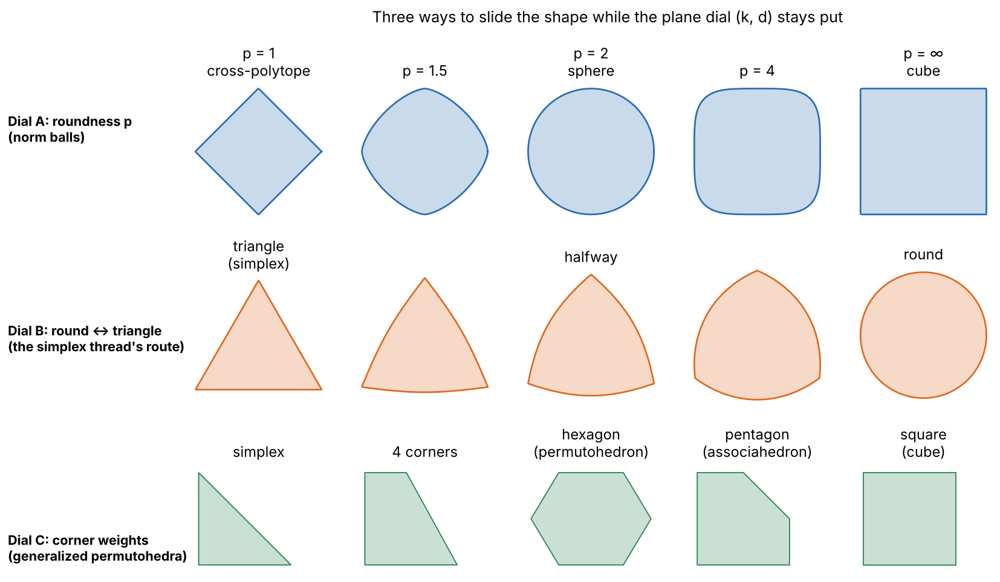

*Figure 0. Three ways to slide the shape with (k, d) fixed. Dial A is roundness p (cross-polytope at p = 1, sphere at
p = 2, cube at p = ∞). Dial B is round ↔ triangle, the route in `simplex/` section 7. Dial C is corner weights
(simplex, associahedron, permutohedron, cube). Each candidate below uses whichever dial its law actually lives on.*

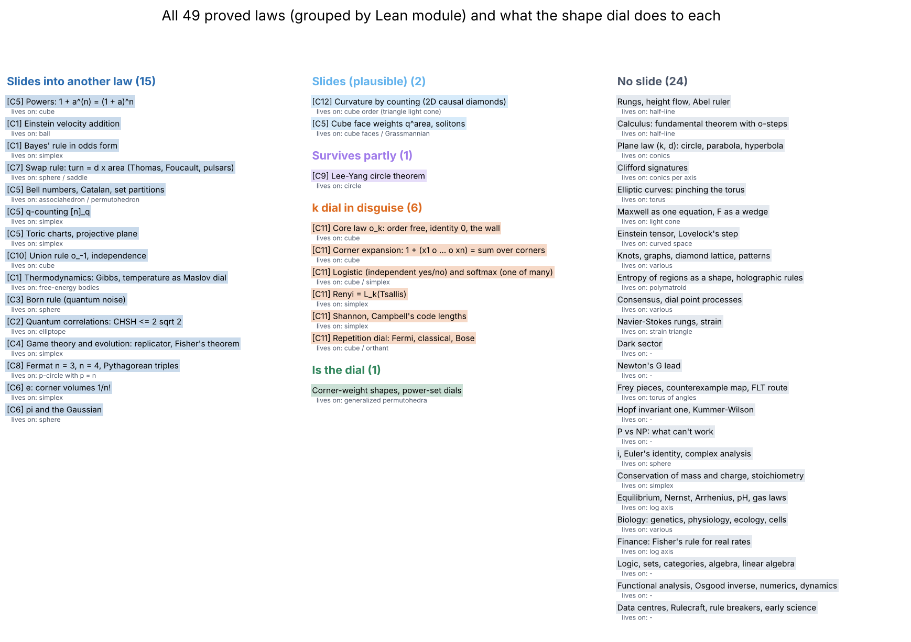

*Figure 12. All 49 groups, sorted by verdict.*

---

## How I tested a slide

For each law I took the shape its proof really uses (the `polar-recast/` table), held (k, d) fixed, and moved only the
shape along one of the three dials. A link counts as **slides** when both ends are proved laws and the quantity that
carries one into the other is checked along the whole path, exactly where a closed form exists. **Plausible** means the
numbers slide but nothing proves the law in the middle. A shape move that turns out to be a change of k is marked as
the **k dial in disguise**.

One tool shows up everywhere: the p-norm at roundness p is the soft maximum at temperature 1/p (check M1, error
9e-16). So sliding toward the cube is cooling toward a hard maximum, which is why several laws below end in a max.

---

## C1. Relativity (ball) ↔ Bayes (triangle) ↔ the cube's causal order — slides

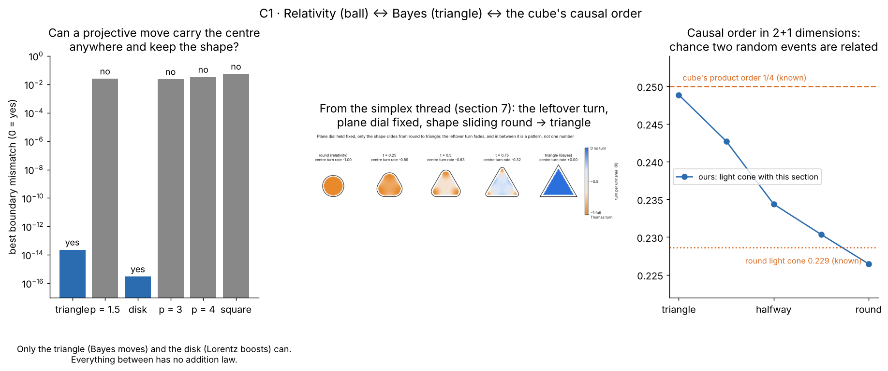

*Figure 1. Left: after moving the centre, only the triangle and the disk come back to their own shape (mismatch
2e-14 and 3e-16); p = 1.5, 3, 4 and the square stay off by 0.02 to 0.05. Middle: the turn map from `simplex/` section 7
as the shape slides. Right: the fraction of ordered pairs in a causal diamond, sliding the light cone from triangle to
disk.*

- **Known (orange):** in one dimension a coin's odds multiply exactly as relativity adds speeds (0.5c ⊕ 0.6c = 0.846c,
  odds 3 × 4 = 12; check B1). The disk with Hilbert's distance is relativity's velocity space; the triangle is flat.
- **Ours (blue):** on the roundness and round-triangle dials, **only these two stops have a centre you can move
  anywhere** (checks B2, B3). So relativity and Bayes are the two homogeneous ends, and every shape between them has a
  preferred centre. Thermodynamics joins through check M1: cooling is sliding the roundness toward the cube, so the
  Gibbs law rides the same dial (the simplex page's cooling route).
- **Causal order (C12, plausible):** a triangle-shaped light cone gives the cube's product order, ordering fraction
  1/4 (0.249 measured). Sliding to the round cone it falls smoothly to Myrheim–Meyer's 0.2286 (0.226 measured,
  error bar ±0.003). The curved-space page's "curvature by counting" therefore slides from cube counting to round
  counting, but the law in between isn't proved.
- **Verdict: worth following.** It says which shapes can carry a "boost" at all, and the answer is just these two.

## C2. Bell's bound along the roundness dial — slides

*Figure 2. CHSH with Alice's measurements in the p-ball and Bob's in its dual. Left: the formula against the numbers.
Middle: even polygons. Right: the segment (one classical bit, the 1-D simplex) gives 2.*

- **Known:** 2 (classical), 2√2 (Tsirelson, quantum), 4 (the PR box).
- **Ours:** all three are one curve, **CHSH(p) = 2^(1 + max(1/p, 1 − 1/p))**, matching the optimiser to 4e-16 at
  p = 1.25, 1.5, 2, 3, 4, 8 (checks C1–C3). Polygons: square 4, hexagon 3, every multiple of 8 sides exactly 2√2, the
  others a little above and tending to 2√2 (check C5).
- **In print (checked Nov 26):** known in part.
  - The three stops (2, 2√2, 4) are textbook.
  - The polygon family is Janotta, Gogolin, Barrett and Brunner, New J. Phys. 13, 063024 (2011). Our polygon numbers
    match their table: every multiple of 8 sides gives exactly 2√2, and 4 mod 8 gives 2√2·sec(π/n) (4 for the square,
    2.928 for n = 12, as here). They also show odd polygons stay below 2√2 and even ones reach or pass it.
  - The general link between this bound and how incompatible two measurements can be is Banik et al. (2013) and Stevens
    and Busch (2014); Bluhm, Jenčová and Nechita (2022) compute that incompatibility as a ratio of tensor norms and give
    exact values for the disk and the cube, but only bounds for the cross-polytope.
  - **Found on the second pass:** the closed form is twice the **James constant** of ℓp, J(ℓp) = max(2^(1/p), 2^(1 − 1/p))
    (Gao and Lau, 1990, from Clarkson's inequalities). So the formula is known as a fact about norms; what I didn't find
    in print is the step that makes it a Bell bound (section N1).
  - **Not found in print:** the continuous roundness family read as Bell scores. One unreviewed
    preprint on ResearchGate has "Tsirelson bounds in ℓp" in its title, but it wouldn't open, and the formula quoted
    from it gives 2 rather than 4 at p = 1, so it looks like a different setup.
  - One difference in setup: Janotta et al. use the polygon's own entangled state; here Alice measures in the shape and
    Bob in its dual. The two agree on every even polygon we compared.
- **Verdict: the strongest lead.** It ties the quantum bound to the sphere's place on the dial: 2√2 is the minimum
  along the dial, and the sphere is the only point that reaches it.

## C3. Quantum (sphere) ↔ classical probability (simplex) — slides, with two stops only

*Figure 3. Squaring carries the sphere onto the simplex (the Born rule). A smooth family of norm-keeping maps exists
only at p = 2 (rotations) and at p = 1 for positive vectors (stochastic maps).*

- **Known:** the Born rule is "square the amplitudes"; Aaronson (2004) showed only p = 1 and p = 2 have enough
  norm-keeping maps.
- **Ours:** checked along the whole dial (checks D1–D3): the mismatch is 1e-16 at the two stops and 0.007 to 0.035
  everywhere else. So the slide from quantum to classical is a jump between two stops, not a path.
- **Verdict: confirms known structure.** It explains why C2's classical end sits on the simplex.

## C4. Evolution (simplex) ↔ ground-state seeking (sphere) — slides

*Figure 4. The replicator equation, read through square roots, is normalised imaginary-time Schrödinger evolution with
energy = −fitness/2.*

- **Known:** this correspondence appears in the literature on replicator dynamics.
- **Ours:** checked to 1e-12 (E1), and Fisher's fundamental theorem (mean fitness rises at the rate of its variance)
  becomes the energy-drop rule d⟨H⟩/dt = −2 Var(H) (E2). Our Lean's game-theory and evolution laws slide onto quantum
  cooling through the same Born step as C3.
- **Verdict: solid, mostly known.** Useful as a bridge between the biology and quantum modules.

## C5. One genus, the shape picks the polynomial — slides

*Figure 5. Hirzebruch's genus with 1 + kx + dx² = (1 + αx)(1 + βx) and q = β/α, read on four shapes.*

- **Known:** h-vectors of toric shapes (Danilov, Stanley): simplex [n]_q, cube (1 + q)ⁿ, permutohedron Eulerian,
  associahedron Narayana (checks F1, F2).
- **Ours:** at our core law (d = 0, so q = 0) every shape gives 1, so the shape dial does nothing there (F3). At the
  Euler point (q = 1) it counts corners: 4, 8, 24, 14 (F4). Our q-counting, powers, Bell/Catalan and toric-chart laws
  are four readings of one formula. Cube face weights q^area (solitons) look like the same slide but aren't proved
  (plausible).
- **Verdict: tidy, mostly known.** It's a good organising page for those modules more than a new result.

## C6. e and π are two readings of one function — slides

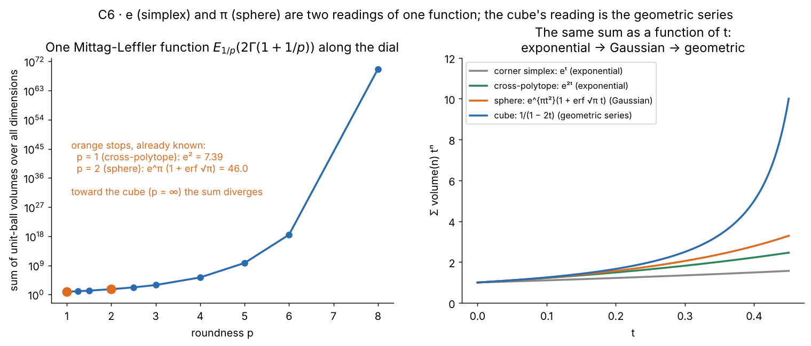

*Figure 6. Left: the sum of unit-ball volumes over all dimensions along the dial. Right: the same sum as a function of t.*

- **Known:** volumes (2Γ(1 + 1/p))ⁿ / Γ(1 + n/p) (G1); corner simplex 1/n! sums to e; the ball's sum is e^π(1 + erf √π)
  = 46.0 (G3).
- **Ours:** every p is one Mittag-Leffler function, E_{1/p}(2Γ(1 + 1/p)) (G4): e² at the cross-polytope, the e^π
  formula at the sphere, and toward the cube it becomes the geometric series 1/(1 − 2t) and diverges (G5).
- **Verdict: a nice picture, modest lead.** It puts our e and π modules on one curve.

## C7. The swap rule slides into corner counting — slides

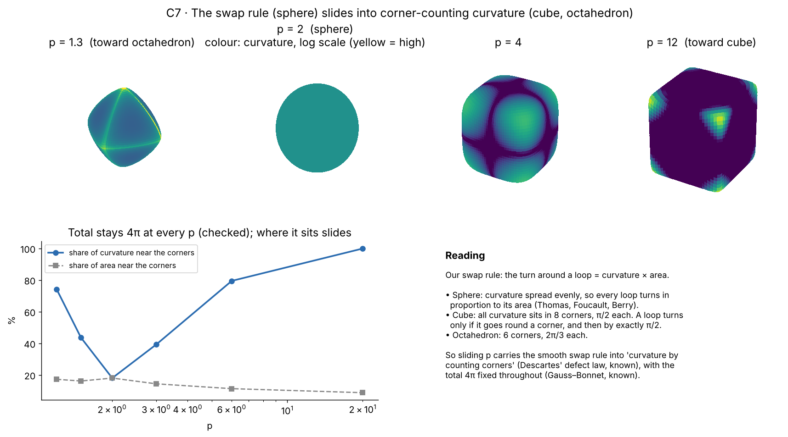

*Figure 7. Curvature on the superellipsoid |x|ᵖ + |y|ᵖ + |z|ᵖ = 1. The total stays 4π; where it sits moves.*

- **Known:** Gauss–Bonnet, and Descartes' corner defects (cube 8 × π/2, octahedron 6 × 2π/3; H3).
- **Ours:** our swap rule (turn = d × area) on the sphere spreads curvature like area (18% within 0.3 of the corners on
  18% of the area). Toward the cube, 99.9% gathers in the 8 corners at p = 20; toward the octahedron, 74% gathers in the
  6 at p = 1.2 (H1, H2). So Thomas, Foucault and pulsar precession slide into counting corners.
- **Verdict: worth following** alongside C1, because it gives the curved-space counting a second route.

## C8. Fermat on the roundness dial — slides

*Figure 8. Rational points on |x|ᵖ + |y|ᵖ = 1 with denominator up to 60.*

- **Known:** Fermat's last theorem; our Lean proves n = 3 and n = 4 and the Pythagorean parametrisation.
- **Ours:** reading Fermat's curves as p-circles puts them on the dial: 4,408 points at p = 1, 68 at p = 2, 4 at p = 3
  and p = 4, 8,816 at p = ∞ (I1, I2). Counts grow like N², then N, then stay flat.
- **Verdict: a good picture, not a proof route.** It doesn't touch the hard part of Fermat.

## C9. Lee–Yang survives only on part of the dial — partly

*Figure 9. Every zero on the imaginary line (Y), or some off it (.), for spins spread over a p-ball with weight
(1 − |x|ᵖ)^a.*

- **Known:** Lee–Yang for the round and cube spins; Pólya's (1 − t)^a family; Newman (1974).
- **Ours:** on the round and cube side every one of 18 cases keeps all zeros on the line (J1). Near the cross-polytope
  it breaks: the octahedron's spin (p = 1, solid ball, n = 3) has all its zeros off the line, the first at
  7.4977 + 2.7687i (J2, and polished in P5). At p = 1 the line holds only for a ≤ 1, and the cut-off rises with p (J3).
- **Correction (new-law pass):** the first scan only looked at fields up to about 28. Summing the function exactly and
  looking further out shows zeros leave the line whenever a > p, unless p is an even whole number. So the p = 3 cells
  above a = 3, which the first scan marked "on", are off. Figure 9 now shows the corrected map; section N3 has the rule.
- **Verdict: the one honest break.** It's worth a closer look because it says which spins our Lee–Yang modules may not
  cover.

## C10. Union rule (cube) → shares of a whole (simplex) — slides

*Figure 11. At the same k = −1, the union rule's running total is stick-breaking, which lands evenly on the triangle.*

- Checks S1, S2: the running total of stick pieces equals v₁ ∘₋₁ … ∘₋₁ v₅, and the cuts land evenly (cell spread 0.014).
  Already in `simplex/`; listed here because it's the cube-to-simplex slide for our probability laws.

## C11. The k dial in disguise — 6 groups

*Figure 10. Left four: the tropical picture of 1 + x + y + kxy as k goes from 0 (simplex) to 1 (cube). Right: Rényi
level sets, whose order is the norm's p, with k = 1 − p.*

- 1 + (x₁ ∘ₖ … ∘ₖ xₙ) = 1 + Σ k^(|S|−1) x^S (K1): k = 0 keeps the single corners (simplex), k = 1 keeps every corner
  (cube). So for the core law, corner expansion, logistic vs softmax, Rényi/Tsallis, Shannon and the repetition dial,
  the cube-to-simplex slide is just turning k (K2–K4).
- **Verdict: no new slide**, but it explains why the shape dial and k look alike in so many places.

---

## N. New laws at the in-between shapes

Brennan asked next for every law to be checked at the in-between settings, to see whether a law appears there that
matches none of the known ones, and to use the smooth-to-angular switch as well. I swept all 49 groups along the
roundness dial (smooth ↔ angular: cross-polytope, sphere, cube), the shape dial (round ↔ triangle), the corner-weight
dial, and where it made sense the crossing of the first two. What came out:

| Dial | In-between law | Status |
|---|---|---|
| Roundness, crossed with shape | **N1** Bell's 2√2 is a floor for every symmetric shape, and a saddle where the dials cross | Follows from a known theorem (Gao–Lau 1990); the Bell reading wasn't found |
| Roundness, rational settings | **N2** Fermat for every rational p: only p = 1, 2, ∞ have rational points to spare | Short corollary of Fermat's last theorem; not found stated |
| Roundness | **N3** Lee–Yang holds iff a ≤ p (n ≤ 1 + p² for a uniform spin), always at even p | Not found in print; break proved, holding proved for n ≤ p + 1, p = 2, p = 3 (computer-assisted) and p = 4 whole a; far zone proved for 1.1 ≤ p ≤ 8; **rule proved for every 1.1 ≤ p ≤ 5** (computer-assisted; at p = 4 only up to a = 4 and at whole a); rest open |
| Roundness | Volume sums E_{1/p}(2Γ(1 + 1/p)) | Immediate from the known volume formula: nothing new |
| Roundness | Replicator at any p | The same law at every p (u = x^(1/p) is a change of variable, check N5): nothing new |
| Shape (round ↔ triangle) | The turn fades from −1 to 0; ordering fraction falls 1/4 → 0.229 | Already in `simplex/` §7; no closed form for the ordering fraction |
| Corner weights | Genus is constant between walls and jumps when a face collapses | Known (toric geometry) |

### N1. Bell's bound is a floor (roundness dial, and its crossing with the shape dial)

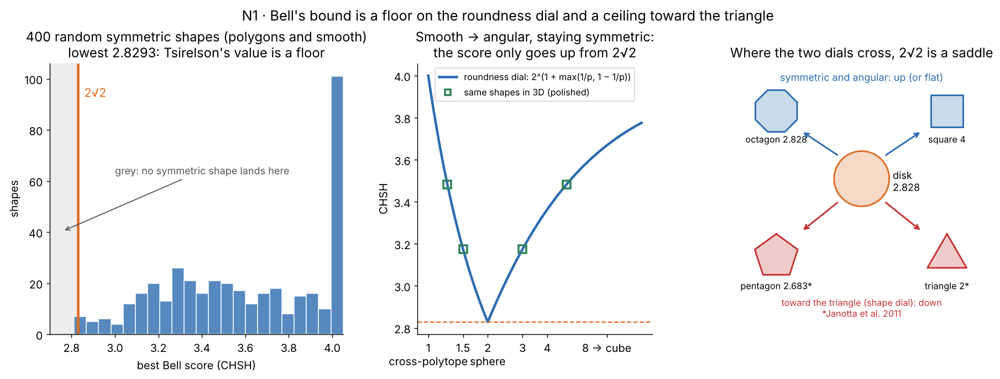

*Figure 13. Left: 400 random symmetric shapes, 300 polygons checked exactly at their corners and 100 smooth ones
polished; none scores below 2√2. Middle: the roundness dial, with the same formula confirmed in three dimensions.
Right: the saddle where the two dials cross.*

- **The law.** Put Alice's measurements in a centrally symmetric shape and Bob's in its dual. The best Bell (CHSH) score
  is the largest value of ‖x + y‖ + ‖x − y‖ over unit vectors, and it is **never below 2√2**. Angular symmetric shapes
  push it up, to 4 at the square or cross-polytope. The round disk sits on the floor, but so does the regular octagon
  (2.828427124746, polished), so the floor does not single out the round shape. Toward the triangle along the shape
  dial, Janotta et al. (2011) find the score falls below 2√2 (pentagon 2.683 with their entangled state, triangle 2). So
  2√2 is a saddle: a floor one way, a ceiling the other.
- **Checks.** N1a: lowest of 400 random shapes is 2.8293. N1b: octagon exactly 2√2. N1c: the p-ball formula holds in 3D
  to 1e-8 (p = 1.25, 1.5, 3, 5).
- **In print.** The floor is the Gao–Lau theorem that the James constant of any normed plane is at least √2, since the
  score is at least twice that constant; the p-ball value is twice J(ℓp). I didn't find this read as a Bell bound.
- **What it might be for.** Physics: a Bell score above 2√2 would point to a symmetric but angular state space, and one
  below it to a lopsided, triangle-like one, so the score reads the shape of a hypothetical theory. It also says
  "roundness" alone can't explain Tsirelson's bound, since the octagon matches it.
- **Verdict: worth a short note,** mostly as a bridge between our Bell work and standard norm geometry.

### N2. Fermat for every rational roundness (roundness dial at rational settings)

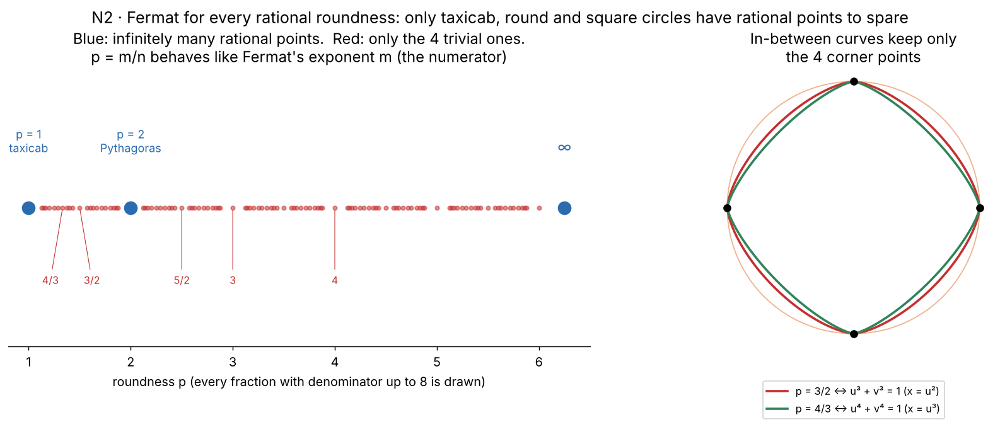

*Figure 14. Every fraction p ≥ 1 with denominator up to 8. Only p = 1, 2 and ∞ have infinitely many rational points.*

- **The law.** On |x|ᵖ + |y|ᵖ = 1 with p = m/n in lowest terms, a rational point needs x = uⁿ and y = vⁿ (a rational
  number whose m/n-th power is rational must be an n-th power), and then uᵐ + vᵐ = 1. So the curve behaves exactly like
  Fermat's exponent m, the numerator. On p ≥ 1 that leaves **infinitely many rational points only at p = 1, 2 and ∞**;
  every other rational p has only the 4 trivial ones.
- **Checks.** N2a: exact search at p = 3/2, 4/3, 5/2, 5/3, 5/4, 7/4, 6/5, 7/2, 9/4 finds only the trivial points, and a
  brute-force scan that doesn't assume the n-th-power step finds none either. N2b: p = 1 and p = 2 keep filling up.
- **Proof status.** Our Lean has exponents 3 and 4, which covers every p whose numerator is divisible by 3 or 4. The rest
  rests on Wiles. Irrational p is open here.
- **In print.** Not found stated; it's a two-line corollary, so it may well be folklore.
- **What it might be for.** Computing: exact rational geometry (rational rotations, exact grid points on a unit circle)
  works only in the taxicab, Euclidean and chessboard distances. Any in-between distance, such as the superellipse
  used in design, has no rational points to build on.
- **Verdict: a neat fact, not a lead.**

### N3. Where Lee–Yang breaks (roundness dial)

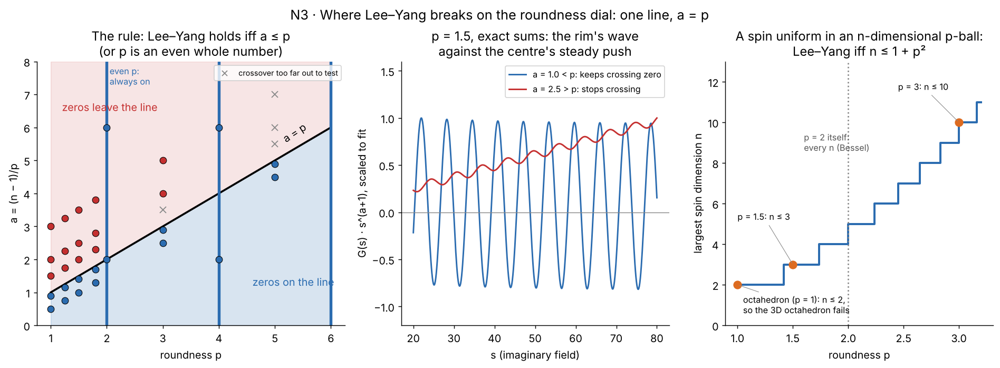

*Figure 15. Left: every tested (p, a). Blue means the zeros keep coming on the line; red means they leave it; grey means
the break would only show beyond the range I could sum. Middle: at p = 1.5, just below and above the line. Right: the
law in spin terms.*

- **The law.** A spin uniform in the n-dimensional p-ball, read along one axis, has weight (1 − |x|ᵖ)^a with
  a = (n − 1)/p. Its field function G(s) = ∫₀¹ (1 − xᵖ)^a cos(sx) dx has all its zeros on the Lee–Yang line
  **exactly when a ≤ p, that is n ≤ 1 + p²**, unless p is an even whole number, where it holds for every a.
- **Why.** Far out, G is a wave coming from the rim, of size s^−(a+1), plus a steady push from the centre, where |x|ᵖ has
  a kink, of size a Γ(p+1) sin(πp/2) s^−(p+1). If a > p the push wins past a crossover that the formula predicts, G stops
  changing sign, and zeros must leave the line. At even whole p there is no kink and no push.
- **Checks (exact sums with mpmath, not quadrature).** N3a: below a = p the sign changes keep coming at the expected
  rate out to s = 210; above a = p, in 14 cases tested past their predicted crossover, G has no real zeros and carries
  the sign the kink predicts. N3b: at p = 2 and 4, every a up to 10 stays on the line. N3c, the polish: counting every
  zero in |s| < 60 shows all are real for a just under p, and 36 of 36 are off the line at p = 1.5, a = 2.5.
- **In print.** The two ends are known: p = 1 is Pólya's (1 − t)^a family (on the line only for a ≤ 1) and p = 2 is the
  Bessel functions (always on the line). A second search (Nov 26) again found neither the general rule nor the
  n ≤ 1 + p² form. Two recent Lee–Yang preprints (arXiv:2503.03510, arXiv:2603.18675) treat Blume–Capel spins, the sphere
  and e^(−V) weights, not p-balls.
- **What it might be for.** Statistical physics: the Lee–Yang theorem is how one proves phase transitions happen only at
  zero field, and it needs single-spin weights with the property. This rule says which soft-cornered bounded spins
  qualify: the 3D octahedral spin doesn't, a p = 1.5 spin does up to 3 components, and every even-p spin does.
- **Verdict: worth following.** It's a clean statement I couldn't find in print, now half proved outright and proved
  on three more slices of the other half. Closing the gap would make it a theorem worth writing up on its own.

### N3, proof. What closes and what doesn't

Asked next by Brennan: "Prove the Lee–Yang rule." **Short answer: partly proved.** The breaking half is proved. The
holding half is proved for every p when n ≤ p + 1, for the round ball at every n, and for p = 4 when a is a whole number.
The rest of the holding half, 1 < a ≤ p, is still open, though every zero I counted there is on the line.

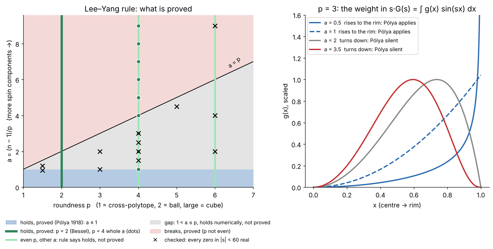

*Figure 16. Left: the (p, a) map. Blue and dark green are proved to hold, red is proved to break, grey is the gap, and
crosses are the cases checked by counting every zero in |s| < 60. Right: the weight g that decides whether Pólya's 1918
theorem applies. It has to rise all the way to the rim, which happens exactly when a ≤ 1.*

Write G(s) = ∫₀¹ (1 − xᵖ)^a cos(sx) dx with p ≥ 1 and a = (n − 1)/p. G is even, entire and of exponential type 1, and
"Lee–Yang holds" means every zero of G is real.

1. **Holding for a ≤ 1, any p (n ≤ p + 1). Proved.** Integrate by parts once: s·G(s) = ∫₀¹ g(x) sin(sx) dx with
   g(x) = a p x^(p−1) (1 − xᵖ)^(a−1), which is positive. Its slope has the sign of (p − 1)(1 − xᵖ) − (a − 1) p xᵖ, which
   stays ≥ 0 up to the rim exactly when a ≤ 1. Pólya's theorem (1918) says a sine transform over (0, 1) of a positive
   nondecreasing weight has only real zeros, so G does too. At p = 1 this is the whole rule, so **the cross-polytope
   end is fully proved** (hold for a ≤ 1, break for a > 1).
2. **Holding for the round ball, every n. Known.** At p = 2, G is a Bessel function J_(a+1/2)(s)/s^(a+1/2) up to a
   constant, and those have only real zeros for every a.
3. **Holding at p = 4 for whole a (n = 5, 9, 13, …). Proved.** Factor 1 − x⁴ = (1 − x²)(1 + x²). Multiplying the weight
   by x² is the same as applying −d²/ds² to its transform, so G = (1 − D²)^a F, where F is the round-ball (Bessel)
   transform of (1 − x²)^a. F is in the Laguerre–Pólya class (real zeros, exponential type), and 1 − D and 1 + D each
   keep a function in that class (Laguerre). So G has only real zeros. This trick works only at p = 4: at p = 6 the
   extra factor 1 + x² + x⁴ turns into an operator with non-real roots.
4. **Breaking for a > p, p not even (n > 1 + p²). Proved.** Far out on the real axis, Erdélyi's endpoint expansion gives
   G(s) = a Γ(p+1) sin(πp/2) s^−(p+1) + O(s^−(a+1)): the centre's push beats the rim's wave, so G has only finitely many
   real zeros. But G is bounded on the real line and of exponential type 1 in both imaginary directions, so by the
   Cartwright–Levinson theorem it has about 2r/π zeros in |s| < r. Infinitely many of them are therefore off the line.
5. **For a < p, only finitely many zeros can be off the line. Proved in outline (a standard argument, not written out in full).** Now the rim's wave is the
   bigger term, so far out G changes sign once per half period, which accounts for every zero the Cartwright–Levinson
   count allows there. Any zeros off the line sit in a bounded region.

**The gap, exactly.** For p not even and 1 < a ≤ p (p + 1 < n ≤ 1 + p²), and for even p ≥ 4 outside the cases above, I
can't rule out a few zeros near the origin leaving the line. Step 5 confines them to a bounded region, and the counts
below found none there. Routes I tried that don't close it: the multivariate Lee–Yang property for the whole ball fails
(its two-field function vanishes at h = (1 + 5i, 1 − 5i)), so there is no shortcut through the n-dimensional spin;
pulling out a factor (1 + x²)^(−1) is an operator that can destroy real zeros; and (1 + x²)^a with fractional a gives no
entire operator. The likeliest route is a monotone weight after a different integration by parts or substitution, in
the spirit of Pólya's later work on ∫ e^(−t^(2m)) cos(st) dt.

**Checks** (`proof_checks.py` → `proof_checks_output.txt`, **4 of 4 pass**, 34 s):

| Check | What | Result |
|---|---|---|
| P1 | s·G(s) equals the sine transform of g (three (p, a) pairs, quadrature) | gap 3e-14 |
| P2 | g rises to the rim exactly when a ≤ 1 (30 pairs, p from 1 to 6) | 30 of 30 |
| P3 | at p = 4, G = (1 − D²)^a F for a = 1, 2, 3 (exact sums) | gap 3e-41 |
| P4 | every zero in \|s\| < 60 is real: 4 proved cases, 7 gap cases (p = 1.5, 3, 4, 5, 6 at a from 1.2 to 4.5), and p = 6, a = 9 | 12 of 12 |

**Lean.** None of the proof is in Lean yet. The rule and its open band are stated, as propositions with no proof, in
`topics/mathlib-map/MathlibMap/LeeYangBand.lean`, which compiles against Mathlib. The pieces that would
formalize first are step 1's slope computation and the integration by parts; Pólya's theorem and Cartwright–Levinson
aren't in Mathlib, so the whole proof would need them added or taken as stated assumptions.

### N3, sliding check. Is the sliding route alive?

Asked next by Brennan: "Run the check." The idea: start at a = 1, where Lee–Yang is proved, and slide a up. A zero can
only leave the line by first meeting a neighbour there, so if neighbours never meet before a = p, the rule holds. For
Bessel functions (p = 2) the standard proof shows the zeros at a and a + 1 alternate, so I tested whether they alternate
here.

**Short answer: alive for p ≥ 2, not as it stands for 1 < p < 2.** For every roundness from 2 to 6 the zeros at a and
a + 1 alternate, and no two zeros meet anywhere in the open band. Below p = 2 the band is narrower than 1, so a + 1 is
already past p and its zeros have left the line: there's nothing to alternate with.

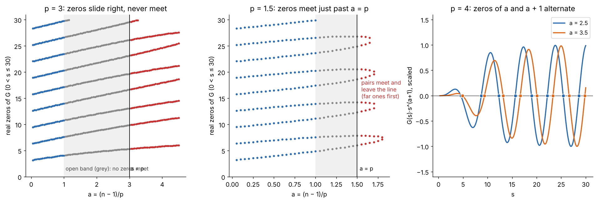

*Figure 17. Left: at p = 3 every zero slides steadily to the right as a grows and none meet, inside the band (grey) or
just past it. Middle: at p = 1.5 the zeros start pairing up inside the band and the pairs meet and leave the line just
after a = p, the far pairs first, as the proved breaking side says. Right: at p = 4 the zeros at a = 2.5 (blue) and
a = 3.5 (orange) alternate along the line.*

- **What the numbers show.** In all 40 pairs where both a and a + 1 still have zeros on the line (p = 2 to 6, a from 1
  up to p), the zeros alternate in |s| ≤ 30. That includes 24 pairs with both a and a + 1 inside the band. Tracking the
  zeros in steps of 0.05 in a, the gap between neighbours stays at least 2.95 up to a = p at p = 3, and at least 1.85 at
  p = 1.5, where the first meeting in view comes at a = 1.7.
- **What a proof still needs.** Alternation only proves something with an identity that ties G at a to G at a + 1.
  Bessel functions have one (at p = 2, s·G at a equals a constant times the derivative of G at a − 1). For other p
  I don't see one, because the weight that appears after integrating by parts, x^(p−1)(1 − xᵖ)^(a−1), is the derivative
  of the cosine kernel only at p = 2. The equivalent statement, by the Hermite–Kakeya–Obreschkoff theorem, is that every
  weight (1 − xᵖ)^a (c − xᵖ) with c real gives a transform with only real zeros. That's a wider family than the one we
  started with, so it isn't easier on its face.
- **For 1 < p < 2.** The pairing has to use some other partner, one that stays on the line. The middle panel shows why
  it's harder there: the zeros already crowd in pairs inside the band.
- **Verdict.** The route is worth one more step for p ≥ 2: look for the identity linking a and a + 1, or prove the
  wider (c − xᵖ) family directly. For 1 < p < 2 it doesn't help as it stands.

**Checks** (`interlace_check.py` → `interlace_check.json`, then `interlace_summary.py` → `interlace_output.txt`,
**4 of 4 pass**, 35 s plus 2 s polish):

| Check | What | Result |
|---|---|---|
| I1 | zeros of G at a and a + 1 alternate wherever both are on the line, \|s\| ≤ 30 | 40 of 40 pairs |
| I2 | at p = 1.5, a + 1 has no zeros on the line for a = 1, 1.25, 1.5 | confirmed |
| I3 | no two zeros meet while a ≤ p (tracked in steps of 0.05) | none; first meeting at p = 1.5 is a = 1.7 |
| I4 | polish: findroot refines each zero (moves of 0.025 at most) and alternation still holds | holds |

### N3, step identity. The link between a and a + 1

Asked next by Brennan: "Look for it." **Short answer: found, and it proves a new step, but it runs the wrong way to close
the band.** The identity holds at every roundness p. It carries Lee–Yang from a + 1 *down* to a, never up, so the open
band shrinks to one strip of width 1 just under a = p (for p ≥ 2). That strip is still open.

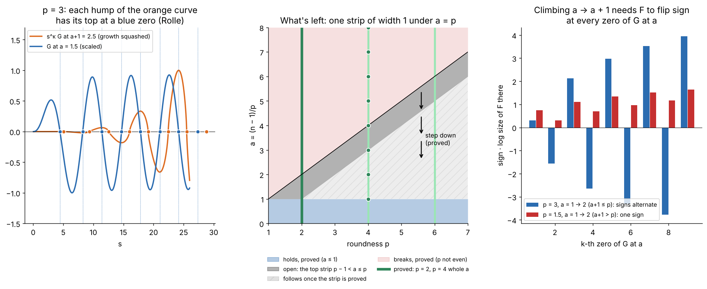

*Figure 18. Left: at p = 3, each hump of s^κ G at a + 1 (orange) peaks exactly at a zero of G at a (blue), which is the
identity at work. Middle: what's left after stepping down; the dark strip is the only open part for non-even p, and the
hatched part follows from it. Right: why the identity won't climb: going from a to a + 1 needs a running integral F to
flip sign at every zero of G at a. It does at p = 3 (blue) and doesn't at p = 1.5 once a + 1 passes p (red).*

- **The identity.** With κ = (a + 1)p + 1, for every p > 0 and a ≥ 0,
  **(a + 1) p · G_a(s) = s G′_(a+1)(s) + κ G_(a+1)(s) = s^(1−κ) · d/ds [ s^κ G_(a+1)(s) ]**.
  It's one integration by parts: x · d/dx of (1 − xᵖ)^(a+1) equals (a + 1)p times ((1 − xᵖ)^(a+1) − (1 − xᵖ)^a).
  At p = 2 it is the classical Bessel recurrence, which is why the ball was easy.
- **What it proves (step down).** If every zero of G at a + 1 is real, every zero of G at a is real too, and the two sets
  of zeros alternate. Proof: write G_(a+1)(s) = φ(s²); φ has only positive zeros u_k and Σ 1/u_k converges. The identity
  makes G_a proportional to ψ = 2uφ′ + κφ, and ψ/φ = κ + 2 Σ u/(u − u_k). Off the real line its imaginary part is
  −2 Im(u) Σ u_k/|u − u_k|², which isn't zero, and for u ≤ 0 it is at least κ > 0. So every zero of ψ is a positive u,
  and every zero of G_a is real. Rolle's theorem on s^κ G_(a+1) puts exactly one zero of G_a between each pair of zeros
  of G_(a+1). This explains the alternation the sliding check saw.
- **What it buys.**
  1. The Lee–Yang set is closed under a → a − 1 at every roundness.
  2. For non-even p ≥ 2, the open band 1 < a ≤ p now follows from the **top strip p − 1 < a ≤ p** alone. For 1 < p < 2 the
     band is already narrower than 1, so nothing shrinks.
  3. For even p, where the rule says every a, it is enough to prove one unit-wide strip at a time, arbitrarily high up.
     The p = 4 whole-number result doesn't spread: stepping down from whole numbers only reaches whole numbers.
- **Why it won't climb.** Going up means integrating: s^κ G_(a+1) = (a + 1)p ∫₀^s t^(κ−1) G_a(t) dt. That keeps the
  zeros real only if the running integral flips sign at every zero of G_a. Far out, the rim's wave makes the lobes grow
  like s^((a+1)(p−1)), and the centre's steady push grows like s^((a+1)p−p). The wave wins when a + 1 < p (they tie at a + 1 = p),
  so the climb fails far out precisely where the rule says it breaks. Near the origin the first few lobes still have to be
  checked, and that is the same "first few zeros" problem in a sharper form. This is an explanation, not a proof.
- **In print.** I didn't search for the identity separately. It's the kind of parameter-shift relation these Bessel-like
  functions usually have, so I'd expect it to be known. I haven't seen it used for Lee–Yang, or the top-strip reduction.
- **Verdict: worth following.** For non-even p ≥ 2 the whole open question is now one strip under a = p, and the right
  panel suggests the attack: prove the running integral flips sign at the first few zeros when a + 1 ≤ p.
- **Lean.** `topics/mathlib-map/MathlibMap/LeeYangStep.lean` states StepDown, TopStrip and TopStripReduces against the
  definitions in `MathlibMap/LeeYangBand.lean`. It is statements only (definitions of propositions, nothing proved), and
  CI builds it with the rest of the Mathlib map.

**Checks** (`identity_check.py` → `identity_output.txt`, `identity_check.json`, **4 of 4 pass**, 20 s):

| Check | What | Result |
|---|---|---|
| K1 | the identity on the functions, by quadrature, at 5 (p, a, s) with p from 1.5 to 5 | gap 5e-17 |
| K2 | polish: the same identity coefficient by coefficient at 50 digits (exact Beta-function step), k < 40 | gap 8e-50 |
| K3 | each gap between zeros of G at a + 1 holds exactly one zero of G at a (polished zeros) | 40 of 40 pairs |
| K4 | the climb's sign test: alternates at p = 3 (a = 1 → 2) and p = 1.5 (a = 0.4 → 1.4), fails at p = 1.5 (a = 1 → 2) | as predicted |

### N3, top strip. The strip p − 1 < a ≤ p through the shape dial

Asked next by Brennan: "yes" (go after the strip). **Short answer: not proved for every p, but now a finite check for
each p, and that check passes at every p I ran (2.5, 3, 5, 7).** Two of the theory's own moves do the work. Sliding the
roundness dial to the ball handles everything far from the centre. Peeling one shell (the step identity) handles the
first few zeros near the centre. What still needs a real proof is a bound that works for all p at once.

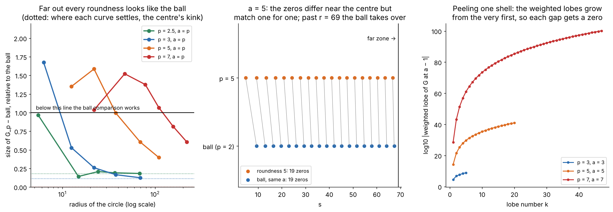

*Figure 19. Left: how far the roundness-p function is from the ball's (scaled), on circles of growing radius. Once it's
below 1 the two have the same zeros inside, and the ball's are all real. Each curve settles at the dotted level, which
is the centre's kink, |sin(πp/2)|/p^(p−1). Middle: at p = 5, a = 5 the zeros sit in different places near the centre but
match one for one. Right: peeling one shell, the weighted lobes grow from the very first one.*

- **Move 1: slide the roundness dial to the ball, keeping a fixed.** Near the rim, 1 − xᵖ ≈ p(1 − x) whatever p is, so far
  out G at roundness p looks like (p/2)^a times the ball's G. The only difference is the kink at the centre. On a
  circle through a crest of the rim wave, the kink's share settles at |sin(πp/2)|/p^(p−1), which is below 1 for every
  p > 1. So past some radius, Rouché's theorem gives G_p exactly as many zeros inside as the ball, and the ball's are all
  real. The same picture shows why the rule stops at a = p: above it, the kink's share on the real axis grows without
  bound and the comparison fails.
- **Move 2: peel one shell.** By the step identity, s^κ G_a is a running integral of t^(κ−1) G_(a−1), with κ = ap + 1. If
  the weighted lobes of G at a − 1 grow one after another, G at a changes sign between every pair of neighbouring zeros
  of G at a − 1. That puts one zero in each gap, and the count against the ball leaves no room for any other zeros.
- **What the numbers say.** The far zone starts at radius 17–19 for p = 2.5 and 3, 37–69 for p = 5, and about 157 for
  p = 7: it grows quickly with p. Inside it the zero counts match the ball's exactly (4, 4, 9, 19 and 46 zeros). The
  weighted lobes grow from the first lobe in every case, by a factor of at least 1.85 each step. Across the whole strip
  at p = 3, in steps of 0.05, the margin stays under 0.17 and the counts match.
- **What's still missing.** Two bounds that hold for every p: an explicit radius where the ball comparison starts (it
  grows fast with p, so the 1/s corrections need a real estimate), and an inequality showing each weighted lobe beats
  the one before. The lobes have a wide cushion, so that inequality is the most promising target. To be a proof for a
  single p, the numbers here would also need interval arithmetic and a step over the continuous range of a.
- **In print.** Rouché against a Bessel function and Sturm-type lobe arguments are standard tools for zeros of Fourier
  integrals. I didn't search for this combination applied to p-balls.
- **Verdict: worth following.** The strip is now a finite, checkable statement for any one roundness, and every case
  passes. Turning the lobe growth into an inequality would come close to finishing the rule.

**Checks** (`strip_check.py` → `strip_output.txt`, `strip_check.json`, **5 of 5 pass**, 52 s):

| Check | What | Result |
|---|---|---|
| S1 | far zone: past a radius, roundness p stays within 90% of the ball on every tested circle | p = 2.5, 3, 5, 7: from r = 17 to 157 |
| S2 | near zone: inside that radius, real zeros of G_p equal the ball's count | 7 of 7 (4 to 46 zeros) |
| S3 | peeling a shell: weighted lobes grow from the first, so each gap gets a sign change | smallest growth factor 1.85 |
| S4 | whole strip at p = 3, a from 2.05 to 3 in steps of 0.05: margin and count | 20 of 20, margin ≤ 0.17 |
| S5 | polish: zeros refined with findroot; first lobes by direct quadrature against the identity | gap 2e-39 |

### N3, lobe law. Do the weighted lobes always grow?

Asked next by Brennan: "Please" (try to prove the lobe-growth inequality). **Short answer: proved far out for every p,
not yet from the first lobe.** Far out the lobes follow a simple law, and its safety margin is the same kink share,
|sin(πp/2)|/p^(p−1), that the ball comparison had. That margin is below 1 for every p > 1, so the lobes grow from some
point on at every a ≤ p, and the law fails exactly past a = p, where the rule breaks. Near the centre the lobes grow much
faster than the law needs, so the tight place is far out, not near the centre. What's missing is an explicit radius
where "far out" starts.

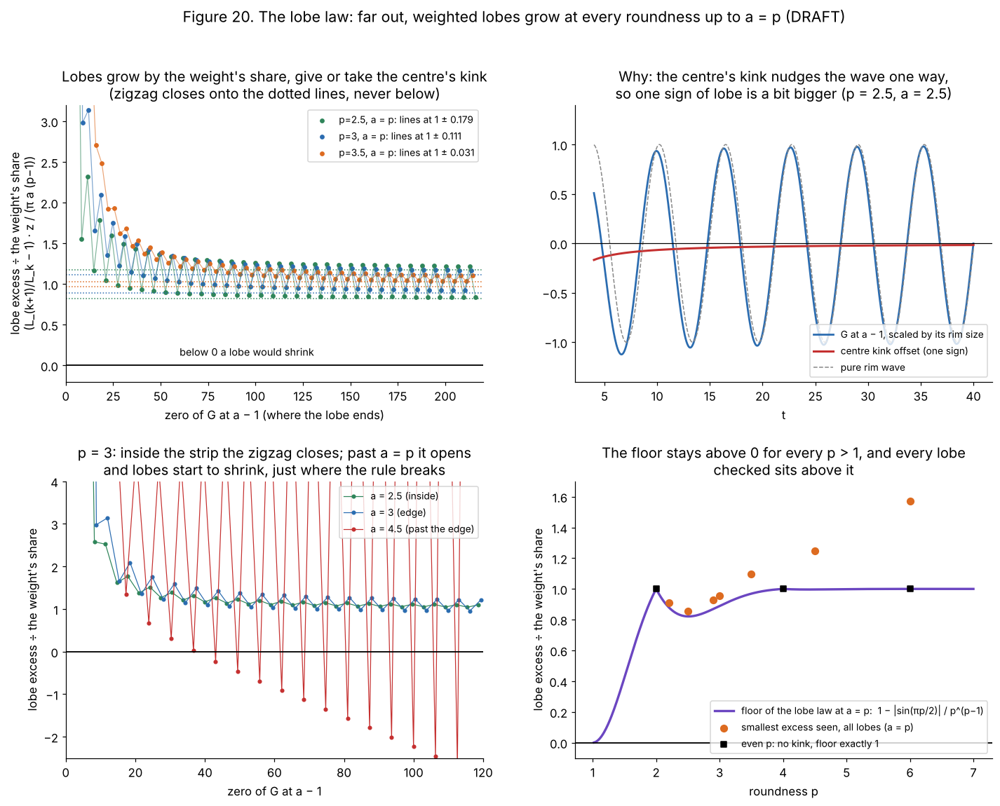

*Figure 20. Top left: how much faster each weighted lobe is than the one before, divided by what the weight alone would
give. It zigzags down onto two lines, 1 ± the kink share, and never goes below the lower one. Top right: why it zigzags.
The rim wave rides on a small one-signed offset from the centre's kink, so lobes of one sign come out a bit bigger. Bottom
left: at p = 3 the zigzag closes inside the strip and opens past a = p, until lobes shrink. Bottom right: the law's floor
at a = p for every roundness, with the smallest value seen over all lobes; every case sits above the floor.*

- **Why lobe growth is the whole job.** Pólya settles a ≤ 1. Peeling one shell, if G at a − 1 has real zeros and every
  weighted lobe beats the one before, G at a gets a zero in every gap, and the zero count against the ball (exact far out
  for a ≤ p) leaves room for no others. So lobe growth at every a between 1 and p, for every lobe, climbs in whole steps
  from Pólya's base to the top and proves the holding side at every p.
- **The law.** Far out, G at a − 1 is a rim wave of size p^(a−1) Γ(a) t^(−a) plus a one-signed term from the centre's kink,
  (a − 1) Γ(p + 1) sin(πp/2) t^(−p−1) (Erdélyi's endpoint expansion). The weight t^(ap) makes each lobe bigger by the
  factor (1 + π/z)^(a(p−1)), about 1 + πa(p − 1)/z. The rim's smaller terms change every lobe in the same smooth way, so
  they drop out of the ratio. The kink pushes alternate lobes up and down. Put together:

  (L_(k+1)/L_k − 1) · z_k / (π a (p − 1)) = 1 ± B · z_k^(a−p) + O(1/z_k), with
  B = (a − 1) Γ(p + 1) sin(πp/2) / (a (p − 1) p^(a−1) Γ(a)).

  At a = p this is 1 ± sin(πp/2)/p^(p−1). Below a = p the kink part fades. Above a = p it grows without bound, and
  lobes start shrinking: the same edge as the rule.
- **Status.** This proves lobe growth past some radius, for every p and every a ≤ p, using standard asymptotics. The
  radius isn't explicit. The numbers say the law's floor already holds from the first lobe: across 28 cases (7
  roundnesses, a from 1.5 to p) every lobe sits above it, approaching from above. So the sharp inequality to prove is

  (L_(k+1)/L_k − 1) · z_k ≥ π a (p − 1) (1 − |B| z_k^(a−p)) for every lobe.
- **What would finish it.** For one p: explicit error constants in the endpoint expansion, then a finite check of the
  first lobes. For every p at once, those constants would also have to be uniform in p. For large p the rim becomes a
  thin layer of width about 1/p shaped like 1 − e^(−y), which is the natural tool there. I didn't do either yet.
- **In print.** The ball's version is classical: lobes of t^μ J_ν grow when μ > 1/2, by Sturm-type monotonicity (Lorch
  and Szegő 1963). I didn't find the kink-share law for p-balls.
- **Verdict: worth following.** The last gap is now one explicit inequality with a named constant, and the same constant
  shows up in both halves of the argument, which is a good sign this is the right route. For each single p the rest is
  bookkeeping. A proof for every p at once probably also needs the large-p rim picture.

**Checks** (`lobe_law_check.py` → `lobe_law_output.txt`, `lobe_law_check.json`, **5 of 5 pass**, 97 s):

| Check | What | Result |
|---|---|---|
| L1 | at a = p the lobe excess tends to 1 ± sin(πp/2)/p^(p−1), by lobe sign (fit on 68 lobes out to s = 220) | p = 2.5, 3, 3.5: kink −0.1789, −0.1111, −0.0309 measured −0.1780, −0.1096, −0.0298 |
| L2 | inside the strip the kink term fades like z^(a−p) with the predicted size (out to s = 500) | p = 3, a = 2.5: −0.261 vs −0.260; p = 2.5, a = 2: −0.313 vs −0.313 |
| L3 | every step of the climb: 7 roundnesses (2.2 to 6), a = 1.5 and three values in the strip, out to s = 120 | 28 of 28: every lobe grows (smallest ratio 1.044) and stays above the floor |
| L4 | past the edge (p = 3, a = 4.5) the kink wins and a lobe shrinks | first shrinking lobe after s = 43 |
| L5 | polish: first three lobes by direct quadrature against the identity; refined zeros | agree to all 50 digits |

### N3, p = 3. A full proof at one roundness

Asked next by Brennan: "yes" (work out p = 3 explicitly, with no gap). **Short answer: proved, computer-assisted.** At
roundness 3, Lee–Yang holds for every a ≤ 3, that is for a uniform spin in every dimension n ≤ 10, and it breaks for
every n > 10 (proved earlier). So **the rule n ≤ 1 + p² is now a theorem at p = 3**. The far-out argument takes over at
s = 21, about the 7th zero, and every zero before that was boxed and checked with error-bounded arithmetic on 200 boxes.
Two links are cited rather than re-proved: Pólya's 1918 theorem and Krein's partial-fraction theorem.

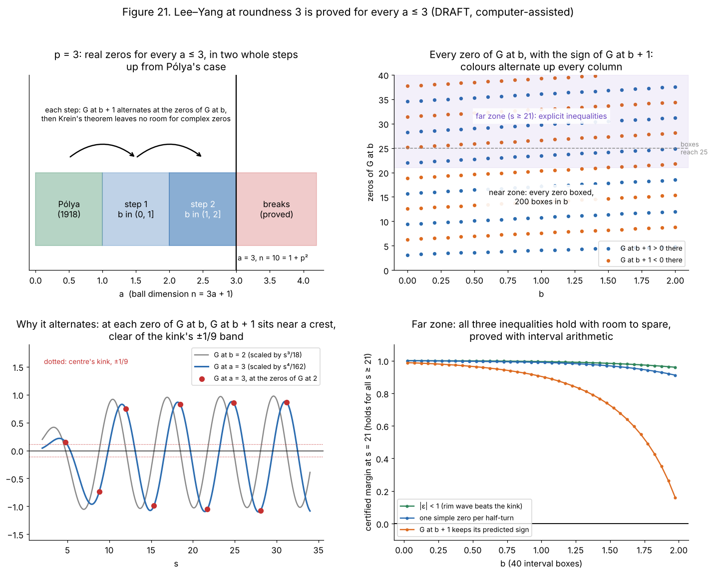

*Figure 21. Top left: the climb. Pólya gives a ≤ 1; two whole steps carry it to a = 3, where it stops because the rule
breaks past it. Top right: every zero of G at b, coloured by the sign of G at b + 1 there. The colours alternate up
every column, which is what each step needs. Below s = 21 every zero was boxed; above it the explicit inequalities
take over, and the two zones share a zero in every box. Bottom left: why it alternates. At each zero of G at 2, G at 3
sits near a crest of its own wave, clear of the small offset from the centre's kink. Bottom right: the three far-zone
margins, proved positive at s = 21 for every b in [0, 2]; they only grow further out.*

- **What was asked for, and what I used instead.** The plan was to make the lobe law's radius explicit. At p = 3 a
  cleaner test does the same job: check the *sign of G at b + 1 at each zero of G at b*. Lobe growth was only ever a
  way to get that sign pattern, and the sign itself is easier to bound.
- **The climb.** For b in [0, 1], G at b has only real simple zeros (Pólya, section N3 proof, step 1). Suppose G at b
  has real simple zeros and G at b + 1 alternates in sign at them. Write u = s². Then G at b + 1 over G at b has simple
  poles at the zeros, its residues all have one sign, and it tends to 0 up the imaginary axis (like 3(b + 1)/y). Krein's
  theorem for functions of this growth then says the ratio is exactly the sum of its poles, so it maps the upper half
  plane into one half plane. Such a function has a zero between each pair of poles and nowhere else off the real
  u axis. One more zero could sit below the first pole, at negative u (an imaginary s), but G is positive on the
  imaginary axis, so it can't. So G at b + 1 has only real zeros, interlacing those of G at b. Two steps, b in [0, 1]
  then b in [1, 2], cover a up to 3.
- **An exact formula far out.** At p = 3, turning the integration path upward from 0 and from 1 gives, exactly,
  G(s) = C(s) + |J(s)| sin(s − πc/2 + arg J(s)), where C is a small one-signed term from the centre and J a smooth rim
  amplitude, each a Laplace integral with explicit bounds. It matches the defining integral to 1e−32.
- **The far zone, s ≥ 21.** With that formula, three inequalities finish the job at every zero past 21: the rim wave
  beats the centre term (|C|/|J| < 1), so G at b has exactly one simple zero per half-turn; and G at b + 1 is close
  enough to its predicted crest to keep the sign the phase gives it. Every bound is monotone in s, so checking s = 21
  with interval arithmetic on 40 boxes in b covers all s ≥ 21. Smallest margins: 0.96, 0.91 and 0.16 (the last one at
  b near 2, where the step is tightest).
- **The near zone, s ≤ 25.** On 200 boxes of width 0.01 in b, G at b and G at b + 1 were enclosed with Taylor models in s
  and in b, evaluated in exact integer arithmetic at 900 bits. In every box there are exactly 7 zeros below 25, each
  isolated (sign change, nonzero slope), and G at b + 1 has a definite, alternating sign at them. Each box reaches a
  zero past 21, so the near and far zones overlap.
- **How solid it is.** Every constant is now a whole number or an exact fraction, and every number after the exact
  integer sums is an outward-rounded interval, so no step leans on float rounding or an ad hoc margin (section N3,
  p = 3 constants). What isn't machine-checked is the analytic side: the contour formula and its remainder bounds were
  derived by hand and checked numerically, and Pólya and Krein are cited.
- **What Lean can hold.** `topics/mathlib-map/MathlibMap/LeeYangP3.lean` (built by CI with the Mathlib map) states the result (`RuleAtThree`, `StripAtThree`) on top of the
  `LeeYangStep` definitions, with no sorry, because it only states. Proving it in Lean would need Pólya's theorem, Krein's
  theorem and a verified interval certificate, none of which Mathlib has.
- **What it says about other p.** Nothing here is special to 3 except the contour formula, which needs p whole. At p = 5
  or 7 the same certificate should run with more rim terms. At a fractional p the rim needs a different expansion. Every
  p at once still needs the explicit, uniform version of the lobe law.
- **Verdict: worth following.** This is the first roundness where the in-between rule is fully proved (p = 2 was already
  known, p = 4 only at whole a). It shows the route works end to end, and the far-out margins are wide everywhere except
  near the top of the strip, which is where any general proof will be tight.

**Checks** (`p3_certificate.py` → `p3_certificate_output.txt`, `p3_certificate.json`, **5 of 5 pass**, 85 s; rerun below):

| Check | What | Result |
|---|---|---|
| F1 | far zone: for every b in [0, 2] and every s ≥ 21, the three inequalities hold (interval arithmetic, 40 boxes) | worst margins 0.960, 0.911, 0.159 |
| N1 | near zone: on 200 boxes covering b in [0, 2], every zero of G at b in [0, 25] is isolated | 7 zeros in every box |
| N2 | near zone: G at b + 1 has a definite sign at each of those zeros, and the signs alternate | 200 of 200 boxes |
| N3 | overlap: in every box the near zone reaches a zero past s = 21 | 200 of 200 boxes |
| P1 | polish: the contour formula against the defining integral, 4 spot checks | gap 1e−32 |

### N3, p = 3 constants. Whole numbers instead of decimals

Asked next by Brennan: "Let's check them in Lean", and whether the constants can be ratios or whole numbers. **Short
answer: yes, all of them.** The two decimals with a safety margin, 0.75 and 2.11, are replaced by the whole numbers
**2 and 6**, and the certificate still passes. Every other constant was already a whole number or an exact fraction.
Lean checks the comparison that gives 2 and 6.

- **Where the 2 and the 6 come from.** The certificate needs bounds on L2 = ∫₀¹ log²(1 − x³) dx and
  L3 = ∫₀¹ |log(1 − x³)|³ dx. On [0, 1], 1 − x ≤ 1 − x³, so |log(1 − x³)| ≤ |log(1 − x)|, and
  ∫₀¹ |log(1 − x)|^k dx = k! (Euler's integral). So **L2 ≤ 2! = 2 and L3 ≤ 3! = 6**. They're looser than the true values,
  but the boxes are small enough that the slack doesn't matter.
- **The true values aren't fractions.** Numerically L2 = 18 − √3 π − 9 log 3 + π²/4 + (9/4) log² 3 + (√3/2) π log 3 − ψ′(1/3)
  (found by integer-relation search and matched to 80 digits, not proved). As fraction brackets from the series
  −log(1 − x³) = Σ x^(3k)/k: **747/1000 < L2 < 748/1000** and **1051/500 < L3 < 263/125**.
- **Every constant, in whole-number or fraction form:**

| Constant | Was | Now |
|---|---|---|
| L2 (second c-derivative) | 0.75 | **2** (= 2!) |
| L3 (third c-derivative) | 2.11 | **6** (= 3!) |
| far-zone remainders | 720, 5040, 362880, 3628800 | unchanged: 6!, 7!, 9!, 10! |
| far zone starts at | 21 | 21 |
| near zone reaches | 25 | 25 |
| cell width in s | 1/8 | 1/8 |
| box half-width in b | 1/200 | 1/200 |
| central-difference step | 10⁻¹² | 1/10¹² |
| error terms in b | about 1e−5 | δ²·L2/2 = **1/40000**, η²·L3/6 = **1/10²⁴** |
| float safety margins (1e−25, 1e−13 relative) | used | **removed**, replaced by interval error bounds |

- **A slip it caught.** The old near-zone code took the b-derivative from two rounded floats, and it never charged for
  that rounding (up to about 5e−7 per value). The new code takes the difference of the exact integers first. No box
  changed its verdict.
- **What Lean holds** (`topics/mathlib-map/MathlibMap/LeeYangP3Constants.lean`, built by CI with the Mathlib map): the pointwise comparison 1 − x ≤ 1 − x³ and the log comparison,
  for every power k; the integral comparison ∫₀¹ |log(1 − x³)|^k ≤ k!, with Euler's integral and integrability passed in
  as hypotheses; and the exact fractions above. Euler's integral itself is classical, and Mathlib has it as the Gamma
  integral. I haven't done the change of variables that connects the two. **Still outside Lean:** the 200 boxes and
  the far-zone inequalities, which are rigorous interval computations in Python, the contour formula's remainder bounds,
  and Pólya and Krein.

**Checks** (`p3_certificate.py`, rerun with the whole-number constants and interval bookkeeping, **5 of 5 pass**, 205 s):
the same F1, N1, N2, N3 and P1 as above, with the same results. The run is slower because of the interval
bookkeeping.

### N3, refactor. One core for every roundness

Asked next by Brennan: refactor the p = 1, 2, 3 proofs the way you'd refactor code, centralize what they share, and aim
at every p. **Short answer: refactored, not yet proved for every p.** Every proof so far uses the same three cited
tools and the same induction. The Lean core proves that induction once, so **the rule at any roundness p now follows
from a single statement, "G at b + 1 alternates at the zeros of G at b, for every step 0 < b ≤ p − 1."** p = 1, 2 and 3
are short instances. For every p at once, the far-out half of that statement looks uniform: same formula, same margin
at every p. The near half grows with p and is still a per-p check.

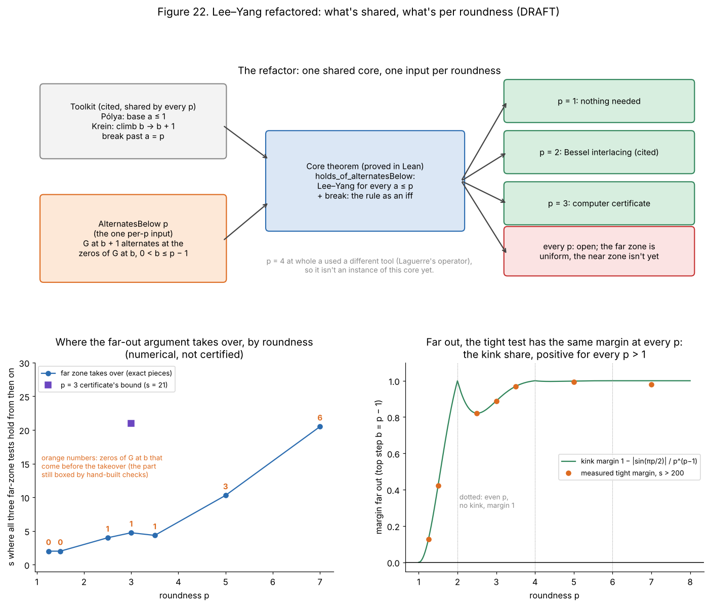

*Figure 22. Top: the refactor as a call graph. A toolkit of cited facts and one per-p input feed a core theorem
proved in Lean, and each known roundness is an instance. Bottom left: with the exact contour pieces, without the
certificate's remainder bounds, the three far-zone tests hold from s ≈ 2 at p ≤ 1.5 up to s ≈ 20 at p = 7. The
p = 3 certificate's 21 came from its loose bounds, not from the math. Orange numbers count the zeros before the
takeover, which still need boxing. Bottom right: far out, the tight test's margin is 1 − |sin(πp/2)|/p^(p−1) at
every roundness, the same kink share as the lobe law. It's positive for every p > 1 and equals 1 at even p.*

- **What was shared.** Pólya's base (a ≤ 1), a climb in whole steps (b → b + 1, by Krein's theorem, once G at b + 1
  alternates at the zeros of G at b), and the break past a = p. The p = 1 proof is just the base. The p = 2 proof is
  the climb with Bessel interlacing as the input. The p = 3 proof is the climb with the certificate as the input.
- **The core, in Lean** (`topics/mathlib-map/MathlibMap/LeeYangCore.lean`, built by CI with the Mathlib map). A `Toolkit` structure holds the three cited facts. Then, proved:
  `holds_of_alternatesBelow` (base + climb + alternation give Lee–Yang for every a ≤ p, by induction on ⌈a⌉),
  `rule_of_alternatesBelow` (add the break to get the rule as an iff), the instances `holds_one`, `holds_two`,
  `holds_three` and `rule_three`, and `holding_half_of_alternation`. The last one says that alternation at every p would
  give the holding half everywhere.
- **What's left per p, exactly.** One statement, `AlternatesBelow p`. Splitting it the way the p = 3 certificate does:
  - *Far zone:* the exact contour formula G = C + |J| sin(s − πc/2 + arg J) holds at every roundness, not only whole
    p (checked at p = 1.5, 2.5, 3.7, 5.3). With it, the three far-zone tests hold past a takeover point at all 7
    roundnesses scanned, and the tight one tends to the kink margin, which is positive for every p > 1. To make this a
    theorem for every p, the remainder bounds on C and J need to be explicit functions of p. At p = 3 that was a page
    of Watson-type bounds, and nothing in it looked special to 3.
  - *Near zone:* the zeros before the takeover. That's 0 at p ≤ 1.5, 1 at p = 2.5 to 3.5, 3 at p = 5 and 6 at p = 7, so it
    grows with p. It's a finite box check for any bounded range of p. Large p needs its own argument, probably the
    thin rim layer from the lobe law.
  - *Near p = 1:* the margin goes to 0 as p → 1, but there the climb is tiny (b ≤ p − 1) and the tests hold from the
    start in the scan, so it looks harmless. It needs care in a uniform proof.
- **What's cited rather than in Lean.** Pólya 1918, Krein's theorem, the break, Bessel interlacing (p = 2) and the
  p = 3 certificate. p = 4 at whole a used Laguerre's operator instead, so it isn't an instance of this core yet.
  Running the certificate at p = 4 would make it one.
- **Verdict: worth following.** The refactor turns "prove the rule" into one family of inequalities about two explicit
  Laplace integrals. The far-out part already shows the same margin at every p. The most useful next step is the
  far-zone bounds as explicit functions of p. That would make the far half a theorem for every p and leave a near
  zone of a few zeros per p. (Done next, for 1.1 ≤ p ≤ 8: section N3, far bounds.)

**Checks** (`general_p_far.py` → `general_p_far_output.txt`, `general_p_far.json`, **4 of 4 pass**, 244 s; numerical
exploration, not a certificate):

| Check | What | Result |
|---|---|---|
| R1 | contour formula against the defining integral at non-whole roundness | p = 1.5, 2.5, 3, 3.7, 5.3: gap ≤ 7e−10 |
| R2 | three far-zone tests with exact C and J, 7 roundnesses × 6 steps, s from 2 to 320 | take over at s ≈ 2, 2, 4.0, 4.7, 4.3, 10.3, 20.5 for p = 1.25, 1.5, 2.5, 3, 3.5, 5, 7 |
| R3 | far-out margin of the tight test against 1 − \|sin(πp/2)\|/p^(p−1) | 0.126/0.126, 0.422/0.423, 0.821/0.821, 0.888/0.889, 0.968/0.969, 0.994/0.998, 0.980/1.000 |
| R4 | zeros of G at b before the takeover | 0, 0, 1, 1, 1, 3, 6 |

### N3, far bounds. The far-out half as formulas in p

Asked next by Brennan: "work out the far-out bounds as formulas in p." **Short answer: done for every roundness from
1.1 to 8, by interval arithmetic, with spot checks out to p = 16.** Every constant in the far-zone argument is now a
formula in p, and **for each p there's a proved point T\*(p) past which the step b → b + 1 always works, at every step
0 ≤ b ≤ p − 1.** T\*(p) grows like p²: about 16 at p = 2, 26 at p = 3, 74 at p = 5, 150 at p = 7 and 197 at p = 8, so
never more than 3.3 p² from p = 3 to 8. What's left of the rule for these p is the near zone below T\*(p).

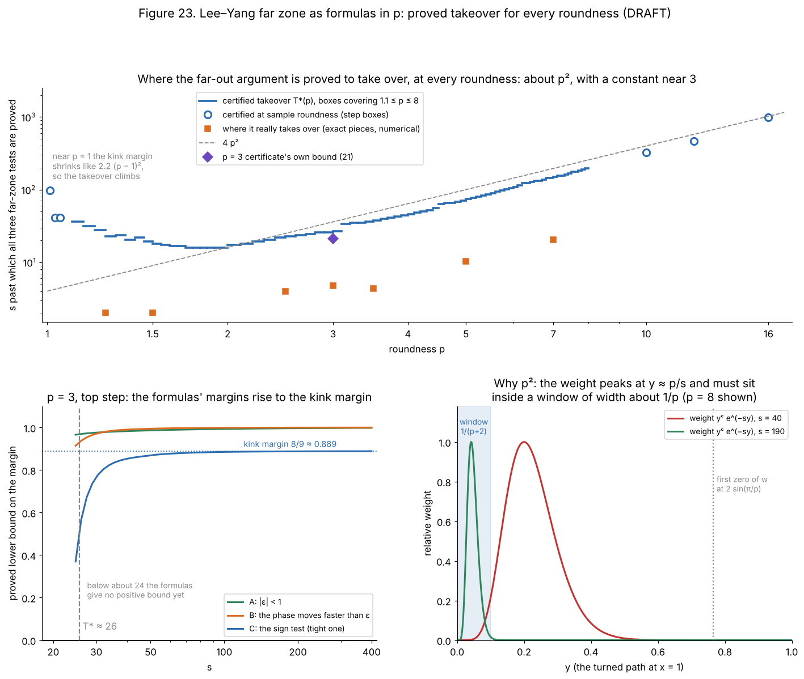

*Figure 23. Top: the proved takeover T\*(p) (blue steps, one per box of roundness) against the point where the tests
really start to hold with the exact pieces (orange). The proof's point is about 3p², and the real one is about 0.4p².
Near p = 1 the takeover climbs again, because the margin itself shrinks like 2.2 (p − 1)². Bottom left: at p = 3, top
step, the three proved margins rise to the kink margin 8/9. Bottom right: why the cost is p². The weight y^c e^(−sy)
peaks near y = p/s, and the bounds only control a window of width about 1/p, because the first zero of w sits at
2 sin(π/p). So s has to be a few times p² before the weight sits inside the window.*

- **The formulas.** J = p^c Γ(c + 1) (s − iβ)^(−c−1) (1 + E) with β = c(p − 1)/2. The error E has two parts. Inside a
  window of width κ/(p + 2), the second-order term of log w is kept exactly, (p − 1)(5 − p)/24, and only the third
  order is bounded. Outside the window, |w/p| ≤ (1 + y²/2)^(p−1) gives a binomial sum. C gets three terms led by
  c|sin(πp/2)| Γ(p + 1)/s^(p+1). Every piece is a closed expression in p, c and s, with two free knobs κ and λ.
- **Checked against the exact values** (F1): at p = 1.25 to 7, c up to 8 and s = 10 to 300, every bound holds. The
  closest the true error comes to its bound is 94% for J; the C bound is exact at c = 1.
- **Certified** (F2): 676 boxes cover 1.1 ≤ p ≤ 8 and every step. Each box is evaluated with intervals, so it
  covers every p and every b inside it at once. Boxes split where the margin was thin, mostly near p = 1.1. Every
  bound decreases in s past (p + 1)/(λ 2^(−1/p)), and every certified T sits past that point, so positive margins at
  T hold for every larger s.
- **Spot checks outside that range** (F3): T\* is about 97 at p = 1.01, 41 at p = 1.03 and 1.05, 328 at p = 10, 466 at
  p = 12 and 982 at p = 16.
- **Compared with the p = 3 certificate.** Its own bound was 21, from constants fitted to p = 3. The general formulas
  give about 26 there. That's 5 more, the price of one set of formulas for every p.

**How solid.** The interval runs are rigorous given the formulas. The formulas themselves come from Taylor
remainders, binomial tails and the contour turn, all derived by hand. F1 checks them numerically at 136 points. None of
it is in Lean yet. Pólya and Krein are cited as before.

**What it changes.** The per-p input `AlternatesBelow p` now splits cleanly. Past T\*(p) it's proved for every
1.1 ≤ p ≤ 8. Below T\*(p) it's a near zone of about T\*/π zeros per step: around 8 at p = 3 and 60 at p = 8. At p = 3
that near zone is already boxed (section N3, p = 3). For other p in the range it's a finite interval computation of
the same kind, but its size grows like p² per step. (Done next, for 1.1 ≤ p ≤ 5: section N3, near zone.)

**Verdict: worth following, with a clear limit.** The far half is now a theorem-shaped statement for a whole range of
p, not one p at a time. The near zone is the bottleneck. A near-zone run like p = 3's over 1.1 ≤ p ≤ 5 is the natural
next step, and it looks feasible, since the zero count stays under about 25 per step there. Every p at once needs
something new for large p, because a box check whose size grows like p² can't cover all p. The proved point is 6 to 7
times the real one, so tighter bounds would shrink the near zone. Turning the path to steepest descent is the
obvious route, but the zero of w at angle π/p gets in the way for large p.

**Checks** (`far_bounds_p.py` → `far_bounds_p_output.txt`, `far_bounds_p.json`, **4 of 4 pass**, 779 s):

| Check | What | Result |
|---|---|---|
| F1 | every bound against exact J, J′, C, C′ by quadrature (p = 1.25 to 7, c ≤ 8, s = 10 to 300) | all hold; closest 0.94 of the bound |
| F2 | T\*(p) on boxes covering 1.1 ≤ p ≤ 8, every step b in [0, p − 1], interval arithmetic | 676 boxes, all certified |
| F3 | T\* at p = 1.01, 1.03, 1.05, 10, 12, 16 on step boxes | 97, 41, 41, 328, 466, 982 |
| F4 | T\*/p² for 3 ≤ p ≤ 8; p = 3 against the certificate's 21 | at most 3.29; 26.6 |

### N3, near zone. The rule proved for every roundness from 1.1 to 5

Asked next by Brennan: "Box the near zone." **Short answer: done. The near zone passes for every roundness from 1.1
to 5, so with the far bounds above, the holding half is now proved, computer-assisted, for every a ≤ p at every p from
1.1 to 5. With the breaking half, the rule is a theorem on that whole range: the zeros are real exactly when a ≤ p,
that is n ≤ 1 + p². The one leftover is p = 4, where the rule says every a and a > 4 is still proved only at whole
a.** At p = 5 that's every ball dimension up to 26. 3,276 boxes cover
every pair (p, b) with 1.1 ≤ p ≤ 5 and 0 ≤ b ≤ p − 1. In each box, every zero of G at step b below the end of the grid
is isolated, G at b + 1 has a definite sign there, and the signs alternate. Each box also reaches past the far zone's
T\*(p), so the two halves join.

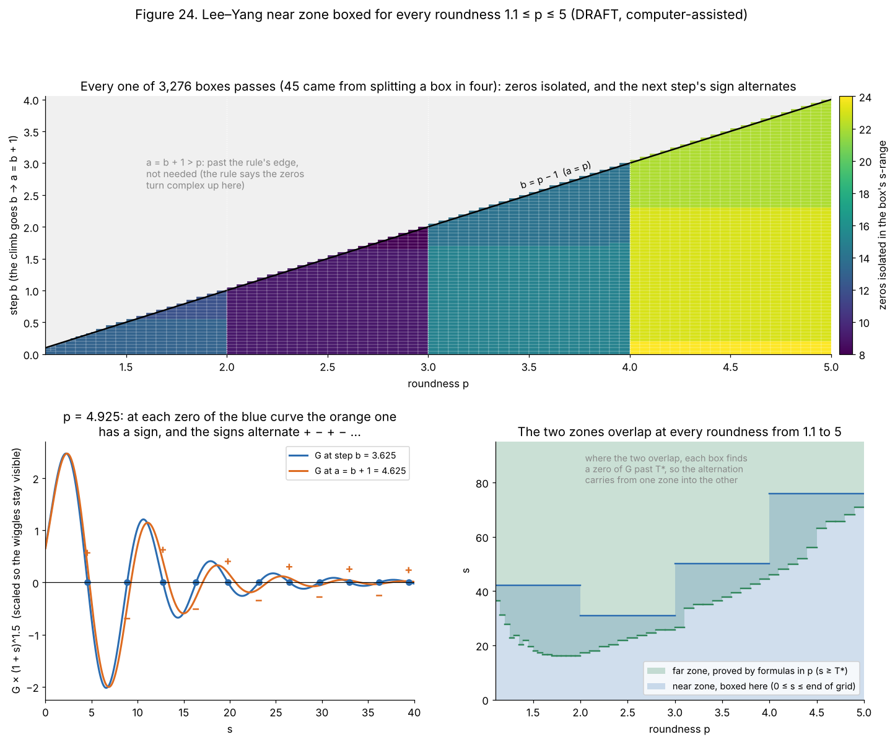

*Figure 24. Top: every box in (p, b), coloured by how many zeros it isolates (8 to 24). The line is b = p − 1, the top
step; boxes poke past it because they're square, and the part above isn't needed. Bottom left: one of the hardest
boxes, p = 4.925 at the top step. At each zero of G at b (blue dots), G at b + 1 is + − + − … in turn. Bottom right:
the near zone (blue, up to the end of each strip's grid) and the far zone (green, from T\*(p)) overlap at every p.*

- **How a whole range of p is covered at once.** At rational (p, c), G is an exact power series with Beta-function
  coefficients, summed with big integers, so each node value carries an error under 2^(−200) e^s. On 14 big boxes
  (a strip of p times a unit range of c) these values are interpolated at 9 to 16 nodes in each direction. The
  interpolation error is bounded with no fitting. In c, every c-derivative of G is at most n!, because 1 − x ≤ 1 − x^p.
  In p, (1 − x^p)^c stays analytic and below 2^c for Re p > 0, so Cauchy's bound applies. Together they give an error
  under 3.4 × 10^(−9) everywhere.
- **The zero test** is the p = 3 certificate's: cells of width 1/8 in s, Taylor models with 7 derivatives, and a run of
  cells holds one zero when its ends have opposite signs and its slope keeps one sign. One thing is new. Near p = 5 a
  zero of G at b + 1 can sit inside the same run, so the sign is checked only on the sub-cells (width 1/128) where G at
  b can still vanish.
- **Splitting.** 45 boxes came from splitting a box in four, up to 4 times. All of them sit on the top step below
  p = 1.35, where the part of a box past the rule's edge matters most.
- **Matches p = 3.** The boxes containing p = 3 pass, as the separate p = 3 certificate says they should.

**How solid.** The node values are exact. The interpolation bounds are proved by hand. The box sweep runs in
double-precision floats, with a worst-case rounding bound added at every step, but without directed rounding. Z4
checks the surrogate against direct quadrature at random points: every value lands inside its enclosure. As with the
far bounds, none of this is in Lean. Pólya (base step b ≤ 1) and Krein (the climb) are cited as before, and the step
identity carries the result down from a + 1 to a.

**What it changes.** For 1.1 ≤ p ≤ 5 the per-p input `AlternatesBelow p` is now fully checked: near zone here, far zone
above. With the breaking half proved earlier, the rule n ≤ 1 + p² is a theorem, computer-assisted, on that whole range,
not only at p = 3 (at p = 4, a > 4 is still open between whole numbers). What remains open: p below 1.1, where the far takeover climbs because the kink margin shrinks like
(p − 1)², and p above 5.

**Verdict: worth following, up to a point.** It closes the rule on a whole interval of roundness, and the run takes only
3½ minutes. Stretching it to p = 8 looks feasible, at roughly 60 zeros per step and a few times the work. Every p at
once can't come from this method, because the near zone grows like p². That needs a new far bound that takes over
much earlier, or an argument that doesn't count zeros. The next steps worth taking are pushing to p = 8, or
moving the near-zone check into Lean on the shared core, which would make the rule on 1.1 ≤ p ≤ 5 machine-checked
rather than Python-checked.

**Checks** (`near_zone_p.py` → `near_zone_p_output.txt`, `near_zone_p.json`, **5 of 5 pass**, 202 s):

| Check | What | Result |
|---|---|---|
| Z1 | every zero of G at b in [0, end of grid] isolated, on boxes covering 1.1 ≤ p ≤ 5 and 0 ≤ b ≤ p − 1 | 3,276 boxes, 8 to 24 zeros each |
| Z2 | G at b + 1 has a definite sign at each such zero, and the signs alternate | all boxes |
| Z3 | every box reaches a zero past the far zone's T\*(p) | all boxes |
| Z4 | surrogate against direct quadrature at 12 random points (polish) | all inside; widest enclosure 3.9e-9 |
| Z5 | boxes containing p = 3 are certified | 81 boxes |

---

## The polishing step

Every numerical fit or search now ends with a cheap exact step, and its cost is recorded:

| Check | What gets polished | Result | Cost |
|---|---|---|---|
| P1 | Moving the centre (C1): exact Bayes scaling and exact Lorentz boost replace least squares | 4e-16, 3e-16 | 2 ms |
| P2 | CHSH angles (C2): local optimiser from the search's best point, compared with the closed form | 4e-16 | 0.72 s |
| P3 | Norm-keeping maps (C3): exact rotation and stochastic matrix | 4e-16, 9e-16 | under 1 ms |
| P4 | Ordering fractions (C1, C12): exact end values 1/4 and 0.2286, plus an error bar | ±0.003 | 0.57 s |
| P5 | Lee–Yang zeros (C9): Newton steps on the octahedron and ball zeros | 7.4977 + 2.7687i; 4.4934 | 3 ms |
| P6 | Gauss–Bonnet (C7): half-resolution recheck of the total | 1.000000 | 11 ms |

| N1 | Bell floor: exact corner check on polygons, local optimiser on smooth shapes and 3D p-balls | 1e-8 | 5.8 s |
| N2 | Fermat at rational p: exact search with whole-number arithmetic | exact | 0.1 s |
| N3 | Lee–Yang: exact zero count in a disc with mpmath | exact | 13.5 s |
| N3 proof | Lee–Yang proof checks: identity, slope, p = 4 operator, 12 disc counts | exact | 34 s |
| N3 sliding | Lee–Yang zeros refined with findroot, alternation rechecked | moves ≤ 0.025 | 1.9 s |
| N3 identity | step identity checked coefficient by coefficient at 50 digits; zeros refined with findroot | exact | under 1 s, of the 20 s run |
| N3 strip | zeros refined with findroot; lobes by direct quadrature against the identity | gap 2e-39 | 1.2 s |
| N3 lobe law | first lobes by direct quadrature against the identity; zeros refined | all 50 digits | under 2 s, of the 97 s run |
| N3 p = 3 | contour formula against the defining integral, 4 spot checks | gap 1e-32 | under 1 s, of the 205 s run |
| N3 refactor | contour formula at non-whole p against the defining integral | gap 7e-10 | under 1 s, of the 244 s run |
| N3 far bounds | every far-zone bound against exact quadrature, 136 points | closest 0.94 of the bound | about a minute, of the 779 s run |
| N3 near zone | surrogate enclosures against direct quadrature, 12 random points | all inside, widest 3.9e-9 | about 2 s, of the 202 s run |

**Total: 1.3 seconds** for the survey's checks and **19.4 seconds** for the new-law pass, on top of their own runs.

---

## Files

- `laws.py` → `laws.json`: the 49 groups with Lean modules, shape, verdict and candidate.
- `checks.py` → `checks_output.txt`, `results.json`: 46 checks (M, K, S, B, C, D, E, F, G, H, I, J, P).
- `figures.py` → `figures/`: figures 0–12.
- `new_laws.py` → `new_laws.json`: 9 checks for the new-law pass (N1–N3, N5). `figures_new.py` → figures 13–15.
- `proof_checks.py` → `proof_checks.json`, `proof_checks_output.txt`: 4 checks for the Lee–Yang proof. `figures_proof.py` → figure 16.
- `interlace_check.py` → `interlace_check.json`; `interlace_summary.py` → `interlace_output.txt`: 4 checks for the sliding route. `figures_interlace.py` → figure 17.
- `identity_check.py` → `identity_check.json`, `identity_output.txt`: 4 checks for the step identity. `figures_identity.py` → figure 18. `../mathlib-map/MathlibMap/LeeYangStep.lean`: Lean statements, built by CI with the Mathlib map.
- `strip_check.py` → `strip_check.json`, `strip_output.txt`: 5 checks for the top strip. `figures_strip.py` → figure 19.
- `lobe_law_check.py` → `lobe_law_check.json`, `lobe_law_output.txt`: 5 checks for the lobe law. `figures_lobe_law.py` → figure 20.
- `p3_certificate.py` → `p3_certificate.json`, `p3_certificate_output.txt`: the 5-part certificate for p = 3. `figures_p3.py` → figure 21.
  `../mathlib-map/MathlibMap/LeeYangP3.lean`: the p = 3 statements (statements only), built by CI with the Mathlib map.
- `../mathlib-map/MathlibMap/LeeYangP3Constants.lean`: Lean proofs behind the whole-number constants 2 and 6, and the exact fractions.
- `../mathlib-map/MathlibMap/LeeYangCore.lean`: the shared Lean core (toolkit, core theorem, p = 1, 2, 3 instances), built by CI with the Mathlib map.
- `general_p_far.py` → `general_p_far.json`, `general_p_far_output.txt`: the far-zone scan across roundness. `figures_refactor.py` → figure 22.
- `far_bounds_p.py` → `far_bounds_p.json`, `far_bounds_p_output.txt`: the far-zone bounds as formulas in p and the certified takeover T*(p). `figures_far_p.py` → figure 23.
- `near_zone_p.py` → `near_zone_p.json`, `near_zone_p_output.txt`: the near zone boxed for every 1.1 ≤ p ≤ 5, so the rule is proved there with the far bounds. `figures_near_p.py` → figure 24.

## References

- S. Aaronson, "Is quantum mechanics an island in theoryspace?" (2004).
- J.-P. Benzécri, convex domains and projective geometry; W. Goldman and J. Loftin on the space of convex shapes.
- B. Tsirelson (1980), the 2√2 bound; S. Popescu and D. Rohrlich (1994), the PR box.
- P. Janotta, C. Gogolin, J. Barrett, N. Brunner, "Limits on nonlocal correlations from the structure of the local state
  space", New J. Phys. 13, 063024 (2011); arXiv:1012.1215.
- M. Banik et al., "Degree of complementarity determines the nonlocality in quantum mechanics", Phys. Rev. A (2013).
- N. Stevens, P. Busch, "Steering, incompatibility, and Bell inequality violations in a class of probabilistic theories"
  (2014); arXiv:1311.1462.
- A. Bluhm, A. Jenčová, I. Nechita, "Incompatibility in general probabilistic theories, generalized spectrahedra, and
  tensor norms" (2022); arXiv:2011.06497.
- F. Hirzebruch, the two-parameter genus; R. Stanley and V. Danilov, h-vectors of toric shapes.
- D. Myrheim (1978) and D. Meyer (1988), ordering fraction and dimension of causal sets.
- T. D. Lee and C. N. Yang (1952); C. Newman (1974); G. Pólya on (1 − t)^a.
- G. Pólya, "Über die Nullstellen gewisser ganzer Funktionen", Math. Z. 2 (1918): sine and cosine transforms of
  positive nondecreasing weights have only real zeros. E. Laguerre and G. Pólya on the Laguerre–Pólya class and the
  operators that keep it.
- A. Erdélyi, Asymptotic Expansions (1956), endpoint expansions of Fourier integrals; B. Ya. Levin, Distribution of
  Zeros of Entire Functions, the Cartwright–Levinson theorem.
- M. G. Krein, on the representation of entire functions of exponential type by their partial fractions (1947); B. Ya.
  Levin, Lectures on Entire Functions (1996), chapter on the Cartwright class: a ratio of such functions with poles
  only at real zeros is the sum of its partial fractions.
- G. N. Watson, A Treatise on the Theory of Bessel Functions (1944), §15.22: interlacing of the zeros of J_ν and J_(ν+1).
- L. Lorch and G. Szegő, "Higher monotonicity properties of certain Sturm–Liouville functions", Acta Math. 109 (1963):
  growing lobes of weighted Bessel functions, the ball's version of the lobe law.
- N. Obreschkoff, Verteilung und Berechnung der Nullstellen reeller Polynome (1963): two real-rooted functions have
  alternating zeros exactly when all their real combinations are real-rooted (Hermite–Kakeya–Obreschkoff).
- D. K. Dimitrov and P. K. Rusev, "Zeros of entire Fourier transforms", East J. Approx. (2011).
- Lee–Yang preprints checked for the rule: "On the Lee-Yang property of some ferromagnets", arXiv:2503.03510; a preprint on
  isotropic vector ferromagnets, arXiv:2603.18675.
- J. Gao and K.-S. Lau, "On the geometry of spheres in normed linear spaces", J. Austral. Math. Soc. (1990): the James
  constant, √2 ≤ J(X) ≤ 2, and J(ℓp) = max(2^(1/p), 2^(1 − 1/p)).
- J. A. Clarkson, "Uniformly convex spaces" (1936).
- N. Obreschkoff, Verteilung und Berechnung der Nullstellen reeller Polynome (1963): two real-rooted functions have
  alternating zeros exactly when all their real combinations are real-rooted (Hermite–Kakeya–Obreschkoff).
- D. K. Dimitrov and P. K. Rusev, "Zeros of entire Fourier transforms", East J. Approx. (2011): survey of Pólya's methods.
