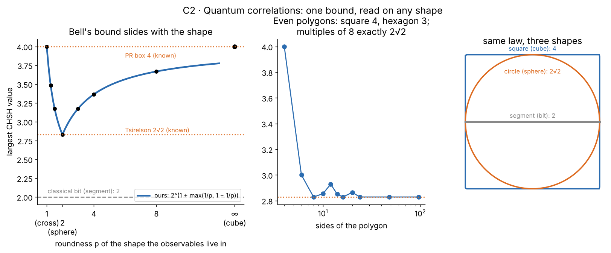
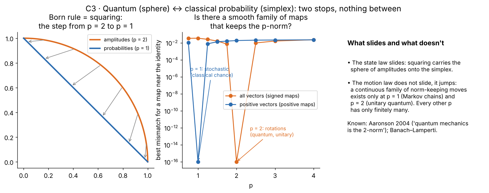
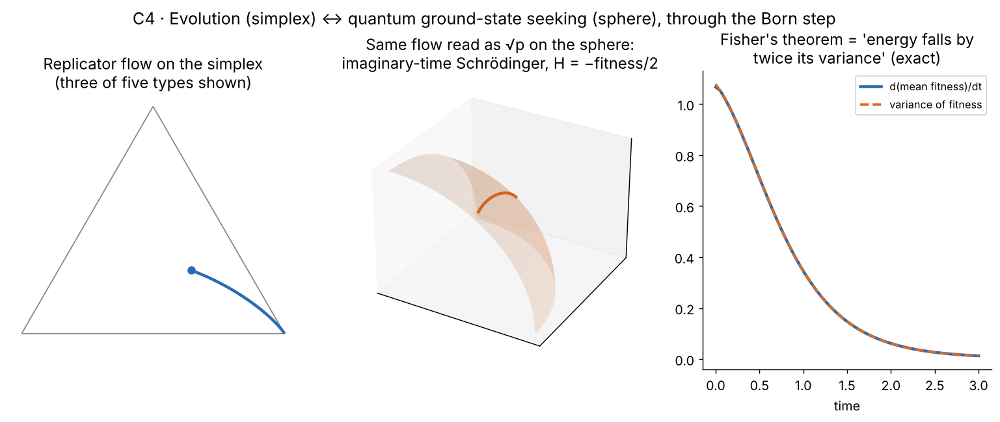
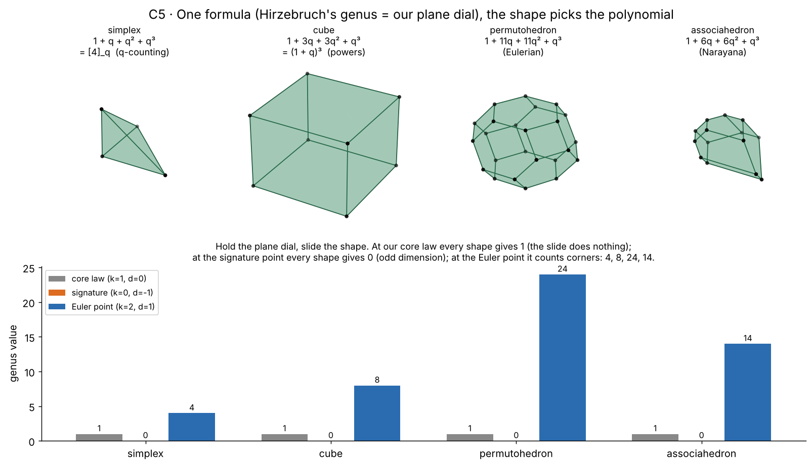
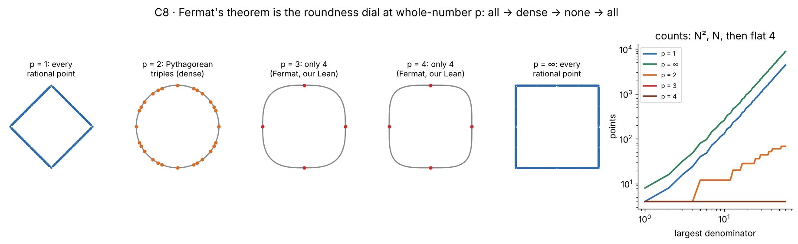
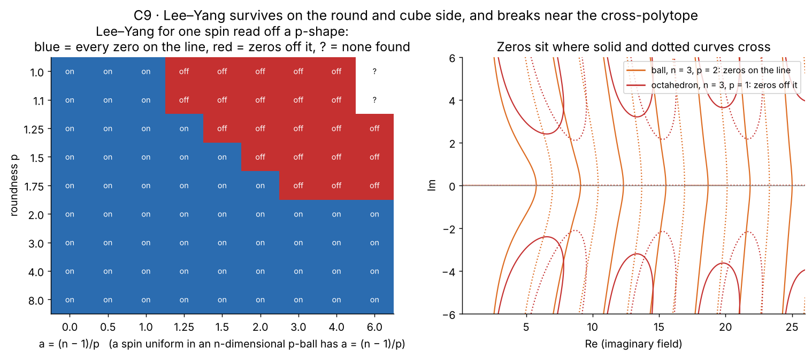
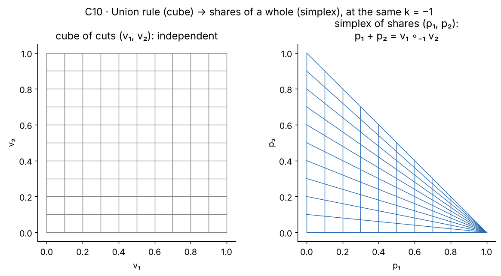
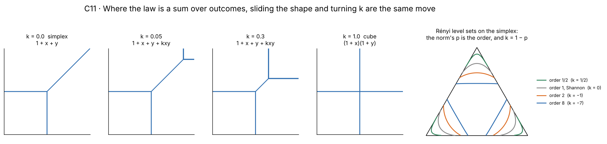

# Shape-dial survey: which proved laws slide into one another (DRAFT)

**DRAFT, Nov 26 2026.** Part of Hypercube Composition Theory (repo: fused-hyperoperation-algebra).
Asked for by Brennan: "a survey of all of our laws that we've proven to see if the shape dial is able to move from one to
another, not just these 2, but really all of them." Then: "add a polishing step to all of our methods, as long as it
doesn't take too much effort from the computer."
Builds on `simplex/` (section 7, the round-to-triangle dial) and `polar-recast/` (the right shape for each family) and does
not repeat them. Checks: `checks.py` → `checks_output.txt`, **46 of 46 pass** (numpy, scipy, mpmath), including 6 polish
checks that cost **1.3 seconds in all**. Law list: `laws.py` → `laws.json`. Pictures: `figures.py` → `figures/`.
No new Lean in this pass. Colour key: **blue = our reading, orange = already known, grey = the cube end.**

## The result

I sorted everything the Lean library and the pages have proved into **49 law groups**. With the plane dial (k, d) held
still and only the shape slid:

- **17 groups slide into another proved law.** For 15 the link is checked exactly or to machine precision; for 2 the
  numbers slide but the law in the middle isn't proved yet.
- **6 groups only look like they slide.** For laws that are a sum over outcomes, moving from the cube to the simplex is
  the same thing as turning k from 1 to 0, so the shape dial adds nothing there.
- **1 group, Lee–Yang, survives on part of the dial** (the round and cube side) and **breaks** near the
  cross-polytope.
- **1 group is the shape dial itself** (corner weights and power-set dials).
- **24 groups don't slide**, either because they are plane-dial laws (rungs, calculus, conics, elliptic curves, Maxwell)
  or because they don't depend on a shape at all.

The strongest leads, in order:

1. **Bell's bound (C2).** One formula, CHSH = 2^(1 + max(1/p, 1 − 1/p)), runs along the roundness dial: 4 at the
   cross-polytope, Tsirelson's 2√2 at the sphere, 4 again at the cube. The classical value 2 sits on the simplex end.
   This is the cleanest slide in the survey.
2. **Relativity ↔ Bayes (C1).** Of all the shapes on the dial, only the triangle (Bayes) and the disk (relativity) can
   move their centre anywhere and keep their shape. Everything between them can't. So the two laws are the only two
   "homogeneous" stops, and the dial between them is the turn-fading route from `simplex/` section 7.
3. **The genus slide (C5).** Hirzebruch's two-parameter genus is our plane dial, and the shape picks the polynomial:
   q-numbers on the simplex, binomials on the cube, Eulerian numbers on the permutohedron, Narayana numbers on the
   associahedron. Tidy, and mostly known.
4. **Fermat on the dial (C8).** Fermat's curves are the p-circles at whole-number p. Sliding p gives every rational
   point (p = 1), a thin dense set (p = 2), only the 4 trivial points (p = 3 and 4, both in our Lean), then every point
   again (p = ∞).
5. **The swap rule → corner counting (C7).** The sphere's spread-out curvature gathers into the 8 cube corners or the 6
   octahedron corners as you slide, with the total fixed at 4π.

*Figure 0. Three ways to slide the shape with (k, d) fixed. Dial A is roundness p (cross-polytope at p = 1, sphere at
p = 2, cube at p = ∞). Dial B is round ↔ triangle, the route in `simplex/` section 7. Dial C is corner weights
(simplex, associahedron, permutohedron, cube). Each candidate below uses whichever dial its law actually lives on.*

*Figure 12. All 49 groups, sorted by verdict.*

---

## How I tested a slide

For each law I took the shape its proof really uses (the `polar-recast/` table), held (k, d) fixed, and moved only the
shape along one of the three dials. A link counts as **slides** when both ends are proved laws and the quantity that
carries one into the other is checked along the whole path, exactly where a closed form exists. **Plausible** means the
numbers slide but nothing proves the law in the middle. A shape move that turns out to be a change of k is marked as
the **k dial in disguise**.

One tool shows up everywhere: the p-norm at roundness p is the soft maximum at temperature 1/p (check M1, error
9e-16). So sliding toward the cube is cooling toward a hard maximum, which is why several laws below end in a max.

---

## C1. Relativity (ball) ↔ Bayes (triangle) ↔ the cube's causal order — slides

*Figure 1. Left: after moving the centre, only the triangle and the disk come back to their own shape (mismatch
2e-14 and 3e-16); p = 1.5, 3, 4 and the square stay off by 0.02 to 0.05. Middle: the turn map from `simplex/` section 7
as the shape slides. Right: the fraction of ordered pairs in a causal diamond, sliding the light cone from triangle to
disk.*

- **Known (orange):** in one dimension a coin's odds multiply exactly as relativity adds speeds (0.5c ⊕ 0.6c = 0.846c,
  odds 3 × 4 = 12; check B1). The disk with Hilbert's distance is relativity's velocity space; the triangle is flat.
- **Ours (blue):** on the roundness and round-triangle dials, **only these two stops have a centre you can move
  anywhere** (checks B2, B3). So relativity and Bayes are the two homogeneous ends, and every shape between them has a
  preferred centre. Thermodynamics joins through check M1: cooling is sliding the roundness toward the cube, so the
  Gibbs law rides the same dial (the simplex page's cooling route).
- **Causal order (C12, plausible):** a triangle-shaped light cone gives the cube's product order, ordering fraction
  1/4 (0.249 measured). Sliding to the round cone it falls smoothly to Myrheim–Meyer's 0.2286 (0.226 measured,
  error bar ±0.003). The curved-space page's "curvature by counting" therefore slides from cube counting to round
  counting, but the law in between isn't proved.
- **Verdict: worth following.** It says which shapes can carry a "boost" at all, and the answer is just these two.

## C2. Bell's bound along the roundness dial — slides

*Figure 2. CHSH with Alice's measurements in the p-ball and Bob's in its dual. Left: the formula against the numbers.
Middle: even polygons. Right: the segment (one classical bit, the 1-D simplex) gives 2.*

- **Known:** 2 (classical), 2√2 (Tsirelson, quantum), 4 (the PR box).
- **Ours:** all three are one curve, **CHSH(p) = 2^(1 + max(1/p, 1 − 1/p))**, matching the optimiser to 4e-16 at
  p = 1.25, 1.5, 2, 3, 4, 8 (checks C1–C3). Polygons: square 4, hexagon 3, every multiple of 8 sides exactly 2√2, the
  others a little above and tending to 2√2 (check C5). I haven't searched the literature for this closed form, so it
  may already be known.
- **Verdict: the strongest lead.** It ties the quantum bound to the sphere's place on the dial: 2√2 is the minimum
  along the dial, and the sphere is the only point that reaches it.

## C3. Quantum (sphere) ↔ classical probability (simplex) — slides, with two stops only

*Figure 3. Squaring carries the sphere onto the simplex (the Born rule). A smooth family of norm-keeping maps exists
only at p = 2 (rotations) and at p = 1 for positive vectors (stochastic maps).*

- **Known:** the Born rule is "square the amplitudes"; Aaronson (2004) showed only p = 1 and p = 2 have enough
  norm-keeping maps.
- **Ours:** checked along the whole dial (checks D1–D3): the mismatch is 1e-16 at the two stops and 0.007 to 0.035
  everywhere else. So the slide from quantum to classical is a jump between two stops, not a path.
- **Verdict: confirms known structure.** It explains why C2's classical end sits on the simplex.

## C4. Evolution (simplex) ↔ ground-state seeking (sphere) — slides

*Figure 4. The replicator equation, read through square roots, is normalised imaginary-time Schrödinger evolution with
energy = −fitness/2.*

- **Known:** this correspondence appears in the literature on replicator dynamics.
- **Ours:** checked to 1e-12 (E1), and Fisher's fundamental theorem (mean fitness rises at the rate of its variance)
  becomes the energy-drop rule d⟨H⟩/dt = −2 Var(H) (E2). Our Lean's game-theory and evolution laws slide onto quantum
  cooling through the same Born step as C3.
- **Verdict: solid, mostly known.** Useful as a bridge between the biology and quantum modules.

## C5. One genus, the shape picks the polynomial — slides

*Figure 5. Hirzebruch's genus with 1 + kx + dx² = (1 + αx)(1 + βx) and q = β/α, read on four shapes.*

- **Known:** h-vectors of toric shapes (Danilov, Stanley): simplex [n]_q, cube (1 + q)ⁿ, permutohedron Eulerian,
  associahedron Narayana (checks F1, F2).
- **Ours:** at our core law (d = 0, so q = 0) every shape gives 1, so the shape dial does nothing there (F3). At the
  Euler point (q = 1) it counts corners: 4, 8, 24, 14 (F4). Our q-counting, powers, Bell/Catalan and toric-chart laws
  are four readings of one formula. Cube face weights q^area (solitons) look like the same slide but aren't proved
  (plausible).
- **Verdict: tidy, mostly known.** It's a good organising page for those modules more than a new result.

## C6. e and π are two readings of one function — slides

*Figure 6. Left: the sum of unit-ball volumes over all dimensions along the dial. Right: the same sum as a function of t.*

- **Known:** volumes (2Γ(1 + 1/p))ⁿ / Γ(1 + n/p) (G1); corner simplex 1/n! sums to e; the ball's sum is e^π(1 + erf √π)
  = 46.0 (G3).
- **Ours:** every p is one Mittag-Leffler function, E_{1/p}(2Γ(1 + 1/p)) (G4): e² at the cross-polytope, the e^π
  formula at the sphere, and toward the cube it becomes the geometric series 1/(1 − 2t) and diverges (G5).
- **Verdict: a nice picture, modest lead.** It puts our e and π modules on one curve.

## C7. The swap rule slides into corner counting — slides

*Figure 7. Curvature on the superellipsoid |x|ᵖ + |y|ᵖ + |z|ᵖ = 1. The total stays 4π; where it sits moves.*

- **Known:** Gauss–Bonnet, and Descartes' corner defects (cube 8 × π/2, octahedron 6 × 2π/3; H3).
- **Ours:** our swap rule (turn = d × area) on the sphere spreads curvature like area (18% within 0.3 of the corners on
  18% of the area). Toward the cube, 99.9% gathers in the 8 corners at p = 20; toward the octahedron, 74% gathers in the
  6 at p = 1.2 (H1, H2). So Thomas, Foucault and pulsar precession slide into counting corners.
- **Verdict: worth following** alongside C1, because it gives the curved-space counting a second route.

## C8. Fermat on the roundness dial — slides

*Figure 8. Rational points on |x|ᵖ + |y|ᵖ = 1 with denominator up to 60.*

- **Known:** Fermat's last theorem; our Lean proves n = 3 and n = 4 and the Pythagorean parametrisation.
- **Ours:** reading Fermat's curves as p-circles puts them on the dial: 4,408 points at p = 1, 68 at p = 2, 4 at p = 3
  and p = 4, 8,816 at p = ∞ (I1, I2). Counts grow like N², then N, then stay flat.
- **Verdict: a good picture, not a proof route.** It doesn't touch the hard part of Fermat.

## C9. Lee–Yang survives only on part of the dial — partly

*Figure 9. Every zero on the imaginary line (Y), or some off it (.), for spins spread over a p-ball with weight
(1 − |x|ᵖ)^a.*

- **Known:** Lee–Yang for the round and cube spins; Pólya's (1 − t)^a family; Newman (1974).
- **Ours:** on the round and cube side every one of 18 cases keeps all zeros on the line (J1). Near the cross-polytope
  it breaks: the octahedron's spin (p = 1, solid ball, n = 3) has all its zeros off the line, the first at
  7.4977 + 2.7687i (J2, and polished in P5). At p = 1 the line holds only for a ≤ 1, and the cut-off rises with p (J3).
- **Verdict: the one honest break.** It's worth a closer look because it says which spins our Lee–Yang modules may not
  cover.

## C10. Union rule (cube) → shares of a whole (simplex) — slides

*Figure 11. At the same k = −1, the union rule's running total is stick-breaking, which lands evenly on the triangle.*

- Checks S1, S2: the running total of stick pieces equals v₁ ∘₋₁ … ∘₋₁ v₅, and the cuts land evenly (cell spread 0.014).
  Already in `simplex/`; listed here because it's the cube-to-simplex slide for our probability laws.

## C11. The k dial in disguise — 6 groups

*Figure 10. Left four: the tropical picture of 1 + x + y + kxy as k goes from 0 (simplex) to 1 (cube). Right: Rényi
level sets, whose order is the norm's p, with k = 1 − p.*

- 1 + (x₁ ∘ₖ … ∘ₖ xₙ) = 1 + Σ k^(|S|−1) x^S (K1): k = 0 keeps the single corners (simplex), k = 1 keeps every corner
  (cube). So for the core law, corner expansion, logistic vs softmax, Rényi/Tsallis, Shannon and the repetition dial,
  the cube-to-simplex slide is just turning k (K2–K4).
- **Verdict: no new slide**, but it explains why the shape dial and k look alike in so many places.

---

## The polishing step

Every numerical fit or search now ends with a cheap exact step, and its cost is recorded:

| Check | What gets polished | Result | Cost |
|---|---|---|---|
| P1 | Moving the centre (C1): exact Bayes scaling and exact Lorentz boost replace least squares | 4e-16, 3e-16 | 2 ms |
| P2 | CHSH angles (C2): local optimiser from the search's best point, compared with the closed form | 4e-16 | 0.72 s |
| P3 | Norm-keeping maps (C3): exact rotation and stochastic matrix | 4e-16, 9e-16 | under 1 ms |
| P4 | Ordering fractions (C1, C12): exact end values 1/4 and 0.2286, plus an error bar | ±0.003 | 0.57 s |
| P5 | Lee–Yang zeros (C9): Newton steps on the octahedron and ball zeros | 7.4977 + 2.7687i; 4.4934 | 3 ms |
| P6 | Gauss–Bonnet (C7): half-resolution recheck of the total | 1.000000 | 11 ms |

**Total: 1.3 seconds** on top of the survey's own run.

---

## Files

- `laws.py` → `laws.json`: the 49 groups with Lean modules, shape, verdict and candidate.
- `checks.py` → `checks_output.txt`, `results.json`: 46 checks (M, K, S, B, C, D, E, F, G, H, I, J, P).
- `figures.py` → `figures/`: figures 0–12.

## References

- S. Aaronson, "Is quantum mechanics an island in theoryspace?" (2004).
- J.-P. Benzécri, convex domains and projective geometry; W. Goldman and J. Loftin on the space of convex shapes.
- B. Tsirelson (1980), the 2√2 bound; S. Popescu and D. Rohrlich (1994), the PR box.
- F. Hirzebruch, the two-parameter genus; R. Stanley and V. Danilov, h-vectors of toric shapes.
- D. Myrheim (1978) and D. Meyer (1988), ordering fraction and dimension of causal sets.
- T. D. Lee and C. N. Yang (1952); C. Newman (1974); G. Pólya on (1 − t)^a.
