# DRAFT · Shape dials: every angular shape as a first-class citizen, reached by dials

> **Names:** some words or symbols on this page (fused, twist) also mean something else in standard math, physics or computing, or inside this project. [NAMING-COLLISIONS.md](../../NAMING-COLLISIONS.md) says which meaning is in play.

**DRAFT, Nov 26 2026.** Part of Affine Composition Theory (repo: fused-hyperoperation-algebra). Asked for by Brennan:
"Yes I want these shapes as first class citizens in the model and reaching them as simple dials", then "So is this
the sixth fundamental dial?" and "I'm unclear on how this will yield the higher order shapes as a dial", and then
(asked whether depth should join the dial list): "make sure it's really a new dial ... in as rigorous a way as you can
... I also don't want things to be treated as fundamental if they really are derived" (section 6). Builds on
`polar-coordinates/` (the roundness dial p: cross-polytope at 1, ball at 2, cube at ∞), `simplex/` section 7 (the
round-to-triangle routes), `exceptional-shapes/` (24-cell, 600-cell, 120-cell) and `shape-dial-survey/` (Lee–Yang).
Checks: `checks.py` → `checks_output.txt`, **29 of 29 pass** (numpy, scipy; 28 s). Pictures: `figures.py` →
`figures/`. Lean: `lean/FaceDial.lean` (4 theorems, written for the Mathlib project `mathlib-map/`; compiles in the Mathlib CI, imported in 9c08a9d, no sorry).
Section 6: `depth_checks.py` → `depth_checks_output.txt`, **20 of 20 pass** (7 s); `depth_figures.py` → `figures/fig10`
… `fig14`; `lean/DepthDerived.lean` (5 theorems; compiles in the Mathlib CI, imported in 1a9260a, no sorry).
Section 7 (topological shapes, asked for next: "I wonder if we can start adding common topological shapes as well?"):
`topo_checks.py` → **9 of 9 pass**; `topo_figures.py` → `figures/fig15` … `fig19`; `lean/TopologyShapes.lean` (7 theorems;
compiles in the Mathlib CI with no proof changed, imported in the Mathlib map, no sorry).

## The short answer

**One dial reaches every shape we use, together with tools the model already has; nothing new is needed.**

1. **Roundness p (not new: it is our existing p).** Aim p at any polytope's faces and it runs from a perfect ball at
   p = 2 to the exact polytope at p = ∞. Aimed at the cube's faces it gives back the old p dial exactly, cross-polytope
   at p = 1 included.
2. **Depth (derived, not a dial; section 6).** Which polytope p is aimed at can be slid: Wythoff's kaleidoscope
   (1918) walks a family through its shapes: cube (0) → truncated cube → cuboctahedron (1) → truncated octahedron →
   octahedron (2); in 4D, tesseract → … → 24-cell (2) → 16-cell (3). But the shape at depth k + f is exactly the
   Minkowski sum (1 − f)·corner_k + f·corner_(k+1) of two corner shapes, so depth is a weight on shapes the model already
   has. The weight is a chance, the reading t/(1 + t) of the odds dial t. Depth is a reading, not an input.
3. **The family (a pick, not a dial).** Which mirror set: simplex family (A), cube family (B), dodecahedron family
   (H3), 120/600-cell family (H4), the 24-cell's own family (F4), or the n-gon family in 2D. These are a finite list,
   the way crystal classes are; no number slides between them. In 2D the side count n is a whole-number setting.
4. **Holes and twists (picks, not dials; section 7).** Every shape above is topologically one type, a ball. The others
   are counted by holes (torus 1, pretzel 2, …) and twists (projective plane 1, Klein bottle 2, …), built by gluing the
   edges of polygons we already have. p rounds a torus without changing it, and the curvature's sign is forced by the
   count.

*Figure 6. The cube family on two dials. Left to right is depth: which polytope. Bottom to top is p: how sharp.
Every column starts from the same ball at p = 2, so the whole family grows out of one round shape.*

**Is either the sixth fundamental dial?** No. p is the same roundness dial, now able to aim at any shape. Depth is
derived: odds t on a family's corner shapes, joined by the Minkowski sum (the set operation that "multiplying
polynomials adds shapes" already gives the model). The dial list stays k, d, p, t, r, q, s. Depth is independent of p,
but independent of p is not the same as fundamental: it is not independent of t plus the Minkowski sum (section 6).

---

## 1. The roundness dial aimed at any shape (face-power)

**Recipe.** Base inputs: p and the shape. Everything else is read off the shape.

1. Write the shape as its faces, n_i · x ≤ 1, with the origin at the shape's **analytic centre** (the point that
   maximises the sum of log distances to the faces). There the scaled face normals n_i sum to zero.
2. Read off the **offset** a = (R − 1)/2, where R is how far the shape reaches behind a face, in units of the face's
   own distance. a = 0 for every centrally symmetric shape; a = (d − 1)/2 for the d-simplex.
3. The shape at dial p is the set where the power mean of the shifted face values stays under a + 1:
   M_p(a + n_1·x, …, a + n_m·x) ≤ a + 1.

For a centrally symmetric shape (a = 0) this says: the shape at p is a flat slice through the m-dimensional p-ball. So
our p dial already contained every symmetric polytope; it only had to be sliced the right way.

*Figure 1. Polygons, round to sharp. Odd polygons and the triangle have a > 0; even ones have a = 0.*

What the checks show (A1–E1, C1–C2):

- **Round at p = 2, exactly**, for all 34 shapes tried (worst radius spread 4 × 10⁻¹⁴). For regular shapes this needs
  nothing more; for lopsided ones (associahedra, cyclic polytopes, a random zonotope) one linear change of coordinates
  makes it round. The p = 2 shape is the known **Dikin ellipsoid** of the shape at its analytic centre.
- **Exact at p = ∞** for every shape (5 × 10⁻¹⁴).
- **Shrinks steadily** as p grows, never overshooting the shape, and the gap closes like 1/p, with a proved bound:
  the shape at p reaches at most (1 + (m^(1/p) − 1)(a + 1)) times as far as the polytope, m = number of faces.
- **The cube gives the old dial back**: the face-power shapes of the cube equal the ℓᵖ balls for every p from 1 to
  30, up to size, and p = 1 is the cross-polytope.
- **The simplex keeps its corners**: every corner sits on the boundary at every p, so the simplex's dial runs from its
  circumscribed ball down to itself with the corners pinned.

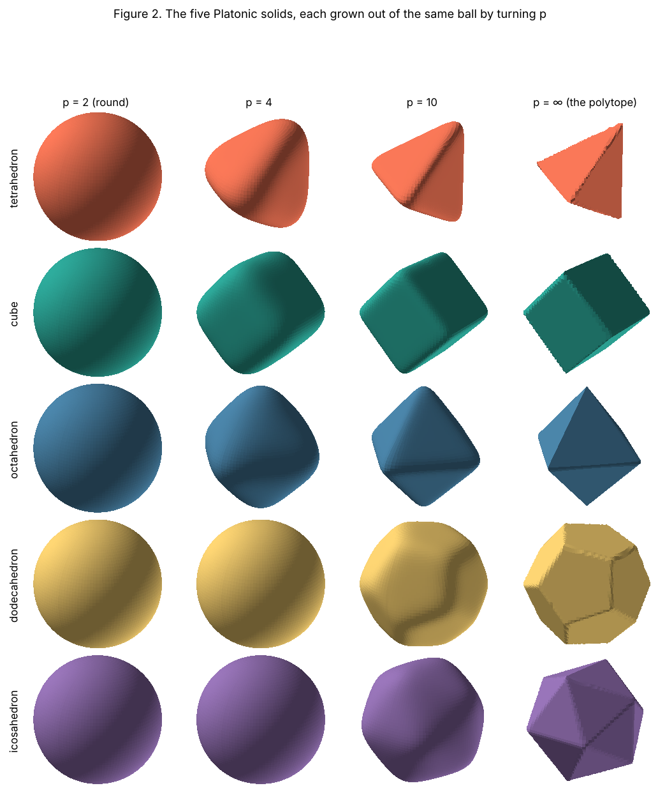

*Figure 2. The five Platonic solids, all grown from the same ball by turning p.*

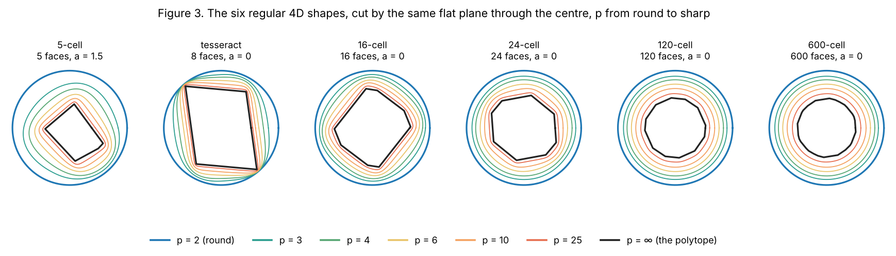

*Figure 3. The six regular 4D shapes, each cut by the same flat plane through the centre.*

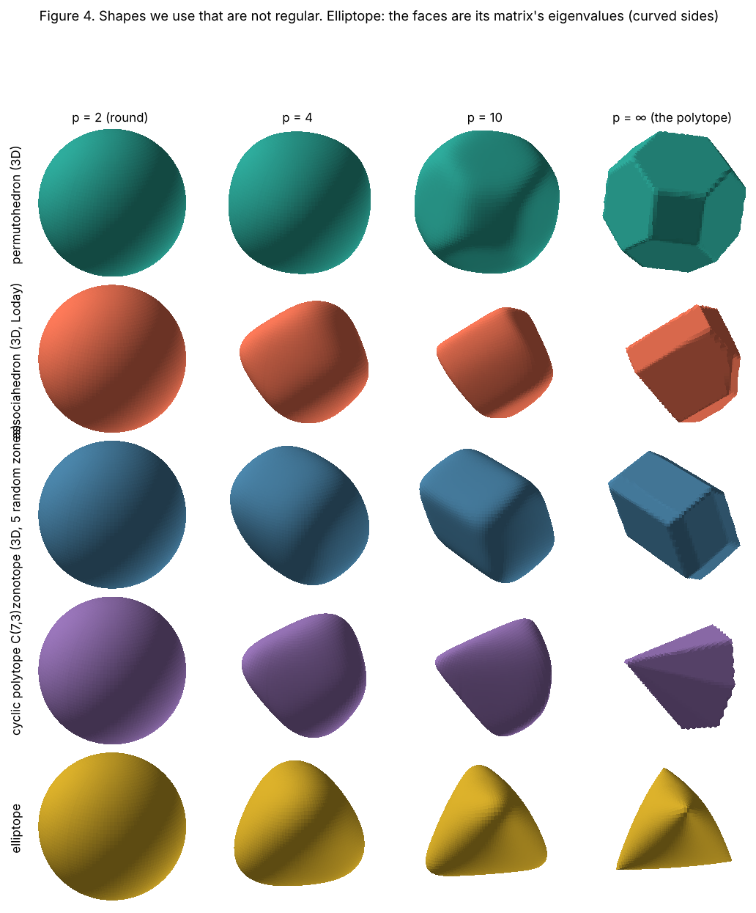

*Figure 4. Shapes we use that are not regular. The elliptope has curved sides, so it has no faces in the usual sense;
the eigenvalues of its correlation matrix play the faces, and the same recipe works (G1–G4): a ball of radius √3 at
p = 2, the elliptope at p = ∞, its four corners pinned throughout.*

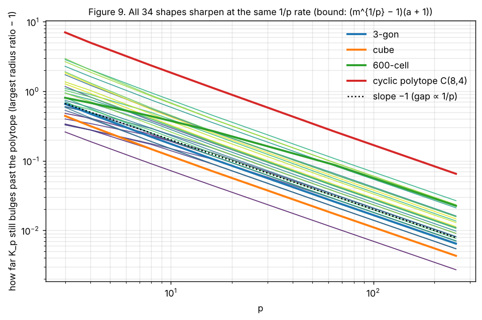

*Figure 9. Every shape sharpens at the same 1/p rate. Many faces and a large offset (the cyclic polytope) only shift
the line up.*

## 2. The shape-choice slider: depth (Wythoff's kaleidoscope)

*Section 6 shows that depth is derived: a Minkowski sum of the family's corner shapes, weighted by odds.*

Put mirrors at the angles a family's diagram gives, put a seed point between them, and reflect it in every mirror. The
images are the corners of a polytope. Seed in a corner of the mirror chamber: a regular or rectified shape. Seed part
way along an edge of the chamber: the truncations in between. Depth measures how far along that path the seed is.

*Figure 5. Depth on three families. Whole depths are the regular and rectified shapes; half depths are truncations.*

Checks W1–W5:

- Depth passes through the named shapes in every family tried: A3, B3, H3 above; B4 (tesseract, 24-cell at depth 2,
  16-cell at depth 3), F4 (24-cell), H4 (120-cell at 0, 600-cell at 3), and the simplex family's whole depths are the
  **hypersimplices** (rectified simplices). The **permutohedron** is the simplex family with the seed at the chamber's
  centre.
- **Every point on every depth path is round at p = 2** with no change of coordinates: all paths meet at one ball
  (Figure 6).
- The offset a slides continuously with depth (tetrahedron 1, octahedron 0, back to 1).
- **In 2D**, depth slides n-gon → regular 2n-gon → n-gon (turned), but **n itself only comes in whole numbers**: a
  fractional n does not close up. So "polygon side count" is a setting, not a slider.

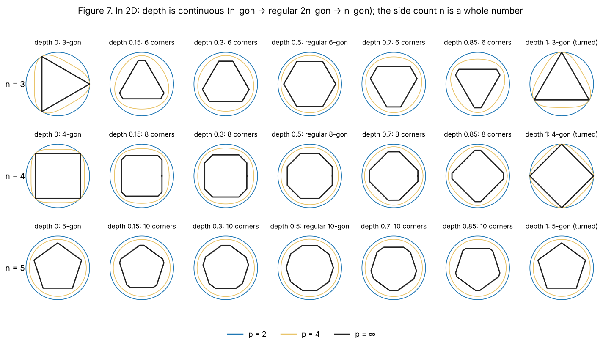

*Figure 7. 2D: depth is continuous; the side count is not.*

**Which shapes are not on a depth path.** The associahedron, cyclic polytopes, general zonotopes and the Birkhoff
polytope are not kaleidoscope shapes. They are still first-class (each has its own p dial, section 1), but reaching
them is a pick, not a slide.

## 3. The simplex test: is the round-to-triangle dial the same as face-power?

The simplex page found three routes from round to triangle: blend (disk plus triangle), trim (triangle cut by a disk)
and temperature (free-energy level sets). Checks F1–F5:

- **Temperature is face-power's far edge, exactly.** Face-power with offset a and p = β·a tends to the temperature
  route at β as a → ∞; the gap falls like 1/a (Figure 8C). So the temperature route is the log-sum-exp member of the
  same recipe.
- **At the triangle's own offset (a = 1/2) the two are close but not equal**: matched for sharpness, the radii differ
  by at most 1.1%. The difference that matters: face-power is exactly round at p = 2, while temperature is only round
  in the hot limit.
- **Blend and trim are separate routes** (closest face-power match off by 1.4% to 5.7%), and both keep flat pieces of
  side all the way, which face-power never has at finite p.
- **Centre turn** (the Thomas-turn measure of the simplex page): −1 at p = 2 exactly, rising steadily toward 0 as p
  grows. Our temperature route reproduces the simplex page's numbers (−0.69, −0.37, −0.14 at β = 1, 3, 10).

*Figure 8. A: face-power and temperature at matched sharpness. B: centre turn along four routes against how
triangular the shape is. C: the temperature route as the a → ∞ edge of face-power.*

**Verdict.** The round-to-triangle dial is the simplex's face-power dial up to a choice of curve: face-power (the
offset a = 1/2) and temperature (a → ∞) are two edges of one recipe. Face-power is the one that keeps "p = 2 is round"
and so matches the p dial on every other shape.

## 4. First-class in the model

- **Python:** `facedial.py` (`FaceDial(corners)` builds any shape's dial: faces, analytic centre, offset, radial
  function at any p), `wythoff.py` (`wythoff_polytope(family, depth)`), `shapes_catalog.py` (all 34 shapes).
- **Lean** (`lean/FaceDial.lean`, Mathlib): the shape at whole-number p as a set; `poly_subset_shape` (the polytope
  is inside every shape), `face_le_of_mem_shape` (the 1/p sharpening bound, without roots), `iInter_shape` (the
  polytope is exactly what all the shapes share: the sharp end of the dial), `shape_two` (p = 2 is a ball when the
  normals sum to zero and form a tight frame). Compiles in the Mathlib CI with no sorry (run 45872146091; imported in 9c08a9d).

## 5. Leads, each judged on its own merits

1. **Quantum: a continuous dial between a classical bit and a quantum bit.** Janotta, Gogolin, Barrett and Brunner
   (2011) used regular n-gons as state spaces: the triangle is a classical system, the disk a real quantum bit, and
   how strong the Bell correlations can be depends on the shape. Face-power gives a continuous version of the same
   walk (triangle at p = ∞, disk at p = 2). Worth following: the next test is the best Bell (CHSH) score along p,
   which `shape-dial-survey/` already measured for symmetric angular shapes (never below 2√2). This is the quantum
   side of the North Star, not gravity.
2. **Qutrits.** On 3-level quantum states the eigenvalues play the faces; p = 2 is exactly the pure-state sphere
   tr ρ² = 1 (H1) and p = ∞ is the true state space. For qubits the dial does nothing, because the 2-level eigenvalue
   simplex is symmetric; that matches the qubit state space being a ball. A clean picture; it is a restatement of known
   facts about the generalized Bloch ball, not a new result.
3. **Quantum gravity, per the design principle.** I tried the two facts I could not find in print (the offset recipe
   that makes p = 2 exactly round for lopsided shapes, and temperature as its a → ∞ edge) against quantum gravity and
   found no foothold; they are geometry bookkeeping. Not a lead there.

## 6. Is depth really a new dial? No: it is derived

Brennan asked for this to be settled as rigorously as possible before anything joins the dial list. Checks:
`depth_checks.py` → `depth_checks_output.txt`, **20 of 20 pass**. Lean: `lean/DepthDerived.lean`.

**Verdict: derived.** Depth is the weight in a Minkowski sum of a family's corner shapes. The weight is a chance, the
reading t/(1 + t) of the odds dial, and the Minkowski sum is the set operation the model already uses ("multiplying
polynomials adds shapes", `polar-coordinates/` §5; `shape-set-operations/`). Depth is independent of p, but not of
t plus the Minkowski sum, so it is a reading, not an input. The family stays a pick from a list.

### 6.1 The proof that depth is a weighted sum

1. **The lemma (standard; Kostant 1973).** A kaleidoscope shape is the hull of a seed's mirror images, so its support
   function is h(u) = max over the group of ⟨w·seed, u⟩. When the seed and the direction u both lie in the mirror
   chamber, the identity wins that maximum (M3, 6 families, error 10⁻¹⁶).
2. **So the support function is linear in the seed.** One winner for every seed in the chamber means the maxima add
   (Lean: `argmax_add`, `argmax_smul_add`). A seed with weights λ_j on the chamber's corners gives the shape
   Σ λ_j·corner_j, a Minkowski sum (M1: all 7 families A3, B3, H3, A4, B4, F4, H4, random seeds, error 5 × 10⁻¹⁵).
3. **Depth is one route.** Depth k + f puts the seed on the chamber edge between corners k and k + 1, so the shape is
   (1 − f)·corner_k + f·corner_(k+1) up to size (M2, error 3 × 10⁻¹⁵).

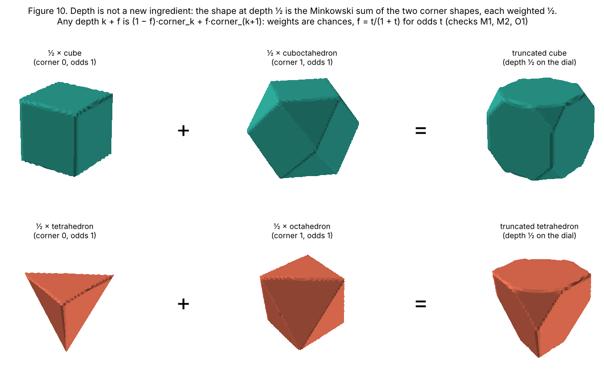

*Figure 10. Half a cube plus half a cuboctahedron is the truncated cube; half a tetrahedron plus half an octahedron is
the truncated tetrahedron. Those are the shapes at depth ½.*

**The same slider on the face side (H1).** Read from the faces instead, the shape is the intersection of the corner
shapes' face sets, each pushed out by a ratio: truncated cube = cube ∩ (scaled octahedron). So depth is equally a
pair of similarity ratios (the r dial's kind of number) with intersection, which Brennan named a core technique.
Both readings use only what the model has.

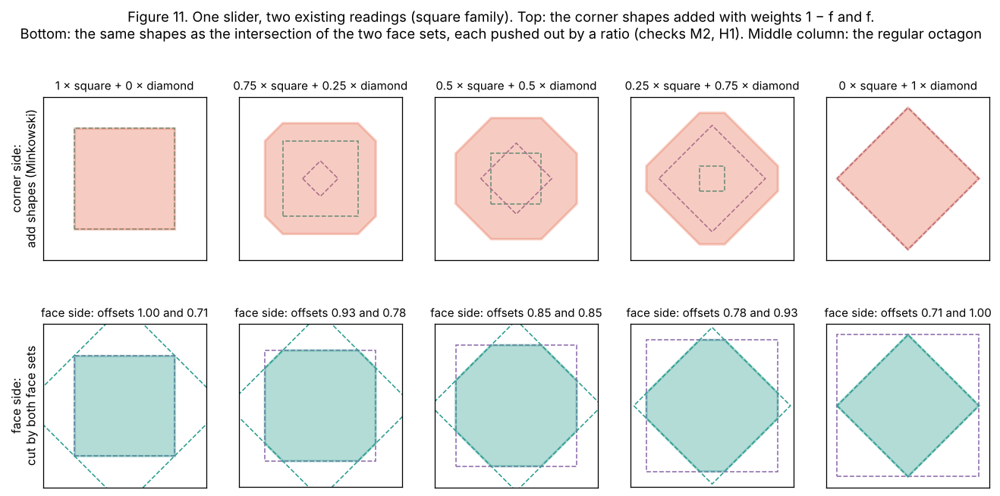

*Figure 11. Square family. Top: square and diamond added with weights 1 − f and f. Bottom: the same polygons cut out
by both face sets. The middle column is the regular octagon.*

### 6.2 The weight is an odds

- **Fraction = chance (O1).** f = t/(1 + t) with t = f/(1 − f), the odds between the two corners.
- **Complement = mirror (O3; Lean `chance_complement`).** The odds complement 1/t gives 1 − f, the depth path run
  backwards.
- **Size convention = a Bayes factor (O2; Lean `odds_rescale`).** Resizing the corner shapes changes no shape; it only
  multiplies the odds by a fixed factor. So depth fractions depend on a size convention and odds ratios do not, which
  is how odds behave everywhere else in the model.
- **Equal odds = the permutohedron (O4).** Equal odds on every corner of the simplex family give
  Perm(n) = Δ(1, n) + … + Δ(n, n), the hypersimplices summed (n = 3 to 6).

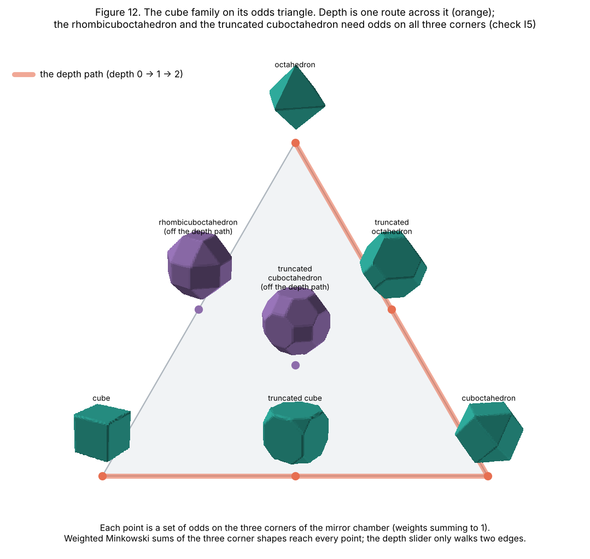

*Figure 12. The cube family's three corners and every odds setting between them. Depth walks two edges (orange). The
rhombicuboctahedron and the truncated cuboctahedron need odds on all three corners, so no depth setting reaches them
(I5); the odds do.*

**More reach than depth (G1, G2).** The same weighted sums give shapes that are not kaleidoscope shapes at all: the
associahedron is a sum of simplex faces with odds 1 each (Postnikov 2009; Loday 2004), and every zonotope is a sum of
segments. So the odds with the Minkowski sum cover depth and more.

### 6.3 Independence, formally

| Reaches… | p on any listed shape | depth | odds + Minkowski sum |
|---|---|---|---|
| truncations between whole depths (truncated cube, …) | **no** (I1, I2) | yes | yes |
| shapes off every depth path (rhombicuboctahedron, omnitruncations, associahedra) | no | **no** (I5) | yes |
| rounded shapes (ball at p = 2, everything between) | yes | **no** (I4) | no |

- **p never reaches a truncation.** For any p strictly between 1 and ∞ the face-power shape is strictly convex: the
  Hessian of Σ|a + n_i·x|^p is a positive sum of n_i n_iᵀ and the normals span, so there is no flat face (I1). At
  p = ∞ it is the listed shape itself. At p = 1 it is the polar of a zonotope, whose faces are centrally symmetric;
  every truncation on a depth path in 3D has corners where three faces meet, so its polar has triangle faces and cannot be one (I2).
- **Where they cross (I3).** p = 1 does land on some whole-depth shapes: cube → octahedron, octahedron →
  cuboctahedron, dodecahedron → icosidodecahedron. These are crossings at points, not one dial containing the other.
- **Depth never reaches a rounded shape (I4)**: every depth shape is the hull of finitely many points.

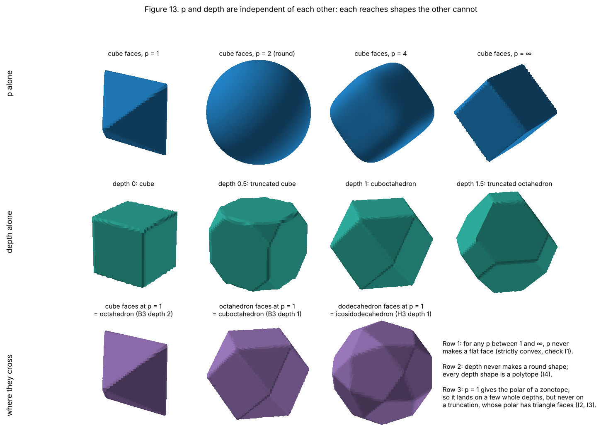

*Figure 13. Row 1: p on the cube's faces. Row 2: depth on the cube family. Row 3: the three places where p = 1 lands
on a depth shape.*

So p and depth are independent of each other, and both are needed to reach "a rounded truncated cube". Only p is an
input. Depth is a reading of the odds.

### 6.4 The simplex gap, settled

The question: face power on the triangle and the temperature route came within 1.1%. Is that exact in some limit, or
a real difference?

- **A real difference at the triangle's own offset (a = ½).** Face power at p = 2 is exactly a circle (S1). The
  temperature route is never exactly a circle at any finite β. Proof: on a circle of radius ρ its defining function is
  3[I₀(βρ) + 2I₃(βρ)cos 3θ + 2I₆(βρ)cos 6θ + …], and I₃(z) > 0 for z > 0, so it cannot be constant on the circle
  (S2, S3; a circle with three-fold symmetry must be centred). Beyond p = 2: in the plane of three-fold and six-fold
  content the two routes trace different curves, so no change of speed turns one into the other (S4, largest gap
  0.0045 near p = 5).
- **Exact in one limit only.** With p = β·a and the offset a → ∞, face power becomes the temperature route, because
  (1 + y/a)^(βa) → e^(βy) (S5, error falling like 1/a; Lean `face_to_temperature`).
- **The two ends agree**: the triangle at p = ∞ and β = ∞, and the circle at p = 2 and β → 0.

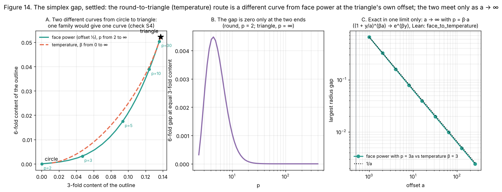

*Figure 14. A: the two routes from circle to triangle trace different curves. B: the gap is zero only at the ends.
C: the a → ∞ limit, with the 1/a rate.*

**Verdict on the simplex.** The round-to-triangle dial is face power's a → ∞ edge, not face power at the triangle's
own offset. Face power is the one that keeps "p = 2 is round" on every shape. Neither is a new dial; both are p aimed at
the triangle's faces, with two curves.

**Against quantum gravity (design principle).** The pieces here I found no source for are a framing (depth read as
odds) and an elementary inequality (the Bessel step). I tried both against quantum gravity and found no foothold;
they tidy the dial list rather than open a lead.

## 7. Topological shapes: one ball, then holes and twists

Brennan: "I wonder if we can start adding common topological shapes as well?" … "I think all of these shapes are just
one type of shape" … "And a hole is another one". Both are the standard view in topology, and the checks bear them out.
Checks: `topo_checks.py` → `topo_checks_output.txt`, **9 of 9 pass** (3 s). Pictures: `topo_figures.py` →
`figures/fig15` … `fig19`. Lean: `lean/TopologyShapes.lean` (7 theorems).

**Verdict.** Every shape in sections 1 to 6 is one topological type, a ball (T5: at every p and depth tried, the solid
has χ = 1 and its surface χ = 2). The other closed surfaces are counted by two whole numbers: **holes** g (handles) and
**twists** c (crosscaps). These are picks, like the family, not dials: no turning of p, depth or size changes them
(T5, T6), and the one continuous path that does change a torus's type does it at a single point (T7). Curvature then
stops being free: its sign is forced by the pick (T3). The dial list stays k, d, p, t, r, q, s.

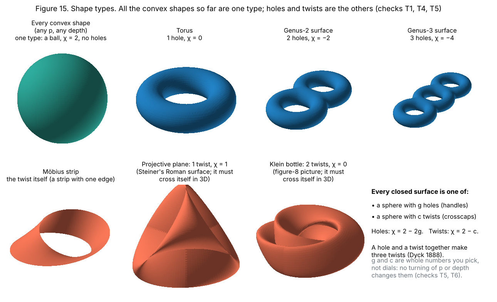

*Figure 15. Top: the ball, then 1, 2 and 3 holes. Bottom: the twist itself (Möbius strip), then the projective plane
(1 twist) and Klein bottle (2 twists), which must cross themselves when drawn in 3D.*

### 7.1 Built from polygons we already have

Each closed surface is a polygon with its edges glued in pairs, read off a word around the edge (the fundamental
polygon; classification by Möbius, Jordan, Dyck and Dehn–Heegaard): torus a b a⁻¹ b⁻¹, Klein bottle a b a b⁻¹,
projective plane a a (or a b a b on the square), genus g as g copies of a b a⁻¹ b⁻¹ in a row, c twists as c copies of a a.
Then χ = (corners left after gluing) − (edge pairs) + 1, and orientable means every letter appears once each way (T1).

- **Joining adds.** Writing two words one after the other is the connected sum, and 2 − χ adds (T2; Lean `chi_concat`,
  `euler_genus_add`). Holes give 2 − χ = 2g; twists give 2 − χ = c.
- **A hole plus a twist is three twists.** Torus # projective plane = three projective planes (Dyck's surface), so once a
  twist is present, holes and twists are one count (T2).

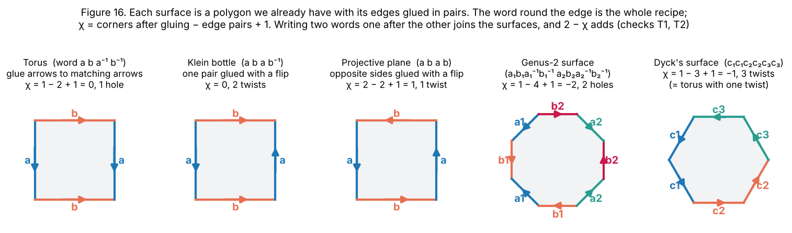

*Figure 16. The square (torus, Klein bottle, projective plane), octagon (2 holes) and hexagon (3 twists), with each
edge glued to its matching letter in the arrow's direction.*

### 7.2 Which dials reach them

- **Roundness p** rounds a torus's tube and core from diamond-like (p near 1) to round (2) to square (∞) without
  changing its type (T6). At p = ∞ the flat torus is the cube family's square with opposite sides glued; at p = 2 the
  product of two circles in 4D is the Clifford torus, which sits on the unit 3-sphere and is flat (T9).
- **Size and aspect ratio** are not new dials either, but they show where type can change: core radius R against tube
  radius r gives a ring torus for R > r (1 hole), the horn torus at R = r, and a spindle for R < r whose outer surface has
  no hole (T7).
- **Curvature is forced.** The glued corners must add to 360°. Gauss–Bonnet (curvature × area = 2πχ) then fixes the
  curvature's sign: positive for the sphere and projective plane, flat for the torus and Klein bottle, negative from
  2 holes or 3 twists on (T3; Lean `curvature_pos_iff`, `curvature_zero_iff`, `curvature_neg_iff`). So the model's
  curvature reading d − k²/4 has its sign set by the hole and twist count.
- **χ is a reading the model already has.** It is the face polynomial at t = −1. Face polynomials multiply on products,
  so χ multiplies (Lean `chi_product`; T8), and 1 − χ composes as x + y − xy, the same rule as the k = −1 fused step
  (Lean `one_sub_chi_mul`).

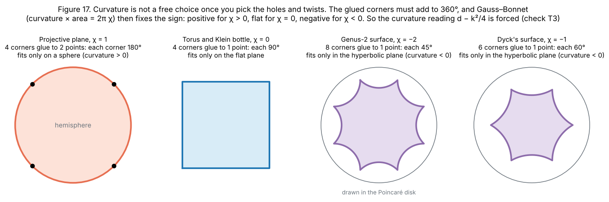

*Figure 17. Each gluing polygon fits only one kind of geometry: a hemisphere, the flat square, or hyperbolic polygons
(drawn in the Poincaré disk) with corners small enough to meet at one point.*

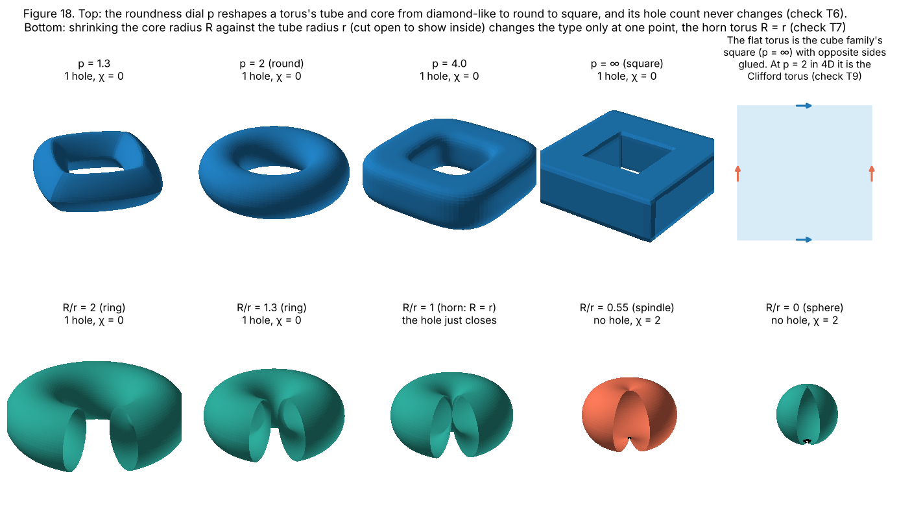

*Figure 18. Top: p reshapes the torus but keeps its hole. Bottom: the hole closes only at R = r.*

### 7.3 Against quantum gravity

The two framings here that I found no source for are "holes and twists are picks, not dials" (a reading of the
classification) and "1 − χ composes like the k = −1 step" (algebra). Both match how 2D gravity and string theory treat
topology, which is known: the sum over surfaces weights each one by g_s^(−χ) = g_s^(2g − 2), so every added hole costs the
same odds g_s² ('t Hooft 1974; Polyakov 1981), and the 2D Einstein–Hilbert action ∫R = 4πχ is topological, which is the
Gauss–Bonnet step above. Neither framing gives a new prediction there.

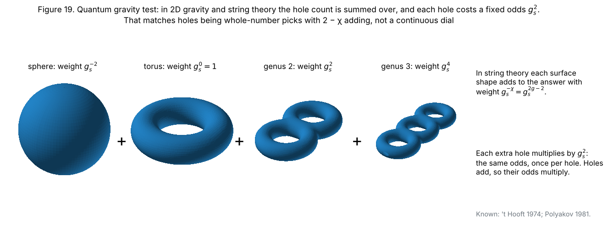

*Figure 19. The string-theory sum over surfaces: one more hole, one more factor g_s².*

### 7.4 Lead: twists and fluid flow (not run here)

Brennan asked whether a twist yields a result in Navier–Stokes. From known work: on a twisted surface the fluid's
vorticity has no global sign (it is a pseudo-scalar), so circulation stops matching the integral of vorticity ("Vortex
dynamics on a Möbius strip", J. Fluid Mech. 2021; a Hamiltonian study of point vortices on the Klein bottle, 2022). The
number of steady sweeping flows on a flat surface equals the first Betti number: 2 on the torus, 1 on the Klein bottle.
2D flow stays smooth on any closed surface, and the open 3D problem is posed on ordinary untwisted space, so a twist does
not bear on it directly. A simulation on the Klein bottle would be its own piece of work.

## What is known and what is ours

| Piece | Status |
|---|---|
| ℓᵖ / Lamé curves between square and circle; Gielis' superformula for other polygons | known (Lamé 1818; Gridgeman; Gielis 2003; Matsuura 2015) |
| A symmetric polytope is a slice of a cube; unit balls of slices of ℓᵖ, their polars the Lp-zonotopes | known (Campi–Gronchi; Bolker; slices-of-cubes literature) |
| Log-sum-exp smoothing of a polytope's faces | known, standard in robotics collision work |
| Analytic centre, Dikin ellipsoid (our p = 2 member) | known (Dikin; Sonnevend) |
| Wythoff's construction, truncation and rectification | known (Wythoff 1918; Coxeter) |
| Orbit polytopes are linear in a dominant seed (Minkowski sums of fundamental orbit polytopes); Kostant convexity | known (Kostant 1973; Ardila–Castillo–Eur–Postnikov 2020 on Coxeter permutahedra) |
| Permutohedra and associahedra as Minkowski sums of simplices | known (Postnikov 2009; Loday 2004) |
| Reading depth as odds on the corners, and the formal p-versus-depth reach table | ours, as a framing of known facts |
| The temperature route is never exactly a circle (Bessel I₃ > 0) | elementary; I found no source stating it |
| The offset a = (R − 1)/2 making p = 2 exactly round for any shape, corners pinned on the simplex; temperature as the a → ∞ edge | I found no source; elementary, so treat as unchecked rather than new |
| Closed surfaces from glued polygons; classification by holes and twists; torus # projective plane = 3 projective planes | known (Möbius; Jordan; Dyck 1888; Dehn–Heegaard 1907) |
| Gauss–Bonnet fixing the sign of curvature; regular hyperbolic 4g-gons | known (Gauss; Bonnet; Poincaré; uniformization) |
| Clifford torus; horn and spindle tori | known |
| Genus expansion with weight g_s^(2g − 2) | known ('t Hooft 1974; Polyakov 1981) |
| Vorticity as a pseudo-scalar on non-orientable surfaces | known (Möbius-strip and Klein-bottle vortex papers) |
| Holes and twists read as picks, not dials; 1 − χ composing as the k = −1 step | ours, as a framing of known facts |

## Files

- `facedial.py`, `wythoff.py`, `shapes_catalog.py`: the shapes and both dials.
- `checks.py` → `checks_output.txt`, `results.json`: 29 checks.
- `figures.py` → `figures/fig1` … `fig9`.
- `lean/FaceDial.lean`: for `mathlib-map/MathlibMap/`.
- `depth_checks.py` → `depth_checks_output.txt`, `depth_results.json`: 20 checks (section 6).
- `depth_figures.py` → `figures/fig10` … `fig14`.
- `lean/DepthDerived.lean`: 5 theorems for section 6.
- `topo_shapes.py`: surfaces from gluing words, and the 3D pictures' shapes.
- `topo_checks.py` → `topo_checks_output.txt`, `topo_results.json`: 9 checks (section 7).
- `topo_figures.py` → `figures/fig15` … `fig19`.
- `lean/TopologyShapes.lean`: 7 theorems for section 7.

## References

- G. Lamé (1818); N. T. Gridgeman, "Lamé ovals", Math. Gazette (1970); J. Gielis, Am. J. Botany 90 (2003); M. Matsuura,
  "Gielis' superformula and regular polygons", J. Geometry (2015), doi 10.1007/s00022-015-0269-z.
- S. Campi, P. Gronchi, on Lp-zonotopes (volume bounds); E. D. Bolker, zonoids and L1 embeddings.
- I. I. Dikin (1967); G. Sonnevend (1985), the analytic centre.
- W. A. Wythoff (1918); H. S. M. Coxeter, *Regular Polytopes*.
- P. Janotta, C. Gogolin, J. Barrett, N. Brunner, "Limits on nonlocal correlations from the structure of the local
  state space", New J. Phys. 13, 063024 (2011), arXiv:1012.1215.
- B. Kostant, "On convexity, the Weyl group and the Iwasawa decomposition", Ann. Sci. ÉNS 6 (1973).
- A. Postnikov, "Permutohedra, associahedra, and beyond", IMRN (2009), arXiv:math/0507163.
- J.-L. Loday, "Realization of the Stasheff polytope", Arch. Math. 83 (2004).
- F. Ardila, F. Castillo, C. Eur, A. Postnikov, "Coxeter submodular functions and deformations of Coxeter
  permutahedra", Adv. Math. 365 (2020).
- W. Dyck, "Beiträge zur Analysis situs", Math. Ann. 32 (1888); M. Dehn, P. Heegaard, "Analysis situs", Enzyklopädie
  der math. Wiss. III (1907).
- G. 't Hooft, "A planar diagram theory for strong interactions", Nucl. Phys. B 72 (1974); A. M. Polyakov, "Quantum
  geometry of bosonic strings", Phys. Lett. B 103 (1981).
- "Vortex dynamics on a Möbius strip", J. Fluid Mech. (2021), arXiv:2102.07697;
  "A Hamiltonian approach for point vortices on non-orientable surfaces II: the Klein bottle",
  arXiv:2202.06175.
