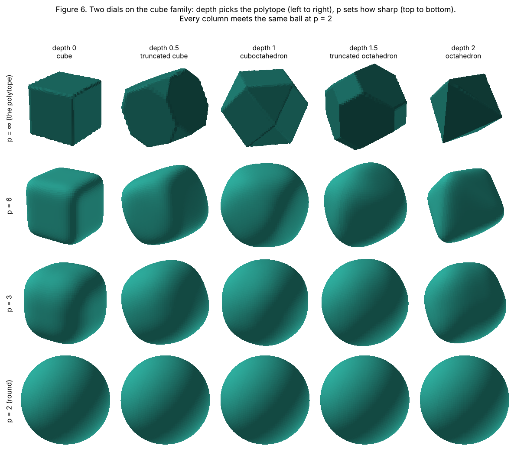
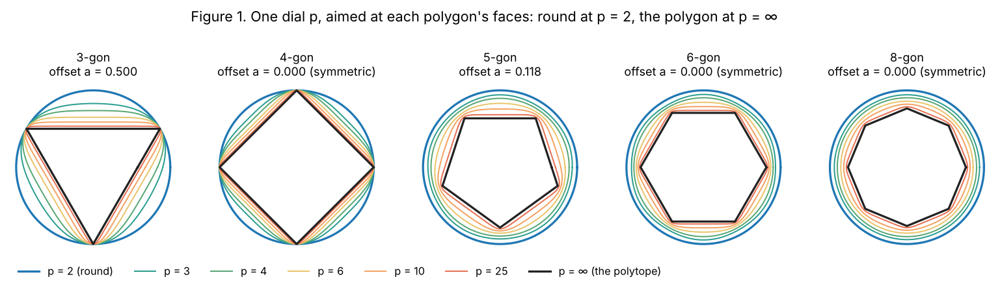
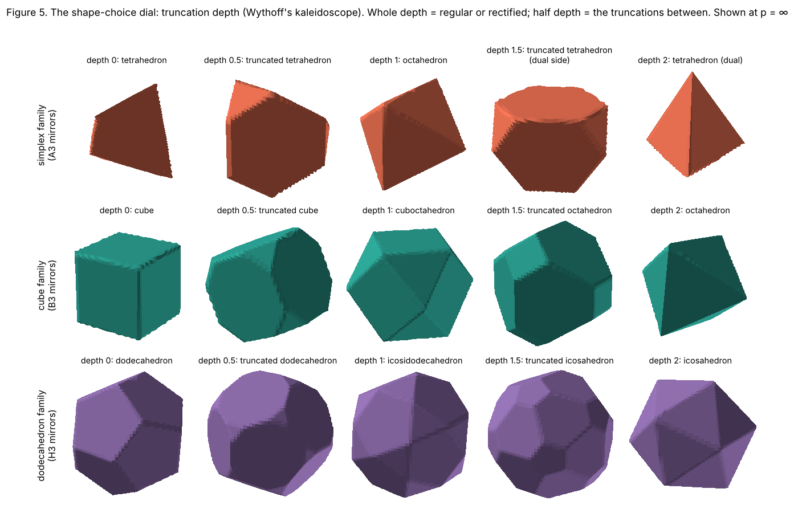
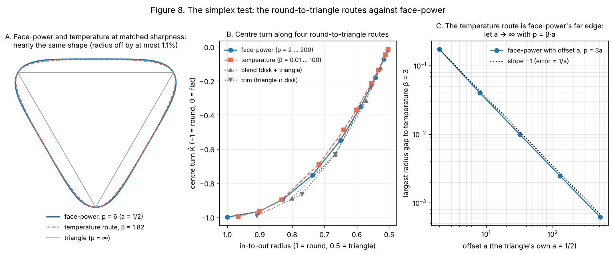

# DRAFT · Shape dials: every angular shape as a first-class citizen, reached by dials

**DRAFT, Nov 26 2026.** Part of Affine Composition Theory (repo: fused-hyperoperation-algebra). Asked for by Brennan:
"Yes I want these shapes as first class citizens in the model and reaching them as simple dials", then "So is this
the sixth fundamental dial?" and "I'm unclear on how this will yield the higher order shapes as a dial". Builds on
`polar-coordinates/` (the roundness dial p: cross-polytope at 1, ball at 2, cube at ∞), `simplex/` section 7 (the
round-to-triangle routes), `exceptional-shapes/` (24-cell, 600-cell, 120-cell) and `shape-dial-survey/` (Lee–Yang).
Checks: `checks.py` → `checks_output.txt`, **29 of 29 pass** (numpy, scipy; 28 s). Pictures: `figures.py` →
`figures/`. Lean: `lean/FaceDial.lean` (4 theorems, written for the Mathlib project `mathlib-map/`; compiled clean in the Mathlib CI build on Nov 26, no proof changed).

## The short answer

**Two dials reach every shape we use, plus one pick from a short list.**

1. **Roundness p (not new: it is our existing p).** Aim p at any polytope's faces and it runs from a perfect ball at
   p = 2 to the exact polytope at p = ∞. Aimed at the cube's faces it gives back the old p dial exactly, cross-polytope
   at p = 1 included.
2. **Depth (new to the model, old in mathematics).** Which polytope p is aimed at is itself a slider: Wythoff's
   kaleidoscope (1918). Depth walks a family through its shapes: cube (0) → truncated cube → cuboctahedron (1) →
   truncated octahedron → octahedron (2). In 4D the same slider passes tesseract → … → 24-cell (2) → 16-cell (3).
3. **The family (a pick, not a dial).** Which mirror set: simplex family (A), cube family (B), dodecahedron family
   (H3), 120/600-cell family (H4), the 24-cell's own family (F4), or the n-gon family in 2D. These are a finite list,
   the way crystal classes are; no number slides between them. In 2D the side count n is a whole-number setting.

*Figure 6. The cube family on two dials. Left to right is depth: which polytope. Bottom to top is p: how sharp.
Every column starts from the same ball at p = 2, so the whole family grows out of one round shape.*

**Is either the sixth fundamental dial?** p is not; it is the same roundness dial, now able to aim at any shape. The
dial list stays k, d, p, t, r, q, s. Depth is a genuine extra coordinate, independent of p, but it is a different kind
of thing from the law dials: it does not change the operation, only which corner set the operation lives on. My
suggestion is to file it as a **shape coordinate**, not a law dial; that call is yours. If it joins the list it needs a
letter other than t, which is already the odds dial.

---

## 1. The roundness dial aimed at any shape (face-power)

**Recipe.** Base inputs: p and the shape. Everything else is read off the shape.

1. Write the shape as its faces, n_i · x ≤ 1, with the origin at the shape's **analytic centre** (the point that
   maximises the sum of log distances to the faces). There the scaled face normals n_i sum to zero.
2. Read off the **offset** a = (R − 1)/2, where R is how far the shape reaches behind a face, in units of the face's
   own distance. a = 0 for every centrally symmetric shape; a = (d − 1)/2 for the d-simplex.
3. The shape at dial p is the set where the power mean of the shifted face values stays under a + 1:
   M_p(a + n_1·x, …, a + n_m·x) ≤ a + 1.

For a centrally symmetric shape (a = 0) this says: the shape at p is a flat slice through the m-dimensional p-ball. So
our p dial already contained every symmetric polytope; it only had to be sliced the right way.

*Figure 1. Polygons, round to sharp. Odd polygons and the triangle have a > 0; even ones have a = 0.*

What the checks show (A1–E1, C1–C2):

- **Round at p = 2, exactly**, for all 34 shapes tried (worst radius spread 4 × 10⁻¹⁴). For regular shapes this needs
  nothing more; for lopsided ones (associahedra, cyclic polytopes, a random zonotope) one linear change of coordinates
  makes it round. The p = 2 shape is the known **Dikin ellipsoid** of the shape at its analytic centre.
- **Exact at p = ∞** for every shape (5 × 10⁻¹⁴).
- **Shrinks steadily** as p grows, never overshooting the shape, and the gap closes like 1/p, with a proved bound:
  the shape at p reaches at most (1 + (m^(1/p) − 1)(a + 1)) times as far as the polytope, m = number of faces.
- **The cube gives the old dial back**: the face-power shapes of the cube equal the ℓᵖ balls for every p from 1 to
  30, up to size, and p = 1 is the cross-polytope.
- **The simplex keeps its corners**: every corner sits on the boundary at every p, so the simplex's dial runs from its
  circumscribed ball down to itself with the corners pinned.

*Figure 2. The five Platonic solids, all grown from the same ball by turning p.*

*Figure 3. The six regular 4D shapes, each cut by the same flat plane through the centre.*

*Figure 4. Shapes we use that are not regular. The elliptope has curved sides, so it has no faces in the usual sense;
the eigenvalues of its correlation matrix play the faces, and the same recipe works (G1–G4): a ball of radius √3 at
p = 2, the elliptope at p = ∞, its four corners pinned throughout.*

*Figure 9. Every shape sharpens at the same 1/p rate. Many faces and a large offset (the cyclic polytope) only shift
the line up.*

## 2. The shape-choice dial: depth (Wythoff's kaleidoscope)

Put mirrors at the angles a family's diagram gives, put a seed point between them, and reflect it in every mirror. The
images are the corners of a polytope. Seed in a corner of the mirror chamber: a regular or rectified shape. Seed part
way along an edge of the chamber: the truncations in between. Depth measures how far along that path the seed is.

*Figure 5. Depth on three families. Whole depths are the regular and rectified shapes; half depths are truncations.*

Checks W1–W5:

- Depth passes through the named shapes in every family tried: A3, B3, H3 above; B4 (tesseract, 24-cell at depth 2,
  16-cell at depth 3), F4 (24-cell), H4 (120-cell at 0, 600-cell at 3), and the simplex family's whole depths are the
  **hypersimplices** (rectified simplices). The **permutohedron** is the simplex family with the seed at the chamber's
  centre.
- **Every point on every depth path is round at p = 2** with no change of coordinates: all paths meet at one ball
  (Figure 6).
- The offset a slides continuously with depth (tetrahedron 1, octahedron 0, back to 1).
- **In 2D**, depth slides n-gon → regular 2n-gon → n-gon (turned), but **n itself only comes in whole numbers**: a
  fractional n does not close up. So "polygon side count" is a setting, not a slider.

*Figure 7. 2D: depth is continuous; the side count is not.*

**Which shapes are not on a depth path.** The associahedron, cyclic polytopes, general zonotopes and the Birkhoff
polytope are not kaleidoscope shapes. They are still first-class (each has its own p dial, section 1), but reaching
them is a pick, not a slide.

## 3. The simplex test: is the round-to-triangle dial the same as face-power?

The simplex page found three routes from round to triangle: blend (disk plus triangle), trim (triangle cut by a disk)
and temperature (free-energy level sets). Checks F1–F5:

- **Temperature is face-power's far edge, exactly.** Face-power with offset a and p = β·a tends to the temperature
  route at β as a → ∞; the gap falls like 1/a (Figure 8C). So the temperature route is the log-sum-exp member of the
  same recipe.
- **At the triangle's own offset (a = 1/2) the two are close but not equal**: matched for sharpness, the radii differ
  by at most 1.1%. The difference that matters: face-power is exactly round at p = 2, while temperature is only round
  in the hot limit.
- **Blend and trim are separate routes** (closest face-power match off by 1.4% to 5.7%), and both keep flat pieces of
  side all the way, which face-power never has at finite p.
- **Centre turn** (the Thomas-turn measure of the simplex page): −1 at p = 2 exactly, rising steadily toward 0 as p
  grows. Our temperature route reproduces the simplex page's numbers (−0.69, −0.37, −0.14 at β = 1, 3, 10).

*Figure 8. A: face-power and temperature at matched sharpness. B: centre turn along four routes against how
triangular the shape is. C: the temperature route as the a → ∞ edge of face-power.*

**Verdict.** The round-to-triangle dial is the simplex's face-power dial up to a choice of curve: face-power (the
offset a = 1/2) and temperature (a → ∞) are two edges of one recipe. Face-power is the one that keeps "p = 2 is round"
and so matches the p dial on every other shape.

## 4. First-class in the model

- **Python:** `facedial.py` (`FaceDial(corners)` builds any shape's dial: faces, analytic centre, offset, radial
  function at any p), `wythoff.py` (`wythoff_polytope(family, depth)`), `shapes_catalog.py` (all 34 shapes).
- **Lean** (`lean/FaceDial.lean`, Mathlib): the shape at whole-number p as a set; `poly_subset_shape` (the polytope
  is inside every shape), `face_le_of_mem_shape` (the 1/p sharpening bound, without roots), `iInter_shape` (the
  polytope is exactly what all the shapes share: the sharp end of the dial), `shape_two` (p = 2 is a ball when the
  normals sum to zero and form a tight frame). Written without a local Lean; compiled clean in the Mathlib CI build on Nov 26, no proof changed.

## 5. Leads, each judged on its own merits

1. **Quantum: a continuous dial between a classical bit and a quantum bit.** Janotta, Gogolin, Barrett and Brunner
   (2011) used regular n-gons as state spaces: the triangle is a classical system, the disk a real quantum bit, and
   how strong the Bell correlations can be depends on the shape. Face-power gives a continuous version of the same
   walk (triangle at p = ∞, disk at p = 2). Worth following: the next test is the best Bell (CHSH) score along p,
   which `shape-dial-survey/` already measured for symmetric angular shapes (never below 2√2). This is the quantum
   side of the North Star, not gravity.
2. **Qutrits.** On 3-level quantum states the eigenvalues play the faces; p = 2 is exactly the pure-state sphere
   tr ρ² = 1 (H1) and p = ∞ is the true state space. For qubits the dial does nothing, because the 2-level eigenvalue
   simplex is symmetric; that matches the qubit state space being a ball. A clean picture; it is a restatement of known
   facts about the generalized Bloch ball, not a new result.
3. **Quantum gravity, per the design principle.** I tried the two facts I could not find in print (the offset recipe
   that makes p = 2 exactly round for lopsided shapes, and temperature as its a → ∞ edge) against quantum gravity and
   found no foothold; they are geometry bookkeeping. Not a lead there.

## What is known and what is ours

| Piece | Status |
|---|---|
| ℓᵖ / Lamé curves between square and circle; Gielis' superformula for other polygons | known (Lamé 1818; Gridgeman; Gielis 2003; Matsuura 2015) |
| A symmetric polytope is a slice of a cube; unit balls of slices of ℓᵖ, their polars the Lp-zonotopes | known (Campi–Gronchi; Bolker; slices-of-cubes literature) |
| Log-sum-exp smoothing of a polytope's faces | known, standard in robotics collision work |
| Analytic centre, Dikin ellipsoid (our p = 2 member) | known (Dikin; Sonnevend) |
| Wythoff's construction, truncation and rectification | known (Wythoff 1918; Coxeter) |
| The offset a = (R − 1)/2 making p = 2 exactly round for any shape, corners pinned on the simplex; temperature as the a → ∞ edge | I found no source; elementary, so treat as unchecked rather than new |

## Files

- `facedial.py`, `wythoff.py`, `shapes_catalog.py`: the shapes and both dials.
- `checks.py` → `checks_output.txt`, `results.json`: 29 checks.
- `figures.py` → `figures/fig1` … `fig9`.
- `lean/FaceDial.lean`: for `mathlib-map/MathlibMap/`.

## References

- G. Lamé (1818); N. T. Gridgeman, "Lamé ovals", Math. Gazette (1970); J. Gielis, Am. J. Botany 90 (2003); M. Matsuura,
  "Gielis' superformula and regular polygons", J. Geometry (2015), doi 10.1007/s00022-015-0269-z.
- S. Campi, P. Gronchi, on Lp-zonotopes (volume bounds); E. D. Bolker, zonoids and L1 embeddings.
- I. I. Dikin (1967); G. Sonnevend (1985), the analytic centre.
- W. A. Wythoff (1918); H. S. M. Coxeter, *Regular Polytopes*.
- P. Janotta, C. Gogolin, J. Barrett, N. Brunner, "Limits on nonlocal correlations from the structure of the local
  state space", New J. Phys. 13, 063024 (2011), arXiv:1012.1215.
