# Set operations on shapes, as a core technique (DRAFT)

**DRAFT, Nov 26 2026.** Part of Affine Composition Theory (repo: fused-hyperoperation-algebra).
Asked for by Brennan: "Intersections of shapes seems like fertile ground and should be a core technique I think",
"Or really set operations on the shapes", "So the fused hyperoperation is in fact a union at it core in the most
atomic way", and "I think there might be some interesting work where we try other set operations at the most granular /
Or maybe that is the dial k" (section 7). Sparked by the e result (`../hypersphere/` section 2, `../e/`).
Checks: `checks.py` → `checks_output.txt`, **56 of 56 pass** (numpy, scipy, sympy, mpmath). Pictures: `figures.py` → `figures/`.
No Lean in this pass.

## The result in five sentences

1. **Yes, the operation is a union at its core.** a ∘ₖ b is the size of the union of two independent slabs in an
   ambient box, and the dial is fixed by the box: **k = −1 / (size of the ambient)**. A unit box gives k = −1
   (probability), an endless box gives k = 0 (plain sums), and **k > 0 is the same union counted with a signed size**,
   Euler characteristic, where an open line counts −1 (Fig 1).
2. Every Boolean operation on slabs lands on the family or on the product: union is ∘ at −1/M, symmetric difference is ∘
   at −2/M, intersection is the product, complement turns ∘ into the product (De Morgan) (Fig 2).
3. **Correlated shapes get a pair dial** k(A, B) = −size(A ∩ B) / (size A · size B). Two shapes always fit the law with
   their own dial; a shape joined with itself sits exactly on the wall. Three shapes fit one dial only if their triple
   overlap is k²abc, and the mismatch is the centre of Yeung's information diagram (Figs 3, 4).
4. **The e result is an intersection, and both dials move it.** Along the ℓp exponent p, cube ∩ (corner of the
   ℓp ball) gives a Mittag-Leffler value E₁/ₚ(Γ(1 + 1/p)), with e at p = 1. Along k, cube ∩ (the ∘ₖ-ball of radius 1)
   gives **E(k) = (1 + k)^(1/k) + k/(1 + k)**, with e at k = 0, exactly 5/2 at k = 1, exactly 3 at k = −1/2, and the
   compound-interest staircase at k = 1/m (Figs 5, 6).
5. **The limit of "union at the core":** sets with ordinary sizes give only classical correlations (CHSH ≤ 2); the
   quantum value 2√2 needs signed sizes. That is the same move that gives k > 0 its set meaning, so the sign of the
   size is where classical and quantum part (Fig 9).
6. **At the most granular level, k is the overlap.** Of the 16 operations on two independent sets, exactly four are
   commutative and associative: OR = ∘ₖ, XOR = ∘₂ₖ, and their mirror images AND and XNOR. Every other dial value is a
   union of *correlated* sets, and restricting to a set A turns the dial to −1/(size of A), which is what makes the
   distributive law hold (Figs 10 to 12).

Colour key in the pictures: **orange and blue = the two shapes, purple = what the operation keeps, green = growth.**

---

## 1. Every place a result already came from combining shapes

| Result | Set operation | Where it lives | Status |
|---|---|---|---|
| e from the cube's corner simplex (1/n!, sum e); random-sum puzzle | cube ∩ half-space Σx ≤ 1 (= cube ∩ ℓ1 ball) | `../hypersphere/` §2 (E1–E3), `../simplex/` | known (Freudenthal; puzzle) |
| e^π from even ball volumes; the sphere borrows the simplex | ball, polar split | `../hypersphere/` §2 (E4) | known |
| Union rule ∘₋₁ holds for orthogonal hemispheres, fails for smaller caps | union of two hemispheres / caps | `../hypersphere/` §7 (Q3, Q3b) | known reading |
| Cube = Newt(1 + a∘b∘c); multiplying polynomials adds shapes | **Minkowski sum** of segments | `../polar-coordinates/` §5 (D2) | known (Ostrowski, Postnikov) |
| Corner "compose" on shape weights; facet heights multiply | OR of corner weights (Smets' disjunctive rule) | `../polar-coordinates/`, lead K1 | ours until searched |
| Holographic entropy cone = cube corner sums at k = −1; I₃ ≤ 0 | inclusion–exclusion of regions | `../holographic-entropy-cube/` | known ineqs, reading ours |
| Inclusion–exclusion = the k = −1 corner chain | union of n sets | `../boolean-lattice/`, `../homothety-dial-survey/` C1 | known |
| \|A ⊔ B ⊔ A×B\| = a ∘₁ b; XOR wall 1/2; Euler characteristic of open interval | disjoint union, XOR | `../logic-sets/` items 3, 5 | known (Schanuel 1991) |
| k = −1/π for a susceptible share π (mixture cure model) | union inside a sub-population | `../where-k-moves/`, `../probability-entanglement/` §9 | known model, reading ours |
| 24-cell / tesseract / 16-cell bridges | vertex-set union (24-cell = tesseract ∪ 16-cell corners) | `../exceptional-shapes/` | known (Coxeter) |

What was missing was the common frame: one rule that says what any set operation on any pair of shapes gives,
and how the dials enter. That is sections 2 to 4.

## 2. The foundation: the operation is the size of a union

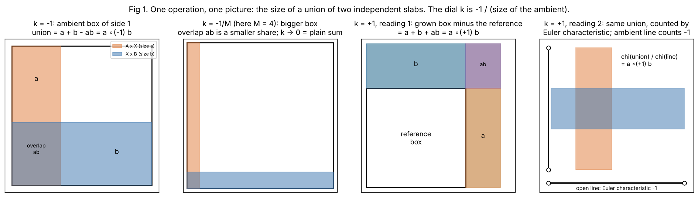

*Fig 1. One operation, one picture. Left: in a unit box, two slabs of widths a and b cover a + b − ab = a ∘₋₁ b. Second:
in a box of side M the overlap ab is a smaller share, and the union in units of M is a ∘ at k = −1/M; an endless box
gives k = 0. Third: k = +1 as growth, a box of sides 1 + a and 1 + b minus the reference square. Right: k = +1 as the
same union counted by Euler characteristic, where the ambient open line counts −1.*

**The rule (one line of inclusion–exclusion).** Let φ be any size that adds over disjoint pieces and multiplies over
products (volume, probability, counting, Euler characteristic). Put A inside a space X and B inside Y, with
φ(X) = φ(Y) = M. Then

  φ(A × Y ∪ X × B) / M = a + b − ab/M = **a ∘ₖ b with k = −1/M** (checks A2, A3).

With n slabs in an n-dimensional box the union is a₁ ∘ₖ … ∘ₖ aₙ, and its expansion over the corners of the n-cube is
inclusion–exclusion term by term (A4, A4b). So **the cube's corner sums are inclusion–exclusion on slabs**, which is
why they kept appearing.

**The coordinator's algebra, checked (A1).** With P = −k·a, −k(a ∘ₖ b) = 1 − (1 − P_a)(1 − P_b) at every k ≠ 0. That
is the union rule for independent events, and it reads as a probability while −k·a stays in [0, 1]. Section 2 gives the
reading outside that range: P is then the share of an ambient whose size has the other sign.

**k > 0 has two honest set readings.**

- *Growth:* (1 + a)(1 + b) − 1 = a ∘₁ b is the grown box minus the reference box (C1). For any convex body K,
  vol(K + xK) − vol K = vol K·((1 + x)ⁿ − 1), the n-fold ∘₁ (C2). This is why k is called the homothety dial.
- *Signed size:* with Euler characteristic, a point counts +1 and an open interval −1 (Schanuel). The same union of two
  slabs in ℝ × ℝ gives χ(union)/χ(ℝ) = a ∘₊₁ b exactly, in integers (B1), and three slabs in ℝ³ give a ∘₁ b ∘₁ c (B2).
  In general **k = −1/χ(ambient)**: a closed segment (χ = 1) gives k = −1 and an open line (χ = −1) gives k = +1 (B3).

**The wall is "the whole space".** a ∘ₖ a = a only at a = 0 and a = −1/k (A5). A shape joined with itself does not
grow, and the only size that behaves that way is the wall, which in the box picture is M, the ambient itself
(absorbing: anything joined with the whole space is the whole space).

**Verdict on "union at the core": yes, with two limits.** (1) It is the union of *independent* slabs: correlated
shapes need the pair dial of section 3. (2) For k > 0 the sizes must be allowed to be negative, or read as growth.
**Known:** inclusion–exclusion; independence; homogeneity of volume; Euler characteristic of open cells (Schanuel 1991,
Propp 2003); k = −1/π in the mixture cure model. **Ours (a reading, not a theorem):** k = −1/(size of the ambient) as
the one rule behind all three stops, and k > 0 as the signed-size side.

## 3. The five Boolean operations, and correlated shapes

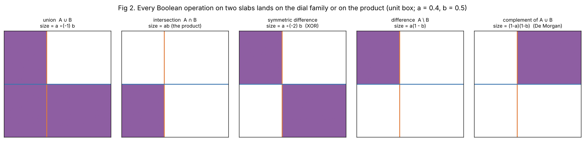

*Fig 2. Two slabs in the unit box (a = 0.4, b = 0.5). Each Boolean operation's size is a member of the family or the
product.*

| Operation on two independent slabs | Size (box of side M, in units of M where needed) | On the family? |
|---|---|---|
| union A ∪ B | a ∘ at k = −1/M | yes |
| symmetric difference A △ B | a ∘ at k = −2/M (XOR) | yes, doubled dial |
| intersection A ∩ B | ab | the product (k → ∞ after rescaling) |
| difference A \ B | a(M − b)/M | product with a complement |
| complement of A ∪ B | (M − a)(M − b) | De Morgan: ∘ becomes product |

All five checked by Monte Carlo (A3) and exactly (A2, A6). The XOR line is the `../logic-sets/` wall at 1/2 seen on slabs.

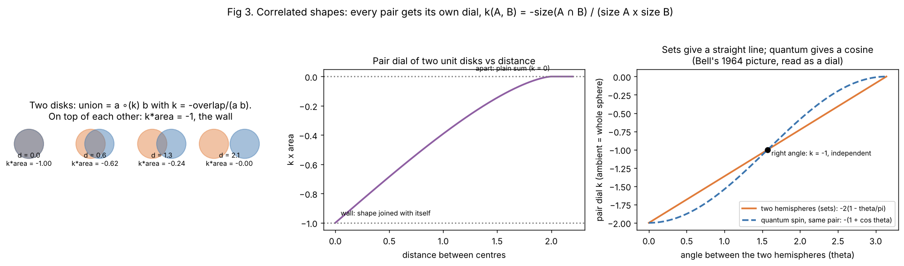

*Fig 3. Left and middle: two unit disks at distance d. Their union is a ∘ b with the pair dial k = −lens/(area²); it runs
from the wall (on top of each other, k·area = −1) to 0 (apart, plain sum). Right: two hemispheres at angle θ have
k = −2(1 − θ/π), a straight line through k = −1 at right angles (D3); the quantum spin correlation for the same pair
of directions follows −(1 + cos θ) instead.*

**Correlated shapes.** For any two shapes define the pair dial k(A, B) = −φ(A ∩ B)/(φ(A)φ(B)). Then
φ(A ∪ B) = a ∘ₖ b with k = k(A, B), exactly, always (D1). This is inclusion–exclusion with the overlap renamed, so on its own it
is a relabeling: k is minus the "lift" of data mining, scaled by the ambient. What it buys is that every pair of shapes
now sits somewhere on the dial, with independence at −1/M, disjointness at 0 and coincidence on the wall (D2). Under the Nov 26 design rule the pair dial is a reading, an output: it is the homothety dial k read off a pair of shapes, never fed back in as a new input.

**Where the content is: three shapes.**

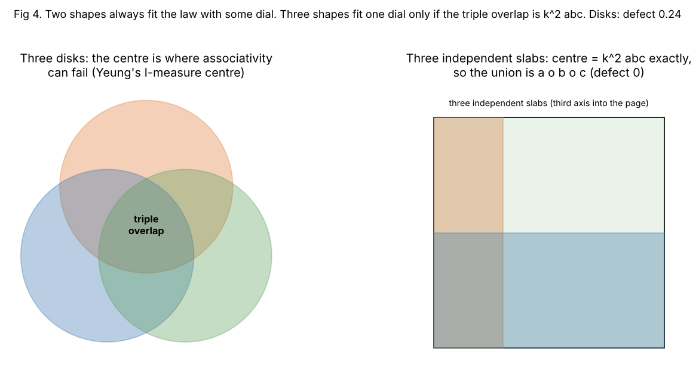

*Fig 4. Left: three disks (a Venn diagram). Right: three independent slabs. One dial fits all three shapes only if the
triple overlap equals k²abc; for slabs it does (defect 0), for these disks the union is 6.14 against a ∘ b ∘ c = 5.91,
a defect of 0.24 (E1, E2).*

Associativity of ∘ₖ forces the triple overlap to be k²abc once the pair overlaps are −k·ab. So the defect of a
three-shape union from a ∘ b ∘ c is the triple-overlap mismatch. In information theory this centre cell is the
I-measure of the triple (Yeung 1991), and its sign is the tripartite information I₃, whose holographic version is the
monogamy rule I₃ ≤ 0 already in `../holographic-entropy-cube/`. **Known:** all of it (inclusion–exclusion; Yeung's
I-measure; Hayden–Headrick–Maloney monogamy). **Ours:** the reading that the associativity defect of the fused law is
that centre cell.

## 4. The technique, written down

For a pair (or more) of shapes A, B in an ambient X, and a dial setting:

1. **Pick the size φ.** Volume or probability (k < 0 side), Euler characteristic (signed, reaches k > 0), the intrinsic
   volumes V_j (Hadwiger: every continuous, motion-invariant size on convex bodies is a combination of these), or a
   count. Write a = φ(A), b = φ(B), M = φ(X).
2. **Compute the four sizes** φ(A ∪ B), φ(A ∩ B), φ(A \ B), φ(A △ B), plus curvature where it is defined
   (via Steiner's formula, below).
3. **Read the dial.** The pair dial k(A, B) = −φ(A ∩ B)/(ab). Compare with −1/M (independent), 0 (disjoint), −1/a
   (coincident = wall).
4. **For three or more shapes, compute the defect** from a ∘ b ∘ c. Zero means the shapes compose like independent
   slabs and the corner expansion applies as is. Non-zero is the interaction term, and it is where new structure sits.
5. **Turn the shape dials.** Replace a shape by its dial family (ℓp ball for p; the ∘ₖ-ball {x₁ ∘ₖ … ∘ₖ xₙ ≤ r} for k;
   the plane-dial conic x² + kxy + dy² ≤ … for d) and follow the sizes as the dial turns.
6. **Minkowski sums** are the set operation that adds shapes: vol(K + tL) = Σ_j C(n, j) V(K[n−j], L[j]) t^j (mixed
   volumes). For the cube with itself this is (1 + t)ⁿ, the n-fold ∘₁.

## 5. Running it, simplest pairs first

### 5.1 Cube ∩ ℓp ball: e on the ℓp exponent

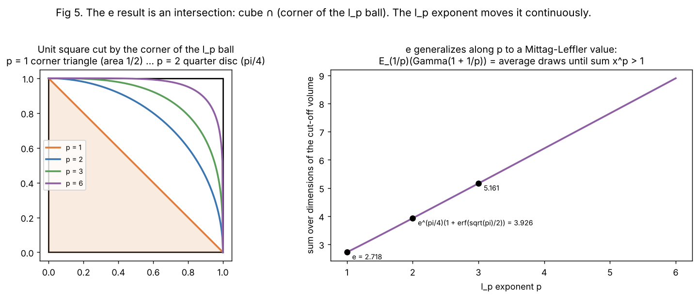

*Fig 5. Left: the unit square cut by the corner of the ℓp ball; p = 1 is the corner triangle of the e result, p = 2 the
quarter disc. Right: summing the cut volume over every dimension gives a smooth curve in p, through e at p = 1.*

The corner of the ℓp unit ball sits inside the unit cube and has volume Γ(1 + 1/p)ⁿ/Γ(1 + n/p) (Dirichlet). Summed
over n it is the Mittag-Leffler value **E₁/ₚ(Γ(1 + 1/p))**, and by the same tail-sum argument as the random-sum puzzle it
is the **average number of uniform draws until x₁ᵖ + x₂ᵖ + … passes 1** (F2: p = 1, 2, 3 by series, mpmath and 300,000
simulated runs each). Values: e at p = 1; **e^(π/4)(1 + erf(√π/2)) = 3.9258** at p = 2 (F3); 5.1611 at p = 3; it grows
without bound as p → ∞, because the cube contains itself in every dimension.

**Known:** ℓp ball volumes; John D. Cook's note that the sum of all unit-ball volumes is E₁/₂(√π). **Not found in print
(quick search, Nov 26):** the general-p draws puzzle with this answer. It follows in one line from known formulas, so
treat it as elementary. **Lead?** Small. It shows e is the p = 1 point of a continuous family, and it puts the
hypersphere (p = 2) and the cube (p = ∞) on the same curve as the simplex, which is the sorting the hypersphere page
already made.

### 5.2 Cube ∩ ∘ₖ-ball: e on the homothety dial

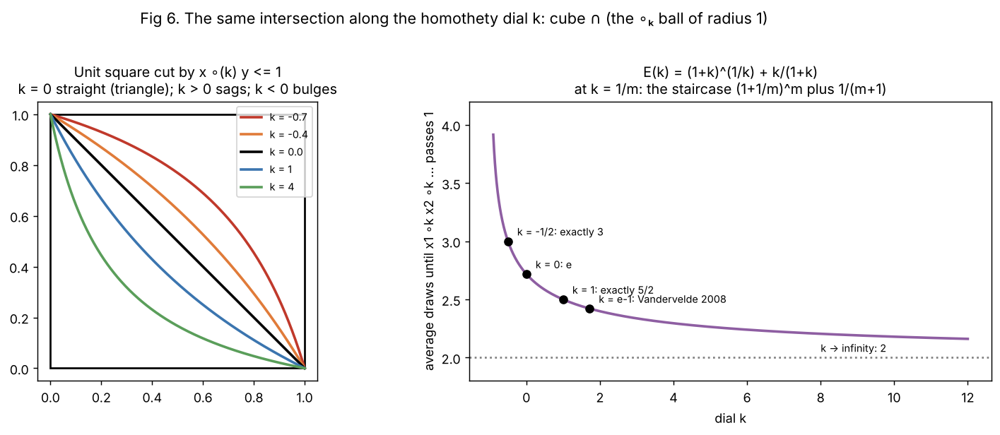

*Fig 6. Left: the unit square cut by x ∘ₖ y ≤ 1. At k = 0 the cut is the straight diagonal of the e result; k > 0 sags it
into a hyperbola, k < 0 bulges it. Right: the average number of draws until x₁ ∘ₖ x₂ ∘ₖ … passes 1.*

Draw uniform numbers in [0, 1] and combine them by ∘ₖ until the result passes 1. The chance of still being under 1
after n draws is the volume of the cube cut by the ∘ₖ-ball, and the average number of draws is

  **E(k) = (1 + k)^(1/k) + k/(1 + k)** (G1: five values of k by simulation and by series).

The volumes themselves come from one generating function, G_k(z) = 1 + z((1 + k)^(1 + z/k) − 1)/(k + z), which is e^z at
k = 0 (so the 1/n! of the e result is its k = 0 case). Derivation: take logs, u = ln(1 + kx); the stopping count obeys
a renewal equation whose kernel is eᵘ/k, and that equation solves in closed form.

- k → 0 gives **e** (G2). k = 1 gives **exactly 5/2**; k = −1/2 gives **exactly 3** (G6). k → ∞ gives 2 and k → −1 gives
  infinity, because the union rule never passes 1 (G5).
- At **k = 1/m** it is **(1 + 1/m)^m + 1/(m + 1)**: the compound-interest staircase of `../e/` plus one small step (G6).
  So the two e derivations in the repo, the cube's layers and the cube's corner simplex, meet on the k dial.
- k = e − 1 is a published puzzle: draws from [1, e] until the product passes e, answer (e − 1)/e + e^(1/(e − 1))
  (Vandervelde, *Expected Value Road Trip*, Math. Intelligencer 30(2), 2008; Geneson, arXiv:1605.00277). Our formula
  matches it exactly (G3).
- n = 2 at k = 1: the area under the hyperbola (1 + x)(1 + y) ≤ 2 is 2 ln 2 − 1 (G4).

**Known:** the k = e − 1 case (Vandervelde 2008). **Not found in print (quick search, Nov 26):** the general formula,
the generating function, and the staircase identity. **Lead?** Yes, a small one: it is an exact one-dial family through
e with rational stops, cheap to state and prove in Lean, and it ties the two e pages together. It is not by itself a
physics lead.

### 5.3 Cube + ball (Minkowski sum): Steiner's formula

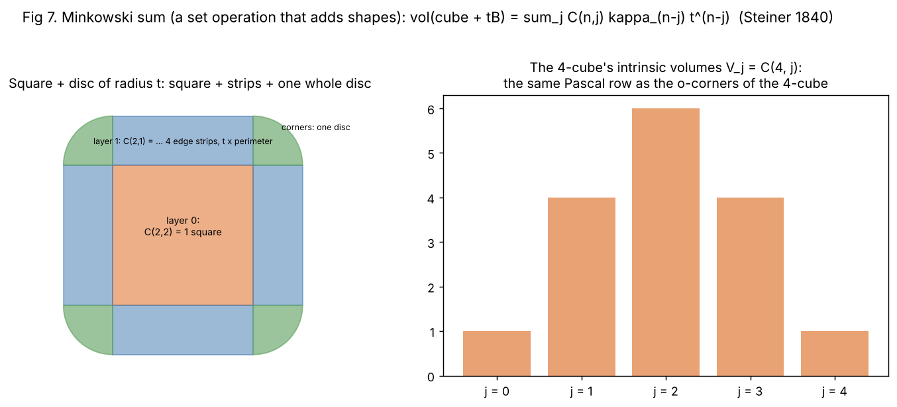

*Fig 7. Left: a square grown by a disc of radius t is the square, four edge strips and one whole disc at the corners.
Right: the 4-cube's intrinsic volumes are the Pascal row 1, 4, 6, 4, 1.*

vol(cube + tB) = Σ_j C(n, j) V_{n−j} t^{n−j}, where V_m is the volume of the m-ball (H1, n = 2 and 3). The cube's
intrinsic volumes are C(n, j), the same layers as the ∘-corners of the n-cube. **Known:** Steiner 1840, intrinsic
volumes of the cube. **Lead?** No new content. It is the bridge that lets curvature (the V_j) into the technique.

### 5.4 Cube ∩ cross-polytope: one family through e, the cuboctahedron and the 24-cell

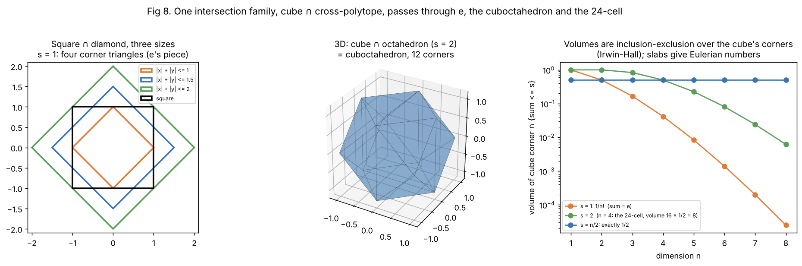

*Fig 8. Left: square ∩ diamond at three sizes. Middle: in 3D, cube ∩ octahedron (s = 2) is the cuboctahedron. Right:
corner volumes by dimension; s = 1 is 1/n! (e), s = 2 in 4D gives the 24-cell, s = n/2 is exactly 1/2.*

The cube corner cut at Σx ≤ s has volume (1/n!) Σ_j (−1)^j C(n, j)(s − j)₊ⁿ (Irwin–Hall), which is itself
inclusion–exclusion over the cube's corners (I1). At s = 1 this is the e result; slabs between whole numbers give the
Eulerian numbers (I4, Laplace). In 3D, {|xᵢ| ≤ 1, Σ|xᵢ| ≤ 2} is the cuboctahedron (12 corners) and in 4D it is the
24-cell with corners (±1, ±1, 0, 0), volume 8 (I2, I3). **Known:** all of it. **Lead?** No; it is a tidy map showing that
three results already in the repo are one intersection family.

### 5.5 The limit: correlated sets cannot reach quantum correlations

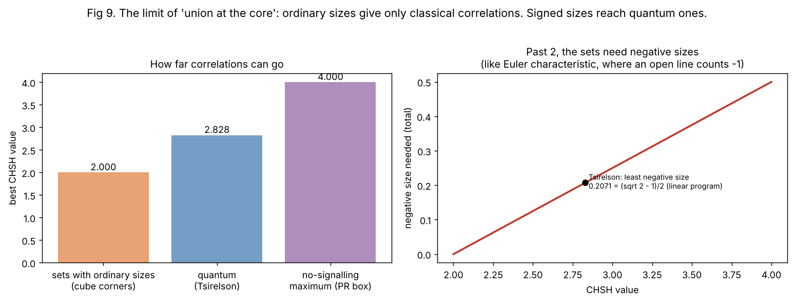

*Fig 9. Left: best CHSH value for sets with ordinary sizes (2), quantum (2√2) and the no-signalling maximum (4). Right:
past 2 the sets need negative sizes; for Tsirelson's correlations the least total negative size is 0.2071.*

The corners of the 4-cube (one yes/no answer per measurement) give CHSH = ±2 (J3), and sets with ordinary sizes are
mixtures of corners, so they cap at 2: Bell, and Pitowsky's correlation polytope. Tsirelson's 2√2 has **no** realization
by sets with sizes ≥ 0 (J1, linear program infeasible) and **does** have one with signed sizes (J2), as Abramsky and
Brandenburger proved for every no-signalling model (New J. Phys. 13, 113036, 2011, Thm 5.5). The least negative size we
found is 0.2071 = (√2 − 1)/2, which equals (CHSH − 2)/4 at that point. We infer this linear rule from one point; it is
likely already in the negative-probability literature and has not been checked here.

**What this says about the foundation.** Unions of sets with ordinary sizes are exactly classical probability. The fused
law at k < 0 lives there. The quantum world needs sizes that can go negative, and k > 0 is the side of the dial where
the union rule already needs a signed size (section 2, Euler characteristic). **Inferred, unchecked:** that this is
more than a shared word, i.e. that the k > 0 side of the dial supplies the negative sizes quantum correlations need.

## 6. Leads, judged on their own merits

1. **Union as the foundation, with k = −1/(size of the ambient) and k > 0 as signed size.** Worth following. It turns
   the dial from a free number into a property of where the shapes sit, and it locates the classical/quantum split at
   the sign of the size. Next test: build a signed-size slab model at k > 0 and see whether it reaches CHSH > 2.
2. **E(k) = (1 + k)^(1/k) + k/(1 + k).** Worth a Lean statement and a short note; small. Generalizes a published puzzle.
3. **E₁/ₚ(Γ(1 + 1/p)) as the draws count along p.** Small and elementary; useful as a picture.
4. **Three-shape defect = I-measure centre.** Known math, a useful reading; it connects the operation's associativity to
   the holographic monogamy result we already have.
5. **Steiner and cube ∩ cross-polytope.** No new content; bridges only.
6. **Restricting turns the dial (section 7):** a ∩ (b ∘ₖ c) = (a ∩ b) ∘₋₁/ₐ (a ∩ c). Worth keeping; it is the
   algebraic form of the foundation rule, and the natural next step for correlated sets.

## 7. The other set operations, at the most granular level

Brennan's question: try the other set operations at the most granular level, "or maybe that is the dial k". Builds on
`../homothety-dial-survey/` C9 (Lean `idem_defect`, `bits_closed_iff`: bits stay bits only at k = −1 and k = −2).

**The algebra (K1).** With P = −k·a the share of the ambient and independent sets: union = a ∘ₖ b; XOR = a ∘₂ₖ b;
intersection = −k·ab; A ∖ B = a + k·ab; complement = −1/k − a, a reflection about −1/(2k). All exact.

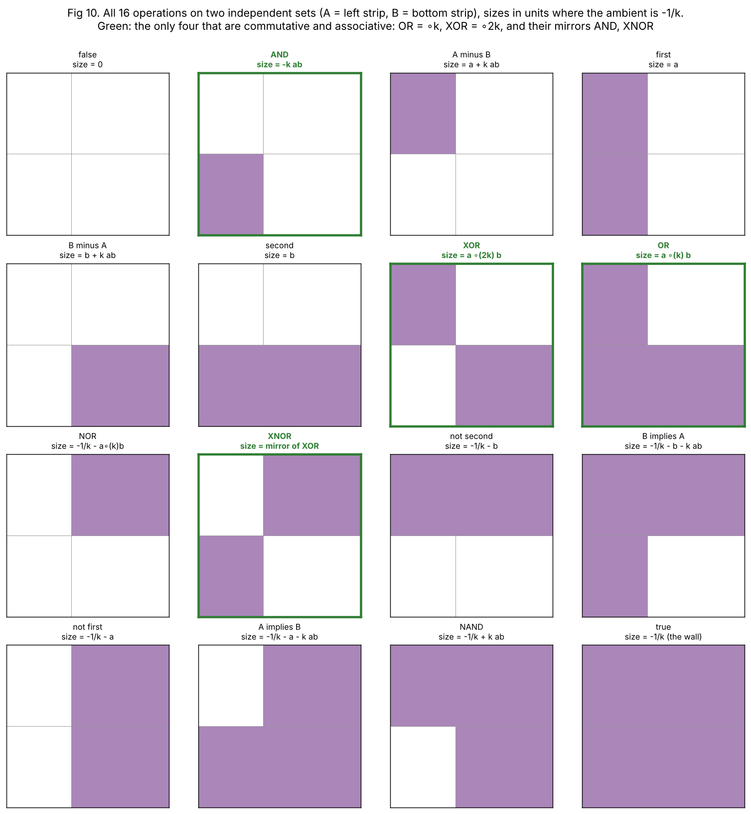

*Fig 10. All 16 operations on two independent sets, each with its size. Green: the only four that are commutative and
associative.*

**Only four are laws (K2, K3).** Of the 16 two-input operations, exactly four are commutative, associative and not
constant: **OR = ∘ₖ, XOR = ∘₂ₖ, AND and XNOR**, and the last two are the first two seen through the complement mirror.
So the Boolean world supplies exactly two dial values, k and 2k, plus their mirror images. AND is a law whose unit is the
wall (intersecting with the whole space changes nothing), where OR's unit is 0. Complement swaps the two, which is
De Morgan in sizes (K4). It also says the known map to multiplication, 1 + k·a, is the complement's share: ∘ₖ becomes a
product because the complement of a union is the product of complements.

**So is the dial k "the other set operations"? Partly.** The operations themselves only reach k and 2k. Every other
value of the dial comes from *correlation*: two sets whose overlap differs from the independent one sit at the pair dial
k(A, B) = −φ(A ∩ B)/(ab) (section 3). XOR is the union with the overlap counted twice over, which is why it lands at 2k.
So the most granular reading is: **k says how the two shapes overlap, relative to their sizes**, and the Boolean
operations are the few overlap patterns that compose cleanly.

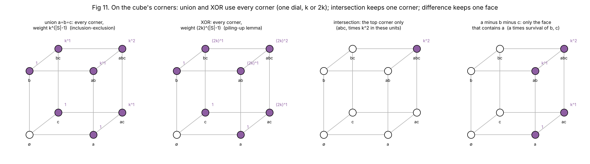

*Fig 11. On the 3-cube's corners. Union: every corner, weight k^(|S|−1) (inclusion–exclusion). XOR: every corner,
weight (2k)^(|S|−1) (Matsui's piling-up lemma, K8). Intersection: only the top corner. Difference: only the face that
contains a.*

**Difference is an action, not a second dial (K6, K7).** A ∖ B = a(1 + kb): a times the share that B leaves. It is not
associative, but it obeys a ∖ (b ∘ₖ c) = (a ∖ b) ∖ c, so the ∘ₖ law *acts* on sizes through difference. Its asymmetry
is exactly the odds ratio: (A ∖ B)/(B ∖ A) = odds(A)/odds(B), with odds a/(1 + ka). **Testing the q idea:** a one-dial
weight on the second slot, a + q·b + k·ab, is associative only at q = 1, the union (K6b), and the two orders of difference
differ by the amount a − b, not by a fixed factor, so no commutation constant q produces them. On this test **the order
dial q is not the home of difference; the odds dial t is**, since difference's asymmetry is an odds ratio. This tests
two readings of q only; the order-dial survey's Moyal reading was not tried.

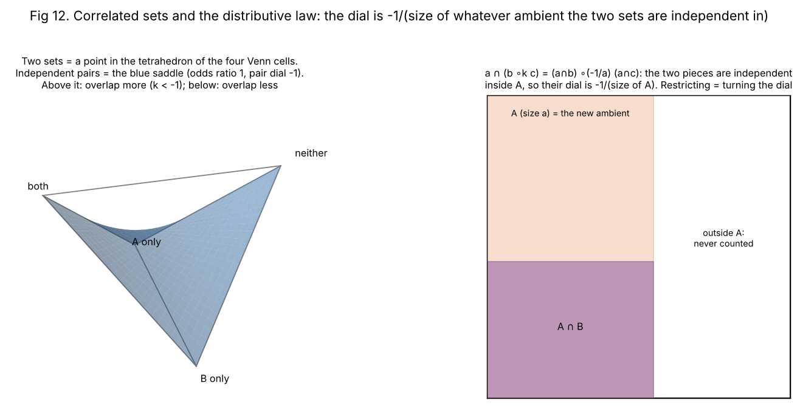

*Fig 12. Left: any two sets are a point in the tetrahedron of the four Venn cells; independent pairs form the saddle
surface (odds ratio 1, pair dial −1, K9). Right: inside A, the pieces A ∩ B and A ∩ C are independent, so their dial
is −1/(size of A).*

**Correlated sets restore the distributive law (K5).** On numbers, a ∩ (b ∘ₖ c) and (a ∩ b) ∘ₖ (a ∩ c) differ by
−k²abc(1 + ka), which is zero only when a is crisp (0 or the whole space). That is the known failure of the product
t-norm to distribute over the probabilistic sum in fuzzy logic. The two pieces A ∩ B and A ∩ C share A, so they are
correlated; inside A they are independent, and with the dial of their shared ambient, k′ = −1/a, the law holds exactly:
**a ∩ (b ∘ₖ c) = (a ∩ b) ∘₋₁/ₐ (a ∩ c)** (K5b, and Monte Carlo K5c). This is section 2's rule again, k = −1/(size of the
ambient), now saying that **restricting to a set turns the dial**. In probability it is conditioning on A.

**What each operation does to the shapes.**

- *Cube corners* (Fig 11): union and XOR use the whole cube with one dial; intersection uses one corner; difference
  uses one face. That is why the corner expansion fits union and XOR and not the others.
- *Simplex* (Fig 12): two sets are a point in the 3-simplex of Venn cells. Intersection, the two differences and the
  complement of the union are its four coordinates; independence is the saddle; the pair dial measures the distance off it.
- *Sphere* (Fig 3): two hemispheres' intersection is a lune whose area is linear in the angle, so the pair dial is
  linear in angle; quantum correlations bend it into a cosine, which no family of sets can do (section 5.5).

**Known vs new.** Known: all four laws among the 16 operations (Boolean algebra), De Morgan, the piling-up lemma
(Matsui 1993), non-distributivity of product and probabilistic sum (fuzzy logic), conditioning, the odds ratio, the
independence saddle (algebraic statistics). **Ours (readings):** k as the overlap with only k and 2k reachable by Boolean
operations; difference as the ∘ₖ action whose asymmetry is the odds dial; the distributive law restored by the
shared-ambient dial −1/a. **Lead?** The shared-ambient rule is worth keeping: it is the same rule as section 2 and the
mixture cure model, now as an algebraic law, and it gives correlated sets a clean place in the algebra. The rest is a
tidy and complete map, not a lead on its own.

## Assumptions

- Section 2 assumes independent slabs (product sets) and a size φ that adds over disjoint pieces and multiplies over
  products. Euler characteristic is used on finite unions of open cells and points (o-minimal / Schanuel setting).
- Section 3's pair dial is defined for any measurable pair; the three-shape statement assumes one common dial.
- Section 5.1 and 5.2 use uniform draws on [0, 1]; 5.2 needs k > −1. The closed form is derived analytically and
  checked numerically, not in Lean.
- Section 5.5 uses the standard CHSH setting with fair marginals. The (CHSH − 2)/4 rule is from one point only.
- Section 7 uses independent sets except where it says correlated; q was tested in two readings only.
- Monte Carlo checks use a fixed seed and a 5-standard-error tolerance.

## Known vs new

| Item | Status | Source |
|---|---|---|
| Union rule for independent events; inclusion–exclusion | known | standard |
| k = −1/π for a sub-population of size π | known model | mixture cure model (`../where-k-moves/`) |
| Euler characteristic of an open interval = −1 | known | Schanuel 1991; Propp, arXiv:math/0203289 |
| k = −1/(size of the ambient) for every size φ, including χ | ours (reading) | — |
| Pair dial = minus the lift; three-shape defect = I-measure centre | known math, reading ours | Yeung 1991, IEEE Trans. Inf. Theory 37(3) |
| ℓp ball volumes; sum of ball volumes = Mittag-Leffler | known | Dirichlet; J. D. Cook (2019) |
| Draws until Σxᵖ > 1 = E₁/ₚ(Γ(1 + 1/p)) | not found in print; elementary | — |
| E(k) = (1 + k)^(1/k) + k/(1 + k) and its generating function | not found in print (k = e − 1 case known) | Vandervelde 2008; Geneson arXiv:1605.00277 |
| Steiner formula; cube's intrinsic volumes | known | Steiner 1840; Hadwiger 1957 |
| Irwin–Hall, Eulerian slabs, cuboctahedron, 24-cell | known | Laplace; Coxeter |
| Four laws among 16 operations; De Morgan; piling-up lemma; conditioning | known | Boolean algebra; Matsui 1993 |
| Difference as the ∘ₖ action, asymmetry = odds ratio; distributivity via k′ = −1/a | ours (readings) | — |
| CHSH ≤ 2 for sets; signed realizations of no-signalling models | known | Bell 1964; Pitowsky 1989; Abramsky–Brandenburger 2011 |

Literature checks were quick web searches on Nov 26, 2026. "Not found in print" means not found in those searches.
