# The simplex as its own shape (DRAFT)

**DRAFT, Nov 26 2026.** Part of Affine Composition Theory (repo: fused-hyperoperation-algebra).
Asked for by Brennan: "let's look at the simplex as well. And use that as another shape that we try to do things with."
Builds on `polar-coordinates/` and `polar-recast/` and does not repeat them. Checks: `checks.py` → `checks_output.txt`,
**44 of 44 pass** (numpy, scipy); section 7 (cubic-form dial) adds 26 of 26. Pictures: `figures.py` → `figures/`. No Lean in this pass (no Lean on this machine).
Colour key: **blue = the simplex / our readings, orange = the sphere, grey = the cube.**

## The result in four sentences

The simplex (the triangle, tetrahedron and their higher versions, every list of shares that adds to 1) is the shape of a
**fixed total**, and our operation lives on it in two places: at **k = −1 it is stick-breaking**, which turns the cube
into the simplex, and at **k = +1 it is Bayes' rule**, which moves you around inside it. The simplex gives **e** most
simply (its corner volumes 1/n! add to e), it only **borrows π** from the sphere (through square roots), and it has
**no i at all**: it is exactly the sphere with its phases forgotten, which is the Born rule. The sharpest comparison is
with the sphere: one distance rule (Hilbert's) makes the ball into relativity's velocity space, which is curved and
**precesses**, and makes the simplex into a **flat** space where updates commute and nothing precesses. In one
dimension the two agree exactly: a coin's log odds is a rapidity. **Update (section 7):** the shape itself is a second
dial, separate from the curvature dial (the plane dial). Sliding from round to triangle fades the leftover turn from −1 to 0, it becomes a
pattern across the shape in between, and cooling is one route along this dial.

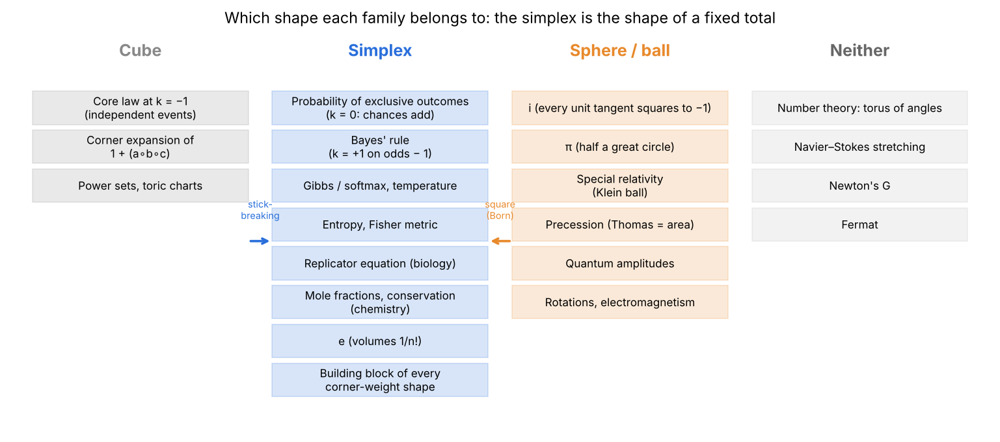

*Figure 9. Which shape each family belongs to. The simplex column is every law with a fixed total.*

---

## 1. Polar coordinates on the simplex: three coordinate systems on one triangle

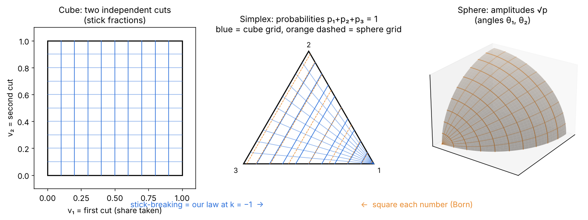

*Figure 1. Left: the cube of stick fractions (v₁, v₂). Middle: the triangle of probabilities, with the cube's grid
(blue) and the sphere's angle grid (orange dashed) drawn on it. Right: the octant of the sphere, where the amplitudes
√p live. Squaring sends the sphere onto the triangle; stick-breaking sends the cube onto it.*

One point of the simplex can be written three ways:

| Coordinates | What they are | Where they come from |
|---|---|---|
| **Barycentric** p₁ … pₙ (sum 1) | the shares themselves | the simplex itself |
| **Stick fractions** v₁ … vₙ₋₁ in [0,1] | "take v of what's left" at each cut | the **cube**, via our law at k = −1 |
| **Angles** θ₁ … θₙ₋₁ in [0, π/2] | hyperspherical angles of √p | the **sphere**, via squaring |

and they are tied together by **v = cos²θ** (check S3). So stick-breaking *is* the polar coordinate system of the
simplex: each cut is one angle.

**Ours (on known math):** the running total of the pieces is v₁ ∘₋₁ v₂ ∘₋₁ … ∘₋₁ vₘ (check S1), because
what is left after each cut multiplies: 1 − (a ∘₋₁ b) = (1 − a)(1 − b). The map is one-to-one from the open cube
onto the open simplex (S2), and the even spread on the simplex comes from independent Beta(1, n − m) cuts (S4).
**Known:** stick-breaking (Sethuraman 1994, the Dirichlet process), hyperspherical coordinates.

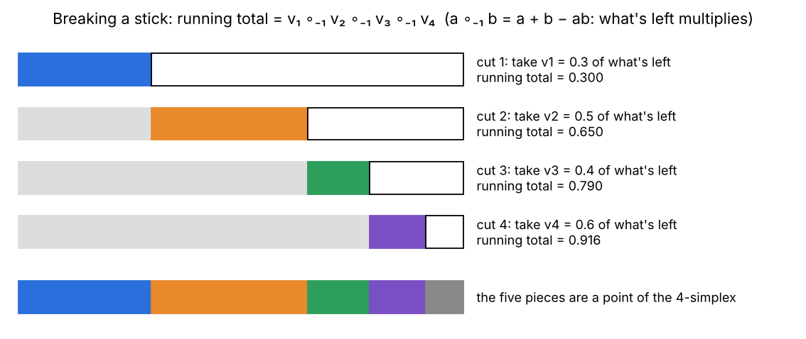

*Figure 2. Breaking a stick four times. The running total after each cut is the core law at k = −1 applied to the
fractions taken.*

**Verdict: a real bridge, not a new theorem.** It says the cube and the simplex are two coordinate charts of one thing,
joined by our own operation, and that the sphere's angles are a third chart of the same thing.

## 2. One dial, three jobs on the simplex

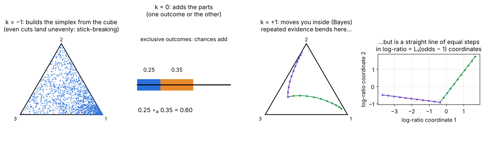

*Figure 3. k = −1 builds the simplex from the cube (even cuts land unevenly). k = 0 adds the shares of outcomes that
can't happen together. k = +1 is Bayes' rule: repeated evidence bends across the triangle but is a straight line of
equal steps in log-ratio coordinates.*

- **k = −1, builds.** Stick-breaking (section 1).
- **k = 0, adds.** Shares of outcomes that exclude each other just add. That is the budget region of the
  beyond-the-cube pass at k = 0.
- **k = +1, moves.** Bayes' rule multiplies each share by a likelihood and renormalizes (Aitchison's "perturbation").
  The odds against the last outcome, rᵢ = pᵢ/pₙ, multiply, so **rᵢ − 1 composes by ∘₁** (check R1). The simplex's own
  radius coordinate, the log-ratio log(pᵢ/pₙ), is **our ruler L₁ applied to odds − 1** (R2). Repeated identical evidence
  is equal steps along a straight line in those coordinates (R3).

**Known:** Aitchison's geometry of compositions (1982–86), Bayes in odds form. The project already knew that the flip
φ₋₁(x) = x/(1 − x) is the odds and carries ∘₋₁ to ∘₁. **Ours:** reading the three dial settings as build / add / move
on one shape. **Verdict: unifies; no new theorem.**

## 3. The simplex and the sphere: square roots and forgotten phases

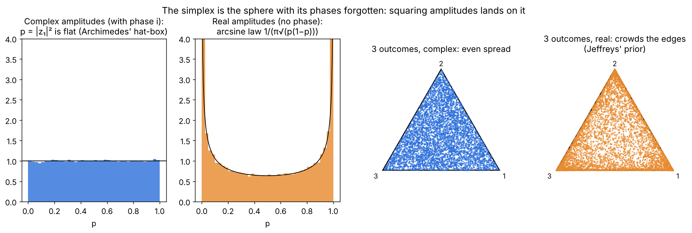

*Figure 4. Random complex amplitudes, squared, spread evenly over the simplex (Archimedes' hat-box). Random real
amplitudes (no phase) pile up at the edges, the arcsine law.*

- **Square roots make the simplex round.** The natural statistical distance on the simplex (Fisher's) is twice the
  angle between √p and √q: the simplex is one corner of a sphere of radius 2 (checks F2, F3).
- **Forgetting phases lands on the simplex.** A random point on the complex sphere, squared, is spread perfectly evenly
  over the simplex (F4). That is Archimedes' hat-box theorem in its general form, and it is the Born rule: probabilities
  are the sphere of amplitudes with every phase thrown away. With real amplitudes (no phase), the shares crowd the
  edges with density 1/(π√(p(1 − p))) (F5).
- **Lévy's arcsine law** for random walks is the same picture: the fraction of time a walk spends ahead has a
  *uniform* simplex angle (F6).

**Known:** Fisher/Rao/Bhattacharyya; Wootters 1981 (statistical distance = angle between states, F7); Archimedes;
the moment map of complex projective space onto the simplex; Lévy 1939. **Ours:** nothing new; this section is the
bridge that lets us compare the simplex with the hypersphere page.

## 4. Constants: e lives here, π is borrowed, i is absent

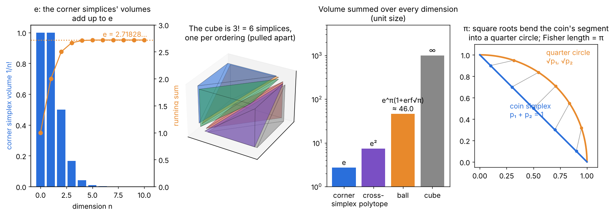

*Figure 5. Left: the corner simplex of the unit n-cube has volume 1/n!, and these add up to e. Second: the cube is n!
such simplices, one for each ordering of its coordinates. Third: volumes summed over every dimension: corner simplex
e, cross-polytope e², ball e^π(1 + erf √π) ≈ 46.0, cube infinite. Right: squaring bends the coin's segment into a
quarter circle, and its Fisher length is π.*

- **e.** The corner simplex of the unit n-cube has volume 1/n! (E1); the cube splits into n! of them, one per ordering
  (E2); the volumes add to e (E3). Scaled by t, they add to eᵗ (E6): the simplex is the shape of the exponential.
  The average count of random numbers needed to pass 1 is e (E4). The e page's layers C(n,k)/nᵏ → 1/k! are exactly these
  volumes (E5). **Simpler on the simplex: yes.** On the cube every volume is 1 and the sum diverges; on the sphere the sum
  is e^π(1 + erf √π), true but not simpler.
- **π.** The simplex has no π of its own. π appears only after square roots turn it into a piece of sphere: the coin's
  Fisher length is π (F1), the Fisher volume of the simplex is half the sphere's area (F3), the arcsine law's 1/π (F5).
  **Simpler on the sphere.**
- **i.** Absent. The simplex is what is left of the sphere after the phases (the i's) are forgotten (F4). **Lives on the
  sphere only.**

**Known:** all of these facts. **Ours:** the three-way sorting, and the line from the e page to the corner simplices.

## 5. One distance rule, three shapes (the main comparison)

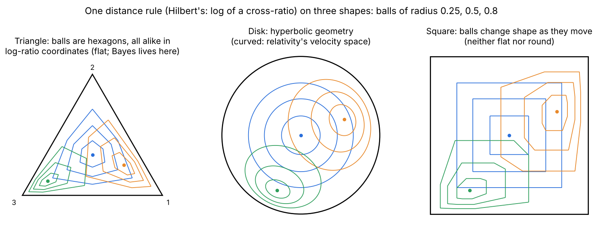

*Figure 6. Hilbert's distance (half the log of a cross-ratio with the two boundary points on the line) drawn as balls of
radius 0.25, 0.5 and 0.8 around three centres. Triangle: hexagons, all alike in log-ratio coordinates (flat). Disk:
hyperbolic geometry (curved). Square: the balls change shape as they move.*

Hilbert's distance needs only a convex shape, so it is a fair way to compare shapes.

- **Segment.** Distance from the middle is the rapidity, and Einstein's velocity addition, our plane law at k = 0,
  d = −1, adds it (H1).
- **Ball.** It is hyperbolic space in the Klein model (H6), which is exactly the space of velocities in special
  relativity.
- **Simplex.** It is half the spread of the log-ratios (H3); Bayes updates are distance-preserving shifts (H4);
  tempering a belief by t multiplies its distance by t (H5). So it is a **flat normed space**, with hexagonal balls.
- **Square.** Not flat and not a product of the two axis rapidities (H10, H11).

**Known:** Klein model; Foertsch and Karlsson 2005 proved that **the simplex is the only convex shape whose Hilbert
geometry is a normed space**; de la Harpe 1993 for the hexagonal balls.

### Relativity precesses, Bayes does not

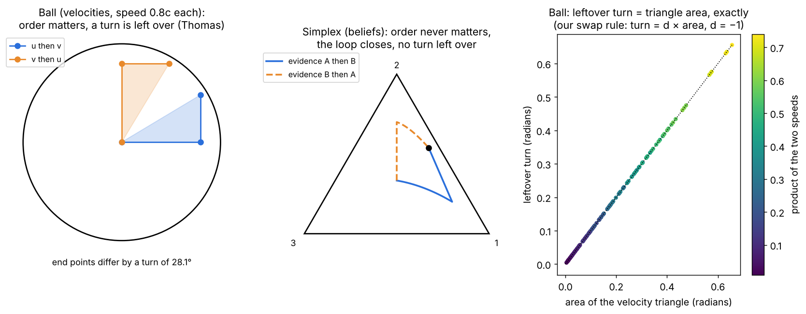

*Figure 7. Left: two perpendicular velocities of 0.8c composed in either order end 28.1° apart (Thomas–Wigner
rotation). Middle: two pieces of evidence taken in either order land on the same belief; the loop closes. Right: the
leftover turn equals the area of the velocity triangle, for 150 random cases.*

- On the ball, u ⊕ v and v ⊕ u differ by the Wigner angle arccos((γᵤ + γᵥ)/(1 + γᵤγᵥ)) (H7), and that angle is
  **exactly the area of the hyperbolic triangle** 0, u, u ⊕ v (H8). That is our precession page's swap rule,
  turn = d × area, with d = −1.
- On the simplex, Bayes updates commute exactly (H9). No area, no turn.

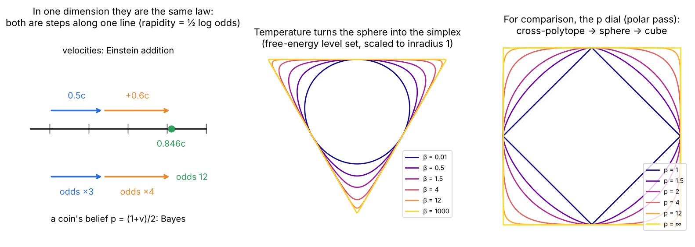

*Figure 8. Left: in one dimension, 0.5c ⊕ 0.6c = 0.846c and "odds ×3 then ×4 = odds 12" are the same two steps on one
line (rapidity = ½ log odds, H2). Middle: temperature turns a round ball into the simplex (free-energy level sets, R5).
Right: the polar pass's ℓp dial (the roundness dial) for comparison.*

- **In one dimension they are the same law** (H2): put p = (1 + v)/2, and the odds (1 + v)/(1 − v) multiply exactly
  when velocities add Einstein's way. The identity is elementary; I found no source stating it, so treat the
  observation as likely noticed before.
- **In two or more dimensions they split** by shape: round velocity space curves and precesses, flat belief space
  doesn't.

**Ours:** putting relativity and Bayes side by side as the ball and the simplex under one rule, and placing the
Thomas angle on our swap-rule line. **Known:** each half (Rhodes and Semon 2004 for Thomas rotation as hyperbolic
area; Foertsch–Karlsson for the simplex).

## 6. Laws that come out simpler on the simplex

| Law | On the simplex | Check |
|---|---|---|
| Bayes' rule | a straight shift (∘₁ on odds − 1), distance-preserving | R1–R3, H4 |
| Gibbs / softmax | temperature slides from the centre (hot) to a corner (cold) | R4 |
| Roundness | hot free-energy ball is a sphere, cold one is the simplex | R5 |
| Entropy | its curvature is the Fisher metric | R6 |
| Replicator equation (biology) | the Fisher-metric uphill direction of mean fitness | R7 |
| Born rule | sphere with phases forgotten, lands evenly | F4 |
| Arcsine law | uniform in the simplex angle | F6 |
| Conservation (mass, charge, probability) | the total is the simplex's defining equation | (definition) |
| Corner-weight shapes | every one is a weighted sum of simplices (Postnikov) | polar pass E1 |

Harder or no help on the simplex: relativity and precession (need the ball), i and π (need the sphere),
independent events (need the cube), number theory (torus of angles), Navier–Stokes, Newton's G and Fermat (unchanged).

## 7. The cubic-form dial (the shape dial): a second dial, separate from the curvature dial

Asked for by Brennan after the first pass: hold the curvature dial fixed, slide the shape from round to triangle, and see
whether the law still changes; and test whether the leftover turn fades smoothly as temperature drops. Checks:
`shape_dial.py` (method) and `shape_dial_checks.py` → `shape_dial_checks_output.txt`, **26 of 26 pass**. Pictures:
`figures_shape_dial.py` → `figures/fig10` … `fig13`.

**Result.** Yes, it is a separate dial. With the curvature dial held fixed, sliding the shape from round to triangle
moves the leftover turn per unit area from the full Thomas amount (−1) to nothing (0), smoothly and in one direction,
along every route tried. In between, the turn is no longer one number: it varies from place to place inside the shape,
and no setting of the curvature dial can do that, because the curvature dial only scales the turn evenly. Cooling does the same
thing: the turn fades smoothly to zero, about 1.45/β when cold, with no jump.

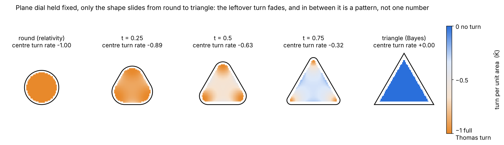

*Figure 10. Curvature dial fixed, shape sliding from round to triangle. Colour is the turn per unit area at each point
(orange = the full Thomas turn, blue = none). The round end turns the same everywhere; in between, the rounded corners
still turn while the flat sides stop; the triangle turns nowhere.*

**How the turn is measured on a shape that is neither.** Every convex shape has one distance rule that its own
projective symmetries keep (Vinberg's characteristic function: the area of the "polar" shape seen from each point,
log of it, second derivatives, minus a third of the square of the first). On the round shape this is relativity's
velocity space; on the triangle it is the flat Bayes space of section 5. The leftover turn around a small loop is the
curvature of this rule times the loop's area (Gauss–Bonnet), which is exactly how the Thomas–Wigner turn arises on the
round shape. I report the curvature scaled so the round shape gives −1 (written K̂). Checks V1–V5 confirm the method:
−1 on the disk at every point and every size, 0 on the triangle, and the polar-area formula matches the exact one.

- **Two routes, same answer (M1–M3, C1).** Blending disk into triangle gives centre values −1, −0.89, −0.63, −0.32, 0;
  trimming the triangle with a disk gives −1, −0.95, −0.76, −0.50, −0.24, −0.07, 0. Halfway along the blend the value
  runs from −0.82 near a rounded corner to −0.50 near a flat side.
- **Temperature (T1–T5).** The free-energy shapes of Figure 8 run from round (hot) to triangle (cold). The centre value
  goes −0.9996, −0.997, −0.965, −0.69, −0.37, −0.14, −0.048, −0.015, −0.005, −0.0014 for β = 0.001 to 1000: about
  −1 + 0.35β when hot and −1.45/β when cold. So the temperature dial is a route along the cubic-form dial, and the leftover
  turn fades with it. The earlier lead (section 5, lead 1) passes its test.
- **Only the triangle is flat (P1–P12, L-checks).** Squares, pentagons, hexagons, any regular polygon with four or more
  sides, and the ℓᵖ balls all look perfectly round at their centre (K̂ = −1) and flatten toward their edges. The
  triangle is the only one flat at its centre.
- **Always between the two ends (B1).** 262 points in 45 random shapes (30 polygons, 15 smooth blobs) all gave
  −1 ≤ K̂ ≤ 0. So round and triangle are the two extremes of this dial, not two stops among many.

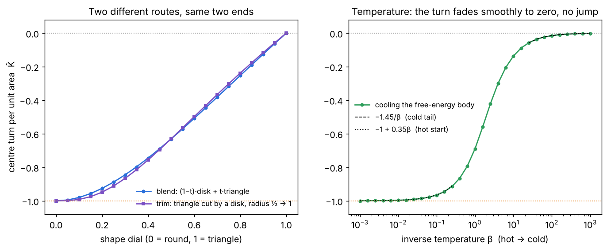

*Figure 11. Left: the centre turn along two different routes from round to triangle. Right: cooling the free-energy
shape; dashed and dotted lines are the cold and hot rates.*

**Why it is not the curvature dial.** The curvature dial d is the overall scale: on the round shape it sets c (d = −1/c²),
and the turn per unit velocity-area is |d| × K̂, the same at every point. Turning d down to zero gives Galileo: flat,
but with round unit balls. The triangle is flat with **hexagonal** unit balls (de la Harpe; Foertsch–Karlsson). So the
two dials reach "no turn" at two different places, and on the triangle the curvature dial changes nothing about the turn
at all. One more difference: an addition law (a group of moves that carries every point to every other) exists only at
the two ends. Round has the three-dimensional Lorentz group, whose boosts don't commute, and the commutator is the
Thomas turn; the triangle has a two-dimensional group of scalings, which commute. Every shape in between has only
finitely many symmetries (Benzécri; in the plane, ellipse and triangle are the only shapes with symmetries that reach
every point). So between the ends the "law" survives only as the turn field, not as an addition rule.

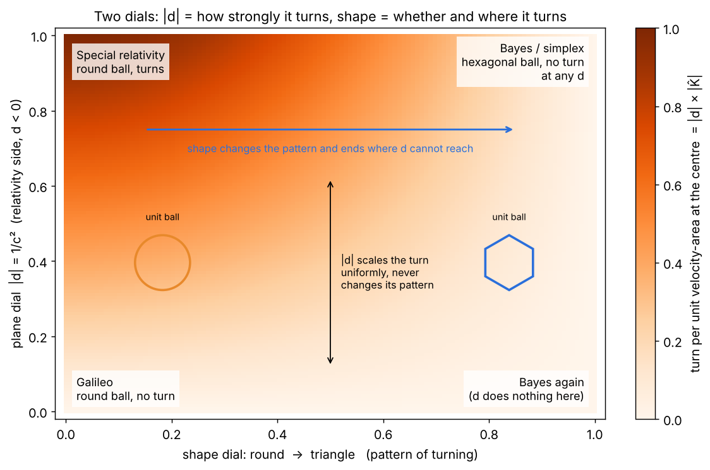

*Figure 12. The two dials side by side. Colour is the centre turn rate |d| × |K̂| (schematic in the shape direction,
using the blend route). Up and down scales the turn evenly; left to right changes its pattern and ends at a place, flat
with hexagonal balls, that the curvature dial never reaches.*

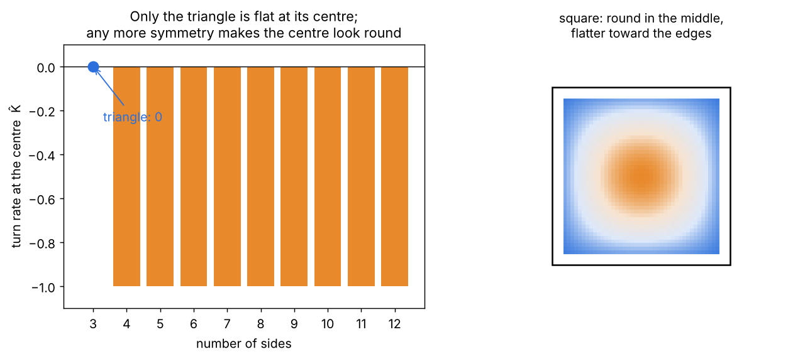

*Figure 13. Left: centre turn rate for regular polygons; only the triangle is flat there. Right: the square is round in
the middle and flatter near its edges.*

**The right name.** The dial is the **space of convex shapes up to projective change** (Benzécri's space; each shape
carries its own Hilbert geometry). The quantity that measures, point by point, how far a shape has moved from round
toward cornered is a **cubic form**: for surfaces, the **Pick cubic form**, or the **cubic differential** of Labourie and
Loftin. It is zero exactly for ellipses (Pick–Berwald), and Dumas–Wolf picture the triangle as the extreme case.

One caveat on the numbers. A convex shape has two standard symmetric distance rules: Vinberg's, which I computed, and
the Blaschke (Cheng–Yau) metric, which is the one the Pick form and the cubic differential belong to. Both give −1 on
round shapes and 0 on the triangle, and both have curvature set by a cubic third-derivative term, but they differ in
between, so the in-between values depend on which you pick. The verdict (separate dial, smooth fade, ends at −1 and 0)
does not. For the Blaschke metric the −1 to 0 range is Calabi's bound, which I recall but did not find confirmed in the
searches here; for Vinberg's metric it held at every point tested, which is a numerical check, not a proof.

How the other names offered compare:
- **"A deformation of convex projective structures"**: close. In the literature that phrase usually means shapes of
  whole surfaces built from these pieces; the dial itself is Benzécri's space.
- **Amari's α-family**: a different dial. It changes the way you take straight lines on one fixed shape, not the shape.
- **Tropicalization / Maslov dequantization**: names the temperature route only (cooling log-sum-exp into a max), not
  the whole dial.

**Known versus ours.** Known: Hilbert geometry, Vinberg's characteristic function, Benzécri's space, the Pick form and
cubic differentials, Calabi's bound (Blaschke metric), homogeneity only at the ellipse and triangle, Thomas turn as hyperbolic area.
Ours: reading Brennan's cubic-form dial as that space and the leftover turn as its curvature (Vinberg's metric); the numbers along the blend,
trim and temperature routes; the cold-tail rate 1.45/β (numerical, not derived); the observation that the temperature
dial is a route on the cubic-form dial, so the free-energy temperature and the Thomas turn are one dial reading. I found no
source giving the curvature of the free-energy family; treat that as unchecked against the literature.

## Leads, each judged on its own merits

1. **Relativity and Bayes as one rule on two shapes (section 5).** Worth following. It explains *why* precession exists
   in a way our swap rule can use: the leftover turn is the area that roundness creates, and the flat simplex has none.
   The natural test is a dial between them: the free-energy bodies of Figure 8 run from round to simplex, so measure
   how the leftover turn of their Hilbert geometries shrinks as temperature drops. If it falls smoothly to zero, the
   temperature dial becomes a curvature dial, which would join the precession stream, the Maslov dial and the corner
   weights. If it doesn't, the idea ends there. Cheap to try. **Tested in section 7: it fades smoothly (about
   1.45/β when cold), so the lead stands.** Next step on it: derive the 1.45 and see whether the turn field matches a
   swap-rule quantity.
2. **Stick-breaking is ∘₋₁ (section 1).** Small but solid: it gives the cube-to-simplex map in our own operation, and
   the Dirichlet process (infinitely many cuts) becomes "∘₋₁ forever". Worth one look at whether the Chinese restaurant
   counting matches anything on the repetition dial; otherwise it is a clean restatement.
3. **e as the simplex's constant (section 4).** Not a lead; it settles where e lives, which the hypersphere task can use.

## Next (offered, not started)

- Derive the cold-tail constant 1.45 in section 7 exactly, and repeat the cubic-form dial in three dimensions (ball to
  tetrahedron), where the in-between shapes are richer.
- Lean (Mac Studio): S1 (stick-breaking total = fold of ∘₋₁), R1 (perturbation = ∘₁ on odds − 1), H2 (odds product =
  Einstein addition). All are short ring identities. From section 7, V3 (polar area of a disk = π/(1−|y|²)^{3/2})
  is a clean calculus fact; the rest of section 7 is numerical and is not a Lean target.

## Files

- `README.md`: this write-up
- `checks.py` → `checks_output.txt` (44/44)
- `figures.py` → `figures/fig1` … `fig9`
- `shape_dial.py`, `shape_dial_checks.py` → `shape_dial_checks_output.txt` (26/26), `figures_shape_dial.py` →
  `figures/fig10` … `fig13` (section 7)
- `index.html`: the same write-up as a page

## References

- J. Sethuraman, "A constructive definition of Dirichlet priors", Statistica Sinica 4 (1994).
- J. Aitchison, *The Statistical Analysis of Compositional Data*, 1986.
- W. K. Wootters, "Statistical distance and Hilbert space", Phys. Rev. D 23 (1981).
- P. Lévy, "Sur certains processus stochastiques homogènes", Compositio Math. 7 (1939) (arcsine law).
- T. Foertsch, A. Karlsson, "Hilbert metrics and Minkowski norms", J. Geom. 83 (2005), arXiv math/0407197.
- P. de la Harpe, "On Hilbert's metric for simplices", in *Geometric Group Theory* vol. 1, LMS Lecture Notes 181 (1993).
- J. A. Rhodes, M. D. Semon, "Relativistic velocity space, Wigner rotation, and Thomas precession", Am. J. Phys. 72 (2004).
- S. Shahshahani, "A new mathematical framework for the study of linkage and selection", Mem. AMS 211 (1979).
- A. Postnikov, "Permutohedra, associahedra, and beyond", IMRN 2009.
- J.-P. Benzécri, "Sur les variétés localement affines et localement projectives", Bull. SMF 88 (1960).
- E. B. Vinberg, "The theory of convex homogeneous cones", Trans. Moscow Math. Soc. 12 (1963).
- F. Labourie, "Flat projective structures on surfaces and cubic holomorphic differentials", PAMQ 3 (2007);
  J. Loftin, "Affine spheres and convex RPⁿ-manifolds", Amer. J. Math. 123 (2001).
- J. Loftin, I. McIntosh, "Cubic differentials and hyperbolic convex sets", arXiv 1310.5120.
- D. Dumas, M. Wolf, "Polynomial cubic differentials and convex polygons in the projective plane", arXiv 1407.8149.
- M. Ito, B. F. Lourenço, "The p-cones in dimension n ≥ 3 are not homogeneous when p ≠ 2", arXiv 1701.05801.
