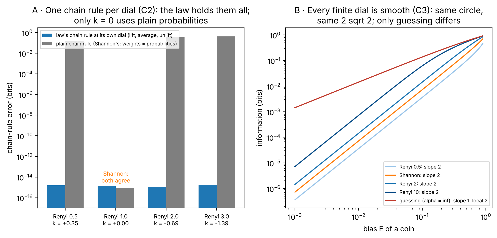

# DRAFT · Does the law force Shannon's chain rule?

*DRAFT, Nov 28 2026. Not versioned, not proved in Lean, not pushed to the repo. Round 5 of `spin-i-tie/`, a lean
follow-up to `forces-circle/`. Brennan: "Test the chain rule".* Checks: `checks.py` → `checks_output.txt` (**3 / 3
pass**), `results.json`. Picture: `figures.py` → `figures/cr1_dial.png`. Colour key: blue = the law's own reading;
orange = textbook; grey = reference.

## The result in plain words

**No. The law doesn't force Shannon's chain rule. It holds a whole family of chain rules, one for each value of its
dial, and Shannon's is the one at k = 0. What's missing is exactly one assumption: that information adds plainly,
dial at zero. Every other setting of the dial gives the same circle and the same 2√2, though; what only Shannon's
setting is proven to supply is the rule that one sent bit carries at most one bit.**

*cr1. A: chain-rule error for four Rényi entropies. Each obeys the law's own chain rule at its dial k = (1 − α) ln 2
exactly (blue, about 10⁻¹⁵). Only Shannon (k = 0) also obeys the plain chain rule with ordinary probability weights
(grey); the others miss by 0.16 to 0.44 bits. B: information against a coin's bias. Every finite dial grows like bias²
(slope 2), which draws the quantum circle; only the guessing measure (dial at −∞) grows like the bias (slope 1), which
gives the local 2.*

## What each check shows

- **C1 (textbook, in the law's form).** The union rule applied one step at a time with the conditional chance is exact
  for dependent events: P(A or B) = P(A) ∘₋₁ P(B | not A) (500 random cases, 2 × 10⁻¹⁶). So the law does have a chain
  rule for probabilities. It is ordinary conditional probability, and every entropy is built on it, so it can't choose
  among them.
- **C2 (Rényi 1961; the dial reading is ours).** Every Rényi entropy obeys a chain rule shaped like the law: the joint
  entropy is H(X) plus the conditional entropies averaged the law's way (lift each with the law's lift at dial
  k = (1 − α) ln 2, take the weighted average, unlift). This is exact for orders ½, 1, 2 and 3. The weights are p^α.
  Only k = 0, Shannon, uses the plain probabilities as weights and the plain average. **So the law holds every chain
  rule in the family, and nothing in it picks k = 0.**
- **C3 (textbook facts, our use).** Every finite dial is smooth at a fair coin and grows like bias², so in Pawłowski's
  tree every one of them draws the same circle and the same 2√2 (`forces-circle/` F1; the constant in front drops
  out). Only the dial at −∞ (the guessing measure) gives the local 2.

## What exactly is missing

To get from the law to 2√2 without assuming it, one still needs **"one sent bit gives Bob at most one bit"** for some
smooth member of the family. Pawłowski et al. proved that for Shannon (k = 0) using its plain chain rule. The law
supplies the shape (biases multiply at k = −2, the bit flip, smoothness) but not the choice k = 0, and I have not shown
that the bound holds at any other dial. In one line: **"information adds" means the law's dial at zero, and that is an
assumption, not a consequence.**

## Known vs ours

- **Known:** Rényi's characterization of his entropies by additivity plus a quasi-arithmetic ("lift, average, unlift")
  mean, with only straight-line and exponential generators allowed (Rényi 1961; Aczél and Daróczy 1975); escort weights
  p^α; Shannon's uniqueness from the plain chain rule (Faddeev 1956). Also known and close to home: Tsallis entropy
  composes by the law itself, S(A, B) = S(A) + S(B) + (1 − q)S(A)S(B), the law with k = 1 − q (Tsallis 1988).
- **Ours:** reading Rényi's averaging generator as the law's lift at dial k = (1 − α) ln 2, and the observation that the
  circle (and 2√2) is the same at every finite dial, so only the one-bit bound depends on k = 0.

## Does it open a lead?

**A narrow one, and it is now sharply posed.** The question "why 2√2?" has come down to "why is information's dial at
zero?" If the one-bit bound could be proved at a dial k ≠ 0 (a Rényi or Tsallis version of information causality), the
ceiling would no longer rest on Shannon specifically. I did not check whether that has been studied. Otherwise this line
has reached what the law can give: the shape, not the principle.

## Sources

From memory, not re-fetched: Rényi, Proc. 4th Berkeley Symp. 1, 547 (1961); Aczél and Daróczy, *On Measures of
Information and their Characterizations* (1975); Faddeev, Uspekhi Mat. Nauk 11, 227 (1956); Tsallis, J. Stat. Phys. 52,
479 (1988); Pawłowski et al., Nature 461, 1101 (2009). No paper text is stored in this folder.

## Correction (round 6, DRAFT)
The claim above that every finite dial gives the same circle holds only deep in the guessing tree. The first levels bind too. Rényi order 2 forbids quantum boxes at depth 1 (bias 0.644 < 0.707), as Oughton & Timpson (Entropy, 2024) showed. Under the simple definition used in ../renyi-bound/, orders above about 1.39 fail. See ../renyi-bound/README.md.
