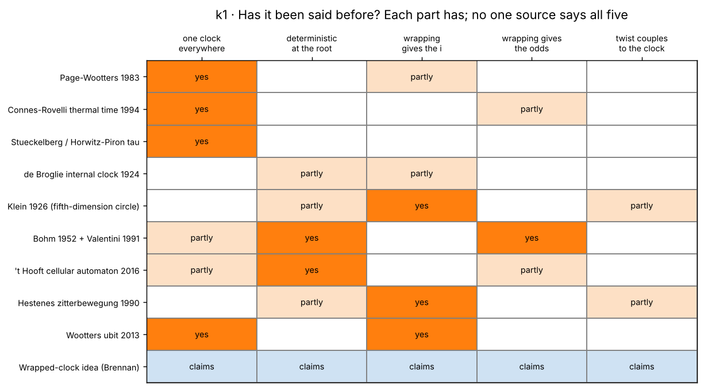
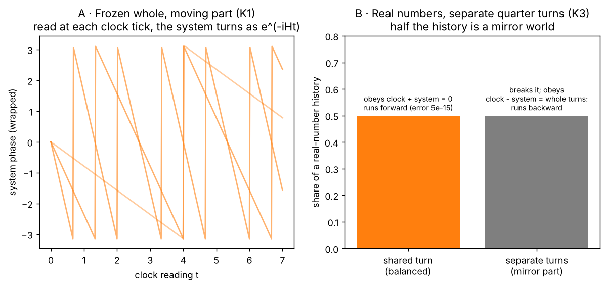
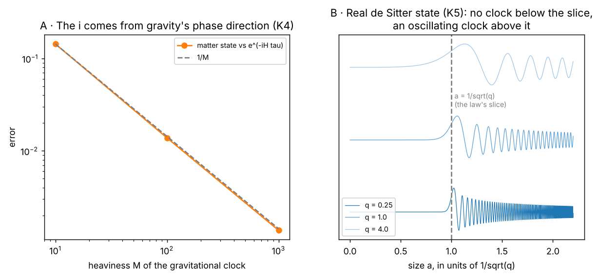
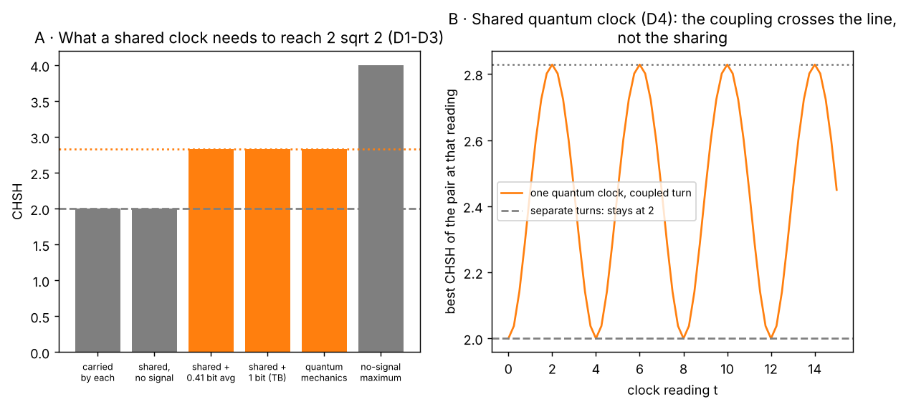
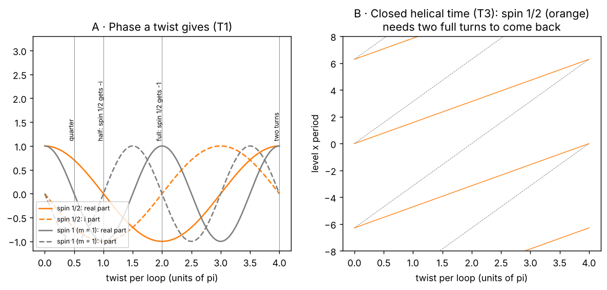
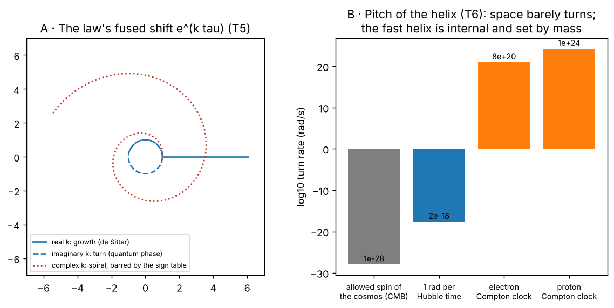
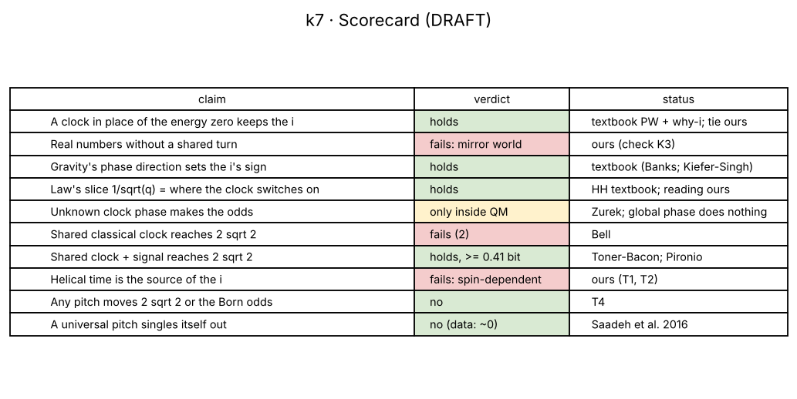

# DRAFT · One clock for everything: does the i survive, can the clock make the odds, and what does twisted time do?

> **Names:** some words or symbols on this page (fused, wall, twist) also mean something else in standard math, physics or computing, or inside this project. [NAMING-COLLISIONS.md](../../../NAMING-COLLISIONS.md) says which meaning is in play.

*DRAFT, Nov 28 2026. Not versioned, not proved in Lean, not pushed to the repo. Round 2 of `spin-i-tie/`. Asked for by
Brennan on a call: "keep chasing that", "having the very small clock that produces probability would be something that
would unify things", "we've already done quite a bit of work on Bell's theorem ... just keep on hammering at it", then
the torsion / Klein bottle idea, "if this one clock is time, it's literally time", a name for the idea and whether it
already has one, and time "twisted like a helix" with "all the rest of space bent into time".*

Checks: `checks.py` → `checks_output.txt` (**22 / 22 pass**; numpy, scipy, sympy; Monte Carlo where marked), results in
`results.json`. Pictures: `figures.py` → `figures/` k1 to k7. Colour key: **blue = the law's own reading; orange =
textbook physics; grey = reference lines.** Everything not marked "ours" reproduces known results.

This page builds on, and does not redo, `probability-entanglement/` (Bell's wall for loops and helices; the whole-path
model; the |Σ|² rule), `hypersphere/` Q2 (spin-½ odds as a cap's area) and `klein-universe/` (U7: spinor phases on
twisted spaces).

## The result in plain words

**Letting time be one clock tied to everything else keeps the i: it is the direction the clock turns. But one clock
can't make quantum chance on its own. A clock shared by two particles reaches the quantum 2√2 only if a signal passes
between them (at least 0.41 bits per pair), and twisting time into a helix never changes the odds or the 2√2.**

The version of Brennan's idea that survives every test here is already in the literature: a deterministic world with
one global clock, nonlocal like Bohm's, where the Born rule is what you see when you can only read the clock coarsely
(Valentini 1991). It has a known, testable prediction, but it is not specific to our law.

## The idea, in one sentence, and a name

> **Time is one deterministic clock running everywhere at once. We only ever see its hand wrapped around (mod a full
> turn), and that wrapping is where the i and quantum chance come from. A twist in space or time would twist how the
> clock wraps.**

Working name: **the wrapped-clock hypothesis** (Brennan's to change). What the tests say about each clause:

| Clause | Verdict | Where |
|---|---|---|
| One clock tied to everything (time is "literally" that clock) | **Holds, textbook.** Page–Wootters, relational time; in quantum gravity the clock is the gravitational phase | K1, K2, K4 |
| The wrapping gives the i | **Holds, textbook.** The i is the direction the clock turns (which way gravity's phase winds); with real numbers and no shared turn you get a mirror world that runs backwards | K3, K4 |
| Deterministic at the root | **Allowed, but only nonlocal or settings-dependent** (Bell). A shared clock read locally is stuck at 2 | D1, P4 |
| The wrapping gives the odds | **Not by itself.** A hidden global phase does nothing; the Born rule comes from quantum symmetry (Zurek) or from coarse-graining in a nonlocal theory (Valentini) | P1–P3 |
| A twist of time twists the wrapping | **True but small and spin-dependent.** It adds a phase per loop that depends on the particle's spin; it can't be the i and never moves 2√2 | T1–T4 |

## Has it been said before?

*k1. Who has said which part. Each part has been said by someone, but as far as I found, no one source makes all five
claims together. The closest pairs are Bohm with Valentini (deterministic, nonlocal, Born rule from coarse reading) and
Wootters' ubit (one universal rotating hand that is the i).*

| Prior work | What it shares with the idea | Where Brennan's version differs |
|---|---|---|
| **Page and Wootters (1983)** | The universe is frozen as a whole (H Ψ = 0), yet a part read against a clock evolves. One clock, made of the rest of the world | Quantum through and through, not deterministic; says nothing about where the odds come from |
| **Connes and Rovelli, thermal time (1994)** | Time is the flow that a state itself generates (Tomita–Takesaki *modular* flow). It matches his word "modular", and the same object gives a part's probabilities and its time | The clock is derived from the quantum state, not a deterministic root, and nothing is "wrapped" |
| **Stueckelberg; Horwitz and Piron (1941, 1973)** | One universal evolution parameter τ for everything, separate from each object's own time coordinate | Ordinary quantum mechanics on top; no account of chance or of the i |
| **de Broglie's internal clock (1924)** | Every particle carries a clock ticking at mc²/h, and waves come from keeping the clocks in phase | One clock per particle, not one for everything |
| **Klein (1926), the fifth-dimension circle** | Motion around a small extra circle shows up as a phase; the wrapping is what quantizes charge | Per-charge phase on an extra circle, not time, and no probability |
| **Bohm (1952) with Valentini (1991)** | Deterministic at the root, one global configuration; the Born rule is the equilibrium you see when you can only read things coarsely, like heat death | Nonlocal (forced by Bell). The clock isn't singled out as the source of the i |
| **'t Hooft, cellular automaton (2016)** | Deterministic at the root; a step-k → k+1 mod n "cogwheel" is a quantum system with evenly spaced energies (Brennan's "mod operator") | Escapes Bell by superdeterminism (settings tied to the past); Born rule claimed from the ontological basis |
| **Hestenes, zitterbewegung (1990)** | The i in Dirac's equation read as a real rotation (the spin plane) of an internal clock at 2mc²/ħ | Per particle, and it picks a direction in space (the same problem T2 finds) |
| **Aleksandrova, Borish and Wootters, the ubit (2013)** | One universal real rotating hand that touches everything; when it spins fast, complex quantum mechanics comes out. This is "one clock everywhere is where the i comes from" | Doesn't give the Born rule, and the model is nonlocal |

So: **no one of them says the whole thing**, but every clause has a well-known home. Brennan's own contribution is
the combination, and the wording "the odds are the clock seen mod a turn".

## Part A · a clock in place of the energy zero (why-i's A4)

*k2. A: Page–Wootters. The whole state is frozen; read at each clock tick, the system turns as e^(−iHt) (K1, fidelity 1
to 15 digits, at in-between readings too). B: the same with real numbers and separate quarter turns for clock and
system. Half of the history obeys "clock + system = 0" and runs forward; the other half breaks it and obeys "clock −
system = whole turns": a mirror world running backwards (K3).*

- **K1, K2 (textbook).** With a clock, only the balance of clock energy and system energy is fixed, so moving a
  constant from one to the other changes nothing (every odd moves by 2 × 10⁻¹⁵). This *derives* why-i's assumption A4
  (the energy zero is a convention) instead of assuming it. So the proof of i survives when time is a clock.
- **K3 (ours, a small check of a known point).** Real numbers with separate quarter turns J_clock and J_system split
  the history in two equal halves. The half where the two turns agree obeys the constraint (to 3 × 10⁻¹³) and gives one
  forward evolution; the other half is the mirror world. Requiring one shared turn (why-i's A6 booking, the balanced
  product of Stueckelberg 1960) removes it. **The i is the one turn the clock and the rest of the world share.**
- **K4 (textbook: Banks 1985; Kiefer and Singh 1991).** With gravity as the clock (Born–Oppenheimer / WKB), matter
  follows e^(−iHτ) along one direction of the gravitational phase, with error falling like 1/M (0.14, 0.014, 0.0014).
  Along the other direction it follows e^(+iHτ). The real wave function holds both. **Which sign the i has is which way
  gravity's clock winds.**

## Part B · is the law's fused shift the clock?

*k3. A: the gravity-clock error falls like 1/M (K4). B: the real de Sitter state for q = ¼, 1, 4. It does not
oscillate below a = 1/√q, the law's slice size, so there is no clock there; above it, it oscillates, and a clock and a
phase appear (K5: 0 crossings below; 159, 40, 10 above, matching the WKB count to within one).*

- **K5 (Hartle–Hawking textbook; the identification with the law's slice is ours).** The switch from "no time" to
  "time" sits exactly at the law's slice size 1/√q (round 16).
- **K6 (ours).** The clock read off the oscillation, τ = arccosh(√q·a)/√q, gives a = cosh(√q τ)/√q, the closed de
  Sitter growth. The law's fused shift with real k = √q produces that growth; with imaginary k it turns matter by
  e^(−iHτ). **One fused shift plays both clocks: real k is the geometry's clock, imaginary k is matter's phase.**

## Part C · can a small clock nobody can read make the odds?

- **P1 (textbook).** Averaging over a completely unknown *global* clock phase changes no odd (1 × 10⁻¹⁵). A global
  phase is exactly what A4 says drops out, so it cannot be the dice.
- **P2.** An unknown *relative* phase between two paths wipes out the interference and leaves |a|² + |b|². The squares
  were already there (rotations keep lengths); the averaging makes a mixture, not the Born rule.
- **P3 (Zurek 2005, with his assumptions).** Unknowable phases between a system and its surroundings do give the Born
  rule (2/3 from three equal branches), but inside quantum mechanics.
- **P4 (Bell 1964).** A clock phase carried by each particle scores CHSH = 2 at best (also over a 9⁴ grid of settings);
  quantum mechanics gives 2√2, and loophole-free experiments (2015) saw more than 2. A local small clock is ruled out.
- **P5.** The Compton clock (mc²/ħ, about 10²⁰ turns a second for an atom) cancels between two paths; what's left is
  m·g·h·t/ħ, the gravity phase Colella, Overhauser and Werner measured with neutrons in 1975. Whether atom
  interferometers "read" the Compton clock is disputed (Müller, Peters and Chu 2010 against Wolf et al. 2011).

## Part D · one clock shared by both particles

*k4. A: what a shared clock needs. Read locally, any shared clock scores 2 (D1). Add one bit sent from one side to the
other and it reproduces the singlet exactly, 2√2 (D2, Toner–Bacon). The cheapest route uses 0.41 bits per pair on
average (D3, Pironio). The same signal could also reach 4, so the clock picture doesn't say why nature stops at 2√2.
B: a shared quantum clock (D4). Read at time t, the pair's best CHSH swings up to 2√2 when the clock's partner turn
couples the two particles, and stays at 2 when it turns each separately.*

- **D1 (Bell).** However the shared clock runs (one phase, many hands, global, relational), if each particle reads it
  with its own setting, the model is a mixture of the 16 deterministic answer rules and the best is 2.
- **D2 (Toner and Bacon 2003).** Two shared random clock hands plus **one bit** sent between the sides give the
  singlet's −cos(angle) to 4 × 10⁻⁴ (2 million runs), fair coins on each side, and CHSH 2.8297 (2√2 = 2.8284). Switch
  the bit off and the same clock scores 1.41. When the particles are far apart, that bit travels faster than light.
- **D3 (Pironio 2003).** The minimum is √2 − 1 = 0.414 bits per pair on average; a mix of the one-bit strategy and the
  best local rule reaches 2√2 at exactly that cost.
- **D4 (textbook, our framing).** A shared *quantum* clock reaches 2√2, but only when the turn it drives couples the
  particles, and the odds read off it are the Born rule, assumed. It is ordinary quantum mechanics. The law's fused shift
  acting on the joint state behaves the same way.

**What it costs, in known terms:** a shared clock buys 2√2 with a signal (at least 0.41 bits per pair), with
settings-dependence (the earlier whole-path model needed about 0.05 bits of it, `probability-entanglement/` G6), or by
being quantum mechanics. In none of these does the clock explain the ceiling at 2√2; that still needs a principle like
information causality (Pawłowski et al. 2009), as the earlier page found.

## Part T · twisted and helical time

**What the shapes are called (naming checked where marked):**
- **Closed:** time is a circle, and going once round turns space by an angle θ. That is a **mapping torus** of space by
  a rotation (also called twisted boundary conditions or twisted compactification; Melvin-type twist in string theory).
  With a mirror instead of a turn it is the non-orientable, Klein-bottle kind. In imaginary (Euclidean) time it is a
  thermal circle with a rotation chemical potential, e^(−β(H − ΩJ)). In real time a closed time circle means closed
  timelike curves (Gödel-type), which is why the closed case is usually treated in imaginary time.
- **Open (Brennan's helix):** space turns steadily as time runs, never closing. Locally that is a rotating frame; for
  the whole cosmos it is a rotating universe (Gödel 1949 is the famous exact one). The helix is the circle's universal
  cover, as `probability-entanglement/` §7 already notes for the law's lift log(1 + x).
- **Concentrated on a line:** a spinning cosmic string, where going round it shifts time by a fixed amount (Deser,
  Jackiw and 't Hooft 1984; Mazur 1986). Read as geometry, it is a timelike screw dislocation, with torsion on the line
  (Tod 1994; Letelier 1995). Mazur's result is the closest known version of "helical time plus wrapping": asking the
  wave to come back to itself around the string quantizes energy.

*k5. A: the phase a twist of θ per loop gives a spin-½ particle (orange) and a spin-1 particle (grey). Spin-½ gets −i at
a half turn and −1 at a full turn; spin-1 gets −i at a quarter turn. B: closed helical time. Levels sit at (2πn + mθ)/T;
a full turn brings integer-spin levels back but moves spin-½ levels half a spacing, onto the antiperiodic ladder; spin-½
needs two full turns.*

- **T1 (textbook).** A spin-½ component picks up e^(−iθ/2): quarter turn e^(−iπ/4), half turn −i, full turn −1 (seen
  with neutrons: Rauch et al. 1975; Werner et al. 1975), two turns +1. The "±i once round" of the half-turn space in
  `klein-universe/` U7 is this spin-½ case. The local version of helical time, spin coupling to rotation, is measured
  (Mashhoon 1988; Demirel, Sponar and Hasegawa 2015; Danner et al. 2019).
- **T2 (ours, from textbook facts).** A half turn squares to (−1)^(2j): −1 for fermions, +1 for photons and other integer
  spins. It also picks out the twist's axis. Quantum mechanics' i must square to −1 for every particle and commute
  with everything (Stueckelberg 1960). **So a twist cannot be the i.** It can only add a spin-dependent phase on top.
- **T3 (textbook).** Closed helical time shifts energies; it doesn't create the phase.
- **T4.** Twisting each particle by its own amount, at 25 pitches over two turns, leaves the singlet's best CHSH at
  2.828427; turning both together leaves the singlet unchanged. **No pitch moves the Born odds or 2√2.**
- **T7 (ours, using `torsion-dial/`).** Torsion read as the law's order gap k[A, B]: a step in time and a turn of space
  commute, so steady helical time carries no torsion (gap 0), matching `klein-universe/`'s finding for shape twists.
  Torsion needs the twist concentrated on a line (the spinning string) or spin density (Einstein–Cartan).

*k6. A: the law's fused shift e^(kτ). Real k grows (de Sitter), imaginary k turns (the quantum phase), complex k would
spiral, a helix in scale and phase, but round 16's sign table bars it (T5). B: how fast a helix can turn. The CMB allows
the cosmos to turn at most about 10⁻²⁸ rad/s; one radian per Hubble time is 2 × 10⁻¹⁸; the internal Compton clocks turn at
8 × 10²⁰ (electron) and 1 × 10²⁴ (proton) rad/s.*

- **T5 (ours, conditional on the sign table).** With a complex dial k = s + iω the fused shift grows while it turns, a
  log-spiral of pitch ω/s. But k² = s² − ω² + 2isω, and the sign table k² = −q_v·q_s with real q's needs sω = 0. **In the
  law as it stands one dial can't be a helix**: growth and turn live in different sectors, geometry and matter.
- **T6 (data).** The CMB vorticity bound (σ_V/H)₀ < 4.7 × 10⁻¹¹ (Saadeh et al. 2016) caps a helix of space itself at
  about 10⁻²⁸ rad/s, under 5 × 10⁻¹¹ rad over the universe's whole age. A pitch of one radian per Hubble time is excluded
  20 billion times over. The fast helix is internal (Compton), and its pitch is set by each particle's mass.

**Does some pitch single itself out?** (Brennan: "there will be a twist that exactly matches our universe".) Three
twists are special by structure: **half a turn** (spin-½ gets i), **a full turn** (the spinor sign; fermions'
antiperiodic ladder) and **the mirror** (Pin±; ruled out for space by the weak force in `klein-universe/`). Among steady
helices the data force the cosmic pitch to be essentially zero, and the internal pitch differs for every particle. So no
single pitch matches the universe through the clock. If space turns out to be the half-turn space (still open in
`klein-universe/`), the half turn would be singled out, but by topology, testable with matched circles in the CMB, not by
the clock.

## Scorecard

## Textbook vs ours

| Item | Status |
|---|---|
| Page–Wootters; relational time; energy zero as a convention with a clock | Textbook (Page and Wootters 1983; Höhn, Smith and Lock 2021) |
| Real numbers without a shared turn give a mirror sector (K3) | Ours as a check; the shared-J requirement is Stueckelberg 1960 |
| The i's sign = the gravitational phase direction (K4) | Textbook (Banks 1985; Kiefer and Singh 1991) |
| HH state turns on time at 1/√q, the law's slice (K5, K6) | HH textbook; the slice identification is ours |
| Global phase does nothing; relative phase averaging; envariance (P1–P3) | Textbook (Zurek 2005) |
| Local clock ≤ 2; one bit gives 2√2; 0.414 bits minimum (P4, D1–D3) | Textbook (Bell 1964; Toner and Bacon 2003; Pironio 2003) |
| Shared quantum clock: coupling, not sharing, crosses Bell's line (D4) | Textbook content, our framing |
| Twist phases, spinor sign, mapping-torus levels (T1, T3) | Textbook |
| A twist can't be the i (spin-dependent, axis-bound) (T2) | Ours, from textbook facts |
| Steady helical time has no torsion as the law's order gap (T7) | Ours (uses `torsion-dial/`) |
| One dial can't be a helix under the sign table (T5) | Ours, conditional on round 16 |

## How far toward quantum gravity, and any prediction

- **Toward quantum gravity:** this round lands somewhere real. In the frozen universe of quantum gravity (H Ψ = 0) the
  i survives as the turn the clock and everything else share, and its sign is the direction gravity's clock winds. The
  law's slice 1/√q is where that clock switches on. All of that is textbook quantum cosmology with a law-shaped reading.
- **Prediction candidate:** none specific to the law. The family that keeps "deterministic at the root" alive (Bohm with
  Valentini) has one: **quantum non-equilibrium**, relic departures from the Born rule from the early universe, sought
  as a loss of power on the largest scales of the CMB (Valentini's programme). That belongs to Valentini, not to us.
  For forces round 27: nothing new to add.
- **What would make it ours:** a reason, inside the law, why a shared clock's signal stops at 2√2 rather than 4. The
  natural next step is to translate information causality into the law's composition rule.

## Sources

Fetched or searched this round: Toner and Bacon, quant-ph/0304076 (PRL 91, 187904, 2003); Pironio, quant-ph/0304176
(PRA 68, 062102, 2003); Saadeh, Feeney, Pontzen, Peiris and McEwen, arXiv:1605.07178 (PRL 117, 131302, 2016); Valentini,
Phys. Lett. A 156, 5 (1991) and 158, 1 (1991) (abstracts); Demirel, Sponar and Hasegawa, New J. Phys. (2015) and Danner et
al., arXiv:1904.07085 (abstracts); "Conical singularities and torsion", Class. Quantum Grav. 11, 1331 (1994) (record
only; the author is from memory as P. Tod). Fetched in round 2's first pass: Aleksandrova, Borish and Wootters,
arXiv:1210.4535; Kiefer, gr-qc/9405039; Gibbons, arXiv:1111.0457; the Compton-clock exchange (arXiv:1009.0602,
1012.1194, 1102.2587).

From memory, not re-fetched: Page and Wootters, PRD 27, 2885 (1983); Connes and Rovelli, CQG 11, 2899 (1994);
Stueckelberg, Helv. Phys. Acta 33, 727 (1960); Horwitz and Piron, Helv. Phys. Acta 46, 316 (1973); de Broglie, thesis
(1924); Klein, Z. Phys. 37, 895 (1926); Bohm, PR 85, 166 (1952); 't Hooft, *The Cellular Automaton Interpretation of
Quantum Mechanics* (Springer 2016); Hestenes, Found. Phys. 20, 1213 (1990); Banks, Nucl. Phys. B 249, 332 (1985); Kiefer
and Singh, PRD 44, 1067 (1991); Hartle and Hawking, PRD 28, 2960 (1983); Zurek, PRA 71, 052105 (2005); Bell, Physics 1,
195 (1964); Hensen et al., Nature 526, 682 (2015); Colella, Overhauser and Werner, PRL 34, 1472 (1975); Rauch et al. and
Werner et al. (1975, 4π spinor rotation); Mashhoon, PRL 61, 2639 (1988); Deser, Jackiw and 't Hooft, Ann. Phys. 152, 220
(1984); Mazur, PRL 57, 929 (1986); Letelier, CQG 12, 471 (1995); Gödel, RMP 21, 447 (1949); Pawłowski et al., Nature 461,
1101 (2009); Höhn, Smith and Lock, arXiv:1912.00033. No paper text is stored in this folder.
