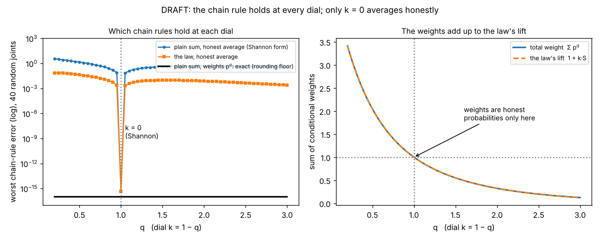

# DRAFT: can the law give Shannon's chain rule instead of assuming it?

**Plain result: it partly cracks.** The law doesn't break the chain rule: a chain rule holds at
every dial, as long as the leftover information is weighted by p^q instead of by p. Those weights
add up to exactly the law's lift, 1 + k·S. Shannon (k = 0) is the one dial where the lift is 1,
so the weights are honest probabilities and the leftover information is an honest average.
So the chain rule comes down to one plain requirement: "what's left to learn is the average
over what happened." That requirement is old, known work (Faddeev's grouping rule), not ours.

## Checks (6/6, unit-test style)
Dial k = 1 − q; entropy at that dial is Tsallis S_q (Shannon at q = 1).
- C1: joint = first + Σ p(a)^q · leftover(a) holds exactly at every dial.
- C2: Σ p^q = 1 + k·S_q, the law's lift, for every distribution.
- C3: for independent parts, C1 reduces to the law itself: S(AB) = S(A) ∘ₖ S(B).
- C4: the law with an honest average fails for linked parts, except at k = 0.
- C5: a plain sum with an honest average (Shannon's form) fails, except at k = 0.
- C6: the p^q chain rule nests consistently over three variables at every dial.

## Known work (not ours)
- Faddeev (1956): the grouping (recursivity) rule with honest weights singles out Shannon.
- Daróczy (1970): chain rule for entropies of type β, with p^β weights.
- Suyari, IEEE Trans. Inf. Theory 50, 1783 (2004), arXiv:math-ph/0205004: Shannon–Khinchin axioms generalized; Tsallis comes out unique.
- Furuichi, J. Math. Phys. 47, 023302 (2006), arXiv:cond-mat/0405600: chain rules for Tsallis entropies. Uniqueness via a generalized Faddeev axiom: arXiv:cond-mat/0410270.
- C1–C3 are these known results, written in the law's notation. Seeing the weight total as the law's lift is a one-line rearrangement of Tsallis's definition, so not new either.

## Lead?
A small one. Honest averaging is the same thing as mixtures adding linearly, and quantum mechanics
assumes that already (expectation values are linear in the state). If that linearity can be shown
to force the lift to be 1, then k = 0 comes from the same root as the rest of quantum mechanics,
not from a separate assumption. Part of this sits in the existing work on entropy in general
theories (Barnum et al. 2009, arXiv:0909.5075), so check there before claiming anything.

## Cleanest next test
In a general theory with linear mixing, define leftover information with weights w(p) and ask
which w keeps entropy concave and keeps mixing linear. If only w(p) = p survives, the chain rule
follows from linear mixing.

Files: checks.py, checks_output.txt, results.json, figures.py, cc1_weights.png. No papers stored.
