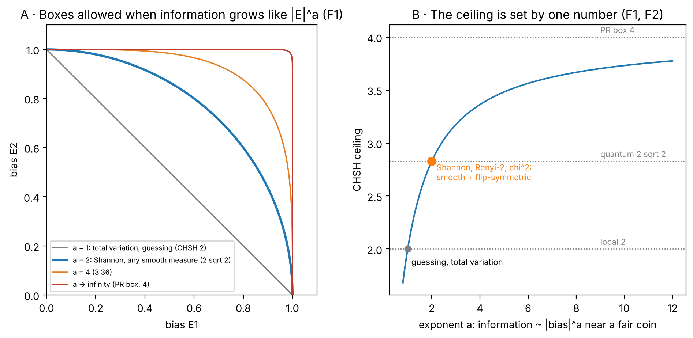

# DRAFT · Does the law's union rule plus "information adds" force the 2√2 circle?

*DRAFT, Nov 28 2026. Not versioned, not proved in Lean, not pushed to the repo. Round 4 of `spin-i-tie/`, a lean
follow-up to `info-causality/`. Brennan: "Test if it forces it".* Checks: `checks.py` → `checks_output.txt` (**3 / 3
pass**), `results.json`. Picture: `figures.py` → `figures/fc1_exponent.png`. Colour key: blue = the law's own reading;
orange = textbook; grey = reference.

## The result in plain words

**Partly. The union rule alone does not force the circle. Adding the chain rule, the strong sense of "information
adds", does: it picks Shannon's information, which is smooth, and a smooth measure that respects the law's bit flip
gives exactly the circle and the 2√2 ceiling. The chain rule comes from Shannon, not from the law, so the ceiling is
not yet the law's own.**

*fc1. A: which boxes (E1, E2) one sent bit allows, if information near a fair coin grows like |bias|^a. a = 1 allows
only the local triangle; a = 2 allows the quantum circle; larger a bulges toward the PR box's corner. B: the CHSH
ceiling is 2^(2 − 1/a). Measures with a corner at the fair coin (guessing probability, total variation) sit at a = 1,
ceiling 2. Smooth ones that respect the bit flip (Shannon, Rényi-2, χ²) sit at a = 2, ceiling 2√2.*

## What each check shows

- **F1 (ours as a framing).** Pawłowski's tree multiplies biases along each branch (the law at k = −2). If information
  grows like |E|^a, the branches sum to (|E1|^a + |E2|^a)^n exactly, so one sent bit covers every level only inside
  |E1|^a + |E2|^a ≤ 1. The ceiling is 2^(2 − 1/a): a = 1 gives 2, a = 2 gives 2√2, a = 4 gives 3.36, and large a heads
  to 4. **The whole ceiling comes down to one number: how fast information grows with the bias.**
- **F2 (the law's part).** Flipping a bit is composing it with the certain bit, p ∘₋₂ 1 = 1 − p, which turns the bias
  E into −E. A measure that respects the flip and is smooth at the fair coin must start at E², so a = 2. Shannon,
  Rényi-2 and χ² measure a = 2.000; the guessing measure and total variation have a corner there and measure a = 1.
- **F3 (textbook).** For independent parts, which is what the union rule describes, every Rényi entropy adds (error
  9 × 10⁻¹⁶). So the union rule can't choose the measure. Only Shannon also obeys the chain rule H(X, Y) = H(X) +
  H(Y | X) for correlated parts (Rényi-2 is off by 0.27, the guessing measure by 0.76). The chain rule picks Shannon
  (Faddeev 1956), and Shannon is smooth.

**So the circle follows from:** the law at k = −2 (biases multiply), the law's bit flip (E → −E), the union rule
(independent bits add), **plus the chain rule** and the information-causality inequality itself (one sent bit can't
give more than one bit). The last two are where Pawłowski's proof does its work, and the law doesn't supply them yet.

## What's known and what's ours

- **Known:** information causality gives exactly 2√2 for these boxes (Pawłowski et al., Nature 461, 1101, 2009); it
  also recovers part of the quantum boundary beyond them (Allcock, Brunner, Pawłowski and Scarani, PRA 80, 040103,
  2009). It holds in any theory whose states have an entropy obeying the chain rule and data processing (Al-Safi and
  Short, PRA 84, 042323, 2011). Whether it singles out the whole quantum set is open; it is not known whether the
  "almost quantum" set (Navascués et al. 2015) obeys it. Shannon's uniqueness from the chain rule is Faddeev (1956).
- **Ours:** the reading in law terms (k = −2 chaining, bit flip as composing with the certain bit) and the exponent scan
  2^(2 − 1/a). The scan is a simple generalization and may well appear in the literature in some form; I didn't find it.

## Does it open a lead?

**A small, sharp one.** The question has narrowed from "why 2√2?" to "does the law have a chain rule?" The law's union
rule covers independent parts; a chain rule is the same statement for parts that depend on each other. If the law's
composition with conditional probabilities (the union rule applied step by step) forces Shannon's chain rule, the
ceiling becomes the law's. If it allows other measures, it doesn't. That is one computation, worth doing next if wanted.

## Sources

From memory, not re-fetched this round: Pawłowski, Paterek, Kaszlikowski, Scarani, Winter and Żukowski (2009); Allcock,
Brunner, Pawłowski and Scarani (2009); Al-Safi and Short (2011); Navascués, Guryanova, Hoban and Acín, Nat. Commun. 6,
6288 (2015); Faddeev, Uspekhi Mat. Nauk 11, 227 (1956); Matsui (1993). No paper text is stored in this folder.
