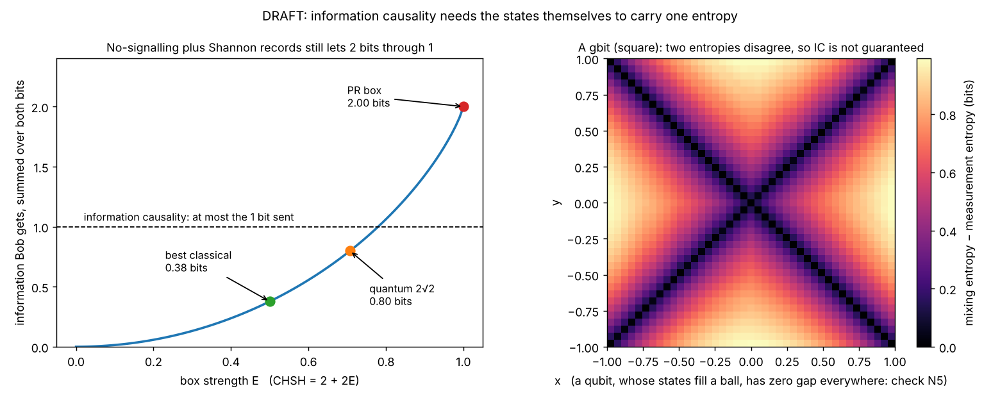

# DRAFT: does information causality follow from the coin rule plus no-signalling?

**Plain result: no.** PR boxes obey no-signalling, and the records they produce are plain bits that
obey the coin rule (Shannon). Yet they let 2 bits of information through a 1-bit message, which
breaks information causality. So those two rules aren't enough. What's missing is known
(Barnum et al. 2009): the theory's own states, not just its records, must carry one entropy, the same
for "how mixed" and "how unpredictable", and that entropy must behave well (strong subadditivity
plus a Holevo-type bound). A qubit's states (a ball) have this. A PR box's local system (a square) doesn't.

## Checks (5/5)
- N1: the PR box is no-signalling: neither side's odds depend on the other's input.
- N2: the depth-1 game, computed exactly: the PR box gives 2.00 bits, the quantum box 0.80, the best classical box 0.38. The limit is 1 bit.
- N3: the records are classical bits, so the coin rule holds for them (both coins).
- N4: a gbit at (0.5, 0): measurement entropy 0.81 bits, mixing entropy 1.50 bits. They disagree.
- N5: a qubit: the two entropies agree for every state (both equal von Neumann's).

## What's known (all of it)
- Pawłowski et al. 2009: PR boxes break information causality; quantum mechanics doesn't.
- Barnum, Barrett, Clark, Leifer, Spekkens, Stepanik, Wilce, Wilke, arXiv:0909.5075: a monoentropic, no-signalling theory whose measurement entropy is strongly subadditive and obeys a Holevo-type bound is informationally causal. PR boxes break strong subadditivity. Measurement and mixing entropy agree for simplices (classical) but not for other polygons.
- This round reproduces pieces of that. Nothing in it is new.

## What it means for the chain we've been building
- linear-mixing (round 8) pinned the dial for records to k = 0. That was the easy half.
- The remaining half is about state shape: information causality needs a state space where mixing
  and measuring give one entropy. A ball works and a square doesn't. Round 3's picture already
  showed this split: quantum boxes on the circle, the PR box at the square's corner.

## Lead?
No new lead. It locates the last assumption: why nature's states form a ball, not a square. That is the
quantum reconstruction programme (Hardy 2001; Masanes & Müller 2011), a big, known question. A
narrower test we could do: check whether "one entropy for mixing and measuring" alone already forces
a polygon to round off into a disk, using regular polygons with more and more sides.

Files: checks.py, checks_output.txt, results.json, figures.py, ic2_square.png. No papers stored.
