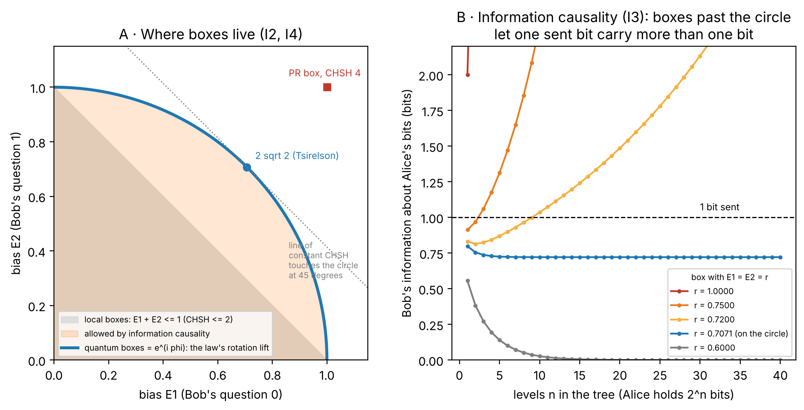

# DRAFT · Why the quantum ceiling is 2√2: information causality, read through the law

> **Names:** some words or symbols on this page (fused) also mean something else in standard math, physics or computing, or inside this project. [NAMING-COLLISIONS.md](../../../NAMING-COLLISIONS.md) says which meaning is in play.

*DRAFT, Nov 28 2026. Not versioned, not proved in Lean, not pushed to the repo. Round 3 of `spin-i-tie/`, a lean
follow-up to `clock-test/`: Brennan said "Start on that" to looking in the law for why a shared clock's signal stops
at 2√2 rather than 4, starting with information causality.* Checks: `checks.py` → `checks_output.txt` (**4 / 4
pass**), `results.json`. Picture: `figures.py` → `figures/ic1_disc.png`. Colour key: blue = the law's own reading;
orange = textbook; grey = reference.

## The result in plain words

**Information causality explains the 2√2 ceiling, and both of the law's moves show up in it: boxes are chained by
the law at k = −2, and quantum boxes sit exactly on the circle traced by the law's rotation. But the law doesn't
supply the principle itself. Information causality still has to be assumed, so this is a clean restatement and a
narrow lead, not a derivation.**

*ic1. A: each box is a point (E1, E2), the biases Bob gets on his two questions. Local boxes fill the grey triangle
(CHSH ≤ 2). Quantum boxes lie exactly on the blue quarter circle, (cos φ, sin φ), one turn of the law's rotation lift.
Information causality allows the orange disc. The highest CHSH in the disc is where a line of constant CHSH touches the
circle, at 45°: 2√2. The PR box (1, 1), CHSH 4, is outside. B: Bob's information after one sent bit, in Pawłowski's
nested game. On the circle (blue) it levels off near 0.72 bit. Past the circle it eventually exceeds the one bit
sent, at level 1 for the PR box, 3 for r = 0.75 and 10 for r = 0.72 (40 for r = 0.71, just past 1/√2).*

## What each check shows

- **I1, the law at k = −2 (textbook fact, our reading).** Two independent bits XOR with probability p + q − 2pq =
  p ∘₋₂ q, and the fused-shift lift 1 − 2p, which is the bias, multiplies (Matsui's piling-up lemma). Pawłowski's game
  chains boxes this way, so information causality is a statement about the law at k = −2.
- **I2, quantum boxes are one turn (textbook content, our reading).** For an entangled pair, opening Alice's settings by
  φ gives Bob the biases (cos φ, sin φ), the real and imaginary parts of e^(iφ), to 2 × 10⁻¹⁶. Quantum mechanics shares
  one unit-length turn between the two questions. That is the law's rotation lift (imaginary k).
- **I3, information causality (Pawłowski et al., Nature 461, 1101, 2009).** With one bit sent, Bob's total information
  stays at or below 1 bit everywhere on and inside the circle (at most 0.994), and breaks it for every box tested
  outside, including a lopsided one 3% out.
- **I4, Tsirelson (textbook).** CHSH = 2(E1 + E2); its maximum on the disc is exactly 2√2, at E1 = E2 = 1/√2.

## Does it open a lead?

**A narrow one.** The new part is the reading: the 2√2 ceiling is where the law's two lifts meet. The k = −2 lift (bias)
is multiplied along the chain, and the information it carries is its square, 1 − h ≈ E²/(2 ln 2). Information causality
says the summed squares over every branch can't grow, so a box's two biases must have E1² + E2² ≤ 1. The rotation lift
of quantum mechanics keeps that length exactly 1. What is not ours or new: the result itself (Pawłowski et al. 2009) and
the circle as the quantum boundary for these boxes (Tsirelson; Uffink 2002). What is not shown: why nature obeys
information causality. That would need a reason inside the law that one bit can't carry more than one bit.

Known limits: information causality recovers 2√2 for boxes of this kind. Whether it singles out the whole quantum set
is still open; it is not known to.

**Next test, if worth it:** whether the law's union rule ∘₋₁ ("the parts share nothing", `probability-entanglement/` §2)
together with the log lift (information adds) forces the summed-squares rule. If it does, the ceiling is the law's; if
not, information causality stays an outside assumption.

## Sources

Fetched for round 2: Pironio PRA 68, 062102 (2003); Toner and Bacon, quant-ph/0304076. From memory, not re-fetched:
Pawłowski, Paterek, Kaszlikowski, Scarani, Winter and Żukowski, Nature 461, 1101 (2009); Tsirelson, Lett. Math. Phys. 4,
93 (1980); Uffink, PRL 88, 230406 (2002); Matsui, EUROCRYPT 1993 (piling-up lemma); Popescu and Rohrlich, Found. Phys. 24,
379 (1994). No paper text is stored in this folder.
