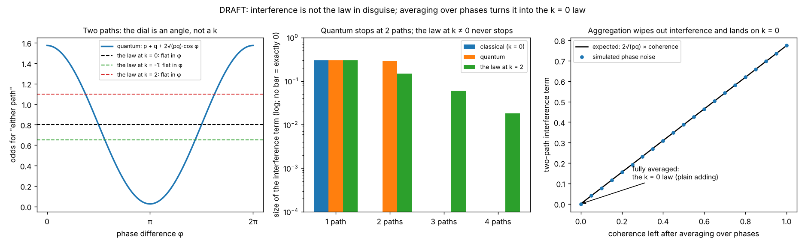

# DRAFT: is the interference rule the law in disguise, and what does averaging do?

**Plain result: no, it isn't the law in disguise, and Brennan's aggregation hunch holds up.** Two
quantum paths combine as p + q + 2√(pq)·cos φ. The dial there is an angle on a circle, not a fixed k.
Averaging over phases you can't see wipes out that extra term and leaves plain adding, which is the
law at k = 0. It can never leave any other k: the law at k ≠ 0 has interference among 3, 4, 5 paths
and so on, and quantum mechanics never has that, before or after averaging. So aggregating quantum
steps can only land on k = 0.

## Checks (6/6)
- Q1: two paths give p + q + 2√(pq)·cos φ exactly (the law of cosines on amplitudes).
- Q2: no fixed k matches it: the k you would need, 2·cos φ/√(pq), changes with p and q even at a fixed phase.
- Q3: the law at k is a measure with interference at every order: the n-path term is k^(n−1) times the product of the single paths.
- Q4: quantum interference stops at 2 paths: the 3-path and 4-path terms are exactly 0 (Sorkin's rule).
- Q5: simulated phase noise scales the 2-path term by the coherence left. Full averaging gives p + q, the k = 0 law.
- Q6: averages of quantum measures keep the 3-path term at 0, while the law at k ≠ 0 needs k²·abc ≠ 0. So no amount of averaging lands on k ≠ 0.

## What's known and what's ours
- Known: Sorkin's hierarchy (Sorkin 1994, gr-qc/9401003): classical odds have no interference, quantum odds have it between pairs only. Three-slit tests find no 3-path term (Sinha et al., Science 329, 418, 2010).
- Known: the law as a measure is Sugeno's λ-measure (1974). Its higher-order terms, k^(n−1) times the product, follow from its known Möbius form.
- Known: decoherence (averaging over unseen phases) turns quantum odds into classical ones (Joos, Zeh, Zurek).
- Ours, as far as I found: setting the law's measures beside Sorkin's hierarchy. The law at k ≠ 0 interferes at every order, so it can't be quantum (stops at 2) or classical (stops at 1). Quantum and the law meet only at k = 0, and averaging is the bridge. The step is short; I didn't find it written this way.

## Tie to the thread
- linear-mixing (round 8) pinned k = 0 for records with the coin rule. This round says where the records come from: averaging over phases, and that averaging can't produce any other k.
- The angle φ is the same circle that started this thread (rotations forcing one shared i). Before a record, steps live on the circle. After aggregation, only plain adding is left.

## Lead?
Yes, a modest one, and it's Brennan's hunch made precise: k = 0 is forced by aggregation, because
quantum interference is strictly pairwise and pairwise terms average away. The open edge is the law
at k ≠ 0 itself. It describes a world with interference at every order, which no experiment has seen.
The cleanest next test: the three-slit bound on a 3-path term caps how far from 0 the law's k could be
for any system that used it. Turning that measured cap into a bound on k is one short calculation.

Files: checks.py, checks_output.txt, results.json, figures.py, il1_orders.png. No papers stored.
