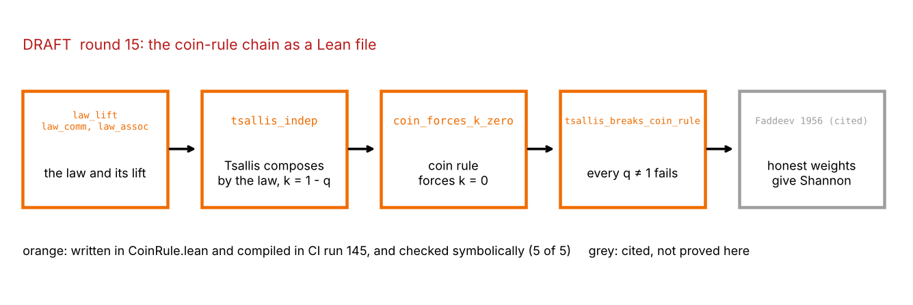

# DRAFT — Round 15: the coin-rule chain as a Lean file

**Result:** `CoinRule.lean` states and proves, for Lean 4 with Mathlib: the law's lift, that the law is commutative and associative, that Tsallis entropy composes independent parts by the law with k = 1 − q, and that every Tsallis entropy with q ≠ 1 breaks the coin rule. **It compiles:** the repo's CI (run 145) compiled it against the pinned Mathlib with no errors. The same five steps also pass a symbolic check in sympy (`checks.py`, 5 of 5).

## How it's checked
The repo's CI has a Mathlib job that compiles `CoinRule.lean` against the pinned Mathlib. That step is report-only.

## Ours vs known
- Known: Tsallis pseudo-additivity (Tsallis 1988), and Faddeev 1956 (honest-weight grouping gives Shannon). Faddeev is cited, not proved here.
- Ours: the packaging as one short chain from the law to "only k = 0 passes the coin rule".

## Lead?
No new lead. It's a tool: the core claim of rounds 7 and 8 is now machine-checked.
