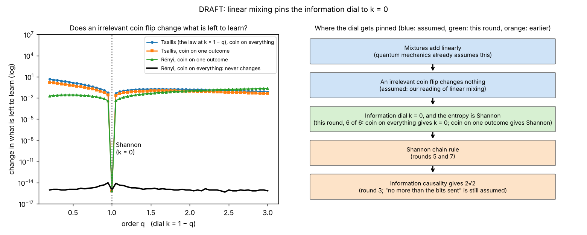

# DRAFT: does linear mixing pin the information dial to k = 0?

**Plain result: yes, with one honest assumption.** Assume one rule: an irrelevant coin flip
doesn't change how much is left to learn. Then the law's information dial is pinned to k = 0,
and the entropy has to be Shannon's. At any other dial, adding an unrelated coin multiplies
what's left to learn by the law's lift, 1 + k·S(coin). The coin rule is our reading of
"mixtures add linearly", which quantum mechanics already assumes. So the chain rule isn't a
separate assumption any more: it comes from the same linearity as the rest of quantum mechanics.

## Checks (6/6, unit-test style)
"What's left to learn" = S(joint) − S(first). No chain-rule form is assumed.
- G1: a coin on everything multiplies the Tsallis leftover by exactly 1 + k·S(coin).
- G2: so the leftover stays put under that coin only at k = 0.
- G3: Rényi entropies pass that coin at every order (they add, so their dial is already 0). This coin pins the law's dial, not the entropy.
- G4: a coin on one outcome only (the state of B unchanged, so the mixture is unchanged) leaves only Shannon. Rényi and Tsallis both move for q ≠ 1.
- G5: concavity doesn't pick the dial: Tsallis is concave at every q > 0. So "well behaved" alone isn't enough; the coin rule does the work.
- G6: the same holds in quantum form (classical–quantum states). Von Neumann's leftover is untouched by both coins; quantum Tsallis gets the 1 + k·S factor.

## What's known and what's ours
- Known: the coin on one outcome is Faddeev's grouping rule (1956) in disguise, and with it Shannon is unique (Faddeev; Khinchin). Tsallis with p^q weights is Suyari 2004 and Furuichi 2006. "On Conditional Tsallis Entropy" (Entropy, 2021) notes there is no agreed conditional Tsallis entropy; conditioning properties are among the tests it uses.
- Known: entropy in general theories (Short & Wehner, arXiv:0909.4801; Barnum et al., arXiv:0909.5075). As far as I can see, both build on Shannon entropy of measurement outcomes, so they take k = 0 as given rather than derive it.
- Ours, as far as I found: the one-line statement that, under the law, an unrelated coin scales the leftover by the lift 1 + k·S. So a nonzero dial for combining independent systems can't live with mixtures that add linearly. It is a short step and may well be written somewhere; I didn't find it in this form.

## Tie to earlier entropy rounds
- information-theory-full: Tsallis pseudo-additivity is "expectation passes through the dial". This round says why the dial for information must be 0: passing a coin through a nonzero dial inflates the leftover.
- chain-rule (round 5) and crack-chain (round 7): a chain rule exists at every dial, but only k = 0 averages honestly. This round gives the reason honest averaging is required.
- renyi-bound (round 6): Rényi orders up to about 1.39 were still consistent with quantum boxes. The coin on one outcome now rules out every order except 1.
- info-causality (round 3): with the chain rule settled, the one remaining assumption on the road to 2√2 is information causality itself ("no more information than bits sent").

## Lead?
Yes, a modest one. It closes the chain-rule question cleanly: the dial is pinned by linear mixing, not
by a separate rule about information. What it doesn't do is derive linear mixing from the law. Linear
mixing stays an input, as it is in every reconstruction of quantum mechanics.

## Cleanest next test
Information causality is now the one leftover assumption. Test whether it follows from the same coin rule
plus no-signalling, in the depth-n guessing game, or whether something more is needed. Barnum et al.
(2009) already derive information causality from entropy conditions in general theories, so read
them before testing.

Files: checks.py, checks_output.txt, results.json, figures.py, lm1_coin.png. No papers stored.
