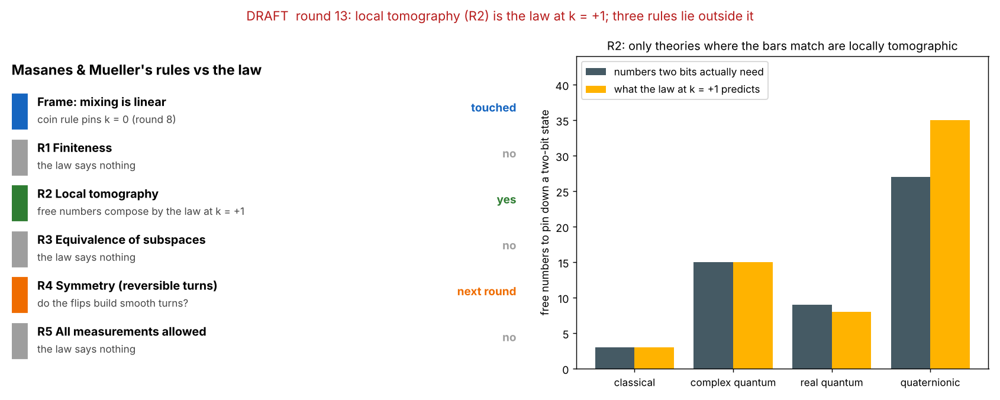

# DRAFT — Round 13: the law against Masanes and Müller's five rules

**Result:** local tomography (rule 2) is exactly the law at k = +1, applied to how many free numbers a system needs. The mixing frame matches our coin rule (k = 0). The law says nothing about three of the five rules (finiteness, equivalence of subspaces, all measurements allowed). Rule 4, reversible turns, is round 14.

## What the picture shows
- **Left:** each rule, and what the law does with it.
- **Right:** to pin down a two-bit state you need N free numbers. In theories where a whole is read off from its parts (local tomography), N for two bits = N₁ ∘ N₂ with k = +1. Classical bits (1 → 3) and complex quantum bits (3 → 15) match. Real-number quantum needs 9 where the law gives 8: the extra number is only visible to joint measurements. The quaternionic count also misses.

## Checks (4 of 4 pass, `checks.py`)
- M1: N_AB = N_A + N_B + N_A·N_B for classical and complex quantum, sizes 2 to 5.
- M2: real and quaternionic counts break it.
- M3: the k = +1 law holds for every K = d^r, so it doesn't choose quantum (r = 2) over classical (r = 1).
- M4: in the mixing frame, Tsallis's leftover after a fair coin equals the plain leftover only at k = 0.

## Ours vs known
- Known: the five rules (Masanes & Müller, NJP 13, 063001, 2011, arXiv 1004.1483); the counting rule K_AB = K_A·K_B and K = d^r (Hardy 2001, quant-ph/0101012).
- Ours: rewriting K_AB = K_A·K_B as the law at k = +1 on N = K − 1. It is a restatement (any rule that multiplies is the law after a shift), not a derivation.
- Correction to my earlier message: their rule 4 says any pure state can be reversibly turned into any other. Smoothness comes from that together with their frame. Hardy's 2001 version states continuity outright.

## Lead?
Modest. The law shows up in three different places with three different dials: k = 0 for entropy, k = +1 for counting numbers, k = −2 for flips. That points to the law being a shared grammar rather than one physical dial. It doesn't supply quantum theory alone.
