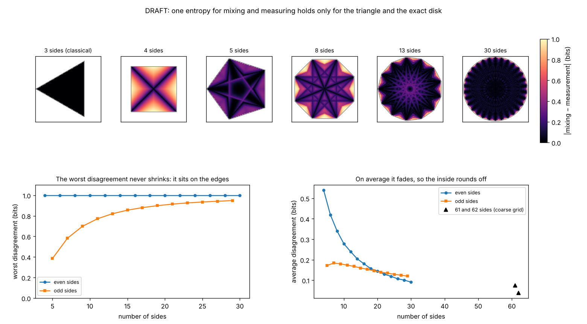

# DRAFT: does "one entropy for mixing and measuring" round a polygon into a disk?

**Plain result: not gradually.** As sides are added, the inside of the polygon does round off: the
average disagreement between the two entropies fades. But the edges keep a full 1-bit disagreement at
every size (even sides), or climb toward 1 bit (odd sides). So the rule can't be met partway. Among
regular polygons only two shapes pass: the triangle, which is classical, and the exact disk, the slice
of a quantum bit. Getting close to round isn't enough. It has to be perfectly round.

## Checks (5/5, both entropies computed exactly)
Each entropy is the least value of a concave function over a polytope, so a corner of that polytope
wins. Every set of up to 3 corners or edge effects is enumerated, so no optimizer is needed.
- P1: the triangle has no disagreement anywhere.
- P2: the square matches round 9 at (0.5, 0): 0.81 vs 1.50 bits.
- P3: the worst disagreement never shrinks. Even sides: exactly 1 bit at every edge midpoint (two corners mix to it, but the edge's own measurement is certain). Odd sides: it climbs from 0.30 bits (5 sides) to 0.95 bits (29 sides).
- P4: the average disagreement fades: from 0.54 to 0.09 bits (4 to 30 sides) and from 0.17 to 0.12 bits (5 to 29 sides).
- P5: it keeps fading further out (coarse grid): 0.091 to 0.038 bits (30 to 62 sides) and 0.114 to 0.076 bits (31 to 61 sides).

## What's known
- Barnum et al. 2009 (arXiv:0909.5075): monoentropy fails for every polytope that isn't a simplex. So the failure at each finite size is known.
- Janotta, Gogolin, Barrett & Brunner, New J. Phys. 13, 063024 (2011): the same polygon models. Whether their entangled state beats Tsirelson's bound depends on one geometric property of the polygon, strong self-duality.
- Hardy (2001), Masanes & Müller (2011): continuous reversible transformations pick out the ball in reconstructions of quantum mechanics.
- Ours, as far as I found: the size picture (the worst case pinned at 1 bit on the edges while the average fades). It's a small computation, not a new theorem.

## Tie back to where this thread started
This thread began with "rotations force one shared i, a circle-shaped phase." Here the entropy rule
also demands an exact circle, and the difference between a polygon and a disk is exactly continuous
rotation: a polygon only has a few turns that map it to itself, a disk has all of them. So both ends
point at the same root, continuous rotation symmetry. That link is real, but reconstruction work has
already made it (continuous reversibility picks the ball), so it isn't a new lead on its own.

## Lead?
No new lead. It closes the loop in this thread: the information side (rounds 5 to 10) and the rotation
side (the first rounds) both rest on continuous rotations. If we push further, the cleanest question is
whether the law itself, with its turn at k = −1 and k = −2, can supply continuous rotations of the state
space, not just of the phase.

Files: checks.py, checks_output.txt, results.json, figures.py, pe1_polygons.png. No papers stored.
