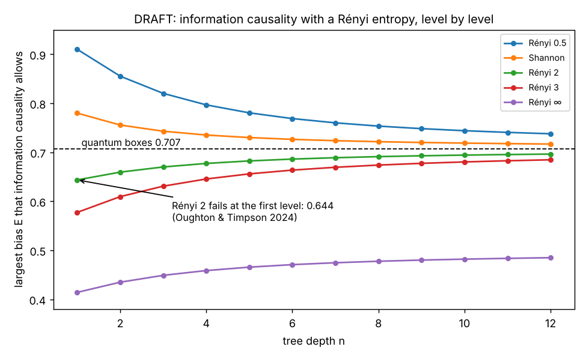

# DRAFT: has anyone proved information causality with a Rényi or Tsallis entropy?

**Plain result.** Yes, people have tried it, and it doesn't hold up. Oughton and Timpson
(Entropy 26, 562, 2024) show that information causality written with a Rényi entropy does
not give Tsirelson's bound. At order 2 it already breaks at bias 0.644, which is below the
0.707 that quantum mechanics reaches. So that version would rule out quantum mechanics itself.
I reproduced their 0.644 as the very first level of the guessing tree: sqrt(sqrt2 − 1) = 0.6436.

## Who proved what (known work, not ours)
- Pawłowski et al., Nature 461, 1101 (2009): information causality with Shannon mutual information gives 2√2.
- Oughton & Timpson, Entropy 26, 562 (2024), doi 10.3390/e26070562: a Rényi version gives the wrong bound (order 2 breaks at about 0.644).
- Dahlsten, Lercher, Renner et al., arXiv:1108.4549: Tsirelson's bound follows from a generalized data-processing inequality.
- arXiv:1207.2286: Tsirelson's bound follows from a chain rule for a generalized mutual information.
- Barnum et al., arXiv:0909.5075: in general theories, information causality follows from a measurement entropy that is strongly subadditive, plus a Holevo-type bound.
- Vilasini & Colbeck, arXiv:1907.02551, and Weilenmann's thesis, arXiv:1807.06345: Tsallis and other entropies used to test causal structures. These works don't derive Tsirelson's bound.
- So the positive results all come back to an entropy that obeys a chain rule like Shannon's.

## Our check (5/5)
One simple Rényi definition (ours, one of several): per bit, I_a(e) = 1 − H_a((1+e)/2). Information causality at depth n: 2^n · I_a(E^n) ≤ 1.
- R1: Rényi 2 at depth 1 gives 0.6436, matching Oughton–Timpson.
- R2: Shannon stays above 0.707 at every depth and creeps down toward it.
- R3: orders 2, 3 and ∞ all dip below 0.707, so they would forbid quantum boxes.
- R4: order 0.5 stays above 0.707, so it is consistent with quantum mechanics, as Shannon is.
- R5: the edge is at order 2 ln 2 ≈ 1.386. At small bias I_a ≈ a·E²/(2 ln 2), so the deep levels stay above 0.707 only for a < 2 ln 2.

## What this means for our dial
- **Correction to round 5 (chain-rule/).** "Every finite dial gives the same circle" is true only deep in the tree. The first levels bite, and for orders above about 1.39 they bite inside the circle. Rényi 2 is one of those.
- Shannon is **not** singled out by this test. Every order up to about 1.39 is consistent with quantum mechanics, and all of them reach 0.707 only in the deep limit. The edge at 2 ln 2 depends on which Rényi mutual information you pick, so it is not a deep number.
- Lead? Not a new one. This confirms the round-5 verdict: what picks Shannon is the chain rule (dial at zero), not the bound itself.

## Cleanest test if this were pushed further
Redo the depth table with the other standard Rényi mutual informations (Sibson, Arimoto, Csiszár) and with Tsallis. For each, find the order where the first levels start forbidding quantum boxes. If every definition's edge lands on Shannon only once the chain rule is imposed, that settles that the chain rule is the real assumption.

Files: checks.py, checks_output.txt, results.json, figures.py, rb1_depth.png. No papers are stored here.
