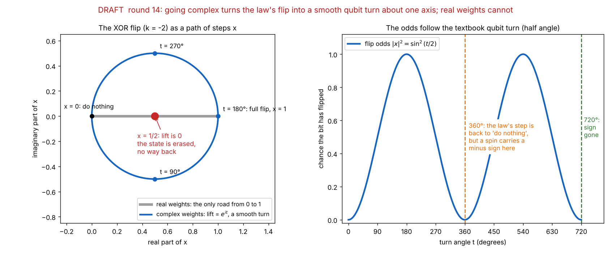

# DRAFT — Round 14: can the law's flip be built from smooth turns?

**Result:** yes, but only once the step x is allowed to be a complex number. At the XOR dial (k = −2), the complex steps x = (1 − e^{it})/2 compose by the law exactly as turn angles add, and the step (1 − x)·1 + x·FLIP is a qubit turn by angle t about one axis. The flip odds come out as sin²(t/2), the textbook half-angle formula. With real steps there is no smooth road: going from "do nothing" to "flip" passes x = 1/2, where the lift is 0 and the state is erased. Requiring the step to stay reversible for every angle picks k = −2 and no other dial.

## What the picture shows
- **Left:** the grey line is the only real road from x = 0 to x = 1, and it crosses the erasing point (red). The blue circle is the complex road. Every point on it can be undone.
- **Right:** the chance the bit has flipped after a turn by t. At 360° the law's step is back to "do nothing", but a spin picks up a minus sign there that only clears at 720°. The law's form hides that sign inside a phase factor e^{it/2}.

## Checks (7 of 7 pass, `checks.py`)
- T1: the real road crosses lift 0.
- T2: x(a) ∘ x(b) = x(a + b) at k = −2.
- T3: the step is unitary and equals e^{it/2}·exp(−i t X/2).
- T4: the flip odds are sin²(t/2).
- T5: over a grid of real and complex dials, only k = −2 keeps the step reversible for every t. The next-best dial misses by 0.025.
- T6: at 360° the step is "do nothing", while exp(−i t X/2) is −1.
- T7: the law is commutative, so any turns it builds commute. Real spin turns about two axes don't.

## Ours vs known
- Known: the qubit turn cos(t/2) − i sin(t/2)·X, the Rabi formula, and the 720° sign of spin-½. Also known: complex amplitudes are what make continuous reversible turns possible (Hardy 2001, and round 10's polygons).
- Ours: reading the turn as the XOR law with a complex step, and the pin on k = −2. Plainly, that pin comes from the flip undoing itself (its eigenvalues are +1 and −1), which is what XOR is.
- Limit: the law gives turns about **one** axis only. A full spin (turns in 3D, which don't commute) is beyond any commutative rule, including the law.

## Lead?
Yes, a modest real one, and the best tie so far between the two questions. The "i" is exactly what turns the law's flip into a smooth, reversible turn, and the half angle of spin shows up in the odds. The open step is whether two copies of the law (two flips that don't commute) can be glued together to give full 3D spin.
