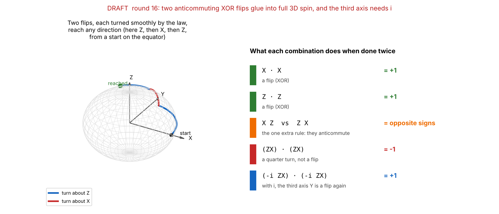

# DRAFT — Round 16: do two of the law's flips glue into full 3D spin?

**Result:** yes, with one extra rule. Take two flips, X and Z, each undoing itself (the XOR law) and each turned smoothly by the law's complex step from round 14. If the two flips anticommute (XZ = −ZX), their turns reach every direction in 3D: they make exactly the spin-½ turns. The third axis then forces i: the combined move ZX done twice gives −1, a quarter turn rather than a flip, and only −i·ZX is a flip. If the two flips commute instead, no 3D turns come out.

## What the picture shows
- **Left:** a turn about Z, then X, then Z, built from law steps, carries a spin from the equator to a new direction. Three such turns reach any direction (Euler's angles).
- **Right:** what each move does when done twice. X and Z are flips. Their product is a quarter turn. Multiplying it by i makes the third flip, Y.

## Checks (7 of 7 pass, `checks.py`)
- S1: X² = Z² = 1, and XZ = −ZX.
- S2: (ZX)² = −1, and (−i·ZX)² = +1, which is the usual Y.
- S3: 300 random 2×2 turns, each rebuilt from law steps about Z, X, Z, exact up to an overall phase.
- S4: with two commuting flips (one on each of two bits), every product commutes, so there are no 3D turns.
- S5: a turn by t moves the spin's direction by t while the state moves by t/2. A full 360° turn gives −1, and 720° returns to +1.
- S6: X and Z by themselves produce the third direction: XZ − ZX = −2i·Y.
- S7: for qubit flips, anticommuting is the same as having mutually unbiased readings: any outcome of one leaves the other at 50/50. Checked on 700 random pairs.

## Ours vs known
- Known: all the matrix facts above. They are the Pauli algebra (Pauli 1927) and are close to Hamilton's quaternions (1843). Euler angles and the double cover of spin-½ are textbook too.
- Ours: the reading. The law supplies each axis (XOR plus a smooth complex turn). One sign rule glues two axes, and the third axis can only be a flip with i.
- The anticommutation rule does **not** come from the law. The law is commutative, so it can't say how two flips order.

## Lead?
Yes, a modest one, and it sharpens the tie between the two questions. "Spin" and "i" meet at one place: make two XOR flips anticommute, and both full 3D spin and a forced i come out together. The open question is where the anticommutation comes from. For a qubit, anticommuting flips are exactly the ones whose readings are mutually unbiased (S7, a known fact): knowing one leaves the other at 50/50. Testing whether any version of the law can supply that sign is the next step.
