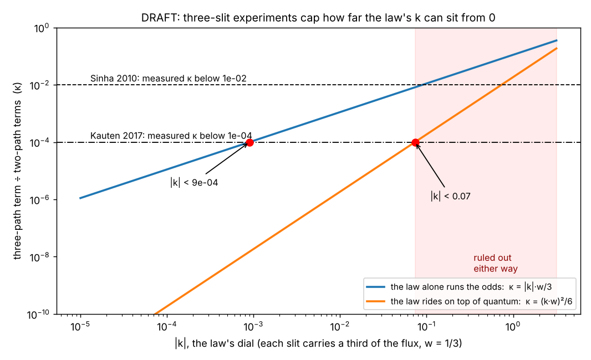

# DRAFT: a three-slit cap on the law's k

**Plain result: the best three-slit data keep the law's k within about 0.07 of zero (|k| < 0.07,
or |k·w| < 0.024) in the most forgiving reading.** That uses Kauten et al. 2017. The older Sinha et al.
2010 limit gives |k| < 0.7. Here w is each slit's share of the odds, taken as 1/3.

## How the number comes out
- The law as a measure has a three-path term k²·abc (round 11). Experiments report κ, the three-path term divided by the sum of the two-path terms.
- **Forgiving reading (the one that counts):** the law rides on top of ordinary quantum interference, so the two-path terms are quantum ones, at most 6w in total. Then κ ≥ (k·w)²/6, so |k·w| < √(6κ).
- **Strict reading:** the law alone runs the odds. Then κ = |k|·w/3, so |k·w| < 3κ, which is |k| < 9×10⁻⁴ from Kauten 2017. This reading is already ruled out, because the law alone can't make the phase-dependent fringes we see (round 11). It's shown only for comparison.

| Experiment | measured κ below | law on top of quantum | law alone |
|---|---|---|---|
| Sinha et al. 2010 | about 10⁻² | \|k\| < 0.73 | \|k\| < 0.09 |
| Kauten et al. 2017 | about 10⁻⁴ | \|k\| < 0.073 | \|k\| < 9×10⁻⁴ |

## Checks (4/4)
- B1: the strict-reading formula κ = |k|·abc/(ab + bc + ca), checked against the measure itself.
- B2: equal slits give κ = |k|·w/3.
- B3: the largest quantum two-path sum for three equal slits is 6w (searched over all phases).
- B4: the cap numbers in the table.

## Caveats
- The cap is really on k·w, the law's dial times the odds it acts on. The cap on k alone depends on what the odds are. With w = 1/3 (whole-slit shares) it's as above; the cap would be looser if the law acted on smaller odds.
- Kauten et al. state their limit as "more than four orders of magnitude" below pairwise interference, from a 5-path interferometer. I used κ ≈ 10⁻⁴ as a round number for that.
- Sources: Sinha et al., Science 329, 418 (2010), arXiv:1007.4193; Kauten et al., New J. Phys. 19, 033017 (2017), arXiv:1508.03253.

## Lead?
It isn't a discovery. It's a number for the law's k ≠ 0 world: if the law touched quantum odds at all,
its dial is already pinned near 0 by experiment, which fits rounds 8 and 11. A tighter future three-slit
result would tighten the cap as the square root of κ.

Files: checks.py, checks_output.txt, results.json, figures.py, ts1_cap.png. No papers stored.
