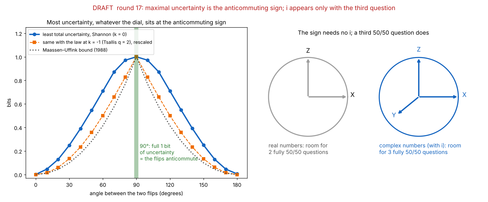

# DRAFT — Round 17: does the uncertainty rule for 50/50 readings bring out the flips' sign?

**Result:** yes, but it doesn't bring out i. Two flips give the most total uncertainty (a full 1 bit, so any reading of one leaves the other at 50/50) exactly when they anticommute, the sign round 16 needed. This holds for the law's dial too: with Tsallis at k = −1 the peak is in the same place. But real numbers already allow two such flips, X and Z. i only becomes necessary for a **third** fully 50/50 question on the same bit, which is the third axis of 3D spin.

## What the picture shows
- **Left:** the least possible total uncertainty for two flips at a given angle. Every curve peaks at 90°, where the flips anticommute. The dotted line is the known Maassen–Uffink bound. It's exact at 90° and loose in between.
- **Right:** real numbers have room for two fully 50/50 questions on a bit. Complex numbers have room for three.

## Checks (6 of 6 pass, `checks.py`)
- U1: the Maassen–Uffink bound holds at every angle and is reached (1 bit) at 90°.
- U2: the bound hits 1 bit only at 90°.
- U3: exactly, AB + BA = 2·cos(angle), so maximal uncertainty and the anticommuting sign are the same condition.
- U4: Tsallis q = 2 (law dial k = −1) peaks at 90° too, so the dial doesn't move it.
- U5: X and Z are real, anticommute, and reach the full 1 bit, so the sign needs no i.
- U6: real flips span only 2 directions; complex flips span 3, and all three pairs anticommute.

## Ours vs known
- Known: the Maassen–Uffink bound (PRL 60, 1103, 1988); its looseness for qubits (Ghirardi, Marinatto & Romano 2003); that anticommuting qubit flips are mutually unbiased; real versus complex counts of such questions (Wootters & Fields 1989 for the complex count).
- Ours: checking that the law's dial doesn't move the peak, and putting rounds 16 and 17 together. The sign comes from maximal uncertainty, and the i comes from wanting a third such question.

## Lead?
Not a new lead on its own. It closes a loop: "why the sign" becomes "the two questions are as incompatible as possible", and "why i" becomes "a bit has three such questions", which is the same as asking for full 3D spin.
