# String theory: what it rests on, and what we could borrow (Nov 25, 2026)

> **Names:** some words or symbols on this page (mult-add, wall) also mean something else in standard math, physics or computing, or inside this project. [NAMING-COLLISIONS.md](../../NAMING-COLLISIONS.md) says which meaning is in play.

**Verdict.** String theory does give G a dial, but not one our chains can turn: Newton's constant comes out as (coupling)² × (string length)^(D−2), G ∝ g_s² ℓ_s⁸, and the coupling g_s is a weight paid every time the string's surface grows a handle. In holography the same fact reads G = π/(2N²) in AdS units. So a G dial needs two things we don't have: an independent length dial and a dial that counts joinings and splittings. The nearest thing inside our reach is the 1/N of N×N matrix chains, which is a known handle-counting dial ('t Hooft 1974); that is the one lead here worth following toward G.

Two smaller things are worth borrowing as framings, both known math with our placement. **T-duality R ↔ α′/R is exactly the circle-operation inverse at k = 1**, with the self-dual radius as the identity and the wall as R = 0. **The order dial's stretch-and-shift group is the "perturbative" (Borel) half of the SL(2) where string dualities live**, with its do-nothing point i as the self-dual coupling g_s = 1. The dualities themselves sit outside our group.

Everything that makes string theory string theory (a 2D field theory on the worldsheet, the critical dimension, supersymmetry, anomaly cancellation, Einstein's equations from beta functions, branes) is field theory on surfaces, which chains of the weighted circle operation (called mult-add before 1.0) can't express.

Checks: `checks.py` → `checks_output.txt`, **36/36 pass** (numpy, sympy, scipy). Figures: `figures.py` → `figures/` (13 labeled PNGs). No Lean file this time: the checkable claims are numerical or symbolic facts about string spectra, not new algebra.

Method (Brennan's rules): built from published work; anything beyond the sources is labeled *ours*. "Proved" below means proved in string perturbation theory unless it says otherwise.

---

## Part 1. What string theory rests on

### 1.1 The inputs

- **The action is an area.** A string sweeps a 2D surface (the worldsheet), and its action is that surface's area times a tension 1/(2πα′) (Nambu 1970, Goto 1971). Polyakov (1981) rewrote it with a metric on the worldsheet, which makes it a 2D field theory: D free fields living on a surface.
- **Two dials.** The string length ℓ_s = √α′, and the string coupling g_s. The coupling is not a free number: it is e^φ, the value of a field (the dilaton) that the string itself contains. This is the sense in which string theory "has no free dimensionless parameters"; the price is that every vacuum chooses its own values.
- **Quantum mechanics and special relativity are assumed**, not derived. The worldsheet is quantized by the usual rules, on a background spacetime chosen in advance.
- **Supersymmetry on the worldsheet** is the extra assumption for the superstring. It brings in spacetime fermions and removes the tachyon of the bosonic string (Gliozzi–Scherk–Olive 1977).

### 1.2 The consistency demands (these are where the power comes from)

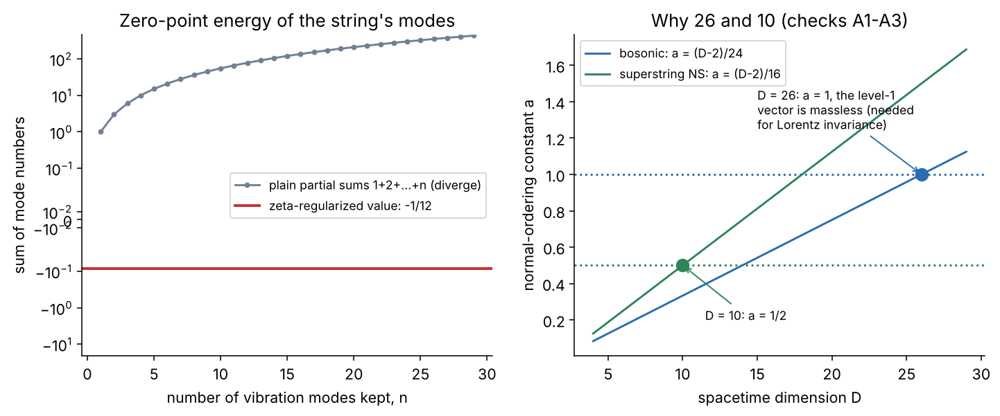

- **Conformal invariance must survive quantization.** Quantizing the worldsheet's free fields gives a zero-point energy (D − 2)/2 × (1 + 2 + 3 + …), which regularizes to −(D − 2)/24 because ζ(−1) = −1/12 (check A1). Lorentz invariance needs the first excited state to be a massless vector, which forces a = 1, so **D = 26** (A2; Lovelace 1971, Brower 1972, Goddard–Thorn 1972). With worldsheet fermions the same count gives **D = 10** (A3).
- **No ghosts, no anomalies.** The no-ghost theorem (Goddard–Thorn 1972) holds exactly in the critical dimension. In ten dimensions, gauge and gravitational anomalies cancel only for SO(32) or E8 × E8 (Green–Schwarz 1984).
- **Modular invariance.** One-loop closed-string amplitudes are integrals over the shapes of a torus, and every torus shape must be counted once (section 2.4).
- **Beta functions vanish.** Put the string on a curved background and demand that conformal invariance still holds: the conditions are Einstein's equations plus corrections in α′ (Callan, Friedan, Martinec, Perry 1985).

### 1.3 What comes out

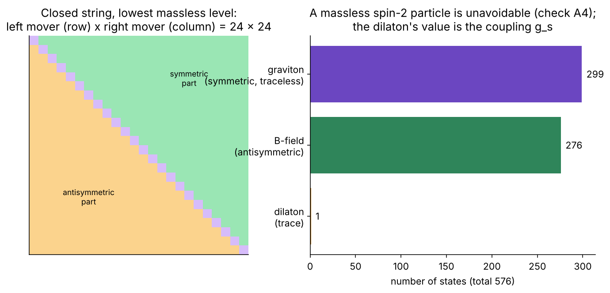

- **A massless spin-2 particle is unavoidable.** The lowest massless closed-string level is 24 × 24 = 576 states: 299 graviton, 276 antisymmetric B-field, 1 dilaton (check A4; Yoneya 1974, Scherk–Schwarz 1974). Weinberg's soft-graviton theorem then says any such particle couples universally, as gravity does.
- **Einstein's equations** at low energy, as the beta-function condition (1.2).
- **Newton's constant is derived:**

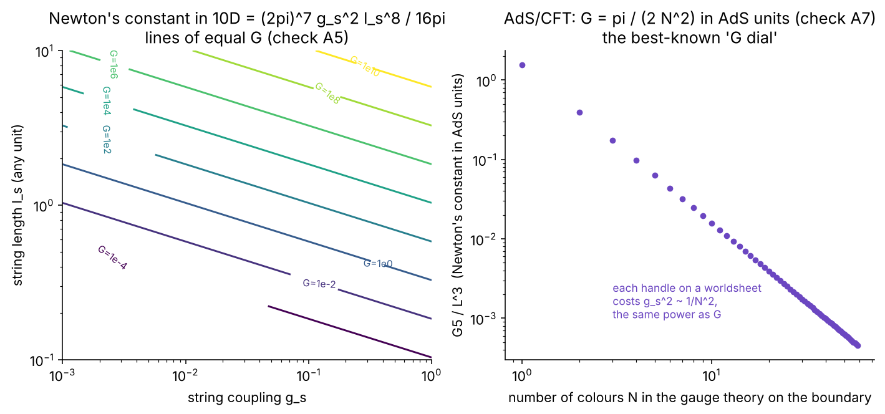

  - In ten dimensions, 16πG = (2π)⁷ g_s² α′⁴ (Polchinski's conventions). Doubling g_s multiplies G by 4; doubling ℓ_s multiplies it by 2⁸ (A5). The 10D Planck length is ℓ_P = g_s^(1/4) ℓ_s (A6). In four dimensions G = G₁₀ / (volume of the six hidden dimensions).
  - In AdS₅ × S⁵, L³/G₅ = 2N²/π for every g_s and N (A7; Maldacena 1997). In the units set by the AdS radius, **G = π/(2N²)**: Newton's constant is literally one over the square of the number of colours in the dual gauge theory.
- **Gauge fields and chiral fermions** in four dimensions after compactification, but with an enormous number of possible vacua (next section).

### 1.4 Proved, conjectured, and criticized

- **Established.** The critical dimensions, the no-ghost theorem, anomaly cancellation, the graviton in the spectrum, Einstein's equations from beta functions, and finiteness of low-genus amplitudes. Superstring perturbation theory to all orders is well founded, with subtleties (Witten 2012; Donagi–Witten 2013 showed supermoduli space can't be projected to ordinary moduli space). Strominger–Vafa (1996) counted the microstates of certain supersymmetric black holes and matched Bekenstein–Hawking entropy exactly: the strongest internal test.
- **Conjectured, with heavy evidence.** AdS/CFT in general (Maldacena 1997). One special case has been derived: tensionless strings on AdS₃ with one unit of flux are dual to the symmetric orbifold of T⁴ (Eberhardt, Gaberdiel, Gopakumar, *JHEP* 02 (2020) 136). S-duality of type IIB (Font, Ibáñez, Lüst, Quevedo 1990; Sen 1994). M-theory as the strong-coupling limit (Witten 1995). Matrix models as non-perturbative definitions (BFSS 1996, IKKT 1996).
- **Conjectured and contested.** The landscape of roughly 10⁵⁰⁰ vacua (Bousso–Polchinski 2000; KKLT 2003). Whether de Sitter vacua exist at all is still argued: the de Sitter swampland conjecture (Obied, Ooguri, Spodyneiko, Vafa 2018, refined by Ooguri, Palti, Shiu, Vafa 2018) says no, and a 2025 review of the swampland (arXiv:2509.02632) treats the question as open.
- **Standard criticisms.** No experimental test so far, and no low-energy supersymmetry at the LHC. The landscape weakens prediction. Perturbative string theory needs a background spacetime chosen in advance (background dependence). The genus series diverges like (2g)! (Gross–Periwal 1988), so the theory is only defined non-perturbatively through dualities and holography. The well-known book-length critiques are Smolin (2006), Woit (2006) and Hossenfelder (2018).

---

## Part 2. What we could borrow, judged on its merits

### 2.1 T-duality is the circle-operation inverse (borrowable framing)

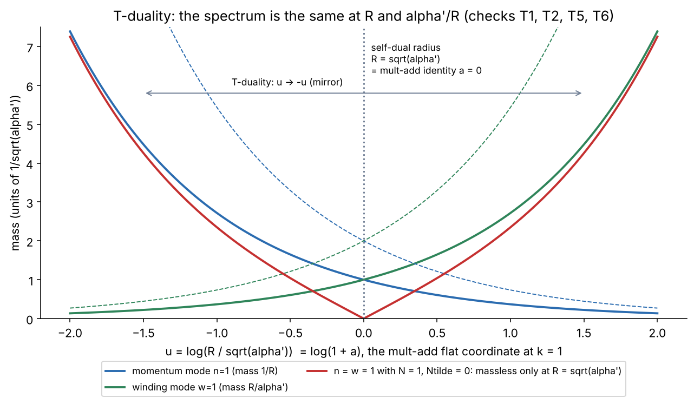

- **Known.** On a circle of radius R, a closed string has momentum n/R and winding wR/α′. The spectrum is unchanged by R ↔ α′/R with n ↔ w (T1; Kikkawa–Yamasaki 1984, Sakai–Senda 1986). At the self-dual radius R = √α′ extra states become massless (T2), giving the SU(2) × SU(2) enhancement.
- **Ours, a restatement.** Write R/√α′ = 1 + a. Then T-duality is exactly the circle-operation inverse at k = 1: 1 + inv(a) = 1/(1 + a), and a ∘₁ inv(a) = 0 (T5). The self-dual radius is the identity a = 0, and the wall a = −1 is R = 0, which T-duality sends to R = ∞ (T6). In the flat coordinate u = log(1 + a), T-duality is the mirror u → −u.

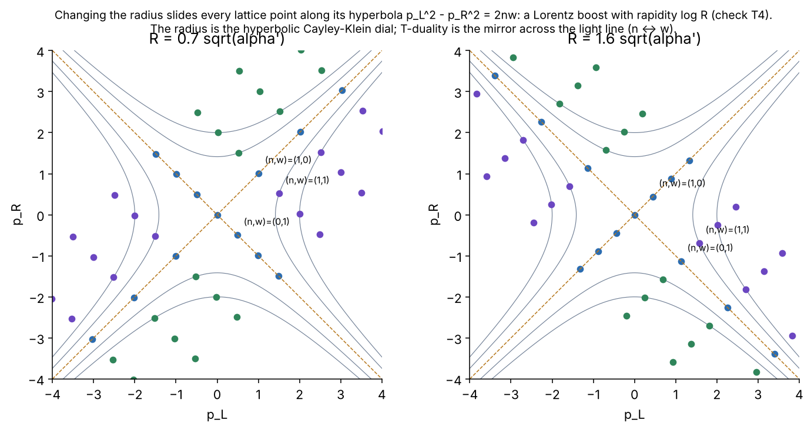

- **Why the match isn't a coincidence (known, Narain 1986).** The momentum–winding lattice lives in a plane with the Lorentzian length p_L² − p_R² = 2nw, which no radius changes (T3). Changing the radius is a Lorentz boost of that plane with rapidity log(R₂/R₁) (T4). So the radius *is* a hyperbolic Cayley–Klein dial in the repo's sense, and our flat coordinate u is its rapidity. On a 2-torus with a B-field the same thing becomes O(2,2;ℤ), with T-duality E → E⁻¹ (T7; Giveon–Porrati–Rabinovici 1994).
- **Honest limit.** Our framework supplies the shape (the group, its inverse, its flat coordinate). It does not supply the reason R and α′/R are *the same physics*: that comes from winding strings, which chains have no counterpart for.

### 2.2 S-duality and the half-plane (partial: our group is the half that perturbation theory sees)

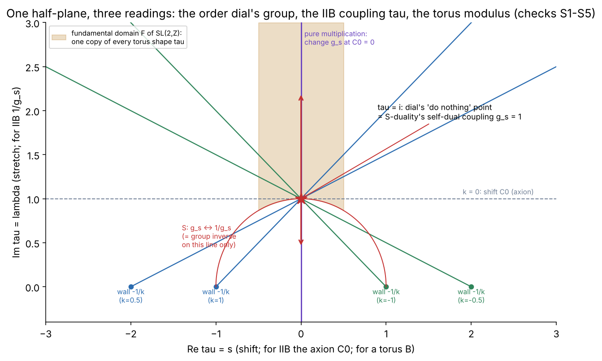

- **Known.** Type IIB's coupling τ = C₀ + i/g_s lives in the upper half-plane, and S-duality acts by SL(2,ℤ); τ → −1/τ swaps g_s ↔ 1/g_s at C₀ = 0. A torus's shape and its complexified size each live in the same half-plane with their own SL(2,ℤ).
- **Ours, placement.** The order dial's maps τ → λτ + s are exactly the upper-triangular (Borel) part of SL(2,ℝ) (S1). Those maps all fix the cusp at infinity, which is weak coupling (S5): they are the shifts of C₀ and rescalings of g_s that perturbation theory sees. Our do-nothing point i is S-duality's self-dual coupling g_s = 1 (S2). On the vertical line, S-duality *is* the group inverse (S3), the same shape as T-duality. Off that line it isn't (S4).
- **So:** dualities live in the part of SL(2) that our group lacks. This is the same gap the [path-integral page](../why-i/path-integral-strong/) found: the useful structure needs the full SL(2,ℝ) and a lattice in it.

### 2.3 Minimum length and the generalized uncertainty principle (ours, coordinate-dependent)

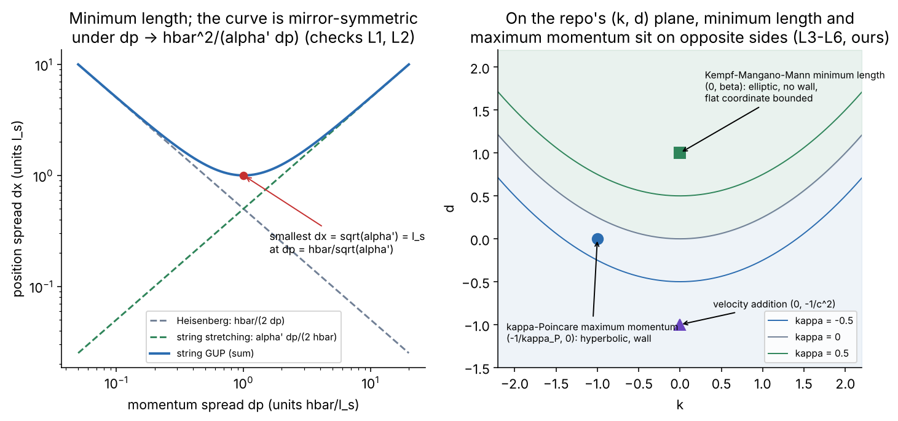

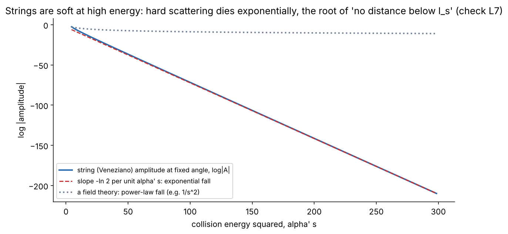

- **Known.** High-energy string scattering at fixed angle falls exponentially, like e^(−α′s ln 2) for the Veneziano amplitude (L7; Gross–Mende 1987–88). From this comes the string GUP Δx ≳ ħ/Δp + α′Δp/ħ, with a smallest Δx of order ℓ_s (L1; Amati–Ciafaloni–Veneziano 1987–89, Konishi–Paffuti–Provero 1990). The curve is itself T-duality symmetric under Δp → ħ²/(α′Δp) (L2). Kempf–Mangano–Mann (1995) built the algebra [x, p] = iħ(1 + βp²) behind it; x is an ordinary derivative in ρ = arctan(√β p)/√β (L3).
- **Ours, placement.** If momenta compose so that ρ adds, the law is the tangent law (p + q)/(1 − βpq): the point (k, d) = (0, β) of the repo's plane, κ = β > 0, elliptic, no wall (L4). κ-Poincaré's massless momenta sit at (−1/κ_P, 0), κ < 0, hyperbolic, with a wall at the maximum momentum (L5). They are mirror images: KMM's flat coordinate is bounded while p is not; κ-Poincaré's flat coordinate is unbounded while p is bounded (L6).
- **Caveats.** KMM doesn't specify a composition law; "ρ adds" is our choice. Any one-number law is plain addition after a ruler change (the κ-Poincaré page's K4), so where a law sits is coordinate-dependent. And ℓ_s is not a hard floor: D-branes probe shorter distances (Douglas, Kabat, Pouliot, Shenker 1996). Nice picture, no new physics.

### 2.4 Modular invariance (needs the lattice we don't have)

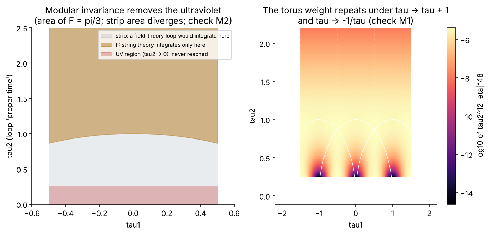

- **Known.** The one-loop closed-string weight is unchanged by τ → τ + 1 and τ → −1/τ (M1), so the loop integral runs over the fundamental domain F, of area π/3, rather than the strip a field theory would use, whose area diverges as τ₂ → 0 (M2). The ultraviolet region is simply not in F. This is the cleanest known physical use of "the half-plane modulo SL(2,ℤ)".
- **For us:** the order dial's half-plane is the same space as the torus modulus, but our group has no lattice. If the path-integral lead (Selberg trace on the half-plane) is followed, string theory's one-loop integral is the concrete physics benchmark for it. One lead, not two.

### 2.5 Hagedorn temperature (analogy, already known)

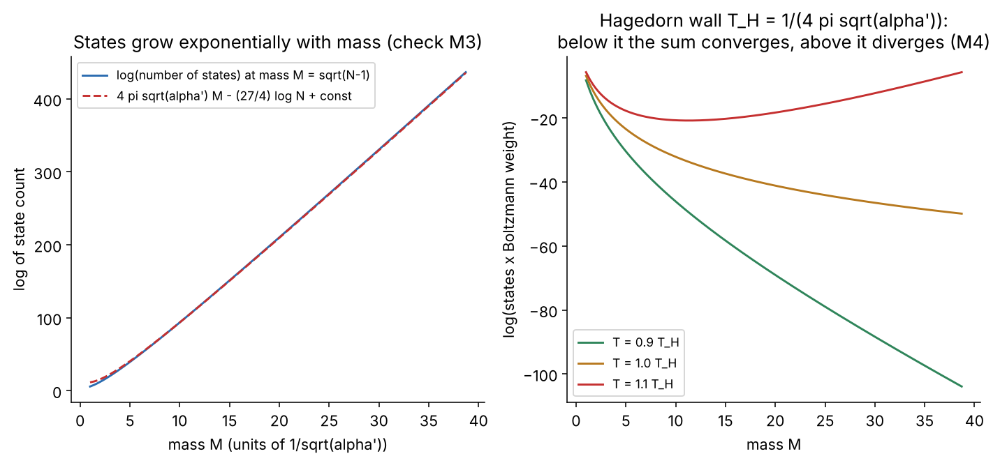

- **Known.** The number of string states grows like e^(4π√N) N^(−27/4) (M3; Hardy–Ramanujan, Meinardus), and the 4π comes from η's τ → −1/τ, so modular invariance fixes it. A gas of strings then has a maximum temperature T_H = 1/(4π√α′) for the open bosonic string (M4; Hagedorn 1965; Atick–Witten 1988).
- **Link to the repo.** The primon gas, which the repo already has, hits the same kind of wall at s = 1 (M6; Julia 1990 noted the parallel). The denominator ∏(1 − qⁿ) is 1 minus the k = −1 chain of the qⁿ (M5), which is bookkeeping, not insight. Analogy only.

### 2.6 α′ and g_s as dials in our sense (partly)

- **α′** behaves like the repo's contraction dials: as α′ → 0 the massive states (mass ~ 1/√α′) leave and supergravity remains, a stable endpoint, like c → ∞ leaving Newtonian mechanics. Unlike Inönü–Wigner, though, nothing in the worldsheet's symmetry algebra contracts; it is an effective-field-theory expansion.
- **g_s** is different in kind. Its endpoint g_s → 0 (free strings) is stable, but the series in g_s has zero radius of convergence (Gross–Periwal 1988), and there are e^(−1/g_s) effects (Shenker 1990; D-branes, Polchinski 1995) invisible at every order. Our k is analytic at k = 0 (log(1 + kx)/k has a convergent series in k). So g_s is a dial whose turning can't be followed smoothly from zero, which ours can.

### 2.7 How string theory gets G, and what would give us a G dial

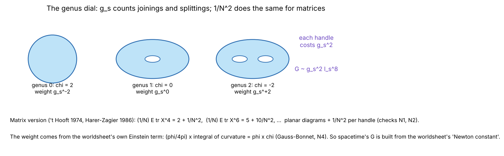

- **Known.** A genus-g worldsheet is weighted by g_s^(2g−2): each handle costs g_s². That weight comes from the worldsheet's own Einstein–Hilbert term: the dilaton multiplies the integrated curvature, which by Gauss–Bonnet is 4πχ, a pure topology count (N4; Polchinski §3.7). So **spacetime's G is built from the worldsheet's "Newton constant"**, raised to the power the handle count needs. The matrix-model version is exact and old: for N×N random matrices, (1/N)E tr X⁴ = 2 + 1/N², (1/N)E tr X⁶ = 5 + 10/N², and so on, planar diagrams plus 1/N² per handle (N1 exact, N2 Monte Carlo; 't Hooft 1974, Harer–Zagier 1986). That is why AdS/CFT's G is π/(2N²) (A7).
- **What would give us a G dial (both needed):**
  1. **An independent length dial.** κ-Poincaré's k = −1/E_P won't do on its own, because E_P already contains G; using it as "the G dial" is circular. In string theory the length ℓ_s comes first and the Planck length ℓ_P = g_s^(1/4) ℓ_s is derived (A6).
  2. **A dial that weighs topology: joinings and splittings.** Chains compose in a line; they never branch or merge, so they have no handles to count. The one handle-counting dial within reach is the **1/N of N×N matrix chains**, via 't Hooft.
- **Lead worth following:** matrix chains with an N dial. Concrete next step: take the repo's ∘ₖ chains of random N×N Hermitian matrices, expand E[(1/N) tr(I + kX)ⁿ] in both k and 1/N², and see whether some combination of k and 1/N plays the role ℓ_P = g_s^(1/4) ℓ_s does. Why it's worth it: it is the only route found here where the framework's own objects (matrix chains) touch a known G dial (1/N² in holography; BFSS and IKKT matrix models). Its known weak spot: it needs a probability measure on matrices (an ensemble), which the framework doesn't have yet, the same gap as the rigorous measure on the path-integral page. Untested; no prediction expected yet.

### 2.8 What our framework can't express

- The worldsheet as a 2D field theory (conformal invariance, the Virasoro algebra, central charge 26 or 15).
- The critical dimension as a consistency condition (we can reproduce the arithmetic, A1–A3, not the reason).
- Supersymmetry, anomaly cancellation, Einstein's equations as beta functions.
- Sums over surfaces of every topology, branes, and the non-perturbative dualities themselves.
- Momentum-space curvature (Snyder), as the κ-Poincaré page already found: chains are associative.

---

## Assumptions

- Units α′ = 1 and ħ = c = k_B = 1 in the checks unless a check says otherwise. G formulas use Polchinski's conventions (2κ₁₀² = (2π)⁷ g_s² α′⁴, κ² = 8πG); other books differ by order-one factors, never in the powers of g_s and ℓ_s.
- The circle spectrum (T1–T6) is the bosonic closed string with level matching N − Ñ = nw; T7 uses the standard generalized metric of an n-torus with constant G and B.
- "The order dial's group" means the orientation-keeping maps x → λx + s (λ > 0), read as points s + iλ, as on the [why-i page](../why-i/).
- The Hagedorn checks use the open bosonic string, α′M² = N − 1, with 24 transverse oscillators; superstrings change the constant (T_H = 1/(2π√(2α′)) for type II), not the mechanism.
- The fixed-angle check L7 evaluates the Veneziano amplitude between poles (α′s = n + 1/2) at t = −s/2; the slope −ln 2 is fitted, and approaches its limit slowly.
- The GUE Monte Carlo (N2) is a sanity check at N = 3 with 200,000 samples; the exact statement is N1.
- "Ours" placements (T5, T6, S1–S3 readings, L4–L6) are restatements of known mathematics in the repo's language; none is claimed as a discovery.
- The literature survey is from my reading; I spot-checked the 2025 swampland review, the Kempf–Mangano–Mann paper and the Eberhardt–Gaberdiel–Gopakumar derivation this session. Other citations are textbook and weren't re-fetched.

## Known vs new

| Claim | Status |
|---|---|
| D = 26 and D = 10, graviton forced, Einstein from beta functions | Known (1970s–1985) |
| G ∝ g_s² ℓ_s⁸; ℓ_P = g_s^(1/4) ℓ_s; G = π/(2N²) in AdS units | Known (Polchinski; Maldacena 1997) |
| T-duality, self-dual enhancement, radius as an O(1,1) boost | Known (Kikkawa–Yamasaki 1984; Narain 1986; GPR 1994) |
| **T-duality = circle-operation inverse at k = 1; u = log(1 + a) is the rapidity** | Ours, a restatement |
| S-duality on the half-plane, SL(2,ℤ) | Known (Font et al. 1990; Sen 1994) |
| **Order dial's group = Borel part of SL(2); i = self-dual coupling; S = group inverse only on the vertical line** | Ours, placement of known group theory |
| Modular invariance cuts off the UV; Hagedorn T_H | Known (Shapiro 1972; Hagedorn 1965) |
| String GUP and minimum length; KMM algebra | Known (Gross–Mende; ACV; KMM 1995) |
| **Minimum length at the elliptic point (0, β), κ-Poincaré on the hyperbolic side, as mirror images** | Ours, coordinate-dependent |
| g_s as a handle weight from the worldsheet's Gauss–Bonnet term; 1/N² per handle | Known ('t Hooft 1974; Harer–Zagier 1986; Polchinski) |
| **A G dial needs a length dial plus a handle-counting dial; matrix-chain 1/N as the candidate** | Ours, a proposal, untested |

## Files

- `checks.py` → `checks_output.txt`: 36/36 pass (numpy, sympy, scipy; about 25 seconds).
- `figures.py` → `figures/s1`–`s4` (Part 1) and `b1`–`b9` (Part 2), labeled PNGs.

## Sources

Checked this session:
- Kempf, Mangano, Mann, "Hilbert space representation of the minimal length uncertainty relation", *Phys. Rev. D* 52, 1108 (1995): [arXiv:hep-th/9412167](https://arxiv.org/abs/hep-th/9412167)
- Eberhardt, Gaberdiel, Gopakumar, "Deriving the AdS3/CFT2 correspondence", *JHEP* 02 (2020) 136: [arXiv:1911.00378](https://arxiv.org/abs/1911.00378)
- Swampland conjectures review (2025): [arXiv:2509.02632](https://arxiv.org/abs/2509.02632); Obied, Ooguri, Spodyneiko, Vafa (2018); Ooguri, Palti, Shiu, Vafa (2018): [arXiv:1810.05506](https://arxiv.org/abs/1810.05506)

Textbook and classic, not re-fetched: Veneziano (1968); Nambu (1970), Goto (1971); Lovelace (1971); Brower (1972); Goddard and Thorn (1972); Shapiro (1972); Yoneya (1974); Scherk and Schwarz (1974); 't Hooft (1974); Gliozzi, Scherk, Olive (1977); Polyakov (1981); Green and Schwarz (1984); Kikkawa and Yamasaki (1984); Callan, Friedan, Martinec, Perry (1985); Narain (1986); Sakai and Senda (1986); Harer and Zagier (1986); Gross and Mende (1987, 1988); Amati, Ciafaloni, Veneziano (1987–89); Gross and Periwal (1988); Atick and Witten (1988); Konishi, Paffuti, Provero (1990); Font, Ibáñez, Lüst, Quevedo (1990); Shenker (1990); Julia (1990, primon gas); Brezin–Kazakov, Douglas–Shenker, Gross–Migdal (1990, matrix models); Sen (1994); Giveon, Porrati, Rabinovici, *Phys. Rep.* 244 (1994); Polchinski (1995, D-branes); Witten (1995); Strominger and Vafa (1996); Douglas, Kabat, Pouliot, Shenker (1996); Banks, Fischler, Shenker, Susskind (1996); Ishibashi, Kawai, Kitazawa, Tsuchiya (1996); Maldacena (1997); Polchinski, *String Theory* (1998); Bousso and Polchinski (2000); Kachru, Kallosh, Linde, Trivedi (2003); Smolin (2006); Woit (2006); Zwiebach, *A First Course in String Theory* (2009); Witten, "Superstring perturbation theory revisited" (2012); Donagi and Witten (2013); Hagedorn (1965); Hossenfelder (2018).
