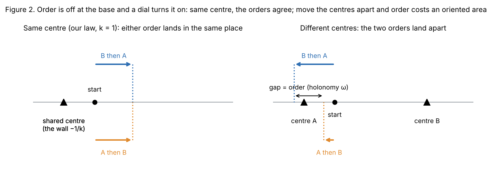
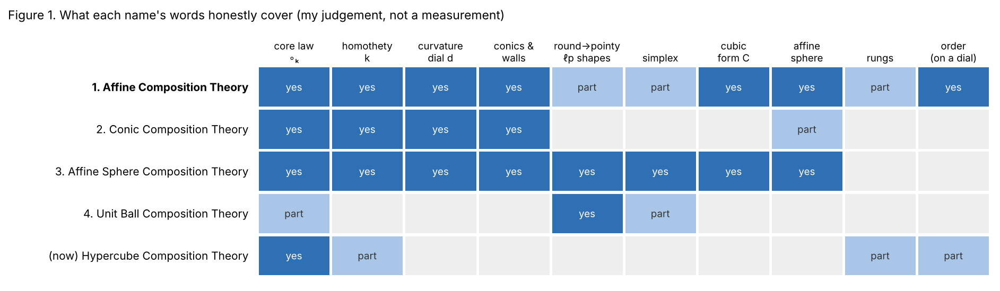
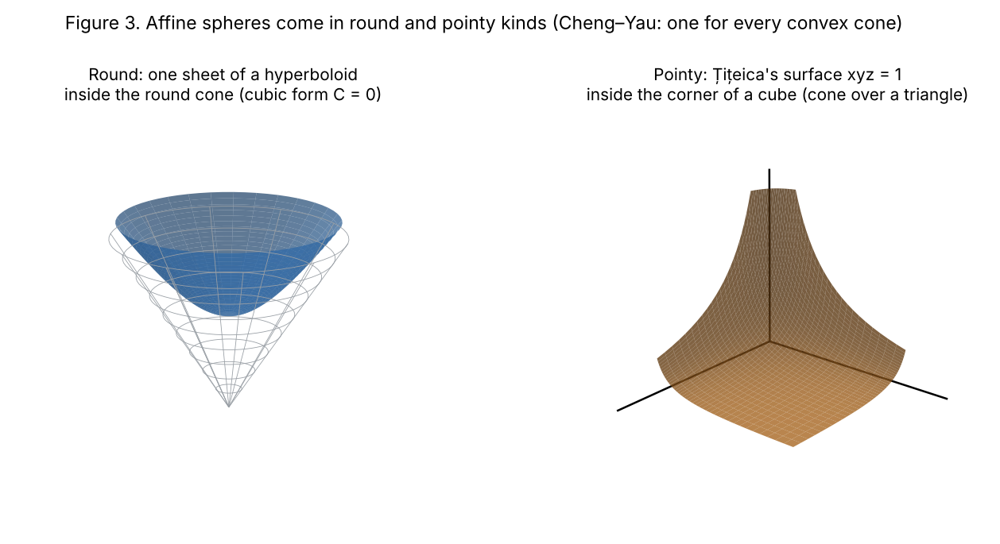

# DRAFT · A name for the whole theory, now that the cube is one shape among many

**DRAFT, Nov 26 2026.** Part of Affine Composition Theory (repo: fused-hyperoperation-algebra).

**Decision (Nov 26, 2026): Brennan picked Affine Composition Theory** ("Affine composition theory."). It replaces the interim name Hypercube Composition Theory (Nov 25), which replaced Fused Hyperoperation Algebra.
Asked for by Brennan on a voice call: "hypercube doesn't work anymore because we have hyper shapes now. Both c- round ones and pointy ones." He said yes to looking for a name, and asked: "do we still feel like composition, the order of composition, is a key part of this theory?"
Prose across the topic folders now says Affine Composition Theory. The repo name, CITATION.cff and .zenodo.json are unchanged.
Builds on `names-review/THEORY-NAME.md` (the Nov 25 interim-name review, not repeated), `affine-names/`, `affine-sphere/`, `conics/`, `order-dial/`, `shape-dial-survey/`, `named-functions/`.
Checks: `checks.py` → `checks_output.txt` (4 of 4, sympy exact). Pictures: `figures.py`.

## What the full model is now

- **Core law:** a ∘ₖ b = a + b + k·ab, and on the whole plane (a + b + k·ab)/(1 − d·ab). It is commutative.
- **Settings (inputs):** homothety k, curvature dial d, ℓp exponent p, cubic form C, odds t, similarity ratio r, growth degree β.
- **Readings (outputs only):** Δ = k² − 4d, curvature −Δ/4, the conic's type, similarity dimension D, holonomy ω.
- **Shapes:** p slides cross-polytope (p = 1) → ball (p = 2) → cube (p = ∞); C slides round → triangle (simplex). The cube is one setting.
- **Geometry:** every (k, d) is one conic x² + kxy + dy² = y with the law as its chord rule; one affine sphere per setting (DRAFT).
- **Rungs:** the hyperoperation ladder carried over by the shift x ↦ 1 + x, with the hypernatural log and exponential.

## On "composition" and order (his question; corrected Nov 26)

Order isn't required, but a dial turns it on when it's needed, and the repo already shows how:

- **Off at the base:** a ∘ₖ b is "stretch by b, then stretch by a", both about the one centre −1/k (check 2). Stretches about one centre commute. On the whole (k, d) plane each "add a" is a projective map fixing the walls, the roots of d·x² + k·x + 1 (checks 1 and 3), and maps sharing fixed points commute.
- **On by a dial:** `order-dial/` sections 4–5 (the q dial, yx = q·xy; ħ as an order dial, the same a + b + ab over the Moyal star product, commutative at ħ = 0) and `why-i/checkerboard/` (one chain: dial −1 is Kac's walk, −i is Feynman's checkerboard).
- **The price of order is an oriented area:** different stretch centres leave the gap (c₁ − c₂)(r₁ − 1)(r₂ − 1) (check 4, Figure 2); in phase space it is the Weyl phase from the area ab.

Effect on the pick: none, or a stronger case. Affine geometry keeps area, and order's price is always an oriented area. Caveat: the quantum route is the Heisenberg group, not the affine group (order-dial §5), so the name claims nothing about that.

## The short list (best first)

1. **Affine Composition Theory (my pick).** Every dial name already comes from affine geometry (homothety, affine curvature, the Fubini–Pick cubic form, affine spheres), and the core law is literally composing homotheties, which are affine maps. Covers the core, k, d and its readings, conics, C, the affine sphere, and order as something a dial switches on. Leaves out: p has no affine name (ℓp is a norm idea; Blaschke's affine perimeter only measures it), and for d ≠ 0 the maps being composed are projective, not affine (the readings stay affine). Clash check: no field or book uses the phrase (search Nov 26). Neighbours: composing affine maps is textbook; "Calabi composition" is a named product of affine spheres in affine differential geometry, worth citing, not a clash.
2. **Conic Composition Theory.** The safest true name for the plane: each (k, d) is a conic and the law is its chord rule, which is the classical group law on a conic (Lemmermeyer 2003; Bellini, Di Scala, Elia, Murru 2021). Covers the core, k, d, readings, walls. Leaves out the round-to-pointy shapes, C, the simplex and rungs. Clash: none as a phrase; "conic" also means conic optimisation.
3. **Affine Sphere Composition Theory.** The one existing shape family that holds round and pointy together: every convex cone has its own affine sphere (Cheng–Yau), a hyperboloid sheet for the round cone (cubic form zero) and Țițeica's surface xyz = 1 for the corner of a cube (Figure 3). Covers both plane dials (our DRAFT: one affine sphere per setting), C, and every shape through its cone. Leaves out the rungs, and it rests on a DRAFT result: our laws on non-round affine spheres are not worked out yet, so the name would promise more than is proved today.
4. **Unit Ball Composition Theory.** The plain name for exactly the round-to-pointy family: the ℓp unit balls (Minkowski: every norm is a convex body). Covers the shapes he named. Leaves out the conic plane, C, rungs, and the simplex (not centrally symmetric, so not a norm's ball).

Dropped: anything with "convex composition" (reads as the composition rules for convex functions in convex optimisation); "superellipsoid" (a graphics term, and the ball family only); "Projective Composition Theory" (true for the plane, but the affine names were his steer and projective was only a bridge on `affine-names/`).

## Where I am unsure

- The phrase searches (Nov 26) found no field named by any of the four; that is a web search, not a guarantee.
- Țițeica's surface over the octant and the Cheng–Yau theorem are from Loftin's survey; I did not re-derive them here.
- The coverage grid is my judgement of what each name's words claim, not a measured quantity.

## Sources

- Loftin, "Survey on Affine Spheres": https://arxiv.org/pdf/0809.1186
- Lemmermeyer, "Conics, a poor man's elliptic curves": https://arxiv.org/pdf/math/0311306
- Bellini, Di Scala, Elia, Murru, "Group law on affine conics and applications to cryptography" (2021): https://iris.polito.it/handle/11583/2922698
- Calabi composition of hyperbolic affine spheres: https://ar5iv.arxiv.org/html/1401.0860
- Composition of affine maps: https://www.proofwiki.org/wiki/Composition_of_Affine_Transformations_is_Affine_Transformation
- Superellipse and ℓp balls: https://en.wikipedia.org/wiki/Superellipse
