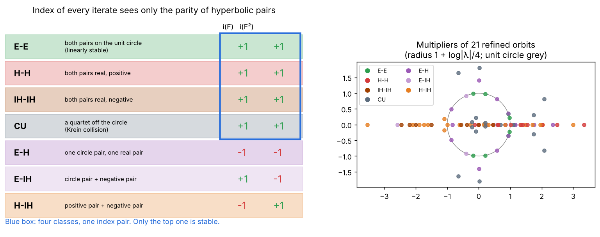
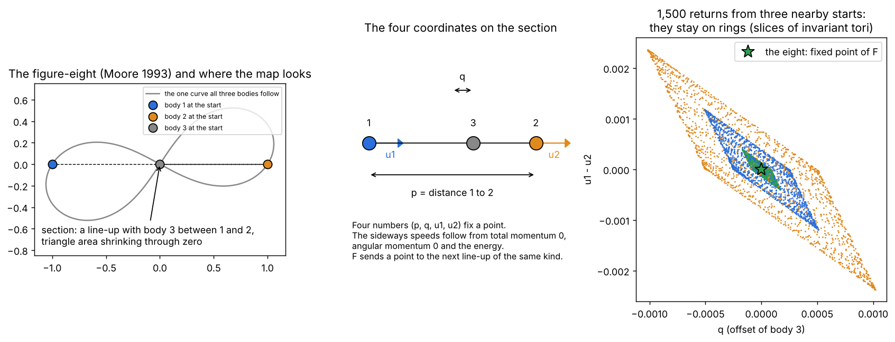
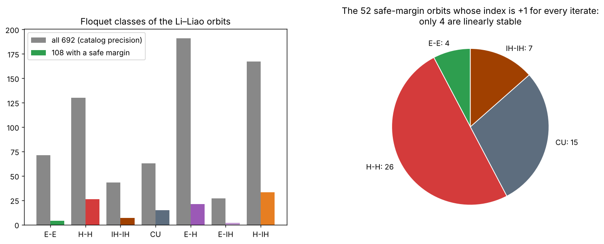
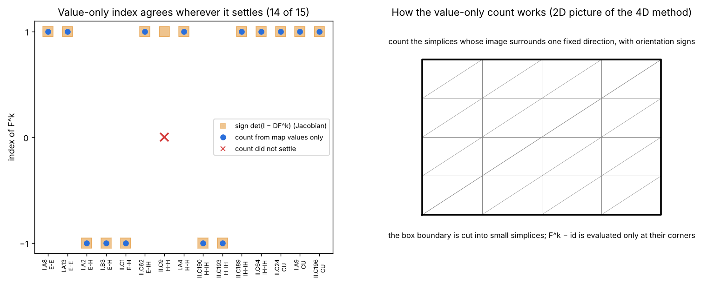
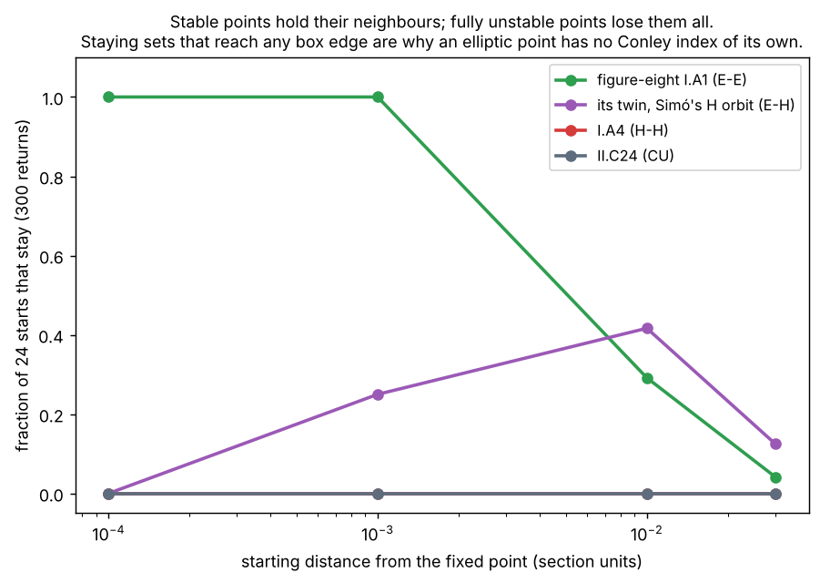
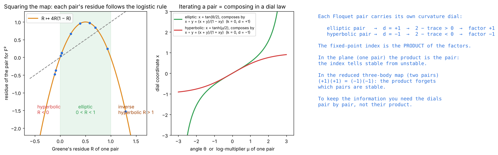
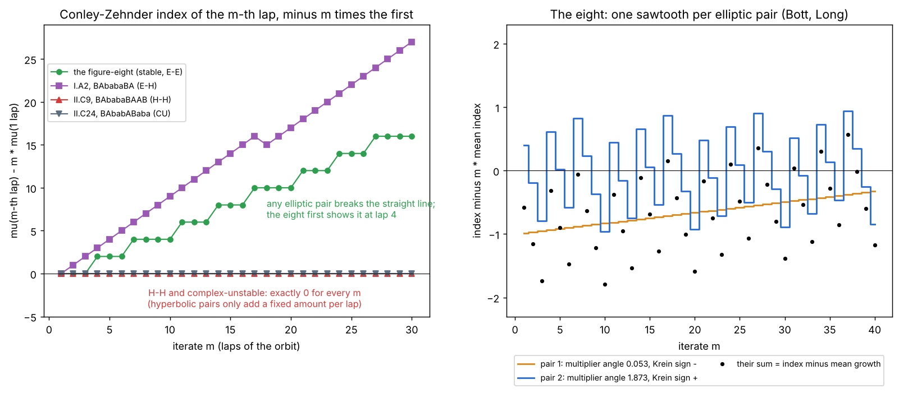
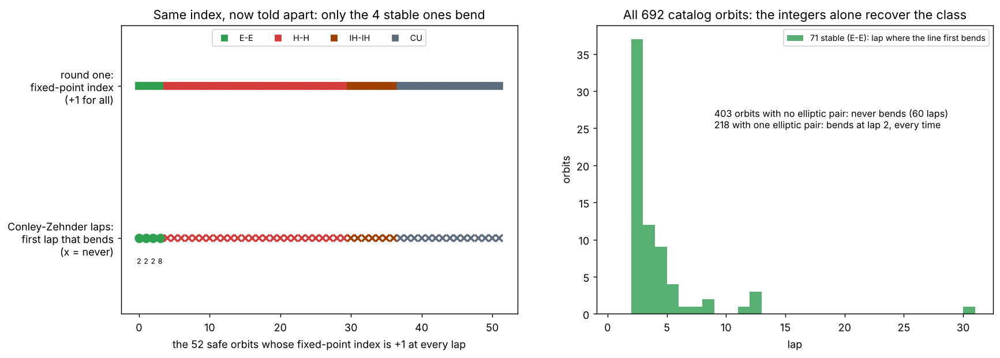
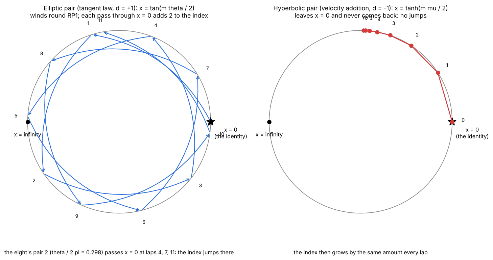
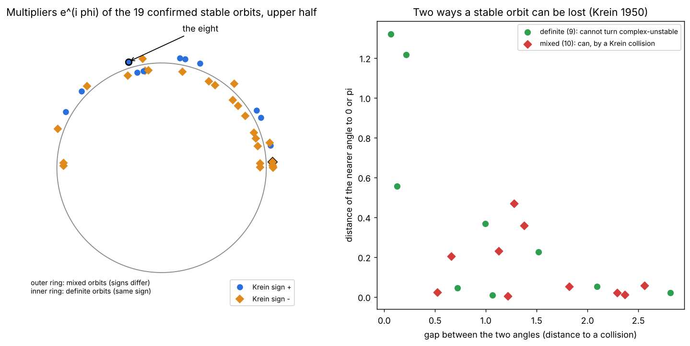

# DRAFT · The Conley index on a real three-body return map

> **Names:** some words or symbols on this page (wall, twist) also mean something else in standard math, physics or computing, or inside this project. [NAMING-COLLISIONS.md](../../NAMING-COLLISIONS.md) says which meaning is in play.

**DRAFT, Nov 27 2026.** Part of Affine Composition Theory, built on Fused Hyperoperation Algebra. Follows
[entropy-topology](../entropy-topology/README.md), which found that the Conley index tells a stable orbit from its
unstable twin where knot type can't, in the logistic, standard and Hénon maps, and graded "test it on a three-body
return map" as worth following (high). Asked for by Brennan on Nov 27 ("Yes" to that follow-up).

Checks: [`checks.py`](checks.py) → [`checks_output.txt`](checks_output.txt), **21 of 21 pass** (numpy, sympy, gcc;
a few seconds; it reads the saved JSON and recomputes the key numbers live); section 8 adds
[`checks_cz.py`](checks_cz.py) → [`checks_cz_output.txt`](checks_cz_output.txt), **10 of 10 pass**. No Lean module. Pictures:
[`figures.py`](figures.py) → [`figures/`](figures/). Colour key where it applies: **orange = known, blue = our reading
of known pieces, green = not found in print** (nothing on this page is green).

## The answer first

**On a real three-body return map, the index tells twins apart but cannot tell stable from unstable.**
That is a clean negative result with a one-line reason, and it marks the road that could work.

*Figure 2. Left: the seven ways a fixed point of the reduced three-body map can sit, and the fixed-point index of the
map F and of F² for each. The four in the blue box share the index pair (+1, +1); only the top one (E-E, both pairs on
the unit circle) is stable. Right: the multipliers of 21 refined orbits, coloured by class.*

1. **The map is real and checked.** The reduced planar three-body problem (equal masses, zero angular momentum, fixed
   energy) has a four-dimensional section: the line-ups with body 3 in the middle. Its return map F was built and
   checked two independent ways (figure 1; checks A1–A4). The figure-eight is a fixed point with all four multipliers
   on the unit circle (E-E).
2. **In four dimensions the index forgets stability.** For a nondegenerate fixed point the index is
   (−1)^(number of real multipliers above 1). With two Floquet pairs that only counts hyperbolic pairs mod 2, so a
   stable point (E-E) and a fully unstable one (H-H, IH-IH, or a complex quartet) get index +1 **for every iterate**
   (B1–B2). In the plane there is one pair, so the same count sorts everything; that is why it worked last round.
   On the Li–Liao catalog: of the 52 orbits whose type is safe from rounding and whose index is +1 for every iterate,
   only 4 are stable (figure 3; B6).
3. **A value-only count works on the real map.** The index of F^k was computed from map values alone (a simplicial
   degree count in four dimensions) and agrees with the Jacobian on every orbit where it settled, 14 of 15 (figure 4;
   B4–B5). So the index really is computable without derivatives here, the step interval arithmetic would certify.
4. **Twins: the index tells them apart, not which is stable** (figure 5). The figure-eight (index +1) and its twin,
   Simó's H orbit (index −1), straddle the wall trace = 2 in one Floquet pair: a fold, seen in the numbers. In 5 of the
   7 same-word pairs the indices are opposite; in those 5, the +1 member is the less unstable one only 3 times (C1–C4).
5. **The pointwise Conley index exists only for fully unstable orbits.** A fully hyperbolic orbit is an isolated
   invariant set with Conley index a pointed 2-sphere and the map ±1 on it. A point with a generic elliptic pair is
   wrapped in invariant tori or circles, so no small box isolates it and it has no Conley index of its own (figure 6;
   D1–D2). So the Conley index proper can certify full instability; it never certifies stability.
6. **What the dials add: each Floquet pair carries its own curvature dial** (figure 7). Iterating an elliptic pair is
   the tangent law (k = 0, d = +1) on x = tan(θ/2); a hyperbolic pair is velocity addition (k = 0, d = −1) on
   x = tanh(μ/2); squaring the map sends each pair's residue R to 4R(1 − R) (E1–E3). The index is the **product** of
   the pairs' signs of d. In the plane the product is the pair; in the three-body map (+1)(+1) = (−1)(−1). That is the
   whole failure in one line, and it says what a fix needs: the dials pair by pair, not their product.
7. **A correction to an earlier page.** The finite-difference instability numbers in
   [three-body-order](../three-body-order/README.md) (`stability.json`) are too high by more than 1 (in log) for 78 of
   239 orbits (A6); the exact variational numbers here replace them. That page's stability check (H1) should be rerun.

**Is it a lead?** As a way to read stability in three bodies: **no**, and now we know exactly why (item 2 is a
theorem, not a sampling accident). Grades two ways:

- **Worth following: low** for stability by the Conley index or its index shadow; **moderate** for two narrower uses:
  certifying that an orbit is fully unstable (an isolating block with a 2-sphere index), and twin bookkeeping (opposite
  indices mean a pair that can be born or die together).
- **Could reach a proof: medium** for existence and index of a given orbit by interval arithmetic (the value-only count
  in item 3 is the piece that would be certified); **low** for stability, which needs KAM (done for the figure-eight by
  Kapela and Simó).

**What would make it a lead:** a topological invariant that keeps the pairs separate. The known candidate is the
Conley–Zehnder index and its iterates (Bott's formula; Long's index iteration theory): an elliptic pair adds a
rotation that grows irregularly with the iterate, a hyperbolic pair a fixed even or odd amount, so E-E and H-H part
ways. It is computable rigorously (Joung and van Koert 2024 do it for the restricted three-body problem). A test on
the Li–Liao catalog, and a check of whether the per-pair dial sign can be read from it, would be the follow-up.
**Done in [section 8](#8-follow-up-the-index-pair-by-pair-conleyzehnder-iteration):** it does separate stable from
unstable on all 692 orbits, but as the known Bott–Long theory, carrying the same information as the multipliers plus
their Krein signs.

## 1. The return map

*Figure 1. Left: the figure-eight; all three bodies run along the one grey curve. The start (Li–Liao's form: bodies at
(−1, 0), (1, 0), (0, 0)) is a line-up with body 3 in the middle. Centre: the four coordinates. Right: 1,500 returns from
three starts near the eight, plotted in two of the four coordinates; they stay on rings, slices of invariant tori.*

**Section.** States with centre of mass 0, momentum 0, angular momentum L = 0 and energy E, at the moments the
triangle's oriented area passes through zero (shrinking), with body 3 between bodies 1 and 2. Turn the frame so body 2
is to the right of body 1. Then four numbers fix a point: p = |r₂ − r₁|, q = where body 3 sits from the midpoint,
u₁ and u₂ = the speeds of bodies 1 and 2 along the line. The sideways speeds are a multiple of
(x₃ − x₂, x₁ − x₃, x₂ − x₁) (from zero momentum and L = 0), sized by the energy and signed by the crossing direction
(`section.to_state`). F sends a point to the next such line-up. Every Li–Liao orbit starts on this section.

Count: 12 phase-space numbers, minus 4 for the centre of mass, 2 for rotation and L, 2 for time and energy, leaves 4.
F preserves volume (and the symplectic form).

**Two independent checks.** (A1–A4)

- The figure-eight returns to itself after one hit per period, to 2 × 10⁻¹¹ before polishing.
- The Jacobian of F (finite differences of the section map) and the monodromy of the variational equations reduced
  to the same 4 × 4 block (`cb3.reduced_block`: Φ on {dCOM = dP = dH = dL = 0} modulo the flow and rotation
  directions) give the same Floquet traces to 10⁻⁶.
- Figure-eight multipliers: e^(±0.0529 i) and e^(±1.8730 i), all on the unit circle (E-E). The small angle is the pair
  that meets Simó's H orbit at the fold (section 4).

The integrator is Dormand–Prince 5(4) at tolerance 10⁻¹³ with the 12 × 12 variational equations carried along the same
steps (`tbvar.c`); section hits are found by bisection inside the step.

## 2. Why the index can't see stability here

A 4 × 4 symplectic matrix has two pairs of multipliers (λ, 1/λ), each summarised by its trace τ = λ + 1/λ. A pair is
elliptic (E) if |τ| < 2, hyperbolic (H) if τ > 2, inverse hyperbolic (IH) if τ < −2; if the traces are complex the four
multipliers form a quartet off the circle (CU, "complex unstable"). Since det(I − M) = (2 − τ₁)(2 − τ₂), and
τ for Mⁿ is a Chebyshev polynomial of τ,

> **i(Fⁿ) = (−1)^#H · ((−1)^(n+1))^#IH** for a nondegenerate fixed point (check B1 on 108 orbits, n = 1..4).

This is the known formula index = (−1)^(number of real multipliers > 1), read for symplectic spectra. It depends only
on the number of hyperbolic and inverse hyperbolic pairs mod 2. So for every n:

| Class | i(F) | i(F²) | all iterates | stable? |
|---|---|---|---|---|
| E-E | +1 | +1 | +1 | linearly stable |
| H-H | +1 | +1 | +1 | no |
| IH-IH | +1 | +1 | +1 | no |
| CU | +1 | +1 | +1 | no |
| E-H | −1 | −1 | −1 | no |
| E-IH | +1 | −1 | alternates | no |
| H-IH | −1 | +1 | alternates | no |

In the plane the same formula has one pair, and the index pair (i(F), i(F²)) = (sign R, sign R(1 − R)) is exactly the
residue class, which is what entropy-topology found. One more dimension and three unstable classes join the stable one.

*Figure 3. Left: Floquet classes of the 692 Li–Liao orbits that integrate (grey) and of the 108 whose type is safe from
rounding (coloured). Right: the 52 safe orbits with index +1 for every iterate; 4 are stable.*

**The catalog.** Li and Liao's 695 orbits (equal masses, zero angular momentum, collinear start) give their start to
10 digits. Floquet pairs near τ = ±2 are sensitive to that rounding: refining four orbits as fixed points of F changed
their class (I.A14 went from E-E to E-H). So the tally keeps only orbits whose traces sit at least 0.01 from ±2 (and
from each other): 108 orbits, 4 E-E, 21 E-H, 2 E-IH, 26 H-H, 33 H-IH, 7 IH-IH, 15 CU. Of the 52 with index +1 at every
iterate, 4 are stable (B6). For comparison, Dmitrašinović, Hudomal, Shibayama and Sugita (2018) found 21 linearly
stable orbits among the more than 200 they studied (another catalog).

## 3. The index from map values only

*Figure 4. Left: for 15 orbits refined to a residual below 10⁻⁸, the index of F^k from the Jacobian (orange squares)
and counted from map values only (blue dots). One count (II.C9) did not settle. Right: the method, drawn in 2D.*

The index of an isolated fixed point is the degree of g = F^k − id on a small sphere round it. In four dimensions:
cut the boundary of a small box into 3-simplices (Kuhn's triangulation of each of its eight 3-cube faces), evaluate g
at the corners only, and count the simplices whose image cone contains a fixed direction, each with the sign of its
image's orientation times its own (`degree.py`). Linear maps give the sign of the determinant exactly; (z₁², z₂) gives 2
(B3). On the three-body map the count is repeated for two box sizes, two subdivisions and five directions, and accepted
only when all agree.

- 14 of 15 well-refined orbits settle, and every settled count equals sign det(I − DF^k) (B4). The 15th (II.C9, an
  H-H orbit with 12 hits per period and residual 3 × 10⁻⁹) never settled.
- Live in the checks: figure-eight +1, Simó's H orbit −1 (B5).
- The box is shaped by (DF^k − I)⁻¹ so the count is well conditioned. That uses the Jacobian to decide where to sample;
  the count itself uses only values of F. A plain cube gives the same answers where it settles.
- Counts for F² (two periods) settled less often: the orbits are unstable enough that a box small enough to be linear
  is close to the refinement error. Those are not used for any claim.

## 4. Twins

*Figure 5. Left: the 7 same-word pairs found earlier ([three-body-word-formula](../three-body-word-formula/README.md)),
each orbit placed at its index, coloured by class, dot size growing with instability. Right: the figure-eight and its
twin on either side of the wall τ = 2 in the pair that folds.*

- **The figure-eight and Simó's H orbit** (C1–C2): one pair has τ = 1.9972 (elliptic) for the eight and 2.0084
  (hyperbolic) for the twin; the other pair is −0.595 against −0.589, elliptic in both. One pair straddling τ = 2 with
  the other unchanged is what a fold looks like (Galán and coauthors 2002 found this fold as a mass changes). Indices
  +1 and −1: here +1 is the stable one.
- **All 7 pairs** (C3–C4): 5 have opposite indices, as fold partners must. II.C66 and II.C75 do not; that fits an
  eigenvalue-1 bifurcation in one of them since their birth, or a birth that is not a simple fold (not traced here).
  In the 5 opposite pairs, the +1 member is the less unstable in 3 (I.A1, II.C73, II.C192) and the more unstable in 2
  (II.B8, II.C246). Away from the figure-eight both twins are unstable, and +1 often marks the fully hyperbolic one.

What it contributes: the index separates twins wherever they were born at a fold and has the right sign rule, which is
why the pair can appear and disappear together. It does not say which twin is stable unless one of them is E-E.

## 5. Isolation: where a Conley index exists

*Figure 6. 24 random starts at each distance from four fixed points, followed for 300 returns. A start "stays" if it
never gets farther than 50 times its starting distance.*

The Conley index belongs to an isolated invariant set: one that is the largest invariant set inside some box and does
not touch the box's edge.

- **Fully hyperbolic points** (H-H, IH-IH, H-IH, CU) are isolated; their Conley index is the pointed 2-sphere (the
  unstable directions) with the map acting by +1 or −1 (the sign is the orientation of the unstable plane; +1 for H-H,
  IH-IH and CU, −1 for H-IH). Every start near I.A4 (H-H) and II.C24 (CU) left, at all four distances (D2).
- **The figure-eight** keeps every start within 10⁻³ (D1), on rings like those in figure 1. Kapela and Simó proved KAM
  tori around it. Tori that fit inside a box but reach its edge make every small box fail to isolate, so the eight has
  no pointwise Conley index. The same goes for any elliptic pair that satisfies the usual twist condition (invariant
  circles in its centre plane), so E-H points are not isolated either, though their staying set has zero volume and
  the test in figure 6 can't see it.
- Exceptions exist: Fayad and Saprykina (2016) built smooth Hamiltonians with isolated elliptic fixed points. The
  statement above is for the generic, twist case.

So in three bodies the Conley index proper certifies full instability. Its shadow, the index, separates twins.
Neither certifies stability.

## 6. The dial reading of one Floquet pair

*Figure 7. Left: squaring the map sends a pair's Greene residue R = (2 − τ)/4 to 4R(1 − R) (blue dots: pairs of the
refined orbits). Centre: an elliptic pair, written as x = tan(θ/2), iterates by the tangent law; a hyperbolic pair,
x = tanh(μ/2), by velocity addition. Right: the index is the product of the pairs' dial signs.*

- **E1.** R(F²) = 4R(1 − R) for each pair (Chebyshev doubling), on every refined orbit.
- **E2.** For an elliptic pair with angle θ, x = tan(θ/2) and the n-th iterate is x ∘ x ∘ … ∘ x in the law
  (x + y)/(1 − xy), our two-dial law at k = 0, d = +1. For a hyperbolic pair with log-multiplier μ, x = tanh(μ/2)
  composes by (x + y)/(1 + xy), d = −1 (velocity addition, rapidities adding). This is the jet: the multipliers are the
  derivative of the return map, as Brennan's frame-dragging note asks for in place of plain velocity addition.
- **E3.** The index factor of a pair is sign(2 − τ) = sign(4R), and R = x²/(1 + x²) > 0 (elliptic) or
  −x²/(1 − x²) < 0 (hyperbolic): the factor is the sign of the pair's curvature dial d.

What the dials add: one language for the whole failure. The stable/unstable wall of a pair is the Δ wall of the dial
plane (d changes sign), the same wall that switched entropy on and off last round. The index multiplies the pairs'
d-signs and so loses them in four dimensions. No new dial: k = 0 throughout and only the sign of d matters.

## 7. Neighbours

- **Dial map** ([dial-map](../dial-map/README.md)): only the curvature dial d is used, at ±1. New here: a Floquet pair
  as a point on the line k = 0, and the index as the product of d-signs.
- **Mathlib** ([mathlib-map](../mathlib-map/README.md)): nothing to port yet. The parity law is linear algebra
  (det(I − M) = Π(2 − τᵢ) for a block-diagonal symplectic M) and could be a small Lean lemma; I don't know of a Brouwer
  degree in Mathlib, so the value-only count has no Lean home.
- **three-body-order:** item 7 above; its stability numbers should be replaced by `floquet.json` here.

## 8. Follow-up: the index pair by pair (Conley–Zehnder iteration)

*Added Nov 27, after the first draft, on the go-ahead to follow the lead named above.*

**Answer: yes, the per-pair index tells every stable orbit from every unstable one, on all 692 catalog orbits. It
does so because it is built from the same unit-circle multipliers as the Floquet class: this is the known
iteration theory of Bott (1956) and Long (2000), written in integers.** What it adds to round one is a clear reason
why round one failed, and the Krein signs, which say which stable orbits can turn complex-unstable.

*Figure 8. Left: the Conley–Zehnder index of the m-th lap minus m times the index of one lap. With only hyperbolic
pairs (H-H, and the complex quartet) it is exactly 0 for every m. Any elliptic pair bends the line: an E-H orbit
bends at lap 2, and the figure-eight at lap 4. Right: the figure-eight's index minus its mean growth splits into one
sawtooth per elliptic pair (Long's formula); pair 1 sits at angle 0.053 with Krein sign −, pair 2 at 1.873 with sign +.*

1. **What was computed.** For each orbit, the index of the m-th lap, μ(m), for m = 1 to 60, from Long's iteration
   formula: μ(m) = m(μ(1) − r) + 2 Σⱼ ⌈m θⱼ / 2π⌉ − r, with r the number of elliptic pairs and θⱼ each pair's
   multiplier angle turned to (0, 2π) by its Krein sign. Our sign convention and the formula were checked against
   direct crossing counts (Robbin–Salamon) on 359 test paths: all agree, 2 only after a finer time grid near a
   resonance (F1, F2). The value of μ(m) depends on a choice of frame along the orbit, but only through a term
   m × (an even number), so everything used here is free of that choice: bend(m) = μ(m) − m μ(1).
2. **It separates.** bend(m) = 0 for every m exactly when the orbit has no elliptic pair. All 403 such orbits stay on
   the straight line for 60 laps; all 289 with an elliptic pair leave it (F5). One elliptic pair shows at lap 2
   every time, since bend(2) is then odd (F8). Two show by lap 2 in 37 of 71 stable orbits and by lap 30 in all of
   them; the figure-eight shows at lap 4. Among the 52 safe orbits whose fixed-point index is +1 at every lap, the 4
   stable ones bend and the other 48 never do (figure 9, F7). The integers μ(1..60) alone give back the number of
   elliptic pairs for all 692 orbits (F6).
3. **Round one sits inside it.** (−1)^μ(m) equals the fixed-point index of F^m for all 692 orbits and m = 1 to 4
   (F3). So the round-one index is the parity of the Conley–Zehnder index, and parity is exactly what forgets
   whether two pairs are both elliptic or both hyperbolic. The topological object that keeps the full degree is local
   Floer homology (Floer; Ginzburg and Gürel): its Euler characteristic is the fixed-point index, and for a
   nondegenerate point it sits in degree μ. It is defined at elliptic points too, because a nondegenerate elliptic
   point is an isolated fixed point even though it is not an isolated invariant set (section 5). It was not computed
   here; it needs the symplectic structure, not just map values.
4. **The dial reading, pair by pair** (figure 10). An elliptic pair is the tangent-law dial x = tan(θ/2); its m-th
   lap is x = tan(mθ/2), which winds round the projective line and adds 2 to the index each time it passes x = 0,
   the identity. A hyperbolic pair is the velocity-addition dial x = tanh(μ/2), which leaves 0 and never comes back,
   so it only adds a fixed amount per lap. The Krein sign is the direction the elliptic dial winds. Round one's
   failure, the product (+1)(+1) = (−1)(−1), is undone by reading the dials one at a time. This is our reading of
   known pieces.
5. **Krein signs of the stable orbits** (figure 11). Refining the 71 catalog E-E orbits as fixed points of F
   confirms 19 (residual below 10⁻⁹ and still E-E); 49 do not refine that far in double precision, 2 turn out E-H
   and 1 fails. Of the 19, 10 are mixed (the two pairs have opposite signs) and 9 definite (F10). By Krein's theorem
   a definite stable orbit cannot turn complex-unstable under a small Hamiltonian change, and a mixed one can, when
   its two angles meet. The figure-eight is mixed, but its two angles are 1.82 apart, far from meeting; its nearer
   edge is the small angle 0.053 next to +1, the direction of its fold with Simó's H orbit (section 4).

*Figure 9. Left: the 52 safe orbits whose fixed-point index is +1 at every lap. Round one gives all of them the same
index; the lap test bends only for the 4 stable ones (numbers: the lap where it first bends). Right: the lap where
the line first bends, for the 71 stable catalog orbits.*

*Figure 10. Left: the figure-eight's pair 2 as a tangent-law dial, lap by lap; it passes x = 0 at laps 4, 7 and 11,
where its index jumps. Right: a hyperbolic pair as a velocity-addition dial never returns to 0.*

*Figure 11. Left: the multipliers of the 19 confirmed stable orbits on the unit circle, coloured by Krein sign
(outer ring mixed orbits, inner ring definite). Right: each orbit's two distances to losing stability: to a Krein
collision (gap between its angles; only mixed orbits can be lost this way) and to +1 or −1.*

**Is it a lead?** For telling stable from unstable three-body orbits, the per-pair index works completely and is
ready to be made rigorous: it is a list of integers, and certifying it needs only enclosures of the angles tight
enough to place each m θ / 2π between integers up to the lap where the line bends (lap 4 for the eight). But it is
the known theory, and it carries the same information as the multipliers plus their Krein signs. It says nothing
about stability over long times, which still needs KAM. Grades:

- **Worth following: low** as a new way to read stability (it is the standard one); **moderate** as the bookkeeping
  for a proof pipeline, and for the Krein signs, which say which stable orbits can be lost by a collision.
- **Could reach a proof: high** for linear stability of a given orbit, but that is not new (Roberts; Kapela and Simó
  did the eight); **low** for stability over long times.

**What would make something new here:** the mean index with a frame that comes from the geometry (the shape sphere)
rather than an arbitrary one, compared with the word. If each close pass adds a fixed rotation, the mean index would
count runs the way the period rule does ([three-body-word-formula](../three-body-word-formula/README.md)). That is
a testable question; it was not tested here.

## Assumptions

- **Equal masses, G = 1, zero angular momentum**, planar. Energy fixed per orbit at its Li–Liao start.
- **Floquet types** come from double-precision variational equations (tolerance 10⁻¹³). Pairs within 0.01 of τ = ±2 are
  left out of the tally because catalog rounding can move them across; refinement of 21 orbits changed 4 classes.
- **The parity law** holds for nondegenerate fixed points (no multiplier equal to 1). It is exact; the catalog checks
  only confirm it was applied right.
- **Value-only counts** are numerical: an outer box, a fine enough triangulation and the absence of other fixed points
  in the box are checked by agreement across sizes and directions, not proved. Interval arithmetic would make them
  proofs; that was not done.
- **Isolation** (section 5) uses KAM for elliptic pairs with a twist condition; the twist was not checked for each orbit,
  only for the figure-eight through Kapela and Simó's proof. The staying test is a picture, not a proof.
- **Twins:** pairing by identical word, from the earlier page; why II.C66 and II.C75 break the sign rule was not traced.
- **"Stable" means linearly stable** (E-E) throughout. Long-time stability needs KAM on top.
- **Section 8:** Long's iteration formula is a theorem for nondegenerate monodromies whose unit-circle multipliers
  are simple; that holds for every orbit used. Indices are computed from it, not from crossing counts on the
  three-body orbits themselves; the formula and our Krein convention were checked against crossing counts only on
  test systems. Only quantities free of the choice of frame (bend(m), parity, the sawtooth part) are reported. Catalog
  classes are at catalog precision; only 19 of the 71 stable orbits were confirmed by refinement. The decode uses
  60 laps. The local Floer homology statement is quoted from the literature, not computed.

## Known vs new

| Item | Status | Source |
|---|---|---|
| Figure-eight: found, existence proved | Known | Moore 1993; Chenciner and Montgomery 2000 |
| Figure-eight linearly stable; KAM stable | Known | Simó 2002 (numerical); Roberts 2007 (ETDS, computer-assisted linear stability); Kapela and Simó (computer-assisted, linear and KAM) |
| Figure-eight's fold with Simó's H orbit | Known | Galán, Muñoz-Almaraz, Freire, Doedel and Vanderbauwhede 2002 (PRL 88, 241101) |
| 695 orbits, equal masses, L = 0 | Known | Li and Liao 2017 |
| Linear stability counts of zero-L orbits | Known (other catalog) | Dmitrašinović, Hudomal, Shibayama and Sugita 2018 |
| Index of a nondegenerate fixed point = (−1)^(# real multipliers > 1); index of iterates | Known | Lefschetz, Dold 1983; standard |
| The parity law for symplectic spectra and the table of section 2 | Elementary consequence; our statement | this page |
| Index pair = residue class in the plane | Elementary | entropy-topology |
| Conley index; isolating blocks; Conley index of a hyperbolic point = pointed sphere | Known | Conley 1978; Conley and Easton 1971; Easton 1975 |
| Isolating blocks in the three-body problem | Known | Easton 1971; Moeckel 2004 (collinear relative equilibria) |
| Generic elliptic points accumulated by KAM tori; smooth isolated elliptic exceptions | Known | KAM; Fayad and Saprykina 2016 |
| Conley–Zehnder index and its iteration | Known | Conley and Zehnder 1984; Bott 1956; Long 2002 |
| Rigorous Conley–Zehnder indices in the restricted three-body problem | Known | Joung and van Koert 2024 |
| Reduced 4D section map of the planar problem at L = 0, value-only 4D degree counts on it | Our computation | this page |
| Catalog tally: 4 E-E among 52 orbits with index +1 at every iterate | Our computation | checks A5, B6 |
| Floquet pair as a dial point (tangent law / velocity addition); index = product of d-signs | Our reading of known pieces (Chebyshev, half-angle addition) | this page |
| Iteration formula for the index of iterates (sawtooth per elliptic pair) | Known | Bott 1956 (CPAM); Long 2000 (Adv. Math. 154); Long 2002 (book) |
| Krein signature; mixed pairs can collide and leave the circle, definite ones cannot | Known | Krein 1950; Gelfand and Lidskii 1955; Moser 1958 |
| Index and stability for symmetric orbits, applied to the figure-eight | Known | Hu and Sun 2009 (CMP 290); Hu, Portaluri and Yang 2020 (dihedral Bott formula) |
| Morse index alone does not decide stability (ten symmetric orbits; the eight has Morse index 2 over a period) | Known | Berti, Canneori, Ciccarelli, De Blasi, Introna and Polimeni 2025 (arXiv 2511.17234) |
| Odd index forces instability (relative equilibria) | Known | Hu and Sun 2009 (C. R. Acad. Sci.); Barutello and Portaluri 2014 |
| Local Floer homology; Euler characteristic = fixed-point index | Known | Floer; Ginzburg and Gürel 2010 |
| Catalog test: lap test separates 692 of 692; round-one index = parity of the iterate index | Our computation of known theory | checks F3–F8 |
| Krein signs of 19 confirmed stable catalog orbits; the figure-eight is mixed (angles 0.053 sign −, 1.873 sign +) | Our computation; the eight's signs not found in print in our searches | checks F9–F10 |
| Per-pair index as the winding of the dial through its identity | Our reading of known pieces | section 8 |

**Searches for section 8 (Nov 27):** "Long precise iteration formulae Maslov-type index ellipticity closed
characteristics"; "Hu Sun index and stability of symmetric periodic orbits figure-eight"; "Morse index odd implies
linearly unstable periodic orbit n-body Portaluri"; "Krein signature Floquet multipliers figure-eight three-body".
No paper found computes the figure-eight's Krein signs or runs the lap test on a large catalog; both are direct uses of
the known theory.

**Searches (Nov 27):** "fixed point index iterates symplectic map elliptic-elliptic hyperbolic-hyperbolic"; "figure-eight
three-body linear stability Floquet multipliers Roberts Kapela Simó"; "Conley index isolating block three-body problem
Moeckel Easton"; "Galán Muñoz-Almaraz Freire Doedel Vanderbauwhede figure-8 fold"; "Conley index Hamiltonian isolated
invariant set elliptic KAM". None stated the parity table as a remark about stability; it is too elementary to call new.
The figure-eight's multiplier angles (0.0529, 1.8730) were not compared with a published value: the papers found give
the method, not the numbers, in what I could read.

## Files

- `tbvar.c` → `libtbvar.so` (built on first import): the equations of motion with the 12 × 12 variational equations,
  and the section-hit finder.
- `cb3.py`: integration, conserved quantities, the reduced 4 × 4 block, Floquet traces, classes, index from traces.
- `section.py`: the four-dimensional return map F, its Jacobian, Newton refinement, hits per period.
- `degree.py`: the value-only degree count in four dimensions.
- `floquet_catalog.py` → `floquet.json`: Floquet classes of the 695 orbits.
- `curated.py` → `curated.json`: 21 orbits refined, typed and counted.
- `twins.py` → `twins.json`: the 7 same-word pairs.
- `analysis.py` → `analysis.json`: the tally and the isolation test.
- `checks.py` → `checks_output.txt`: 21 checks (A the map, B the index, C twins, D isolation, E dials).
- `figures.py` → `figures/fig1`–`fig7`.
- `cz.py`: Krein-normalised pair angles, the iterate index from Long's formula, the decode from integers, and an
  independent Robbin–Salamon crossing count for test systems.
- `czcatalog.py` → `cz.json`: the iterate data of the 692 orbits. `krein_test.py` → `krein.json`: refined stable
  orbits and their Krein signs. `cz_summary.py` → `cz_summary.json`.
- `checks_cz.py` → `checks_cz_output.txt`: 10 checks (F1–F10), a few seconds.
- `figures_cz.py` → `figures/fig8`–`fig11`.
