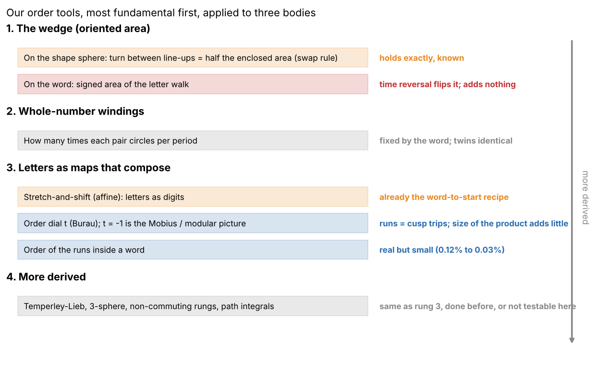
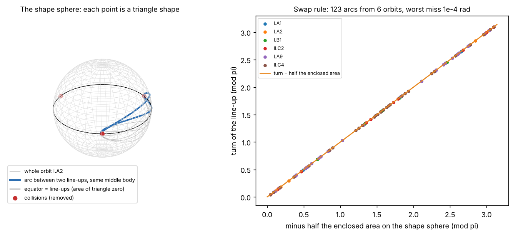
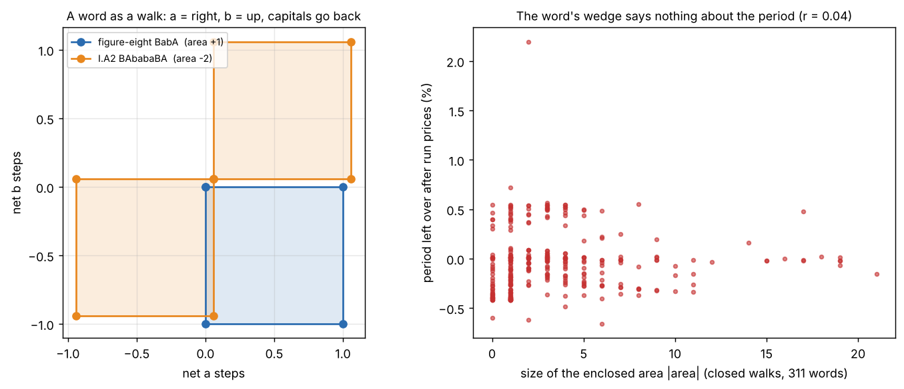
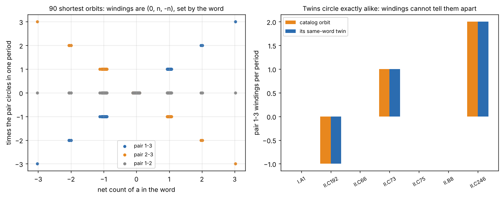
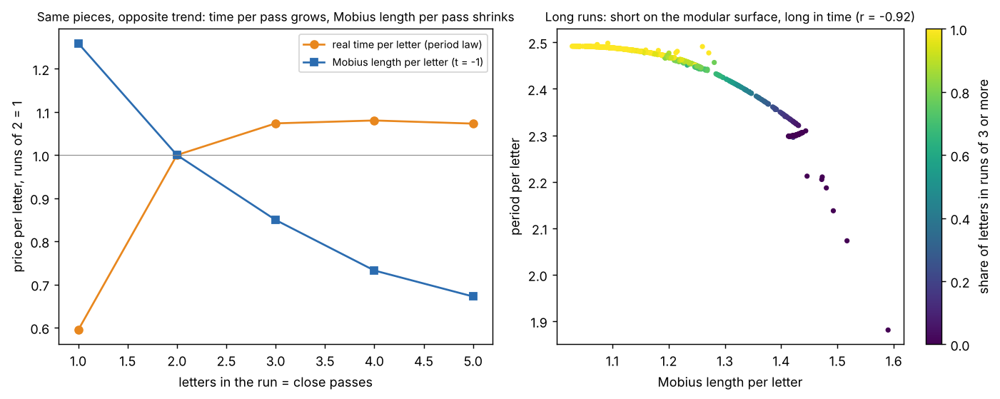
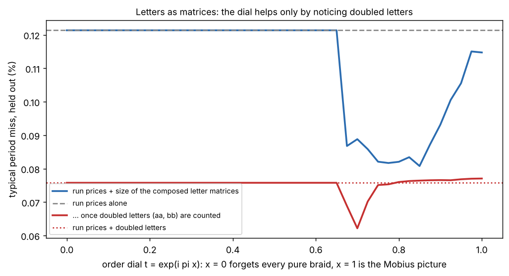
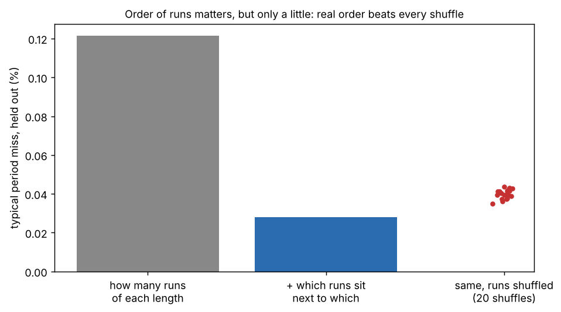
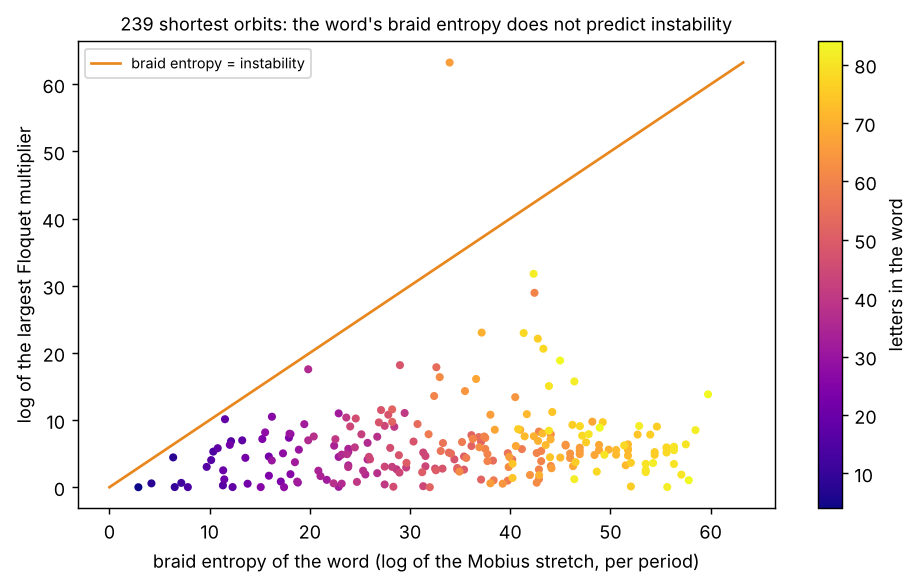

# DRAFT · Three bodies, looked at fresh with our own order tools

**DRAFT, Nov 26 2026.** Part of Affine Composition Theory (repo: fused-hyperoperation-algebra).
Asked for by Brennan on Nov 26: "we do have a way to deal with order in our model so I feel like we should utilize
that ... I almost think the three body problem analysis we did was so much based on the other work that we forgot to
look at how we could apply our own work fresh." And: "start with the most fundamental and work our way to the more
derived." The sections below follow that order.

Same family as `three-body/` and `three-body-word-formula/`: three equal bodies, zero angular momentum, all starting
in a line; the 695 orbits Li and Liao published in 2017, with their words. Colour key in the pictures: **orange =
known, blue = ours, red = does not work, grey = neither.** Checks: `checks.py` → `checks_output.txt`, **23 of 23
pass**. No Lean in this pass: there was no Lean on the machine that ran it.

## The answer first

*Figure 1. The ladder of order tools used here, and what each one gave.*

**No strong new lead.** Applied fresh, our order tools mostly re-find known structure, and they show why: **the period
of these orbits is almost blind to order.** Run prices that simply add (the bag corner of our collection cube, where
order is free) already get within about 0.1%. Order adds a correction of a few hundredths of a percent, and it cannot
tell the same-word twins apart at all.

What each rung gave, most fundamental first:

1. **The wedge (oriented area), on the orbit itself: holds exactly.** Our swap rule (turn = curvature × enclosed area)
   is the whole story of how the triangle turns: between two line-ups, the line turns by minus half the area the shape
   encloses on the shape sphere, checked to 0.0001 rad on 123 arcs. Known (Montgomery, 1996), and already shown for
   whole loops on the `three-body/` page; new here is only the arc-by-arc check between line-ups. Line-ups themselves are
   the moments when the triangle's oriented area is zero, so the letters of every word are made by the wedge.
2. **The wedge on the word: does not work.** The signed area of the word drawn as a walk flips sign when time runs
   backwards, so it cannot carry physics, and its size says nothing about the period.
3. **Whole-number windings: fixed by the word.** Pair 1–2 never circles; pairs 1–3 and 2–3 circle n and −n times, n
   being the net count of the letter a. The triangle never makes a net turn. Same-word twins circle identically.
4. **Letters as composed maps (the order dial on letters): one real structural fact, little predictive gain.** Read
   as Möbius maps (the order dial at t = −1), a run is a trip into a cusp round the third collision point, and the
   word's Möbius length adds up run by run (R² = 0.9999), exactly like the period does. The prices run opposite
   ways, though: time per close pass grows with the run, Möbius length per pass shrinks. The dial sharpens the period
   only by noticing doubled letters and which runs sit side by side.
5. **The order of the runs: real, small.** Which runs sit next to which cuts the typical period miss from 0.12% to
   0.03%, and the real order beats every shuffled order. It is a refinement of the run law, not a new law.
6. **Stability: nothing.** None of the order readings predicts how unstable an orbit is.

---

## 1. The wedge on the orbit: the swap rule is how the triangle turns

*Figure 2. Left: one arc of orbit I.A2 on the shape sphere, between two line-ups with the same body in the middle,
closed back along the equator. Right: the turn of the line against minus half the enclosed area, for 123 such arcs
from 6 orbits.*

The order dial page (`order-dial/`) found that order always costs an oriented area: a·e − b·c for two maps, the corner
ab in quantum phase space, 2x∧y in Clifford's algebra. The most basic place to look for that wedge in three bodies is
the triangle itself.

- **The equator is where the wedge is zero.** On the shape sphere the height above the equator is the triangle's
  oriented area divided by its size. Line-ups (the moments that write the letters) are the equator crossings. So every
  letter of every word is a zero of the wedge.
- **The swap rule gives the turn.** With zero angular momentum the bodies never turn as a whole on purpose, yet the
  line of each line-up points a different way from the last. Our precession swap rule says the turn is the curvature
  times the enclosed area. On this sphere that is exactly minus half the solid angle enclosed by the shape's path
  (closed along the equator, where nothing turns). Polished: each line-up was placed exactly on the equator by
  bisection first, which shrank the worst miss from 0.006 to 0.0001 rad (check E1).

*Known:* this is the geometric phase of the three-body problem (Montgomery 1996; the same Berry-type phase as a
falling cat). The `three-body/` page (section 5) already showed the swap rule giving the turn after whole loops, to
7 × 10⁻⁵. *New here:* only the arc-by-arc version between line-ups, and the remark that line-ups are zeros of the wedge.
*Verdict:* the most fundamental order tool fits perfectly, and that is reassuring, but it is known.

## 2. The wedge on the word: time reversal kills it

*Figure 3. Left: words drawn as walks (a = right, b = up, capitals step back); the enclosed area is the word's wedge.
Right: for the 311 words whose walk closes, the size of that area against what the run prices leave over.*

Compose the letters in the Heisenberg group (shifts that cost a corner area when swapped, as in `order-dial/`
section 5) and each word gets two net counts and one signed area. That is the simplest reading that keeps order.

- Running an orbit backwards reverses the word and swaps each letter's case. That flips the area's sign on every
  closed word (check D1). The same physical orbit carries both words, so the sign means nothing.
- The size of the area adds nothing to the period: the typical held-out miss goes from 0.129% to 0.127% (check D2).

*Verdict:* does not work. A signed reading of the word can only matter for things that change when time runs
backwards, and the period does not.

## 3. Whole-number windings: the word already fixes them

*Figure 4. Left: how many times each pair circles in one period, for the 90 shortest orbits. Right: the same count
for each catalog orbit and its same-word twin.*

The next most basic order reading is a whole number: how many times each pair of bodies circles the other in one
period. These were integrated alongside the motion (sampling the angle missed fast close passes, so that first try
was thrown away).

- Every one of the 90 shortest orbits gives (0, n, −n): pair 1–2 never circles, pairs 1–3 and 2–3 circle n and −n
  times, where n is the net count of a in the word (check F2). The three numbers always add to zero: the triangle
  makes no net turn per period.
- The earlier hypersphere page noted that loops in the full space are the word plus one extra overall turn. In this
  family that extra turn is always zero.
- **Twins:** all 7 same-word pairs circle identically (check F3). Since they are born together at a fold, a whole
  number cannot jump between them.

*Verdict:* nothing beyond the word. The windings cannot separate twins.

## 4. Letters as maps that compose

Our composition frame says a letter is a map and a word is the maps done in order. Two choices of map are natural.

**Stretch-and-shift (affine) maps, each letter with its own centre.** This is where order matters fully: the result
depends on every letter's position, like the digits of a number. It is exactly the "letters as digits" reading the
word-to-start recipe already uses (`three-body-word-formula/` section 3), which narrows the start one letter at a
time. A single global digit formula only ranks the starts loosely (rank correlation about 0.5), which matches the
earlier finding that the start has no closed formula.

**The order dial on letters.** The dial q from `order-dial/` section 4 has a braid version, the Burau matrices, with
one setting t. Each letter becomes a 2 × 2 matrix and the word becomes their product.

- At t = 1 every letter becomes the identity: this end of the dial forgets the word entirely (check B1).
- At t = −1 the letters become the Möbius matrices [[1, 2], [0, 1]] and [[1, 0], [−2, 1]] (check B2). These are the
  standard generators of the modular group Γ(2), whose surface is the thrice-punctured sphere, our shape sphere with
  its collisions removed. The size of the product is the length of the word's loop in that surface's natural
  geometry, and equals the braid's entropy. For the figure-eight it is 12 ln φ, with φ the golden ratio
  (checks B4, B5).
- For t = e^(iπx) with x below 2/3 every word's matrix only rotates: the dial sees no growth at all (check B7).
  Order starts to show at t = e^(2πi/3).

### 4a. Runs are trips into a cusp

*Figure 5. Left: price per close pass in real time and in Möbius length, each set to 1 for runs of 2. Right: Möbius
length per letter against period per letter, coloured by the share of long runs.*

- The product ab is parabolic (trace −2, check B3): it is the loop round the third collision point. A run of
  alternating same-case letters is a power of it, so **a run is a trip into the cusp at that collision**, which is
  the physical picture from `three-body-word-formula/` section 9 (a run of k letters is k close passes of one pair).
- **The Möbius length adds up run by run**, with no knowledge of runs put in: prices 1.80, 2.86, 3.64, 4.19, 4.80
  for runs of 1 to 5 letters, R² = 0.9999 (check C1). So the composition picture finds the run skeleton by itself.
- **But it charges the wrong way.** Real time per pass grows (2.31, 2.48, 2.49 for runs of 2, 3, 4); Möbius length per
  pass shrinks (1.43, 1.21, 1.05), roughly like a logarithm. Deep cusp trips are cheap in the modular surface's
  ruler and dear in time. That is why Möbius length per letter and period per letter run opposite, r = −0.92
  (check C3), and why Möbius length on its own is a poor clock.

*Known:* the cusp structure of the modular surface and its link to continued fractions (Series 1985), and that 3-braid
entropy is read off at t = −1. *Ours:* that the three-body run law and the modular length share one skeleton, the
runs, with opposite price trends.

### 4b. Does the dial sharpen the period?

*Figure 6. Typical held-out period miss when the size of the letter product at each dial setting is added to the run
prices (blue), and after doubled letters such as aa are counted too (red).*

- The best setting is near x = 0.7, just past where growth first appears, and a setting chosen on training data alone
  stays there (check G3). Typical miss: 0.121% with run prices, 0.082% with the dial added.
- Most of that gain is doubled letters (aa, bb inside a run, in 102 of the 695 words): counting them alone gives
  0.076%. The dial then adds a little more, 0.076% → 0.062%, and **nothing once the neighbouring runs are counted**
  (0.0191% → 0.0184%). So the dial is a one-number summary of things section 5 counts directly.

## 5. The order of the runs

*Figure 7. Typical held-out period miss with run counts only, with a table of which run lengths sit next to which, and
with the same table after shuffling each word's runs (20 shuffles).*

The run law treats a word as a bag of runs: order free, prices add. The first place order can enter is between
neighbours.

- Adding a price for each pair of neighbouring run lengths cuts the typical miss from **0.121% to 0.028%** (check G1).
  With doubled letters counted as well: 0.019%.
- Part of that is not order: shuffling each word's runs and refitting still gets 0.035% to 0.044%. The real order beats
  every shuffle (check G2), so the part that is truly about arrangement is the step from about 0.04% to 0.028%.
- A circle-operation shaped corner between neighbours (T = Σp + κ Σ p·p′, one extra number) helps exactly as much with
  shuffled runs as with real ones, so it is not picking up order either (`corner2.py`).

How the misses are measured here: each orbit is left out in turn and the typical miss is the median. The earlier page
quoted the spread for the same run law (about 0.3%); measured this way that law gives 0.12%.

*Verdict:* order matters, at the level of a few hundredths of a percent of the period. Physically, the reversal
between two runs seems to cost a little more or less depending on how tight the binaries on either side are.

## 6. Stability

*Figure 8. For the 239 shortest orbits, the log of the largest Floquet multiplier against the word's braid entropy.*

The braid entropy (the t = −1 reading) is the natural order quantity to try against instability. Monodromy was built
from short segments, so even very unstable orbits are measured.

*[Correction, Nov 27: these finite-difference instability numbers (`stability.json`) are too high by more than 1 (in log)
for 78 of the 239 orbits. Exact numbers from the variational equations are in
[three-body-conley](../three-body-conley/README.md) (`floquet.json`, check A6). The fits below (check H1) have not been
rerun with them yet.]*

- Run counts explain about a third of the spread in instability (held-out R² 0.34); braid entropy adds 0.01 (check
  H1). On its own it explains almost nothing.
- Almost every orbit (238 of 239) is far less unstable than its braid entropy. That is no contradiction: braid
  entropy speaks about the flow around an orbit, not the orbit's own multiplier.

*Verdict:* does not work.

## 7. More derived tools, briefly

- **Temperley–Lieb:** for three strands its representation is the Burau one used in section 4, so it gives nothing new.
- **The 3-sphere (quaternions):** already tried on the hypersphere page; periods and stability came out no simpler.
- **Higher rungs that do not commute:** no natural way was found to turn a three-body letter into a rung, so this was
  not tested.
- **Path integrals split by winding class** (an idea from the call): the classes are exactly the words, and section 3
  shows their whole-number windings are fixed by the word. Weighting each class by a matrix needs a quantum
  three-body calculation, which this pass did not attempt.

## Should this be followed up?

**As a source of new physics here: no.** The fundamental order tools fit (the swap rule is exact) or come out empty
(the word's wedge, windings, stability), and the reason is clear: in this family the period is nearly order-free,
which is our commutative bag corner. Order lives in where an orbit starts, which the existing letters-as-digits recipe
already handles.

**Small, if the run law is pursued:** the neighbour correction (0.12% → 0.03%) and the shared run skeleton with the
modular surface are the two things worth carrying into any attempt to derive the run prices from one close pass.

## Sorting board

| | what | verdict |
|---|---|---|
| Known | swap rule on the shape sphere: line-up turn = −½ enclosed area (Montgomery 1996) | holds, 123 arcs, worst 1e-4 rad |
| Known | line-ups are zeros of the triangle's oriented area | holds |
| Does not work | signed area of the word walk | flips under time reversal; no gain |
| Neither | pair windings per period | (0, n, −n), fixed by the word; no net turn |
| Does not work | windings separating twins | all 7 pairs identical |
| Known | Burau at t = −1 is Γ(2), braid entropy; t = 1 forgets pure braids | holds |
| Ours | a run is a cusp trip; Möbius length adds run by run with log-like prices | R² 0.9999 |
| Ours | dial sharpens the period near t = e^(0.7πi) | only via doubled letters and neighbour runs |
| Ours | which runs sit next to which | 0.121% → 0.028%; real order beats all shuffles |
| Does not work | circle-operation corner between neighbours as an order effect | same gain with shuffled runs |
| Does not work | braid entropy predicting instability | adds 0.01 R² |

## What we could not check

No Lean was compiled (no Lean on this machine). Stability was measured only on the 239 shortest orbits, and windings
on the 90 shortest plus the 14 twin orbits. The path-integral idea needs a quantum calculation and was not tested.

## Files

- `words.py` → `words.json`: runs, Möbius traces and lengths, walk areas for all 695 words.
- `analyze2.py`, `analyze3.py`, `pairs_ctrl.py` → `pairs_ctrl.json`, `corner2.py` → `corner2.json`, `dial_nested.json`:
  period tests (section 4b and 5).
- `physics.py`, `polish_swap.py` → `swap_polished.json`: swap rule, before and after polish.
- `wind_ode.py` → `twin_windings.json`, `wind_cat.py` → `wind_cat.json`: windings integrated with the motion.
- `stability.py` → `stability.json`: Floquet multipliers by segmented monodromy.
- `figures.py` → `figures/fig1` … `fig8`. `checks.py` → `checks_output.txt` (23 of 23).
- Needs numpy, scipy, sympy, matplotlib, and `../three-body/libtb.so` with `tbpy.py`.

## Sources

- R. Montgomery, The geometric phase of the three-body problem, Nonlinearity 9 (1996); Montgomery, the shape sphere and
  its punctures (2002 and later).
- X. Li and S. Liao, 2017 catalog of 695 orbits (data as used in `three-body-word-formula/`).
- C. Series, The modular surface and continued fractions, J. London Math. Soc. (1985).
- Burau representation, its unitarity on part of the unit circle (Squier 1984), and 3-braid entropy at t = −1:
  textbook, not re-fetched.
