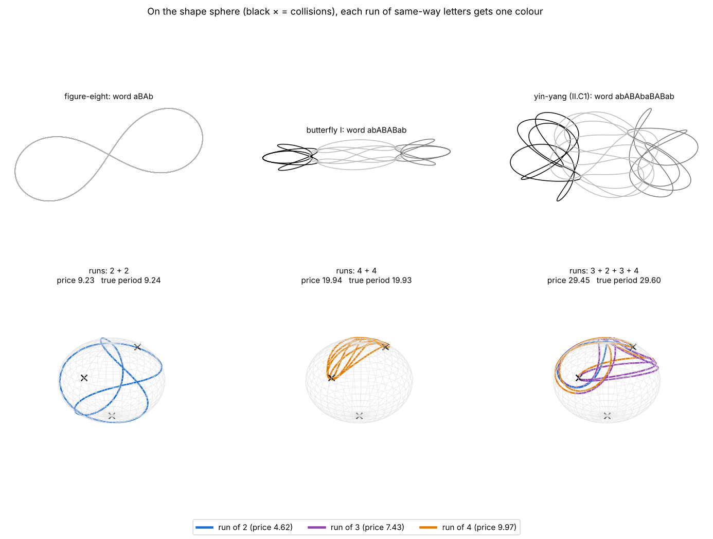
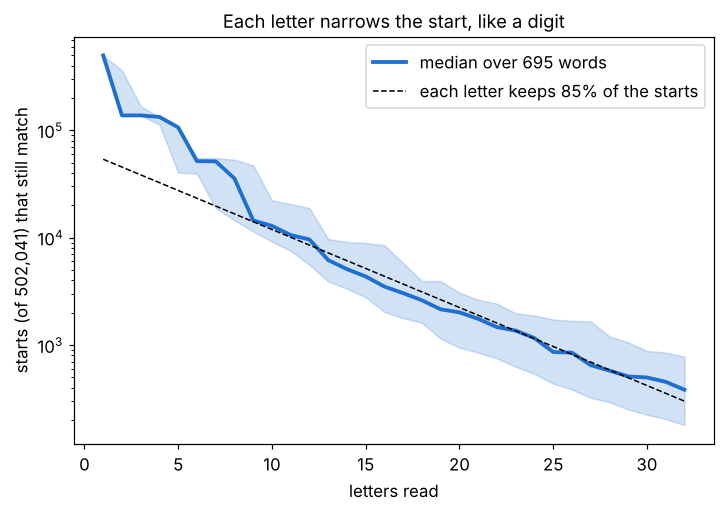
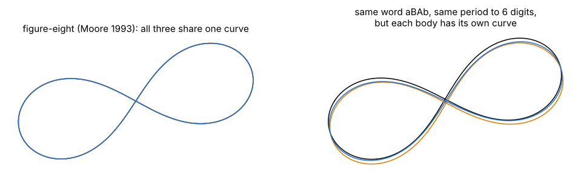
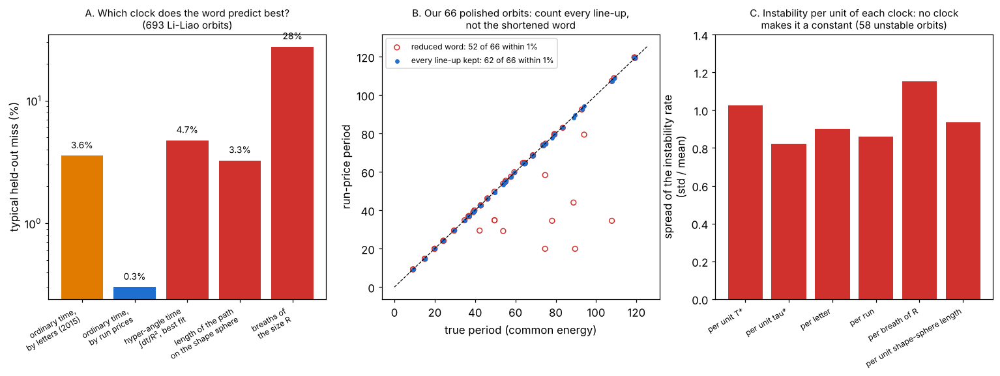
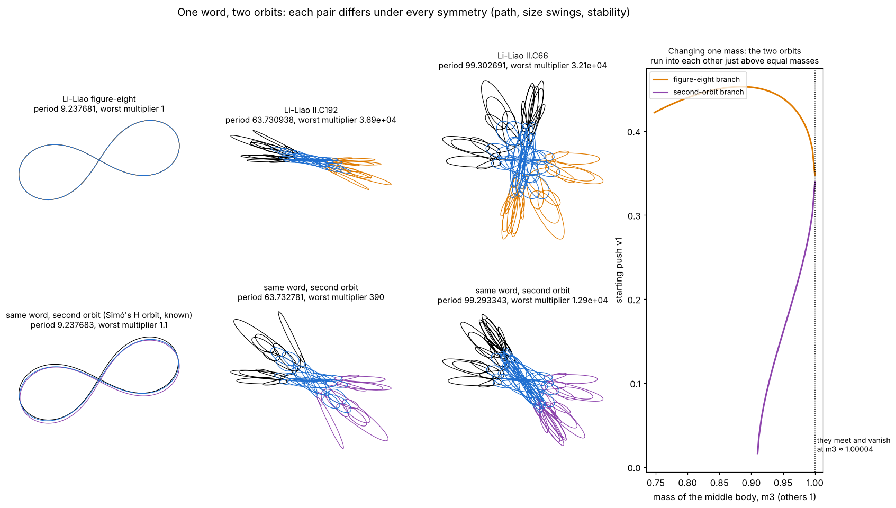
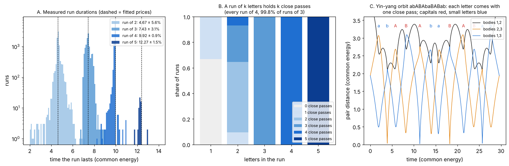
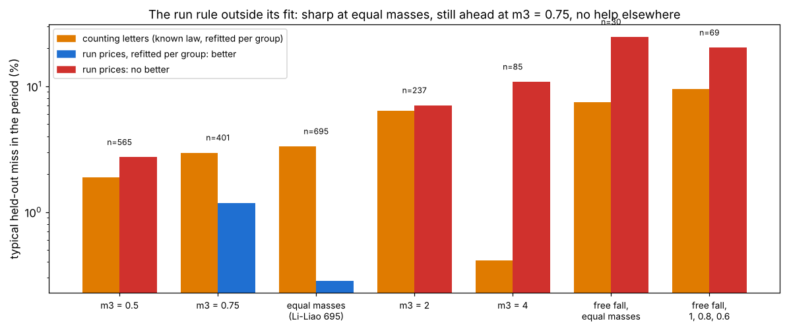

# DRAFT · From an orbit's word to its start

*Three equal bodies, zero angular momentum, all starting in a line. Orange in the pictures is known math, blue is ours, red does not work, grey is neither.*

## The answer first

**There is no formula, published or found here, that turns an orbit's word into its starting push.** Simple word counts miss the start by about 15 times the gap between neighbouring orbits.

**What does work is a recipe, and a sharper period law.** The word's letters, read like digits, plus a new rule that gives the period from the word's runs, rebuild 32 of 68 held-out orbits from the word alone. The period rule is the lead worth following: it is 12 times tighter than the known one.

**The twin orbits are real and come in pairs.** One word can carry two orbits because orbits are born in pairs as the masses change; the figure-eight's partner is Simó's known H orbit, and two more pairs are shown merging the same way. **The run rule has a physical reason** (a run of k letters is k close passes of one pair), and it is sharp only near equal masses.

**Brennan's two extra ideas do not add a lead.** In hyperspherical coordinates the period, word length and stability come out no simpler, and gluing three whole hyperspheres loses the words; the one gluing that keeps them is the shape sphere, already known.

## The question

Every periodic orbit in this family is named by a word: each time the three bodies pass through a straight line, write the letter of the body in the middle (a or b), in capitals when it passes the other way. The figure-eight is aBAb.

Each orbit also has a starting point: the bodies start in a line at (-1,0), (1,0), (0,0), the two outer bodies get the same push (v₁, v₂) and the middle one gets the opposite push, twice as hard. So the question is whether some function takes the word to (v₁, v₂) and to the period.

We used the 695 orbits that Li and Liao published in 2017, with their starts, periods and words.

## 1. The period: known, and a sharper version

**Known (Dmitrašinović and Šuvakov, 2015).** Put every orbit at the same energy, and its period grows in step with the word's length: about 2.46 time units per letter. Tested on orbits left out of the fit, that rule misses by 3.3% on a typical orbit, and by up to 31%.

**Ours: each run has a price.** Split the word (read round in a circle) into runs, a run being letters that all turn the same way before a reversal. aBAb has two runs of 2. Then the period is the sum of a fixed price per run:

| run length | price | price per letter | runs seen in 695 words |
|---|---|---|---|
| 1 | 1.37 | 1.37 | 24 |
| 2 | 4.62 | 2.31 | 8,052 |
| 3 | 7.43 | 2.48 | 10,196 |
| 4 | 9.97 | 2.49 | 7,830 |
| 5 | 12.38 | 2.48 | 56 |

Five numbers, fitted with each test orbit left out, predict the period to **0.28%** on a typical orbit and never worse than 1.5%. That is 12 times tighter than counting letters. On 54 orbits of our own, found by a different search, it lands within 1% for 52 of them.

The picture of why: on the shape sphere (each point is a triangle shape, the three crosses are collisions), a run of 2 is a figure-eight-like swing between two collision points, and a run of 4 is a butterfly-like loop round one. The time each kind of piece takes is nearly fixed, so the times add. Runs of 2 are cheaper per letter than longer runs, which is why counting letters alone misses.

We did not find this rule in what we could read. The straight-line law is known; the run prices are, as far as we found, new.

## 2. A formula for the start from word counts: does not work

Starts crowd onto a few curves in the quarter disc, with a typical gap of 0.004 between an orbit and its nearest neighbour. We tried straight-line fits on letter counts, run counts and symmetry class, and nearest look-alike words. On held-out orbits they miss by about 0.06, fifteen times the gap. **No word-count formula places an orbit.** Nothing in the literature claims one either: the 2015 paper predicts periods only.

## 3. Letters as digits: the word does pin down a region

The right way to read a word is like the digits of a number. Run every start in the quarter disc (502,041 of them on an 800 × 800 grid), write down its first 32 letters, and keep the starts that agree with the word letter by letter. Each letter keeps about 85% of the survivors.

But the survivors shrink to a thin strip, not a point. Every start on that strip shadows the orbit for a while. The word alone cannot say where along the strip the orbit is; something else has to close the loop.

## 4. The recipe: letters, then the run-law period, then a polish

That something is the period. The recipe uses only the word:

1. Keep the grid starts whose letters match the word.
2. Predict the period from the run prices (refitted with this orbit left out) and, along the strip, find the start that comes back closest to itself at that period.
3. Polish that guess with a standard shooting method until the orbit closes.

We then compared the result with the catalog start, which the recipe never saw.

Out of 68 held-out orbits, from 4 to 136 letters:

- **32 land on the catalog orbit** (start within a millionth): 27 on the first pass, 5 more on a second, finer pass.
- **6 land on another closed orbit with exactly the same word** and the same period to 4 to 8 digits, but a different start. Section 8 shows every one of them is a genuinely different orbit.
- **5 close up into an orbit with a different word**, and **25 find nothing** that closes.

Short words work best: 8 of 11 up to 40 letters, 13 of 22 from 41 to 80, and 11 of 35 above 80. Long words fail because the 800 × 800 letter map is too coarse to hold their thin strips; the best guesses for the misses are typically between a ten-thousandth and a few thousandths off, close but outside the polish's reach.

**A word does not always name one orbit.** For the figure-eight's word aBAb, the polish also found a second closed orbit (in an earlier run): same word, same scale-free period to 6 digits (9.237681 against 9.237683), a different start (0.3394, 0.5362 against 0.3471, 0.5327), and each body on its own curve instead of all three on one. Polishing from points between the two lands on one or the other, so they are two separate orbits, not a family. Section 8 identifies it: it matches Simó's H orbit, which is known.

## 5. Invented words: does not work

We also made 30 new words, by splicing halves of catalog words in the same symmetric pattern and keeping only those not in Li and Liao's list, and asked the recipe for orbits with exactly those words. **None gave a new orbit.** Two "hits" were the figure-eight's word written twice and three times over, which is just the figure-eight going round again. For most of the others, no start anywhere on the map follows the invented word, repeated, for more than 5 to 26 letters. Words are not free to choose: splicing breaks whatever rule real orbits obey. That rule is a good question in itself.

## 6. Hyperspherical coordinates: the words' home, but nothing gets simpler

Brennan asked to try the problem on a hypersphere, in polar coordinates there. Once the centre of mass is taken out, three bodies in a plane are one point in four dimensions. Polar coordinates there split it into one size, the hyperradius R, and a direction on a 3-sphere. Forgetting the overall turn leaves Montgomery's shape sphere, where the three collisions are the punctures and the words come from (known). So this is the natural home for the words, and we rewrote our 66 polished orbits and Li and Liao's 695 in it.

Then we asked whether the period, the word and the stability come out simpler in these coordinates. Three new clocks were tried against ordinary time, with the same held-out test for each:

- **Hyper-angle time** (time divided by R², the clock the direction on the sphere naturally keeps): the word predicts it to 4.7% at best, against 0.3% for ordinary time.
- **Length of the path on the shape sphere**: 3.3%.
- **Breaths of the size R** (how many times R swells per period): they do not match letters or runs, and the period per breath misses by 28%.
- **Stability**: how fast nearby orbits peel away, per unit of each clock, spreads by 80% to 115% of its average whatever the clock. No clock turns it into a constant rate.

One useful thing did come out. On our 66 polished orbits the run law works on every line-up the orbit makes, not on the shortened word: 62 of 66 within 1% (the other 4 within 2.3%), against 52 of 66 when letters that cancel are struck out first. In the catalog the two are the same, which is why this did not show earlier.

**Verdict:** the hypersphere is where the words live, which was already known. In its own coordinates the period, word length and stability come out no simpler, so it does not open a new lead. The sharp law stays in ordinary time.

## 7. Gluing three hyperspheres: only one way works, and it is the shape sphere

Brennan also asked whether gluing three hyperspheres together might help. The words are loops round the collision points, written in two letters, so a glued shape can only help if it has two independent loops. That decides it:

1. One sphere per pair of bodies, each touching the next in a ring: one loop only. One letter cannot write these words.
2. Three spheres in a chain, or joined along discs: no loops at all.
3. One cap per collision (bodies 1 and 2 close, 2 and 3, 1 and 3), glued along their rims, with the collision points themselves removed: two independent loops, exactly the two-letter words. This is the shape sphere with its three punctures (known, Montgomery).
4. In four dimensions, the same thing is the 3-sphere with three linked circles removed, one circle per collision. Its loops are the words times one extra overall turn (known).

**Verdict:** gluing whole spheres loses the words. The gluing that keeps them gives back the shape sphere, so it adds nothing new, and it says nothing about the run prices. It does not help.

## 8. The twin orbits: all real, and born in pairs

**Are they copies?** No. Each of the 7 second orbits (the figure-eight's and the 6 from section 4) was compared with its partner under every symmetry of the problem: relabelling the bodies, reflecting, reversing time, rotating, rescaling and shifting the start time. Three fingerprints that none of those change all differ:

- the path on the shape sphere, compared over all 12 relabelled and reflected copies, differs by 3 to 30 times the sampling error;
- the list of swells and dips of the size R differs;
- the worst stability multiplier differs, for example 36,900 against 390 for II.C192, and 1.0 against 1.1 for the figure-eight pair.

The action is no help here: for any periodic orbit it works out to exactly 3 times the period, so equal periods force equal actions.

**Are they in the published lists?** None of the 6 is in Li and Liao's list, which has no repeated words: one orbit per word. Three of them have the same period as some other catalog orbit, and those were checked and are different orbits too. The figure-eight's second orbit matches Simó's H orbit, which is known. The 2024 catalog could not be checked from here.

**Why can one word carry two orbits?** Because orbits are born in pairs. We gave the middle body a slightly different mass and followed both orbits of a pair as it changed. The figure-eight and its partner move toward each other and merge, then vanish together, at a middle mass of 1.00004. That turning point is known: a 2002 study (Galán and coauthors) joined the figure-eight to Simó's H orbit in exactly this way. The same happens for two more pairs: II.C73's pair merges at 1.0016 and II.C66's at 1.0093. For the other four the following stalled before the two met, so for them it is likely but not shown.

So the picture is: as the masses change, a pair of orbits appears together at a turning point and then separates. Both keep the same word, because a word cannot change without a collision, and nearly the same period, because they start as one orbit. At equal masses many pairs sit just past their turning point. **That is why the word fixes the period so well but cannot fix the start.**

## 9. Why each run costs a fixed time, and where the rule breaks

We cut all 695 catalog orbits into their runs and timed each run directly, at the common energy:

| run length | measured time | spread | fitted price | close passes inside |
|---|---|---|---|---|
| 2 | 4.67 | 5.6% | 4.62 | mostly 2 (1 to 4) |
| 3 | 7.43 | 3.1% | 7.43 | 3, in 99.8% of runs |
| 4 | 9.92 | 0.9% | 9.97 | 4, in every run |
| 5 | 12.27 | 1.5% | 12.38 | 5, in every run |

**A run of k letters is k close passes**: one pair swings in close k times while the line-ups keep turning the same way, and each pass takes about 2.5 time units. Long runs are the steadiest because the swinging pair is nearly a binary with a fixed beat. Runs of 2 are the loose ones, figure-eight-like swings with no tight pair, and they carry most of the rule's leftover error. That is the reason the prices add.

**Where it breaks.** We tested the rule on two outside lists from the same Shanghai group, 1,349 orbits with a heavier or lighter middle body and 316 free-fall orbits, refitting the prices for each group and testing on orbits left out:

- **Equal masses:** 0.3%, the sharp case.
- **Middle mass 0.75:** 1.2%, still well ahead of counting letters (3.0%).
- **Middle mass 0.5:** 2.7%, no better than counting letters (1.9%). The fitted prices become flat, about 1.13 per letter whatever the run, so runs stop mattering.
- **Middle mass 2 and up:** runs grow to 5 to 34 letters. At 2 neither rule does well (about 6% to 7%); at 4 and above, counting letters is already nearly exact (0.01% to 0.4%), and the run prices only overfit.
- **Free fall** (bodies start at rest): neither rule works; counting letters misses by 4% to 74% depending on the masses, and the run prices do worse.
- **Our own 66 orbits:** the rule holds when every line-up is counted (62 of 66 within 1%), and fails when cancelling letters are struck out of the word first.

So the run rule is a sharp law of the equal-mass, start-in-a-line family, with a physical reason behind it. It is not a universal law of three bodies.

## Should this be followed up?

**The run law, yes.** It is simple, it is 12 times tighter than the known law, it holds on orbits from a different search, and it has a picture behind it: an orbit is built from a few kinds of pieces whose times add. Section 9 answers why it works (k close passes per run of k) and where it stops (away from equal masses, and in free fall). Still open: the 2024 catalog, nonzero angular momentum (no list with words was reachable), and a formula for the time of one close pass, which would turn the five fitted prices into one derived number.

**A closed formula for the start, no.** The letters behave like digits of a chaotic map, so the start is a limit, not an expression. The recipe above is the constructive answer: word in, orbit out, for about half of the real words we tried (32 of 68, and most of the short ones). Making it reliable for long words needs a finer letter map, not a formula.

## Sorting board

| | what | verdict |
|---|---|---|
| Known | period ≈ 2.46 × letters (2015), 3.3% typical miss | holds |
| Known | letters as symbolic dynamics (Tanikawa and Mikkola, and others) | holds, used here |
| Ours | period = sum of five run prices, 0.28% typical miss | holds on all 695 and on 54 of ours |
| Ours | word → start recipe: letters, run-law period, polish | 32 of 68 held-out orbits land on the catalog orbit |
| Known | the figure-eight's same-word partner is Simó's H orbit; they meet at a fold as one mass changes (Galán and coauthors, 2002) | reproduced, fold at m3 ≈ 1.00004 |
| Ours | 6 more same-word pairs, all distinct orbits, not in Li and Liao's list | 2 shown to merge at a fold (m3 ≈ 1.0016, 1.0093) |
| Ours | a run of k letters = k close passes, each about 2.5 time units | every run of 4, 99.8% of runs of 3 |
| Does not work | run rule away from equal masses or in free fall | ahead only at m3 = 0.75 |
| Does not work | word counts → start formula | misses by 15× the gap |
| Does not work | spliced, invented words → new orbits | 0 of 30 |
| Known | hypersphere and shape sphere as the home of the words (Montgomery) | holds |
| Does not work | hyper-angle time, shape-sphere length or breaths of R as a simpler period | 3.3% to 28% misses, against 0.3% |
| Does not work | a clock that makes stability a constant rate | spread 80% to 115% |
| Ours | run law counts every line-up, not the shortened word | 62 of 66 of our orbits within 1% |
| Does not work | gluing three whole spheres | one loop or none, the words need two |

## What we could not check

The larger 2024 catalog of Hristov, Hristova and coauthors and the authors' own data pages were out of reach from here, so the run law and the twin orbits were not tested against them. No list of orbits with nonzero angular momentum that includes words was reachable either. The 2002 fold paper itself could not be opened; its result is known here from a 2020 paper that describes it.

## Sources

- Dmitrašinović and Šuvakov, "Topological dependence of Kepler's third law for collisionless periodic three-body orbits", Phys. Lett. A (2015), arXiv 1507.08096.
- Li and Liao, "More than six hundred new families of Newtonian periodic planar collisionless three-body orbits", Sci. China (2017), arXiv 1705.00527; data from the sjtu-liao/three-body repository on GitHub.
- Hristov, Hristova and others, 2024 catalog of periodic three-body orbits, arXiv 2404.16526 (not read; data blocked here).
- Šuvakov and Dmitrašinović, "Three classes of Newtonian three-body planar periodic orbits", PRL (2013).
- Tanikawa and Mikkola, symbolic dynamics of the free-fall and planar three-body problems.
- Li, Jing and Liao, unequal-mass periodic orbits, PASJ (2018), and Li and Liao, free-fall periodic orbits, New Astronomy (2019); data from the same sjtu-liao/three-body repository.
- Galán, Muñoz-Almaraz, Freire, Doedel and Vanderbauwhede, "Stability and bifurcations of the figure-8 solution of the three-body problem", PRL 88, 241101 (2002); its fold between the figure-eight and Simó's H orbit as described in arXiv 2002.03496 (2020).
- Montgomery, "The N-body problem, the braid group, and action-minimizing periodic solutions", Nonlinearity (1998), and "Infinitely many syzygies" (2002): the shape sphere, its punctures and the words.

*The raw downloads behind the outside tests (`data/external/`, about 25 MB from the authors' public repositories) are not kept in the repo; `parse_ext.py` reads them, and its parsed output is kept as `data/unequal-mass.json` and `data/free-fall.json`. The compiled libraries are built from their .c files on first use.*

*Code and data: math-theory/three-body-word-formula (twins.py and fold.py for the twin orbits, runcost.py and period_ext.py for the run rule's reason and outside tests, twin_figures.py for their pictures, hyper.py, hyper_fit.py and hyper_figures.py for the hypersphere and gluing sections, period_runs.py for the run law, predict2.py and retry.py for the recipe, predict_new.py for invented words, figures.py for the pictures).*
