# DRAFT · Three bodies on the 3-sphere: which orbits keep it, and finding orbits as minimums

**DRAFT, Nov 26 2026.** Part of Hypercube Composition Theory (repo: fused-hyperoperation-algebra).
Asked for by Brennan on a call, after the hypersphere pass found Newton's orbits are great circles on S³: "Now that just
made me think of the three body problem." He said yes to checking whether the special three-body solutions keep a piece
of the 3-sphere picture, and added: "I'm kind of wondering if there's a way to find other orbits by looking at a minimum
of some sort."

Builds on `hypersphere/` (Kepler orbits as great circles, the plane dial as 1/radius²) and `precession/` (the swap rule:
turn = dial × enclosed area). Checks: `checks.py` → `checks_output.txt`, **23 of 23 pass** (numpy, scipy; the C integrator
`tb.c` is built as `libtb.so`). Landscape: `run_landscape.py` then `refine_minima.py`. Pictures: `figures.py` → `figures/`.
Colour key: **orange = known, blue = ours** (a reading, a check or a find, not a new theorem), red = does not work.
No Lean in this pass. Build the integrator first: `gcc -O3 -fopenmp -shared -fPIC -o libtb.so tb.c -lm`. `landscape.npz` (16 MB) can be
regenerated in about 6½ minutes; Li and Liao's word list is downloaded into `data/` by `checks.py` if it is missing.

## The short answer

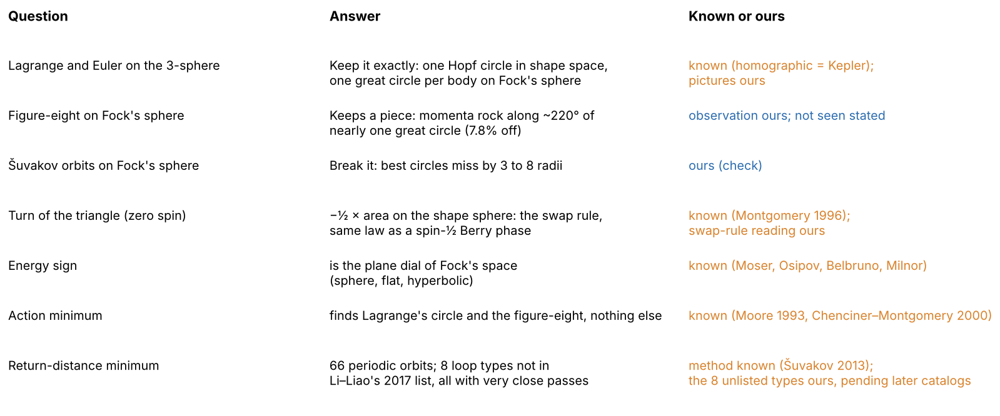

*Figure 11. Each question, its answer, and whether it is known.*

- **Two different 3-spheres show up, and the special orbits keep both.** One is Fock and Moser's momentum sphere (where a
  Kepler orbit is a great circle). The other is the sphere of all triangles of a given size; Hopf's map folds it onto
  Montgomery's *shape sphere*. Lagrange's triangle and Euler's line keep both exactly: the shape never moves, the
  configuration rides one great circle of S³, and each body's momenta sit on one great circle of Fock's sphere (A1 to A3).
- **The figure-eight keeps a piece.** Its momenta stay within 7.8% of one great circle of Fock's sphere, but rock back
  and forth over about 220° instead of going round (A4). None of the ten other famous orbits we tried comes close; their
  best circles miss by 3 to 8 times their radius (A5).
- **The swap rule runs the three-body problem.** With zero spin, the triangle's net turn after any closed loop on the
  shape sphere is exactly minus half the area the loop encloses: the same law as a spin-½ Berry phase. Checked on 448
  loops to 7 × 10⁻⁵ (B2), and on all 66 periodic orbits we found (E2b). Known (Montgomery 1996); the swap-rule reading
  is ours.
- **Minimums do find orbits.** That is how the figure-eight was first found (Moore 1993, by sliding a braid down in
  action; proved by Chenciner and Montgomery in 2000). Our action search lands on exactly two orbits, Lagrange's circle
  and the figure-eight (D1, D2). A second kind of minimum, how close an orbit comes back to its start, found 66 periodic
  orbits in 6½ minutes; 57 match the published 695-family list (Li and Liao 2017) by their loop type on the shape
  sphere, and **9 orbits of 8 loop types are not in that list** (E1, E2c, E2d). All 9 slalom very close past a collision,
  which is probably why a search tuned for collisionless orbits missed them. We have not checked later catalogs.
- **Is it a lead?** Yes, a modest and concrete one: hunting minimums on the shape sphere turns up real orbits outside
  the main published list, cheaply, and the swap rule tells you for free how much each one turns. It is not a new law.
  The 3-sphere does not solve the three-body problem; it organizes it.

---

## 1. Two 3-spheres

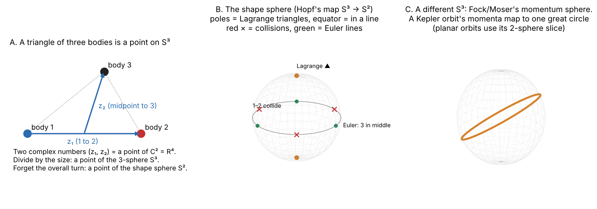

*Figure 1. A: the three bodies as two arrows, z₁ and z₂, which are two complex numbers. B: the shape sphere, where every
triangle shape is one point: the poles are Lagrange's equilateral triangles, the equator is all shapes in a line, the red ×
are the three collisions and the green dots are Euler's three line shapes. C: Fock and Moser's momentum sphere, where a
Kepler orbit is a great circle.*

These are different spheres, and it matters which one we mean.

- **Configuration S³ (Iwai 1987, Montgomery 1996; the shape sphere goes back to Lemaître).** Take the two arrows z₁ (body 1 to body 2) and z₂
  (the midpoint to body 3), scaled by the masses so motion energy is just |ż₁|² + |ż₂|² over two. That is a point of
  C² = R⁴. Divide by the size and you are on the 3-sphere. Turning the whole triangle multiplies both numbers by the same
  e^{iθ}, which moves you along a Hopf circle; forgetting the turn is Hopf's map S³ → S², and the S² is the shape sphere.
- **Momentum S³ (Fock 1935, Moser 1970).** For one body around a centre, stereographic projection of its momentum turns
  every Kepler orbit into a great circle. This is the sphere the hypersphere page used.

## 2. Lagrange and Euler keep both spheres exactly

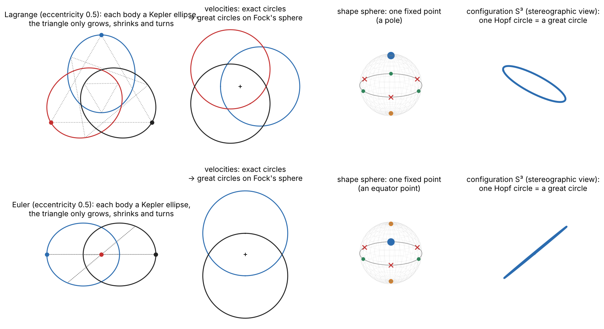

*Figure 2. Top: Lagrange's triangle, eccentricity 0.5. Bottom: Euler's line, body 2 in the middle. Left to right: the orbits
(each body a Kepler ellipse), the velocities (exact circles), the shape sphere (one fixed point), and the configuration
3-sphere seen in stereographic projection (one Hopf circle, which is a great circle).*

- The shape never moves (spread 10⁻¹³; A1): Lagrange sits at a pole, Euler at an equator point.
- The configuration runs along one Hopf circle: |⟨u₀, u(t)⟩| = 1 to 12 digits (A2).
- Each body's velocities lie on one exact circle, so on Fock's sphere they lie on one great circle, with Fock's radius
  p₀ = √(−2E) for that body (A3).

**Why.** A homographic orbit keeps one shape and only grows, shrinks and turns, so it is one Kepler problem in disguise.
**Known** (Lagrange, Euler; Wintner's book). **Ours:** the pictures, and saying which sphere each fact lives on.

## 3. The figure-eight keeps a piece of the momentum sphere

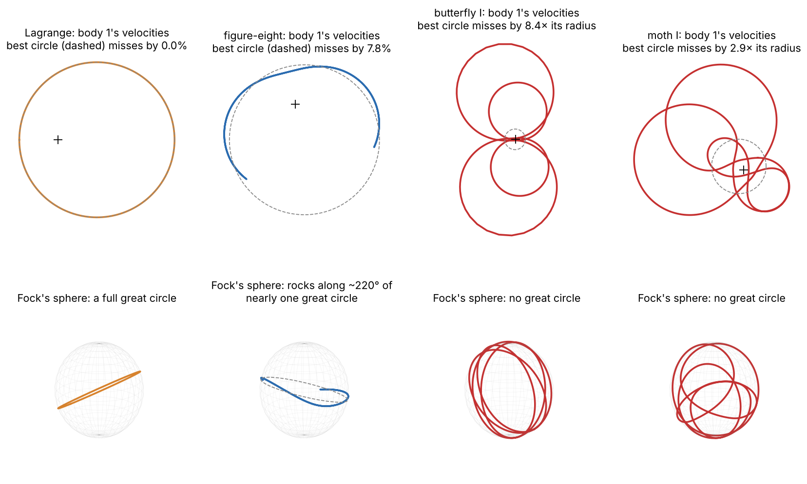

*Figure 3. Top: body 1's velocities with the best-fitting circle (dashed). Bottom: the same velocities on Fock's sphere.
Lagrange: a full great circle. Figure-eight: rocks along about 220° of nearly one great circle (dashed). Butterfly I and
moth I: no great circle at all.*

- **Figure-eight:** the velocities stay within 7.8% of one circle that encloses the origin, but they sweep a 220° arc
  back and forth and never wind round (A4). So on Fock's sphere its momenta stay near one arc of one great circle. All
  three bodies share it, because the figure-eight is a choreography.
- **The others break it:** butterfly I, II, III, moth I, II, III, goggles, dragonfly, yin-yang Ia and Ib miss their best
  circles by 2.9 to 8.5 times the radius (A5). Each of them has close passes, and close passes are where the force is
  far from a single central pull.

**Known or ours?** The figure-eight's nearly circular velocity arc is an observation we have not seen stated. It is a
measurement, not a theorem, and it does not by itself predict anything.

## 4. On the shape sphere, every orbit is a loop

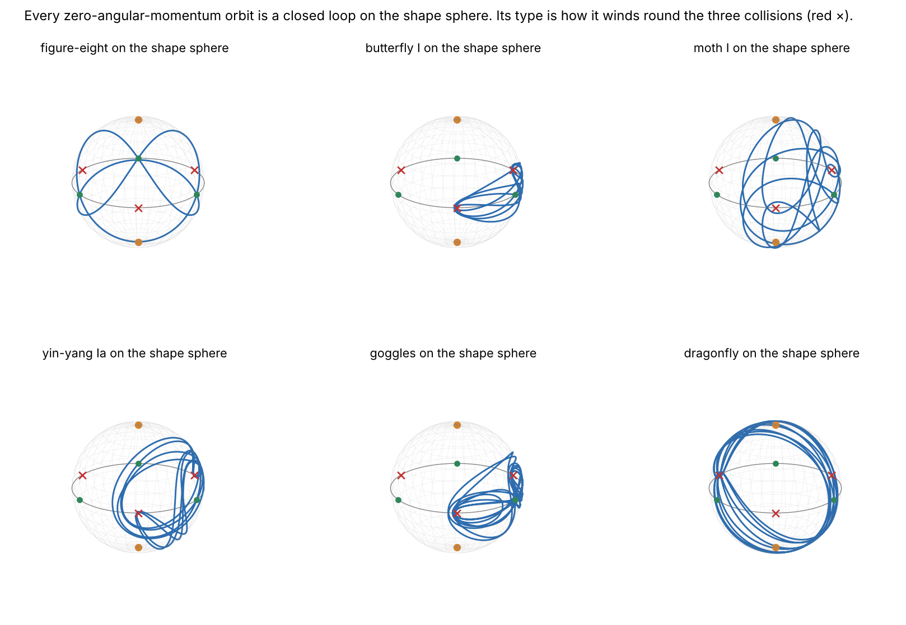

*Figure 4. Six zero-spin periodic orbits drawn on the shape sphere. The type of each loop is how it winds round the three
collisions.*

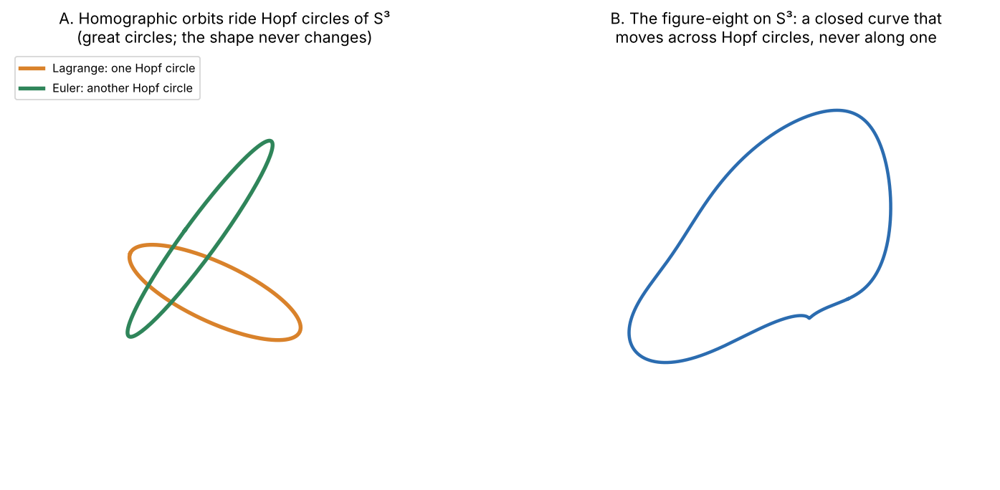

*Figure 5. On the configuration 3-sphere. A: Lagrange and Euler ride Hopf circles. B: the figure-eight is a closed curve
that crosses Hopf circles instead of moving along one.*

The sphere minus three collision points has loops that cannot be pulled tight past a collision, and they are written as
words in two letters a, b (and A, B for going the other way). This is how Montgomery (1998) and Šuvakov and Dmitrašinović
(2013) classify orbits: the figure-eight is abAB. We wrote the code that reads the word off each orbit and tested it on
twelve known orbits: every one matched its published word (figure-eight = I.A1, butterfly = I.A2, moth I = I.B1,
yin-yang = II.C1, bumblebee = I.A17, and so on).

## 5. The swap rule turns the triangle

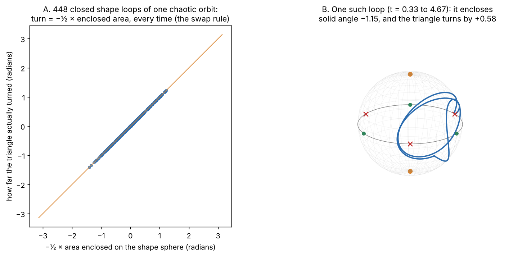

*Figure 6. A: one long chaotic orbit with zero spin returns to the same shape 448 times; each time, the triangle has turned
by exactly −½ × the area its shape loop enclosed. B: one such loop.*

With zero angular momentum the triangle cannot spin on purpose, but it still ends up turned, like a falling cat. The
amount is set by geometry alone:

**turn = −½ × (area enclosed on the unit shape sphere)**

Checked on 448 closed loops to 7 × 10⁻⁵ rad (B2), and on every one of the 66 periodic orbits found below, whose half-area
is a whole number of turns to 10⁻⁸ (E2b), as it must be for an orbit that comes back unturned.

This is the swap rule from the precession page (turn = dial × enclosed area) on a sphere of curvature 1, with the factor
½ that a spin-½ Berry phase also carries. **Known:** Montgomery, "The geometric phase of the three-body problem" (1996).
**Ours:** the identification with the swap rule, which now covers Thomas, Foucault, Berry and the three-body turn.

## 6. The energy is the plane dial of Fock's space

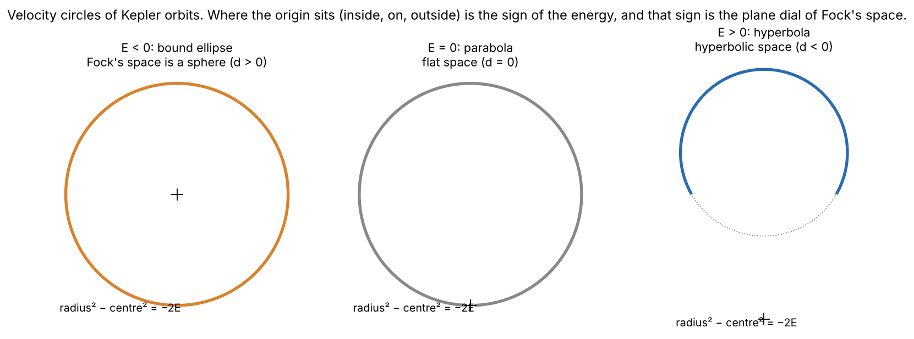

*Figure 7. Kepler velocity circles for negative, zero and positive energy. Radius² − centre² = −2E, so whether the origin
is inside, on or outside the circle is the sign of the energy.*

For bound orbits Fock's space is a sphere, for zero energy it is flat, and for escaping orbits it is hyperbolic (C1). So
the plane dial of the hypersphere page (d = 1/radius²) is **minus the energy**. **Known:** Osipov (1977), Belbruno (1977),
Milnor (1983). **Ours:** saying it in dial terms. For a stronger force (1/r²), Montgomery (2005) proved that at zero
energy (d = 0) the loop types are realized by orbits essentially one for one ("hyperbolic pants"); nothing that clean is known for Newton's law.

## 7. Finding orbits as minimums, kind 1: least action

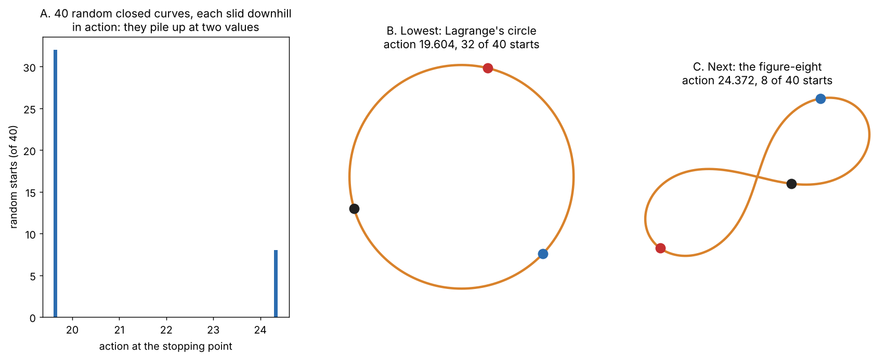

*Figure 8. A: 40 random closed curves, each slid downhill in action (energy of motion minus potential, added up over one
lap), pile up at two values. B: the lowest is Lagrange's rotating circle. C: the next is the figure-eight.*

Brennan's hunch is exactly how the figure-eight was found. Cris Moore (1993) slid braids downhill in action and found it;
Chenciner and Montgomery (2000) proved it exists by minimizing action under its symmetry. Our version: one curve, shared
by all three bodies a third of a lap apart, written with 30 waves, 40 random starts.

- 32 of 40 fall to the lowest action, 19.604: Lagrange's circle (D1). This matches the theorem that the circle is the
  least-action choreography (Barutello and Terracini 2004).
- 8 of 40 fall to 24.372 with zero spin: the figure-eight, which the ODE then confirms (D2).
- Nothing else that is real (D3). For three bodies in a fixed frame, these two are, as far as we know, the only
  choreographies anyone has found (Simó 2000). Rotating frames hold many more (Marchal's P12 family, which joins the circle to the eight; a 2024 paper reports a proof).

**Verdict:** minimum-hunting works, and it rediscovers the known answer. It finds nothing new here.

## 8. Finding orbits as minimums, kind 2: closest return

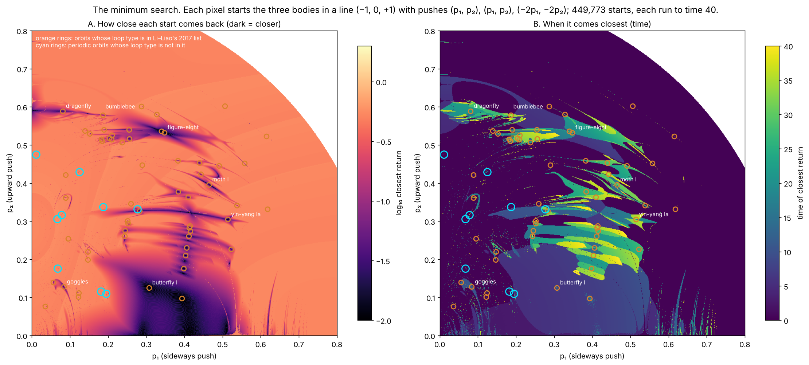

*Figure 9. Every pixel is one start: three bodies in a line at −1, 0, +1, pushed (p₁, p₂), (p₁, p₂), (−2p₁, −2p₂), with zero
spin. A: how close it comes back to its start within time 40 (dark is closer). B: when. Each dark streak hides a periodic
orbit. Orange rings: orbits whose loop type is in Li and Liao's 2017 list. Cyan rings: periodic orbits whose loop type is
not. The cyan ones sit in basins far smaller than a pixel, which is why they look pale here.*

This is Šuvakov and Dmitrašinović's method (2013), and Li and Liao ran it on a 4000 × 4000 grid in 2017, finding 695
families. Ours: a 700 × 700 grid (449,773 starts), each run to time 40 by our own integrator, 6½ minutes on four cores.
We measured the return two ways: plainly, and with the overall turn removed (distance on the shape sphere), which could
catch orbits that come back turned.

- 607 local minima, 230 shot to an exact orbit (return below 10⁻⁸), **66 distinct periodic orbits** (E0b, E1).
- **57 have loop types in the 695-family list** (27 different families, including the figure-eight, butterflies, moths,
  goggles, dragonfly, yin-yang, bumblebee).
- **9 orbits, of 8 loop types, are not in it.** A second integrator (scipy's DOP853) brings each back to within 10⁻⁷, so
  they are real (E2c).
- The turn-free search found nothing extra: every such minimum here shot back to an orbit that returns unturned (E2).

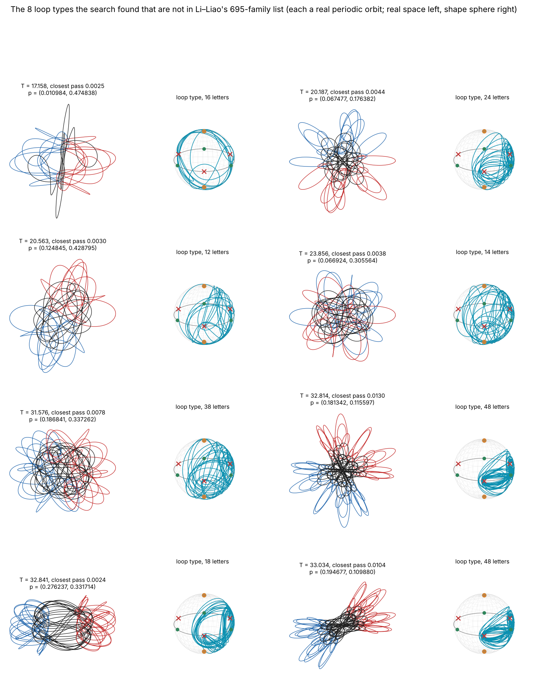

*Figure 10. The 8 unlisted loop types (left: real space; right: the loop on the shape sphere). Periods 17 to 33.*

**What they have in common:** every one passes very close to a collision, between 0.0024 and 0.013 of the starting
spacing, and five of the eight words contain aa or bb, meaning the loop circles one collision twice in a row. Li and Liao integrated in
ordinary double precision first and say they lost orbits to numerical noise, so close-passing orbits are the likeliest to
slip through. **Not checked:** Šuvakov's online gallery, his 2014 "slalom" orbits near the figure-eight, or Liao's later
catalogs. Until we check those, call these "not in the 2017 list", not "new".

## Is it a lead?

1. **Yes, modestly: minimums on the shape sphere find real orbits outside the main published list.** Our cheap search
   found 8 loop types missing from Li and Liao's 695. Worth following because it is concrete and checkable: compare with
   the later catalogs, then push the same search to longer times and other starting lines. It extends a catalog; it does
   not explain the three-body problem.
2. **The swap rule covers the three-body turn.** Known physics, but it joins the precession stream to the three-body
   problem on a geometry we are sure of (the Hopf fibration). Useful for the unified picture, not a new prediction.
3. **The figure-eight's near-great-circle arc.** A clean observation. Worth a short look at whether it is a coincidence
   of how smooth the figure-eight is or a sign of something; we have no reason yet to think it is more.
4. **What does not work:** the 3-sphere does not give a general solution (Poincaré's result stands), and least action in a
   fixed frame finds only the circle and the eight.

## Next (offered, not started)

- Check the 8 unlisted loop types against Šuvakov's gallery and Liao's later catalogs.
- Moore's original idea, aimed at the gaps: list the short loop types (words up to 8 or 10 letters) that no catalog has,
  and slide a loop of each type downhill in action to see which ones hold an orbit.
- The rotating-frame action search, where many more choreographies are known, to see whether the dial (energy sign) sorts
  them.
