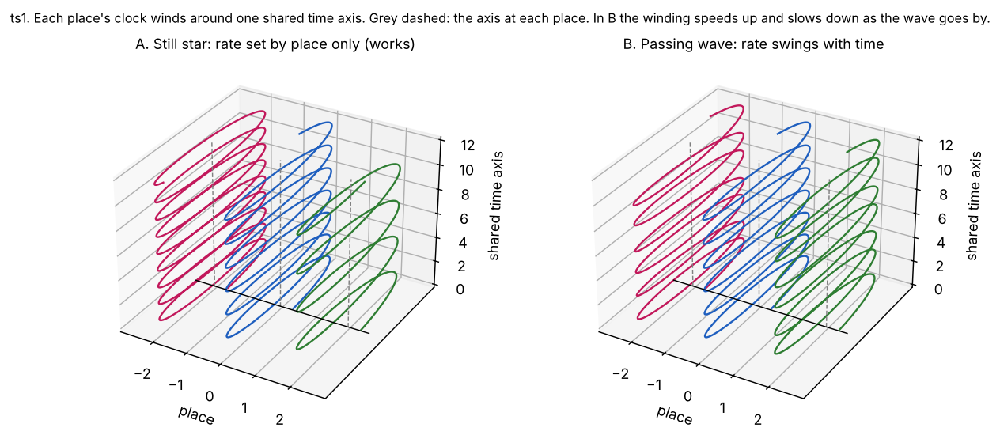
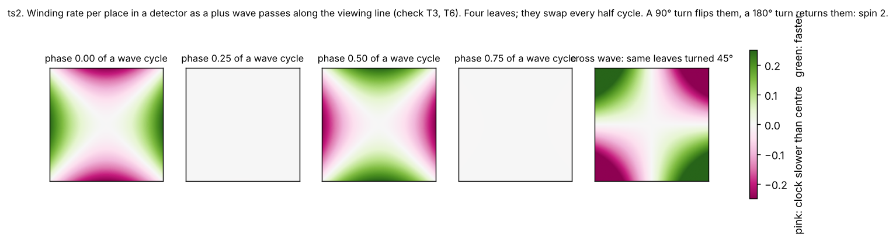
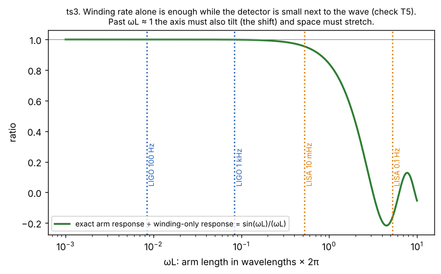
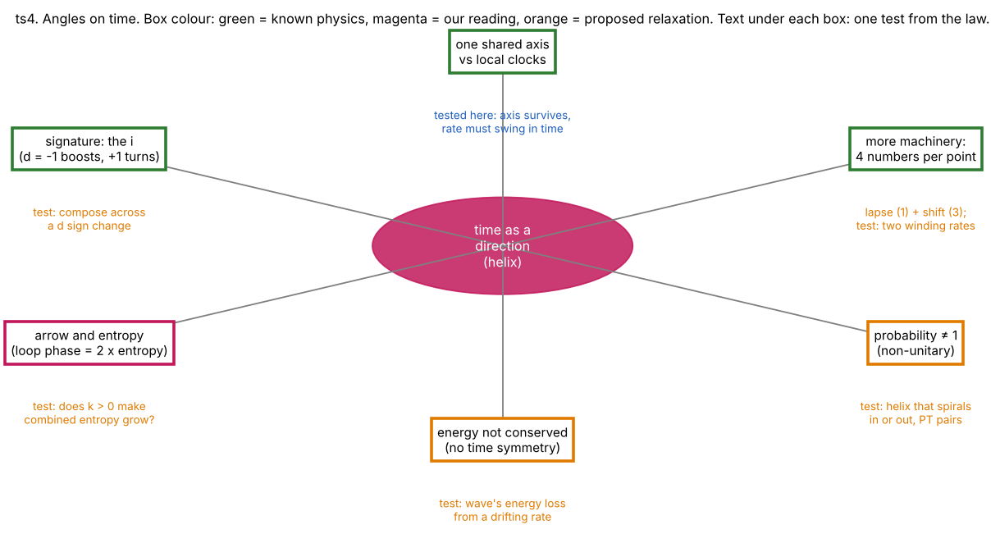

# DRAFT · What time could be: the helix as a direction, and one test against a passing gravitational wave (Nov 28, 2026)

**DRAFT. Not versioned, not proved in Lean, not pushed.** Asked by Brennan on Nov 28: study "all the different angles around what
time could be", the helix as "a direction, a way you could go", and whether one shared time axis still works for something moving:
"if it doesn't, then let's figure out why, 'cause we know it works."

Checks: [`checks.py`](checks.py) → [`checks_output.txt`](checks_output.txt), **8 of 8 pass** (seconds; numpy, sympy), numbers in
[`results.json`](results.json). Pictures: [`figures.py`](figures.py) → [`figures/`](figures/) ts1 to ts4.
Colour key: **green = known physics or derived, blue = numeric check, orange = proposed test or relaxation, magenta = our reading.**

## The result first

**One shared time axis survives a passing gravitational wave. What has to change is that each place's winding rate may change in
time, not only from place to place.** In a small detector the wave is then a four-leaf pattern of faster and slower winding that
swaps every half wave, and that alone carries the wave's whole tidal pull (T3), to within (ωL)²/6 (T5). A winding rate fixed in
time fails completely (T4): that is the exact reason, the wave is not still, and only still spacetimes have one fixed time.
Past ωL ≈ 1 the axis must also tilt from place to place (GR's shift, 3 numbers per point), and space must stretch.

It fits the "helix as a direction, not a thing" reading. How you slice time is a choice: in one slicing (TT) every clock winds at
the same rate and the wave is all in space stretching (T1, T2); in another (the detector's) the wave is all in the winding rate
(T3). Both give the same tidal curvature (T8). So the winding rate itself depends on which way you choose to go; **how the rate
bends from place to place does not.** That is the physical content.

No new dial. The change is in the input (the rate becomes a field over place and time), not in the law. All of this is known GR;
reading the wave as the helix's winding is ours (KNOWN-VS-YOURS K25, K26, U13).

*ts1. Three clocks at three places winding around one shared time axis (grey dashed). A: a still star, each place keeps its own
fixed rate. B: a passing wave, the outer places speed up and slow down in turn while the axis stays put.*

*ts2. The winding-rate field in a detector as a plus wave passes along the line of sight (T3, T6). Pink: clock slower than the
centre; green: faster. The leaves swap every half cycle. Turning the pattern 90° flips it and 180° returns it, which is what spin 2
means. The cross polarization is the same leaves turned 45°, so one rate field carries both polarizations.*

*ts3. How far "shared axis + winding field" alone goes (T5). Ratio of the true arm response to the winding-only response.
LIGO at 100 Hz: off by 0.001%. LISA at 10 mHz: 4.5%. LISA at 0.1 Hz: the picture fails and the axis tilt is needed.*

## The checks

| Check | What it tests | Result |
|---|---|---|
| T1 | TT slicing: rate 1 everywhere, no tilt, masses at rest stay at rest | pass (exact) |
| T2 | yet the light round trip in an arm changes by ½∫h (numeric ray) | pass, error 4 × 10⁻⁴ of signal |
| T3 | detector slicing: N² = 1 − ½ ḧᵢⱼ xⁱxʲ; its pull equals the wave's tidal pull | pass (exact, symbolic) |
| T4 | best winding rate fixed in time over a cycle is zero; misses 100% | pass |
| T5 | winding-only error = (ωL)²/6; LIGO and LISA numbers | pass |
| T6 | spin 2: 90° flips, 180° returns, 45° turns plus into cross | pass |
| T7 | law per place, x = i·v: Re(1 + x∘x) = rate², taking the fastest clock as reference | pass |
| T8 | both slicings give the same tidal curvature R₀ₓ₀ₓ = −½ ḧ₊ | pass (exact) |

T7 note: the law's reading (from `bridges-study/winding-slowdown/`) needs every clock to run at or below a reference. A still star
has one (far away). A wave doesn't, since some clocks run faster than the centre, so the reference is the fastest clock in the
region. That works but is a choice; it is a small seam worth knowing about.

## The map: angles on time

*ts4. The angles, each with one test from the law (orange text). Box colour as in the key.*

| Angle | What it assumes | Known? (who) | One test from the law |
|---|---|---|---|
| **Time as a direction, winding rate per place** | a slicing into moments | known as GR's lapse (Arnowitt–Deser–Misner 1959); helix reading ours | done here |
| **One shared axis vs local clocks** | fixed shared time needs a still spacetime | Killing time; any well-behaved spacetime still has a shared time function (Geroch 1970) | done here: axis survives, rate must swing |
| **More machinery than space** | each point carries 4 time numbers: rate (1) + tilt (3) | ADM 1959; matches Brennan's hunch that time has more properties | give the helix two winding rates (a torus knot) and check it stays stable |
| **Signature and the i** | time ↔ imaginary angle | Wick 1954; signature change, Hartle–Hawking 1983; in the law, d = −1 boosts, d = +1 turns, i flips d | compose the helix across a d sign change and see if the phase stays finite |
| **Arrow and entropy** | low entropy at the start | Past hypothesis; thermal time (Connes–Rovelli 1994); loop phase = 2 × entropy (bridges study) | the scalar law commutes, so no arrow from it alone; check whether k > 0 composition makes coarse-grained entropy grow |
| **Energy not conserved** | drop time-shift symmetry (Noether 1918) | GR has global energy only when still; this wave carries energy off; unimodular/Sorkin Λ already in the repo | let the winding rate drift and compare the loss to the wave energy formula (Peters–Mathews 1963) |
| **Probability ≠ 1** | drop unitarity | PT-symmetric QM (Bender–Boettcher 1998); information loss (Hawking 1976) | feed the law an input off the unit circle so the helix spirals in or out; check PT pairs keep the total |

## Does it open a lead?

Yes, a concrete one. The helix picture works for moving gravity once the winding rate is a field over place and time, and the
frame-free piece is how that rate bends. The next step that follows from this is the tilt: past ωL ≈ 1 the axis has to lean
from place to place, which is the shift and connects to the torsion and frame-drag pages. Testing whether the law can produce that
lean, rather than taking it from GR, is the natural follow-up.
