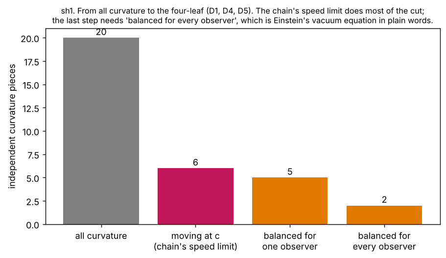
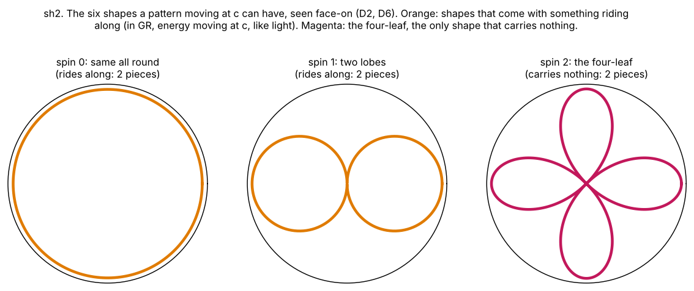
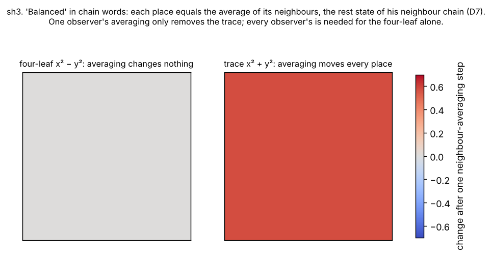

# DRAFT · Can the chain give the four-leaf shape? (Nov 28, 2026)

**DRAFT. Not versioned, not proved in Lean, not pushed.** Follows `../twist/`. Brennan: "Derive the shape" (the four-leaf:
across the direction of travel, and balanced), without the field equations.

Checks: [`checks.py`](checks.py) → [`checks_output.txt`](checks_output.txt), **7 of 7 pass** (symbolic, under a minute).
Numbers in [`results.json`](results.json). Pictures: [`figures.py`](figures.py) → [`figures/`](figures/) sh1 to sh3. Hashes: [`SHA256SUMS`](SHA256SUMS).
Colour key: **green = known, blue = check, magenta = his chain inputs or reading, orange = the missing input.**

## The result first

**The chain gets most of the way, and the one missing input is now pinned down exactly: "balanced for every observer".**

1. **The speed limit does most of the work.** If the pattern moves at c, with all ten metric pieces left free, the curvature
   drops from 20 independent pieces to 6 (D1).
2. **Those 6 come in three spins.** Two are the four-leaf (spin 2). The other four are spin 0 and spin 1 shapes, and every one
   of them comes with something riding along with the wave; in GR that is energy moving at c, like a pulse of light (D2, D6).
3. **Nothing riding along gives exactly the four-leaf:** across the direction of travel and balanced (D3).
4. **Balanced for one observer isn't enough.** It removes 1 of the 4, and the spin 1 pieces survive (D4). **Balanced for every
   moving observer removes all 4 and leaves exactly the 2 four-leaf pieces (D5).**
5. **In chain words:** "balanced" means each place's step equals the average of its neighbours' steps, which is the rest state
   of your neighbour chain from `../tilt` S1. One observer's averaging only fixes the trace (D7); every observer's is needed.

**So the chain alone does not give the shape.** The missing input is one plain statement: a small ball of free clocks keeps its
balance (its volume) for every observer. That statement **is** Einstein's vacuum equation, just said in plain words (Baez–Bunn
2005), so this hasn't removed the field equation. What it shows is that the chain's speed limit already does most of the
cutting, and the field equation's whole job for a wave is to say "nothing is riding along". No new dial.

*sh1. From all curvature to the four-leaf. Grey: all 20 pieces. Magenta: what is left once the pattern moves at c (6). Orange:
balanced for one observer (5), then for every observer (2, the four-leaf).*

*sh2. The six shapes a pattern moving at c can have, face-on. Orange: spin 0 and spin 1, which always come with something riding
along. Magenta: the four-leaf, spin 2, the only shape that carries nothing with it.*

*sh3. One step of neighbour averaging. Left: the four-leaf doesn't change, so it's already balanced. Right: the trace pattern
changes at every place.*

## The checks

| Check | What it tests | Result |
|---|---|---|
| D1 | moving at c, ten metric pieces free: curvature rank 6 of 20 | pass |
| D2 | 4 of the 6 are trace (Ricci) pieces, 2 are trace-free | pass |
| D3 | trace-free means E transverse and balanced: the four-leaf | pass |
| D4 | balanced for one observer leaves 3 trace pieces; E_xz can survive | pass |
| D5 | balanced for 10 random moving observers leaves exactly 2 pieces | pass |
| D6 | four-leaf turns by 2ψ (spin 2); the rest turn by ψ or not at all | pass |
| D7 | neighbour averaging leaves the four-leaf at rest, moves the trace | pass |

## Known and yours

| Item | Status | Who |
|---|---|---|
| Plane-wave curvature: spin 2 (null, type N) plus null matter | known | Pirani 1957; Petrov 1954; null dust |
| Ricci(u,u) = 0 for every observer is the vacuum equation; "a ball of free particles keeps its volume" | known | Baez–Bunn 2005 |
| Harmonic = mean-value (each place = average of its neighbours) | known | Gauss; discrete Laplace |
| Reading "balanced" as the rest state of the neighbour chain, and the chain's speed limit as the main cut | **yours** (a reading; not lit-checked) | Brennan's chain hunch, tested here |
