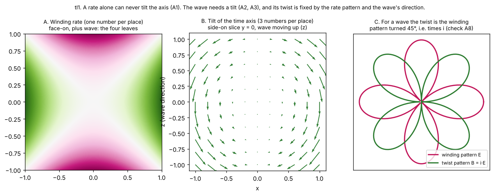
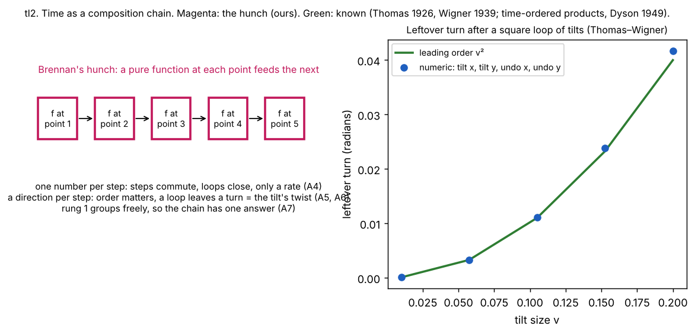
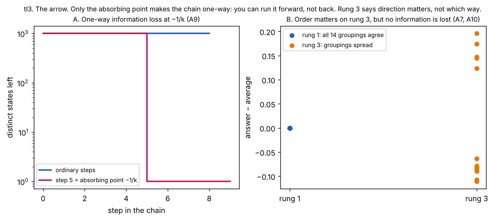
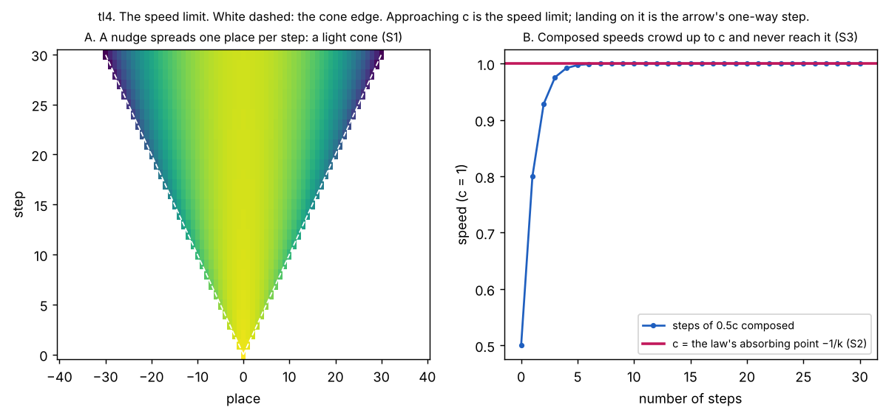

# DRAFT · Can the law tilt the time axis? Time as a composition chain, and where its arrow comes from (Nov 28, 2026)

**DRAFT. Not versioned, not proved in Lean, not pushed.** Follows `../` (the shared-axis test). Asked by Brennan: "Test the tilt";
his hunch: time "is a pure function at each point that sends information to the next input, a composition chain"; and "That also
speaks to times arrow." and "the speed of light also is the speed limit of the composition".

Checks: [`checks.py`](checks.py) → [`checks_output.txt`](checks_output.txt), **13 of 13 pass** (seconds; numpy, sympy). Numbers in
[`results.json`](results.json). Pictures: [`figures.py`](figures.py) → [`figures/`](figures/) tl1 to tl4. Hashes: [`SHA256SUMS`](SHA256SUMS).
Colour key: **green = known GR or derived, blue = numeric check, orange = open, magenta = ours (a reading).**

## The result first

**The law as one number per place can't tilt the time axis, ever (A1). Your chain hunch is exactly what fixes it: when each
point's function carries a direction, composing them in order leaves a turn, and that turn is the tilt's twist (A5, A6).**

1. **Why one number fails.** A winding rate that varies any way in place and time gives zero magnetic curvature (A1). A passing
   wave has magnetic curvature in every slicing (A2), so a rate-only picture must miss it.
2. **What the wave needs.** For a wave the twist is the winding pattern turned 45°, which in complex form is the winding pattern
   **times i** (A8). So the tilt isn't new information: given the rate pattern and the wave's direction, the twist follows.
3. **The chain makes it.** Steps with one number commute, so every loop closes and only a rate comes out (A4). Steps with a
   direction don't commute: tilt along x, then y, then undo both, and you come back turned by about v² (A5, the Thomas–Wigner
   rotation). The law's chain form A∘B = A + B + k·AB is associative and its order gap k[A,B] for two tilts is a pure rotation
   (A6). That chain form is already in `../../torsion-dial/`, so **no new dial**.
4. **Grouping.** Rung 1 gives one answer for all 14 ways to group a 5-step chain; rung 3 doesn't (A7). So a time chain has to be
   built on rung 1 (or anything associative) to have a single "next state".
5. **The arrow.** On rung 1 every step can be undone, except the absorbing point −1/k, which sends every state to the same place
   (1000 states to 1, A9). That makes the chain a function you can run forward but not back: a real one-way direction, the
   information-loss kind (Landauer 1961). Rung 3 makes reading order matter but loses nothing (A10), so it says direction
   matters without saying which way. **So the arrow can come from the absorbing point; non-associativity alone doesn't give it.**

6. **The speed limit.** A chain where each place feeds only its neighbours spreads a nudge exactly one place per step, a
   light cone (S1). The chain fixes that there is a top speed, not its value: it is c only if a place and a step are measured that
   way. And c is the law's absorbing point in other coordinates: velocity addition is the law under a(v) = −2v/(k(1 + v)), and
   light speed lands exactly on −1/k (S2). Composed slower speeds crowd up to c and never reach it; one light-like step lands on it
   and erases what came before (S3). **So the speed limit and the arrow are the same point: approaching it is the limit, landing on
   it is the one-way step.** c is already the d dial (Coleman–McGuinness), so no new dial.

What isn't shown: that the law produces the wave's specific tilt pattern by itself. The twist = i × winding relation comes from
Einstein's equations for a vacuum wave, not from the law. Testing whether the chain, fed the rate pattern and a direction,
reproduces it is the next step.

*tl1. A: the winding-rate pattern of a plus wave (one number per place). B: the tilt of the time axis the wave also needs in the
detector frame, side-on, wave moving up (A3). C: the twist pattern is the winding pattern turned 45°, i.e. times i (A8).*

*tl2. Left: your hunch drawn as a chain of functions, with what each kind of step gives. Right: the leftover turn after a square
loop of tilts, numeric (blue) against the known v² (green).*

*tl3. A: distinct states left as the chain runs. Ordinary steps keep all 1000; one absorbing step collapses them to 1, and nothing
undoes it. B: rung 1 gives one answer however you group the chain; rung 3 spreads, but each step still loses no information.*

*tl4. A: a nudge at the centre spreading through a neighbour-only chain; it fills a cone, one place per step. B: speeds of 0.5c composed again and again approach c (magenta), the law's absorbing point, and never reach it.*

## Known and yours

| Item | Status | Who |
|---|---|---|
| Rate alone has no magnetic curvature; a wave has it; B = i·E for a plane wave | known | linearised GR; Newman–Penrose 1962 (Ψ₄ = E − iB form) |
| Detector-frame tilt g₀ᵢ = −⅔ R₀ⱼᵢₖ xʲxᵏ | known | Manasse–Misner 1963 |
| Tilts in two directions leave a turn | known | Thomas 1926; Wigner 1939 |
| Time evolution as an ordered chain | known | time-ordered products (Dyson 1949); path composition |
| Arrow from information loss | known | Landauer 1961 |
| Top speed in neighbour-only chains | known | light cones in cellular automata; Lieb–Robinson 1972 |
| c ⊕ v = c; velocity addition as multiplication of Doppler factors | known | Einstein 1905; the two-dial law (Coleman–McGuinness 1991) |
| Time as a chain of the law's steps, rung 1 forced by grouping, arrow at −1/k, c as the same point | **yours** (a reading; not lit-checked) | Brennan's hunch, tested here |
