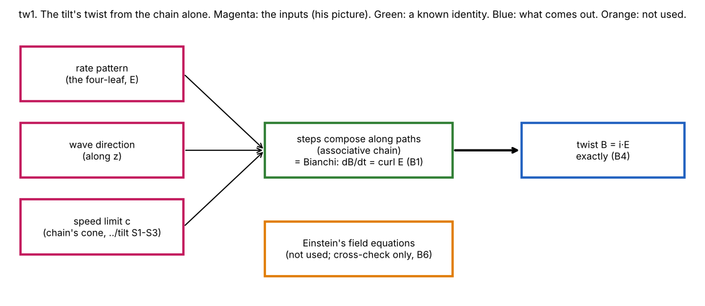
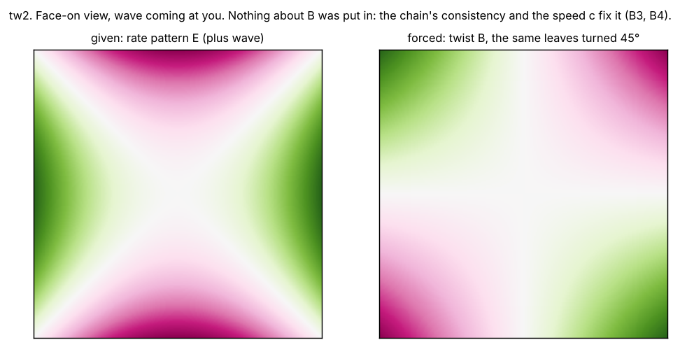
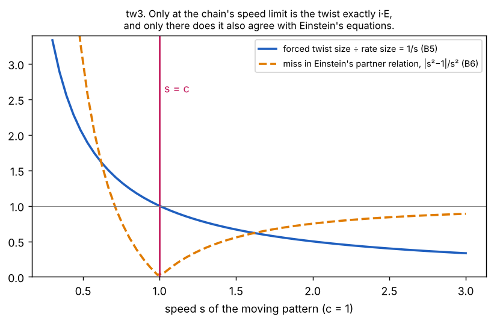

# DRAFT · Does the chain make the wave's tilt by itself? (Nov 28, 2026)

**DRAFT. Not versioned, not proved in Lean, not pushed.** Follows `../tilt/`. Brennan: "Test it" (whether the chain produces the
wave's tilt pattern from only the rate pattern and the wave's direction, without taking twist = i × winding from Einstein's
equations), and "We are so close".

Checks: [`checks.py`](checks.py) → [`checks_output.txt`](checks_output.txt), **7 of 7 pass** (symbolic, sympy; under a minute).
Numbers in [`results.json`](results.json). Pictures: [`figures.py`](figures.py) → [`figures/`](figures/) tw1 to tw3. Hashes: [`SHA256SUMS`](SHA256SUMS).
Colour key: **green = known identity, blue = check result, magenta = his inputs and reading, orange = not used.**

## The result first

**Yes. Give the chain the four-leaf rate pattern, the wave's direction and the speed limit c, and the tilt's twist comes out as
exactly i × the rate pattern. Einstein's field equations are not used.**

1. **The one rule used.** For every metric whatsoever, dB/dt = curl E (B1). This is the Bianchi identity. It says nothing
   about matter or field equations; it only says curvature comes from composing steps along paths. Composing around the faces
   of a small cube has to close up, and that needs the steps to group freely, which rung 1 does (`../tilt` A7). Reading the
   identity as the chain's own consistency is his framing of a known fact.
2. **The tilt is forced.** A four-leaf moving along its direction has curl E ≠ 0, while any pure rate field has curl E = 0
   (B7). So the moving pattern can't sit in the rate alone, and the rule then forces a nonzero twist (B3).
3. **Its size and turn.** Moving at speed s, the forced twist is B = i·E/s (B5). At the chain's speed limit, s = c, it is
   exactly B = i·E, the leaves turned 45°: the same answer Einstein's wave gave in `../tilt` A8 (B4).
4. **Cross-check, not an input.** The other relation, dE/dt = −curl B, is where Einstein's vacuum equations live; it isn't an
   identity (B2). The forced twist satisfies it, and only at s = c (B6). So the chain's answer agrees with Einstein's.

What is still put in by hand: that the rate pattern is a four-leaf across the direction of travel (transverse and traceless).
In GR that shape also comes from the field equations. Deriving the four-leaf shape itself from the chain would close that last
gap. No new dial: nothing here is a parameter of the law.

*tw1. What goes in (magenta), the one identity used (green), what comes out (blue). Einstein's equations (orange) are only a
cross-check.*

*tw2. Face-on, wave coming toward you. Left: the given rate pattern. Right: the twist the chain forces, the same leaves turned 45°.
Nothing about the right panel was put in.*

*tw3. Blue: the forced twist's size relative to the rate pattern, 1/s. It is exactly 1 (twist = i·E) only at s = c. Orange dashed:
how far the result misses Einstein's partner relation; zero only at s = c.*

## The checks

| Check | What it tests | Result |
|---|---|---|
| B1 | dB/dt = curl E for all ten metric pieces arbitrary | pass, identity |
| B2 | dE/dt = −curl B fails for a rate-only field | pass (it fails, as expected) |
| B3 | four-leaf + direction forces B ≠ 0 | pass |
| B4 | at s = c, B = i·E; matches `../tilt` A2 component by component | pass |
| B5 | at speed s, B = i·E/s | pass |
| B6 | partner relation holds only at s = c | pass |
| B7 | moving four-leaf has curl E ≠ 0; any rate field has curl E = 0 | pass |

## Known and yours

| Item | Status | Who |
|---|---|---|
| Bianchi identity; dB/dt = curl E for the Weyl tensor's two halves | known | Bianchi 1902; gravito-electromagnetism (Maartens–Bassett 1998) |
| Bianchi as "loops of loops close" | known | Misner–Thorne–Wheeler 1973, ch. 15 |
| Plane wave has B = n × E | known | standard linearised GR |
| Getting the twist from the chain's consistency plus its speed limit, without the field equations | **yours** (his chain reading; the steps are known, the route is not lit-checked) | Brennan's hunch, tested here |
