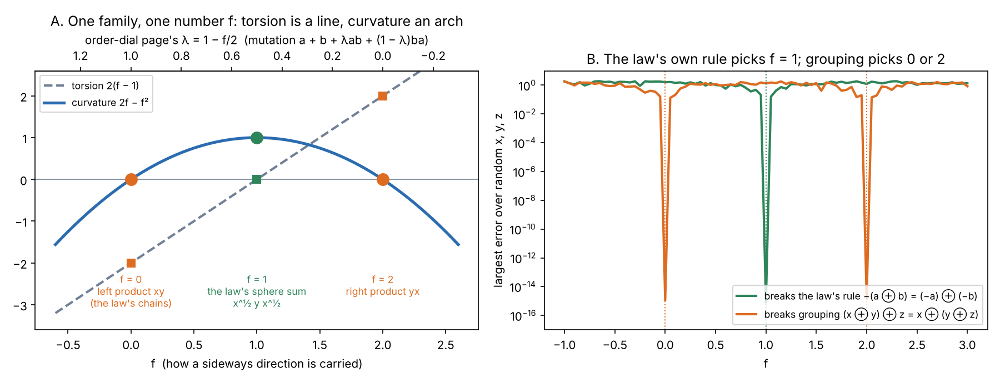
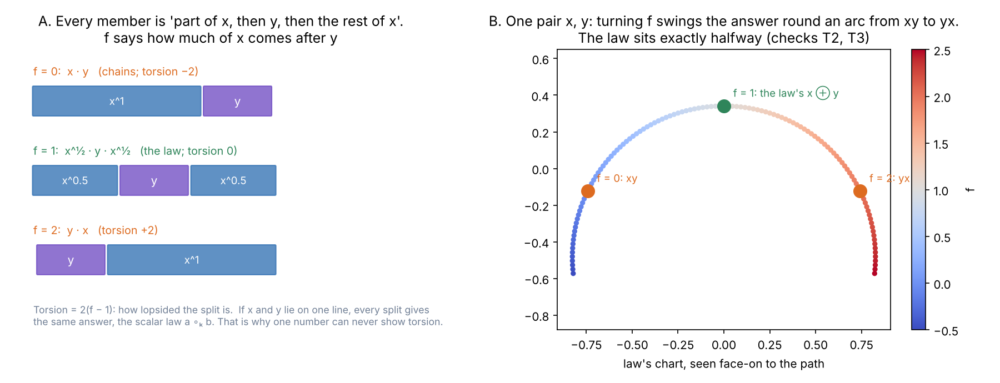
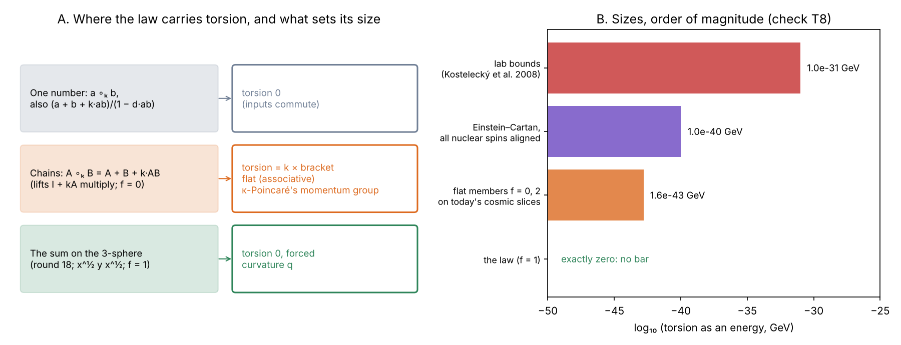

# DRAFT · Torsion: a new dial, or derived?

*DRAFT, Nov 27 2026. Not versioned, not proved in Lean. Asked for by Brennan: "I'd like to take a look at torsion" / "That might be a new dial or a derived property". Builds on forces round 28 (S4), round 25 (K1), `why-i/kappa-poincare/` (K5b), `order-dial/` §3 and the dial audit. Checks: `checks.py` → `checks_output.txt` (**8 / 8 pass**; exact sympy where marked, numeric elsewhere), results in `results.json`. Pictures: `figures.py` → `figures/t1`–`t3`. Colour key: **green = the law's sphere sum (f = 1), orange = plain products and the law's chains (f = 0, 2), blue = curvature, grey dashed = torsion, purple = Einstein–Cartan, red = measured bounds.***

## Verdict first

**Torsion is derived, not a new dial.** It is the law's order gap, a ⊕ b − b ⊕ a, read at second order. Where inputs commute it is zero. Where they don't, the way the law composes them fixes it.

1. **One number can't carry torsion (T5, T7).** The scalar law, the two-dial law (a + b + k·ab)/(1 − d·ab), and any inputs on one line all commute, so their torsion is identically zero. So d never makes torsion.
2. **The law's chains carry torsion, and k sets its size (T7).** A ∘ₖ B = A + B + k·AB multiplies the lifts I + kA. That is the flat, associative member f = 0, and its torsion is k times the inputs' bracket. On the stretch-and-shift chain the order gap is exactly k(ae − bc). This is κ-Poincaré's momentum group, already worked in `why-i/kappa-poincare/` K5b.
3. **The law's sum on the 3-sphere has torsion zero, forced (T3, T4, T5).**
   - Mapped to unit quaternions, the repo's sum is exactly x^½ · y · x^½ (error 1.5 × 10⁻¹⁵), the f = 1 member.
   - Its expansion has no bilinear term at all (exact, any q), so its order gap starts at third order: the twist is curvature, as round 28 found.
   - Its rule −(a ⊕ b) = (−a) ⊕ (−b) holds for f = 1 and for no other member. q only sets the sphere's size; it never moves f.
4. **The in-between values of f are the order-dial page's λ, not a new number of the law (T2, T6).**
   - Each member composes as x ⊕_f y = x^(1 − f/2) · y · x^(f/2): part of x, then y, then the rest of x. f says how lopsided the split is.
   - With λ = 1 − f/2 this is the mutation family a + b + λab + (1 − λ)ba from `order-dial/` §3. Its order gap (2λ − 1) = 1 − f is the torsion line, and its grouping error λ(1 − λ) = (2f − f²)/4 is the curvature arch.
   - f is independent of the seven: no setting of k, d, s, p, t, r or q reaches f = ½, say. But it doesn't count as a dial of the law. It is invisible on any one line, and every value except 0, 1 and 2 breaks both of the law's rules, grouping and the automorphic inverse.

*t1. A: the Cartan–Schouten family on the 3-sphere. Torsion 2(f − 1) is a straight line (grey dashed, squares) and curvature 2f − f² an arch (blue, circles). The law's sum sits at f = 1 (green): torsion zero, curvature at its top. Plain products and the law's chains sit at f = 0 and 2 (orange): flat, with torsion ∓2. The top axis is the same number as the order-dial page's λ. B: measured over random x, y, z (check T5). The law's rule −(a ⊕ b) = (−a) ⊕ (−b) holds only at f = 1 (green dip, 10⁻¹⁵ against 0.16 or more everywhere else on the grid). Grouping holds only at f = 0 and 2 (orange dips). No other f keeps either rule.*

*t2. A: what f does, as a picture. Every member is "part of x, then y, then the rest of x". f = 0 puts all of x first (the product xy, the law's chains), f = 2 puts it all last (yx), and f = 1 splits it evenly (the law). If x and y lie on one line every split gives the same answer, which is why the scalar law never shows torsion. B: one pair x, y. Turning f swings x ⊕_f y round an arc. xy and yx (orange) sit symmetrically and the law's own sum (green) sits exactly at the top (checks T2, T3).*

**Does it couple to spin, as in Einstein–Cartan? (T8)**
- Einstein–Cartan doesn't treat torsion as a free number either. Its Cartan equation is algebraic: torsion equals 8πG/c⁴ times spin density, so it is zero in empty space. That matches the law's f = 1.
- Inside spinning matter, matching Einstein–Cartan would need f − 1 to be proportional to spin density times the slice's radius. f would then be a field set by matter, with Einstein–Cartan's coupling. The law adds no number to that coupling (round 28's C4 answer, here with the reason).
- Sizes, order of magnitude: nuclear matter with every spin aligned gives about 10⁻⁴⁰ GeV, and the flat members on today's cosmic slices give 1.6 × 10⁻⁴³ GeV. Both are far below the ~10⁻³¹ GeV lab bounds.

*t3. A: where the law carries torsion. One number: none, because inputs commute. Chains (lifts multiply, f = 0): torsion k times the bracket, no curvature; this is κ-Poincaré. The sum on the 3-sphere (f = 1): torsion forced to zero, curvature q. B: sizes on a log scale of energy (check T8, order of magnitude). The law's torsion is exactly zero, so it has no bar.*

**Does this open a lead?**
- **No, on its own merits.** Torsion isn't a free parameter anywhere in the theory. It is zero where inputs commute, k on the chains and zero on the sphere sum. The only continuous version, f, is the mutation λ that `order-dial/` §3 already set aside because it breaks grouping. Here it also breaks the law's automorphic inverse.
- **It gives no prediction.** Nothing in the law picks a value for an in-between f, and Einstein–Cartan already fixes spin–torsion coupling with numbers the law doesn't change.
- **What it does give is a tidier map.** Three earlier results turn out to be one picture: round 28's "twist is curvature", κ-Poincaré's torsion (K5b) and the order-dial mutation family. They are the f = 1, f = 0 and in-between members of one family.
- **What would make f a dial:** a reason inside the law to split x unevenly around y, which means giving up both grouping and the automorphic inverse. Nothing in rounds 1 to 28 supplies one. Left–right handedness is the obvious place to look, since f < 1 and f > 1 are mirror images, but round 5's index argument already shows torsion alone can't make net handedness.

## What the checks show

| Check | What it tests | Result |
|---|---|---|
| T1 | Cartan–Schouten family on the 3-sphere | torsion 2(f − 1), curvature 2f − f², same straight lines for every f (exact) |
| T2 | each member as a composition | geodesic loop = x^(1 − f/2) y x^(f/2), error 8 × 10⁻¹³ (60 random x, y, f) |
| T3 | the repo's sphere sum | = x^½ y x^½, error 1.5 × 10⁻¹⁵ (500 pairs); xy, yx miss by 1.4; any q is a rescale (5 × 10⁻¹⁵) |
| T4 | torsion as second-order order gap | law's bilinear term exactly 0 for any q; members' gap (1 − f)[X, Y], error 7 × 10⁻⁸ |
| T5 | which members keep the law's rules | automorphic inverse only at f = 1; left inverse at every f; grouping only at f = 0, 2; on one line all f agree |
| T6 | f = order-dial λ | λ = 1 − f/2; mutation gap (1 − f)[a,b] and grouping error (2f − f²)/4 [b,[a,c]] (exact); members' associator (2f − f²)/8 [[X,Y],Z] (relative error 3 × 10⁻³, the O(ε) step) |
| T7 | torsion on the law's chains | stretch-and-shift gap k(ae − bc), associative; quaternion gap 2k(a × b); two-dial law commutes (exact) |
| T8 | against Einstein–Cartan and bounds | ~1 × 10⁻⁴⁰ GeV (aligned nuclear spins), 1.6 × 10⁻⁴³ GeV (flat members, cosmic slices), bound ~10⁻³¹ GeV |

## How it's computed

- **T1.** Left-invariant frame with [e_a, e_b] = 2ε_abc e_c (as rounds 25 and 28). Torsion T(X,Y) = ∇_X Y − ∇_Y X − [X,Y]; curvature R(X,Y)Z = ∇_X∇_Y Z − ∇_Y∇_X Z − ∇_[X,Y] Z; sectional curvature ⟨R(e₁,e₂)e₂, e₁⟩.
- **T2.** Parallel transport along exp(tX) in the left trivialisation solves y′ = −(f/2)[X, y] (integrated with scipy to 10⁻¹²); then step straight from x. Compared with x^(1 − f/2) y x^(f/2) from matrix logarithms in SU(2).
- **T3.** The repo's 3D sum and chart, unchanged from rounds 18 and 25, mapped to quaternions by inverse stereographic projection; compared up to the sign ±1 of SU(2).
- **T4.** For the law: sympy, a → s·a, b → t·b, coefficient of st, and a ⊕ b − b ⊕ a expanded to second order. For the members: mixed second differences of log(x ⊕_f y), antisymmetrised (the relative-locality reading of torsion).
- **T5.** 81 values of f from −1 to 3, 8 random triples each.
- **T6.** Sympy with non-commuting symbols for the mutation family; the members' associator from log coordinates at ε = 10⁻³.
- **T7.** Sympy for the stretch-and-shift chain (a, c) ∘ₖ (b, e) = (a + b + kab, c + e + kae) and for the two-dial law; numeric for quaternions.
- **T8.** κ = 8πG/c⁴; torsion ≈ κ·ħc·n/2 with n = 0.16 fm⁻³, every spin aligned (an order-of-magnitude upper case, factors of order one not tracked). Flat members: 2ħc/a₀ with round 27's a₀ ≥ 2.51 × 10²⁷ m.

## Textbook and ours

| Claim | Status | Source |
|---|---|---|
| The family ∇_X Y = f[X,Y]/2; f = 0, 2 flat with torsion, f = 1 Levi-Civita | **Textbook** | Cartan and Schouten 1926; a one-parameter family through all three is Akivis's |
| Geodesic loops of a connection; on a symmetric space the loop is the "square-root" product | **Textbook** | Kikkawa 1964; Loos 1969; Sabinin, *Smooth Quasigroups and Loops* (1999) |
| Torsion = non-commutativity, curvature = non-associativity of a composition law | **Textbook** (loop theory; in physics, relative locality) | Akivis; Sabinin; Amelino-Camelia, Freidel, Kowalski-Glikman and Smolin 2011 |
| κ-Poincaré momentum group: flat, torsion set by 1/κ | **Known** | Majid and Ruegg 1994; repo `why-i/kappa-poincare/` K5b |
| Quasi-associative (mutation) algebras | **Textbook** | repo `order-dial/` §3 |
| Einstein–Cartan: torsion fixed algebraically by spin density, zero in vacuum | **Textbook** | Kibble 1961; Sciama 1962; Hehl, von der Heyde, Kerlick and Nester, Rev. Mod. Phys. 48, 393 (1976) |
| Lab torsion bounds ~10⁻³¹ GeV | **Textbook** (measured) | Kostelecký, Russell and Tasson, PRL 100, 111102 (2008) |
| The closed form x ⊕_f y = x^(1 − f/2) y x^(f/2) for every f | **Elementary; not found written** in what we searched (the ends and the middle are textbook) | |
| The repo's 3-sphere sum is exactly x^½ y x^½ | **Ours** (bookkeeping of a textbook fact) | |
| f = order-dial λ; the law's chains are f = 0 with torsion k; the sphere sum's rule pins f = 1; so torsion is derived | **Ours** (bookkeeping) | |

The prior-art audit (`../forces-as-curvature/prior-art-audit/README.md`) already places the one-law physics programme in print (Nesterov and Sabinin 2000) and notes that relative locality reads torsion off a composition law. Nothing here changes that: this page sorts where the theory's torsion sits, and none of it is new physics.

## For the dial map (Brennan's call)

If wanted, `DERIVED-DIALS.md` could gain one row: **torsion: derived. The law's order gap at second order; zero where inputs commute, k × bracket on chains, zero on the sphere sum; its continuous form is the order-dial mutation λ = 1 − f/2.** Not added here.

## What this doesn't do

- **It doesn't cover non-group shapes.** The 3-sphere (q > 0) is a group; the open slices (q < 0) are not, so there the Cartan–Schouten family doesn't apply as stated. The law's hyperbolic sum has the same automorphic inverse and no bilinear term, so its torsion is zero too, but the f family there wasn't built.
- **It doesn't prove anything in Lean.**
- **T8 is order of magnitude**, with the spin density as an upper case.

## Files

- `README.md` (this page)
- `checks.py` → `checks_output.txt`, `results.json`
- `figures.py` → `figures/t1_torsion_dial.png`, `figures/t2_split.png`, `figures/t3_where_torsion.png`
