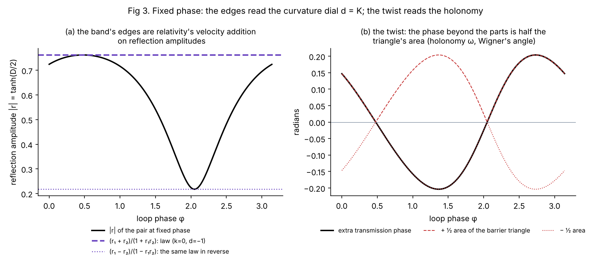
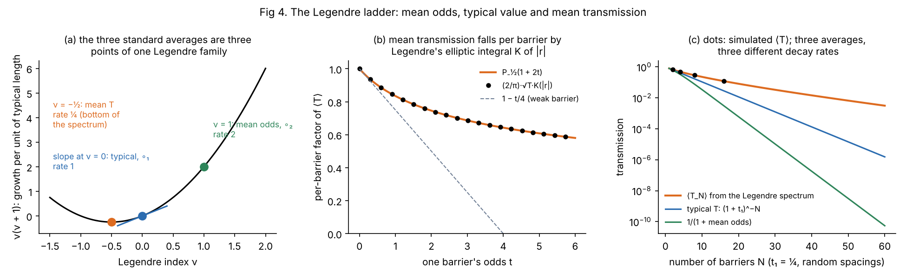
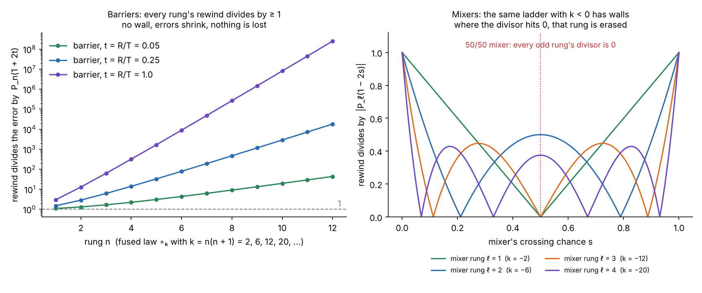
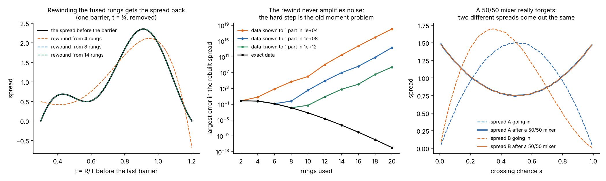
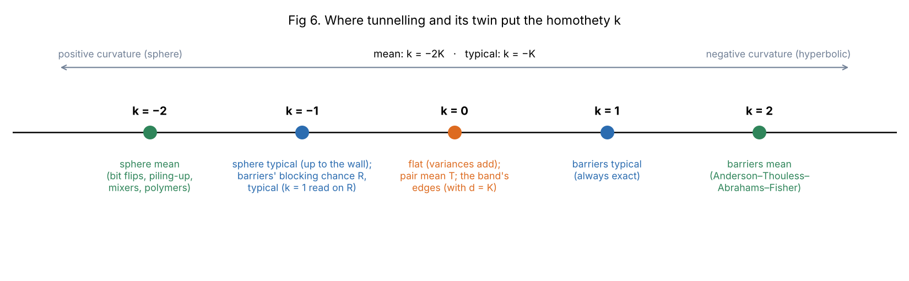

# DRAFT · Tunnelling, worked up with our own tools

> **Names:** some words or symbols on this page (fused, rung, wall, twist) also mean something else in standard math, physics or computing, or inside this project. [NAMING-COLLISIONS.md](../../NAMING-COLLISIONS.md) says which meaning is in play.

Nov 26, 2026. Brennan asked to work on the tunnelling lead that `closed-leads-fresh-look/` (F4) reopened, and to
explore it freely: "just trying out the model and maybe seeing if there's anything that comes of it".
Checks: `checks.py` → `checks_output.txt`, **37/37 pass**; rewinds: `rewind_checks.py` → `rewind_checks_output.txt`,
**14/14 pass** (numpy, scipy, mpmath, sympy; key laws polished to 30
digits). Pictures: `figures.py` → `figures/`. Lean: `lean/Tunnelling.lean`, 10 polynomial identities (3 added with the rewind), compiled in the shared library as
`FusedAlgebra.Topics.Tunnelling` (as written).

## What came out, in one paragraph

A barrier is a **boost of our dial**: its reflection amplitude is twisted-boosts' half-velocity, with curvature −1.
Its lossless cousin, a two-mode mixer (beam splitter, Rabi pulse, polarizer), is the same thing on the sphere,
curvature +1. Once you see that, one interference of two paths gives **three arithmetics at once**: at a fixed phase
the amplitudes compose by our (k = 0, d = K) law and pick up a twist equal to half the triangle's area; averaged
over the phase, probabilities compose by ∘ₖ with **k = −2K**; and the log-average picks the stronger path exactly,
which is the tropical (max) arithmetic. On the sphere that last law has a **wall** at s₁ + s₂ = 1; in the hyperbolic
plane it has none, which is why "blocked" glues by ∘₋₁ exactly along any chain of barriers. Two more things fell
out: the mean transmission of a chain falls per barrier by **Legendre's elliptic integral K of the reflection
amplitude**, and **a barrier keeps everything**: the full spread rewinds exactly on a ladder of fused laws ∘ₖ with
k = n(n + 1), none of which ever has a wall, while a 50/50 mixer erases half that ladder for real.

---

## 1. One law, three curvatures

**Fig 1.** Two steps of lengths D₁, D₂ meeting at angle φ, on a sphere, a flat plane and the hyperbolic plane.
Average the third side over φ. The squared half-chord t = (1 − cos √K·D)/(2K) composes by ∘ₖ with k = −2K: ∘₋₂ on
the sphere, plain addition on the flat plane, ∘₂ in the hyperbolic plane.

- **A barrier is a dial boost (1.1, 1.2).** Every delta barrier's transfer matrix is B₋₁(u) times a phase, where
  B_q(u) = [[1, u], [−q ū, 1]] is the boost from `twisted-boosts/` and u is the reflection amplitude. So
  |u| = tanh(D/2) is a half-velocity, and the odds t = R/T are its flip, |u|²/(1 − |u|²).
- **The mean law, every curvature (4.1–4.4).** Averaging the law of cosines over the angle makes the cos φ term
  vanish, and what is left is ∘ₖ with k = −2K, exactly, for every K tested (−2, −1, −0.3, 0, 0.5, 1).
  - K = −1: t is the barrier's odds R/T and the law is ∘₂, the mean-resistance rule.
  - K = 0: t = D²/4 and the law is plain addition, the rule that variances of independent steps add.
  - K = +1: t is a mixer's switch probability s and the law is ∘₋₂. In bias form, 1 − 2s multiplies. That is the
    rule for independent bit flips, and the piling-up lemma of cryptanalysis. It is also the freely rotating chain
    of polymer physics, where bond correlations multiply.
- **Only the sign is physics (4.5).** Rescaling lengths changes K and k together, so at d = 0 only the sign of k
  carries meaning. That is F1's "k alone: only the sign survives", now with a reason: the sign is the curvature's.
- **Known versus ours.** The averages are classical (each field has its own: Anderson, Thouless, Abrahams and
  Fisher 1980 for barriers; Matsui 1993 for the piling-up lemma; Flory for the freely rotating chain). The barrier
  as an SU(1,1) element and a Lorentz-type boost is known (Monzón, Sánchez-Soto and coauthors, multilayer optics).
  **Ours:** one formula, k = −2K, that puts all four on the homothety dial, and the identification of the barrier
  with twisted-boosts' B_q at q = −1.

## 2. One interference, three arithmetics

**Fig 2.** (a) Two paths with a random relative phase. The mean of |A + Be^(iφ)|² is |A|² + |B|² (green). The mean
of its log is exactly ln max(|A|², |B|²), with a corner (blue on the dashed line). (b) Two mixers: whichever of
stay–stay or switch–switch is likelier sets the typical stay probability; the two tie on the red wall s₁ + s₂ = 1.
(c) Two barriers over the loop phase: the pair's odds (black) and the three averaged laws.

- **The log-average is the max, exactly (5.1).** ⟨ln|A + Be^(iφ)|²⟩ = ln max(|A|², |B|²). This is Jensen's formula
  (1899). Read in our terms: averaging over the phase sends the quantum arithmetic (amplitudes) to the classical one
  (probabilities add, the mean), and the log of it to the tropical one (max). The semiring audit had the tropical
  arithmetic only as the cold end of a limit; here a random phase produces it with no limit at all.
- **Mixers: the typical law has a wall (5.2, 5.3).** ⟨ln(1 − s)⟩ = ln max((1 − s₁)(1 − s₂), s₁s₂). Below the wall
  s₁ + s₂ = 1 the stay probability multiplies, which is ∘₋₁ on s. Above it, the typical stay probability is the
  product of the two switch probabilities: two switches make a stay. The wall is where plain addition reaches 1,
  because (1 − s₁)(1 − s₂) − s₁s₂ = 1 − s₁ − s₂ (Lean `sphere_paths`).
- **Barriers: no wall, so ∘₁ is exact forever (5.5, 5.6).** The direct path always outweighs the double reflection,
  since (1 + t₁)(1 + t₂) > t₁t₂ (Lean `hyperbolic_direct_wins`). So ⟨ln(1 + t)⟩ adds at every barrier, for any
  earlier history, and "blocked" glues by ∘₋₁ exactly along any chain (checked on six different barriers). This
  is the cleanest answer yet to why the old T1 test found ∘₋₁ only approximately: it never averaged the phase.
- **The pair's mean transmission is ∘₀ in both worlds (6.1–6.3).** Barriers: 1/⟨T⟩ − 1 = t₁ + t₂. Mixers:
  ⟨1/(1 − s)⟩ = 1/|1 − (s₁ + s₂)|, which blows up on the same wall. One identity gives both (Lean `pair_identity`).
- **Known versus ours.** Jensen's formula and the phase averages are known. **Ours:** reading the three averages as
  the three arithmetics of one interference, and the wall on the sphere as the reason the hyperbolic law is exact.
  We did not find the mixer wall stated as such, but it is a two-line consequence of Jensen, so it may well be in
  print somewhere.

## 3. Fixed phase: the edges read d, the twist reads the holonomy

**Fig 3.** (a) The pair's reflection amplitude as the spacing changes. Its top edge is (r₁ + r₂)/(1 + r₁r₂), our
(k = 0, d = −1) law, relativity's velocity addition; the bottom edge is the same law run in reverse. (b) The pair's
transmission phase minus each barrier's phase and the propagation phase (black) sits on ± half the area of the
barrier triangle (red).

- **Edges (2.1–2.4).** Barriers: the extreme amplitudes are the (k = 0, d = −1) law on |r| = tanh(D/2). Mixers: the
  extreme tan(θ/2) is the (k = 0, d = +1) law, tangent addition. In both, the curvature reading −Δ/4 = d equals the
  curvature of the geometry, sign included.
- **Twist (3.1, 3.2).** The extra transmission phase is ± half the hyperbolic triangle's area for barriers and ± half
  the spherical triangle's area for mixers, to 1e-14. That is twisted-boosts' holonomy ω = q × area, with the phase
  of X + iY equal to ω/2.
- **Known versus ours.** Known: Wigner's angle as a geometric phase in multilayer stacks (Monzón, Sánchez-Soto and
  coauthors, around 2001), Pancharatnam's phase on the sphere, and Ungar's gyrogroups. **Ours:** that the same dial
  boost B_q covers relativity, multilayers and beam splitters, with q read as the curvature.
- **One honest wrinkle for the design rule.** The edge laws read the curvature through d (K = d). The averaged laws
  sit at d = 0 and read it through k (K = −k/2). The reading −Δ/4 of an averaged law is −k²/4, which is −1 for both
  ∘₂ and ∘₋₂. So for the averaged laws the reading has the right size but loses the sign; the sign lives in k. This
  is not a contradiction (the reading belongs to the law's own conic, not to the geometry it averages over), but it
  is worth a sentence wherever the curvature reading is defined.

## 4. The Legendre ladder, and Legendre's K

**Fig 4.** (a) Each Legendre function P_ν(1 + 2t) multiplies on average and grows at rate ν(ν + 1) per unit of
typical length. The mean odds are ν = 1 (rate 2), the typical value is the slope at ν = 0 (rate 1), and the mean
transmission sits at ν = −½ (rate ¼, the bottom of the hyperbolic plane's spectrum). (b) The per-barrier factor of the
mean transmission, P₋½(1 + 2t), equals (2/π)·√T·K(|r|) (dots). (c) Mean transmission from the Legendre spectrum
(orange) against simulated chains (dots), with the typical and mean-odds curves for comparison.

- **One family (8.1, 8.2).** ν = 1 gives ∘₂; the slope in ν at ν = 0 is ln(1 + t), so ∘₁ is the same family's
  first derivative.
- **Mean transmission (8.3–8.6).** T = 2/(1 + z) has Mehler–Fock coefficient 2π/cosh(πλ), so after N identical
  barriers ⟨T⟩ = ∫ λ tanh(πλ)·2π/cosh(πλ)·P₋½₊ᵢλ(1 + 2t₁)ᴺ dλ; it matches the simulations at N = 2, 4, 8. At large
  N the decay per barrier is P₋½(1 + 2t₁) = (2/π)·√T₁·K(|r₁|), Legendre's complete elliptic integral of the first
  kind with modulus equal to the reflection amplitude, with the usual N^(−3/2) in front.
- **Rates 2, 1, ¼ (8.7).** For weak barriers the mean odds run twice as fast as the typical value (the ratio of their
  k's), and the mean transmission a quarter as fast. The ¼ is the bottom of the spectrum of the curvature −1 plane.
- **Known versus ours.** Known: the product formula, Mel'nikov's equation (1981), the continuum mean transmission
  with its e^(−s/4), and Ng and Englert's Legendre-function treatment of phase disorder (2013, arXiv:1212.1951; we
  could not confirm whether they write the per-barrier factor as an elliptic integral). P₋½(cosh η) as an elliptic
  integral is a standard identity. **Ours:** reading the three averages as three points of one ladder, and the
  link to the elliptic lead (`closed-leads-fresh-look/` F3): tunnelling reaches Legendre's K through the
  mean transmission, where F3 reached it through Jacobi's addition law.

## 5. Rewinds, done with the fused ladder

Brennan: "Try rewinding using the fused operations" and "The goal of fusing is to keep information". Checks:
`rewind_checks.py` → `rewind_checks_output.txt`, **14/14 pass** (40 digits). Pictures: `rewind_figures.py`.

**The result: a barrier keeps everything.** The spread of a chain's odds is carried, with nothing lost, by a ladder of
fused laws, one per whole rung n. Removing a barrier is each rung's ∘ₖ inverse, and no rung ever has a wall. Mixers
(the sphere) use the same ladder with k < 0, and there the walls are real: a 50/50 mixer erases every odd rung.

**Fig 7.** (a) Removing a barrier with odds t divides each rung's error by P_n(1 + 2t), which is never below 1 and
grows fast up the ladder. (b) For a mixer with crossing chance s the divisor is |P_ℓ(1 − 2s)|, which hits 0: on that
rung the mixer has a wall. At s = ½ every odd rung's divisor is 0.

- **The ladder (1.1, 1.2).** For each whole n let g_n(t) = (P_n(1 + 2t) − 1)/(n(n + 1)), which starts as t + ….
  Adding a barrier with odds t₁ to *any* spread sends ⟨g_n⟩ to ⟨g_n⟩ ∘ₖ g_n(t₁), with **k = n(n + 1) = 2, 6, 12,
  20, …**. Rung 1 is the mean law ∘₂ from Section 1. The homotheties are the hyperbolic plane's Laplacian
  eigenvalues. Checked against an independent 2-D average to 41 digits for n = 1 to 24.
- **The rewind (2.1 to 2.4).** Undo each rung by (G − g)/(1 + k g). The divisor 1 + k g_n(t₁) equals P_n(1 + 2t₁) ≥ 1,
  so there is never a wall and every rung's absolute error shrinks. The spread's two edges rewind by the
  (k = 0, d = −1) inverse on amplitudes, which is relativity's velocity subtraction.
- **Why nothing is lost.** The rungs are a fixed linear mix of the spread's power moments, and a spread on a bounded
  range is fixed by its moments (Hausdorff). So the ladder is a complete record, and the rewind runs on that record
  exactly.
- **Where it gets hard (3.1 to 3.3).** Turning the rewound ladder back into a curve is the classical moment problem.
  With exact data the rebuilt spread converges fast (error 0.15, 7 × 10⁻⁴, 9 × 10⁻⁹, 2 × 10⁻¹⁵ at 6, 10, 16, 24
  rungs). With noisy data the rewind itself still only shrinks the error (by exactly 1/P_n), but the usable number of
  rungs is set by the noise: 4 rungs at one part in 10⁶, 8 at one part in 10¹⁰. That limit belongs to moments, not to
  the barrier.

**Fig 8.** (a) A spread before the last barrier, and the spread rewound from 4, 8 and 14 rungs. (b) Rebuild error
against rungs used: exact data keeps improving; noisy data turns around where the moment problem takes over.
(c) Two different spreads (dashed) go into a 50/50 mixer and come out identical (solid).

- **Mixers forget for real (5.1 to 5.4).** On the sphere h_ℓ(s) = (1 − P_ℓ(1 − 2s))/(ℓ(ℓ + 1)) composes by ∘ₖ with
  **k = −ℓ(ℓ + 1)**, and the divisor P_ℓ(1 − 2s₁) has zeros. A 50/50 mixer zeroes every odd rung: it forgets which
  port the light came in by, so two spreads that differ only in that come out the same. A barrier has no such point.

**Fig 5.** (a) In the oscillating (conical) spectrum one barrier multiplies each component by P₋½₊ᵢλ(1 + 2t₁).
(b) Over complex λ every zero of that factor is on the real line. (c) Single numbers: the mean rewinds by dividing by
1 + 2t₁ for barriers and by 1 − 2s₁ for mixers, which has a wall at s₁ = ½.

- **Correction to the first draft.** It said each barrier erases a comb of spectral components that no rewind can
  restore. That was wrong. A barrier does multiply the oscillating (conical) components by P₋½₊ᵢλ(1 + 2t₁), whose
  zeros are all real (Pólya, still true). But a finite chain's spread sits on a bounded range, so its spectrum is an
  entire function of λ, and its values at those zeros are fixed by the values around them. Nothing is lost there; it
  is only badly conditioned. The ladder and the conical spectrum are the same character P_ν(1 + 2t₁), at whole ν
  (≥ 1, a clean rewind) and at ν = −½ + iλ (≤ 1, oscillating). Fusing picks the coordinates where the rewind is
  clean.
- **Fit with the project.** The Riemann pages found that our exact rewinds are single-number flows. That still holds,
  with a twist: here a whole countable family of single-number flows, one ∘ₖ per rung, carries the full spread. Single
  numbers (9.1, 9.2 in `checks.py`) are rung 1 of it.
- **Known versus ours.** The product rule ⟨P_n⟩ → ⟨P_n⟩ P_n(1 + 2t₁) is the known spherical-function property of the
  hyperbolic plane, and Hausdorff's moment theorem is classical. Reading each rung as our fused law with
  k = n(n + 1), the barrier/mixer contrast as walls on the same ladder, and the correction above are ours.

## 6. The continuum flow picks k

- **The flow (7.1–7.4).** Many weak elements give the flow ∂ₜ t(1 + εt) ∂ₜ with ε = −K. At ε = 1 it is Mel'nikov's
  one-channel equation (DMPK for one channel); at ε = −1, heat flow on the sphere.
- **It keeps exactly two settings.** Among all powers (1 + kt)^α and logs ln(1 + kt), the only exact laws are the
  mean at k = 2ε and the log at k = ε (sympy, Lean `continuum_mean_unique`, `continuum_log_unique`). So the physics
  does not just allow k = 2 and k = 1 for barriers; it forces them, and forces −2 and −1 for mixers.

## 7. Where tunnelling puts the dial

**Fig 6.** The homothety line. Means sit at k = −2K, typical values at k = −K, flat geometry and the pair's mean
transmission at k = 0.

## Leads, judged on their own merits

1. **The dial boost covers barriers and mixers (open, strong).** It joins tunnelling to twisted boosts, relativity and
   the holonomy with no new parts, and it makes predictions anyone can check in a multilayer or an interferometer.
   Next: the three-barrier case, where order matters at fixed phase, read through the order dial's oriented area.
2. **Phase averaging as exact dequantization (open, worth following).** A random phase turns amplitudes into
   probabilities (+) and log-probabilities into max, with no limit taken. This could give the semiring audit a
   physical source, and the wall rule (stronger path flips at a tie) is the kind of thing that carries to other
   areas: interferometers, random networks, and possibly decoding, where the same max appears.
3. **Legendre's K in the mean transmission (open, small).** A clean bridge between tunnelling and the elliptic lead.
   Next: see whether the other conical points of the ladder have similar closed forms.
4. **Rewinds on the fused ladder (open, promising).** Barriers keep the whole spread on rungs ∘ₖ, k = n(n + 1), each
   rewound with no wall; mixers have walls, and a 50/50 mixer erases the odd rungs. This corrects the first draft.
   Next: test the ladder on other averaged processes (random walks on spheres and hyperbolic space, the Riemann
   pages' heat flows) to see whether "fuse on the whole-number characters" is a general way to keep information.
5. **The curvature reading (a note for the design rule).** The averaged laws carry their curvature's sign in k, not
   in −Δ/4. Worth one sentence on the dial pages.

## Inputs and readings

Inputs (base dials and settings): each element's odds t (or switch probability s), the loop phase φ, and the
curvature K of the element's geometry. Readings: the pair's odds, the lengths D, the twist ω, the growth rates, and
the curvature reading −Δ/4 of each law.
