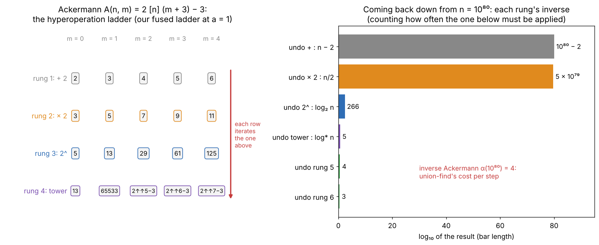
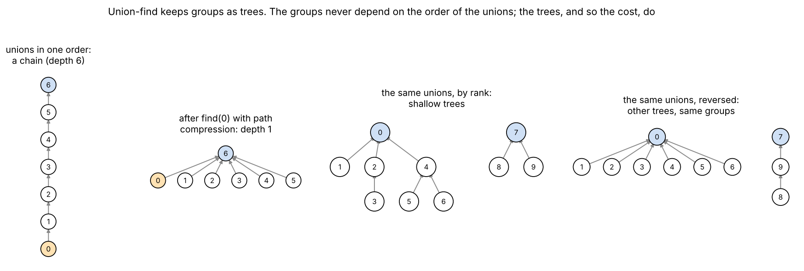
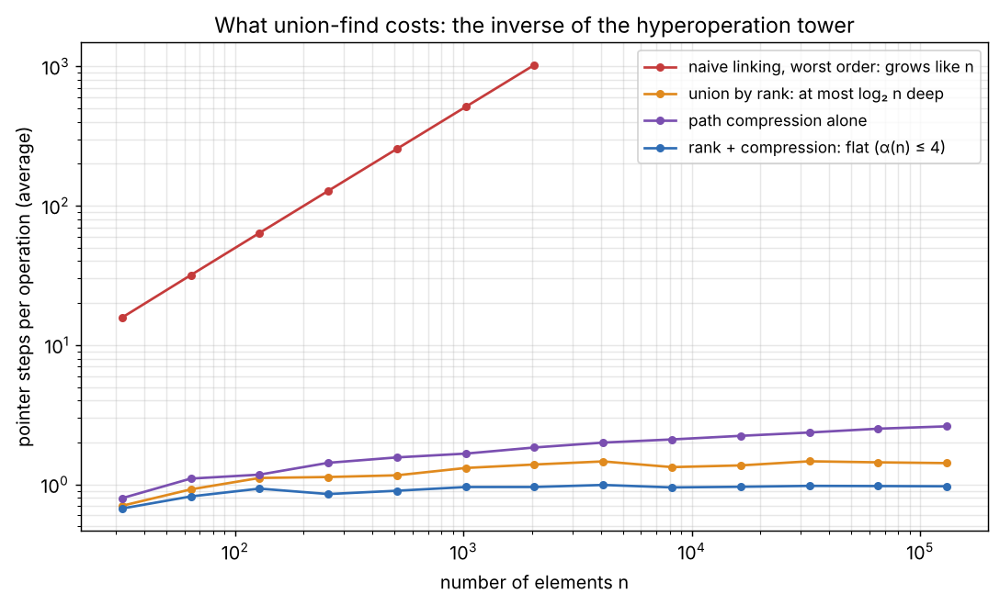
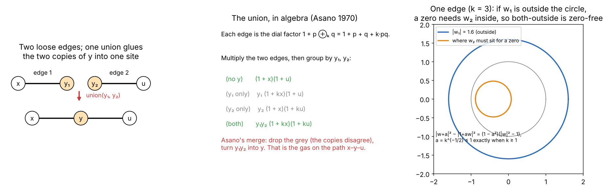
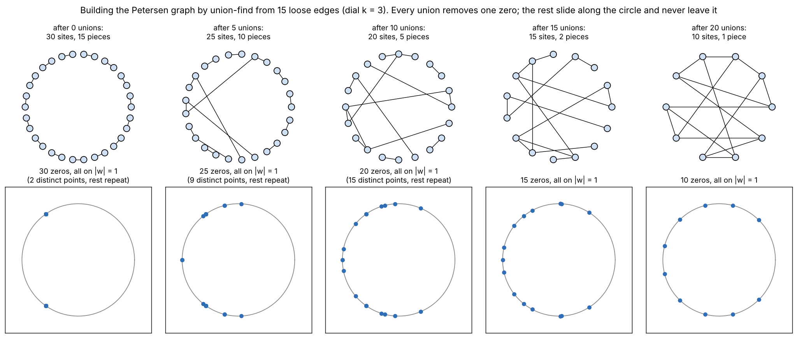
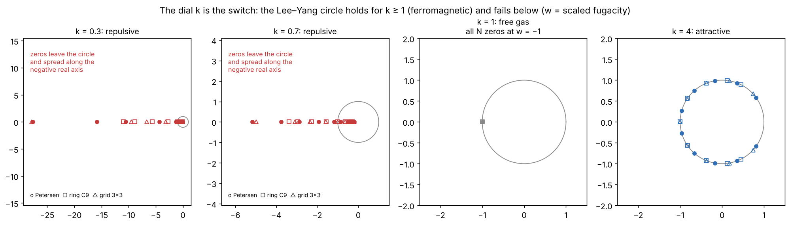
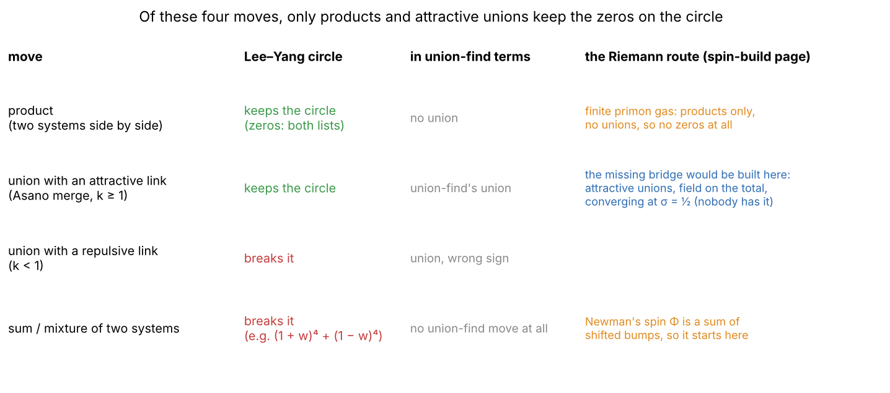

# DRAFT · Union-find, the inverse Ackermann function and the Lee–Yang circle

> **Names:** some words or symbols on this page (⊕, fused, rung, α (inverse Ackermann)) also mean something else in standard math, physics or computing, or inside this project. [NAMING-COLLISIONS.md](../../NAMING-COLLISIONS.md) says which meaning is in play.

**DRAFT, Nov 27 2026.** Part of Affine Composition Theory, built on Fused Hyperoperation Algebra. Follows
[chaos-composition](../chaos-composition/README.md) and the data-structures question. Asked for by Brennan: "Yes" to
studying the union-find and Ackermann link, then "It could be a tool for the yang lee proof", then "Please work on it".
Neighbours: [lee-yang](../lee-yang/README.md) (the dial gas), [hyperoperation-ladder](../hyperoperation-ladder/README.md)
(the rungs), [riemann/spin-build](../riemann/spin-build/README.md) (the Lee–Yang route to RH).

Checks: [`checks.py`](checks.py) → [`checks_output.txt`](checks_output.txt), **22 of 22 pass** (numpy, mpmath, exact
fractions). Code: [`ufcore.py`](ufcore.py). Pictures: [`figures.py`](figures.py) → [`figures/`](figures/). No Lean this
pass.

## The answer first

**Union-find is the bookkeeping of the Lee–Yang proof: Asano's 1970 proof is a run of union steps, and on our dial gas
every step keeps the zeros on the circle exactly when k ≥ 1. The Ackermann link is real but is only about speed, and
none of this supplies the missing step for the Riemann route.**

1. **Union-find's cost is the ladder run backwards.** Ackermann's function is a row of the fused ladder:
   A(n, m) = fused_n(1, m + 2) − 2. Union-find with union by rank and path compression costs O(α(n)) per operation, where
   α undoes the ladder rung by rung. For 10⁸⁰ items, α = 4. Known (Tarjan 1975); the fused-ladder form is ours, and
   trivial.
2. **A union is an Asano merge.** Take the gas edge by edge, with each vertex copied once per edge. One union glues two
   copies of a vertex: keep the terms where the copies agree, drop the rest. Done for every vertex, this rebuilds the
   whole gas. That is exactly Asano's contraction, and its classic use proves the Lee–Yang circle theorem. Known (Asano
   1970, Ruelle 1971); calling it union-find is our reading. One search found nothing that makes the link.
3. **On our dial, the switch is k = 1.** One dial edge 1 + z₁ ⊕ₖ z₂ is the Lee–Yang edge with coupling a = k^(−1/2).
   For k ≥ 1 every union keeps every zero on |w| = 1. At k = 1 it is the free gas (1 + w)^N, and below 1 the zeros leave
   the circle. Lee–Yang for ferromagnets is known; this is it, stated on the dial.
4. **The order of unions doesn't matter, as union-find says.** Ten random union orders give the same final gas, exactly,
   and every intermediate stage also has its zeros on the circle.

**Is it a tool for the Lee–Yang proof?** Yes, as a clean way to run Asano's proof: it says which moves are allowed and
keeps the record free of order. It is not a new proof.

**Is it a tool for the Riemann route?** Not by itself. Of four ways to build a bigger system, only products and
attractive unions keep the circle; sums break it. The finite primon gas uses only products, and Newman's Φ is a sum. The
open step is a family of attractive unions whose limit lands at σ = ½. Union-find tells you which moves that family may
use, but not how to take the limit. **Not a lead toward RH**, though it narrows the search (§6).

## 1. The ladder up and down

*Figure 1. Left: Ackermann's rows A(n, ·) are the fused ladder's rungs at a = 1: add, double, power, tower. Right: the
inverse hierarchy applied to 10⁸⁰. Each α_k counts how often α_(k−1) must be used to reach 1, so it undoes one rung:
α₂ = log₂ gives 266, α₃ = log* gives 5, α₄ gives 4 and α₅ gives 3. The inverse Ackermann α(n) is the least k with
A(k, k) ≥ n, which is 4.*

With fused_n(a, b) = H_n(a + 1, b + 1) − 1, Ackermann–Péter's A(n, m) = 2[n](m + 3) − 3 becomes
A(n, m) = fused_n(1, m + 2) − 2 (checks A1–A2). Each α_k inverts one rung exactly: α₁(2m) = m, α₂(2^m) = m,
α₃(2↑↑m) = m (A3). This hierarchy is Seidel and Sharir's; the fused form adds nothing to its use.

## 2. Union-find: the partition ignores order, the trees do not

*Figure 2. Forty orders of the same 45 unions give one partition (B1) but trees of depth 5 to 11 under naive linking
(B2). The worst order makes a chain of depth n − 1 (B3).*

Union-find answers one question: which items are joined? The answer depends only on the set of unions, not their order.
The trees it builds to answer quickly do depend on order. This is the order dial's pattern again: the result sits on the
order-free side and the cost on the ordered side.

*Figure 3. Pointer steps per operation as n grows. Naive linking on the chain grows like n (63.7 to 511.7 as n grows
eightfold, B6). Union by rank keeps depth below log₂ n (B4). Rank plus path compression stays under 1 step per
operation from n = 2¹⁰ to 2¹⁷ (0.958 to 0.970, B5): α(n) is so flat it can't be seen at this scale.*

## 3. One union, in algebra

*Figure 4. Left: two loose edges x–y₁ and y₂–u, and one union that glues y₁ and y₂. Middle: multiply the two edge factors
and group the terms by y₁ and y₂. Asano's merge drops the two grey terms (the copies disagree) and renames y₁y₂ as y.
What is left is the gas on the path x–y–u. Right: why it keeps the circle. On one edge, if w₁ is outside the circle a
zero needs w₂ inside, so with both outside there is no zero.*

The dial gas is Z = Σ_S z^|S| k^e(S), where e(S) counts edges inside S ([lee-yang](../lee-yang/README.md)). One edge is
1 + z₁ + z₂ + k z₁z₂ = 1 + z₁ ⊕ₖ z₂. Rescale z = w/√k and it becomes 1 + a(w₁ + w₂) + w₁w₂ with a = k^(−1/2), the
standard Lee–Yang edge (C2). Its geometry is one line (C1):

|w + a|² − |1 + aw|² = (1 − a²)(|w|² − 1).

So for a ≤ 1, that is k ≥ 1, the map w ↦ −(1 + aw)/(w + a) sends the outside of the circle inside. That is what makes
"both outside" zero-free. Asano's lemma then says the merge keeps that property. Gluing every vertex's copies gives
Σ_S a^(edges leaving S) w^S, which is the dial gas at z_v = k^(−d_v/2) w_v (C3, checked on a triangle with a tail).

## 4. Building a graph by unions: the zeros never leave the circle

*Figure 5. The Petersen graph built from 15 loose edges (30 vertex copies) by 20 unions, at k = 3. Top: the graph after
0, 5, 10, 15 and 20 unions. Bottom: the zeros of the gas at that stage. Every union removes one zero and the rest slide
along the circle. Largest distance from |w| = 1 at any stage: 1.1 × 10⁻¹⁶ (C8).*

Three more checks fill this out:

- **Many graphs, many k.** For k = 1.5, 3 and 10, on a ring, Petersen, a grid, K₅ and three random graphs, every zero
  has |w| = 1 (C4, with exact counts and 60-digit roots).
- **One circle in z for regular graphs.** With every degree d, |z| = k^(−d/2). For the 4×4 torus (d = 4) at k = 2 that is
  1/4, the lee-yang page's k⁻² (C5).
- **Order doesn't matter.** Ten random union orders build the same final gas on the 3×3 grid, exactly in fractions (C9).

## 5. The dial is the switch

*Figure 6. The same three graphs at four dial values. At k = 0.3 and 0.7 (repulsive) the zeros leave the circle and
spread along the negative real axis, out to about −28 at k = 0.3. At k = 1 every zero sits at w = −1: the gas is exactly
(1 + w)^N, the free gas (C6). At k = 4 (attractive) every zero is on the circle.*

So k = 1 is where the circle stops working: below it a union has the wrong sign (C7). On the dial map this is the same
k = 1 that turns ⊕ₖ into plain multiplication of (1 + z)'s, so the switch sits at the dial's most familiar point.

## 6. Which moves keep the circle, and what that says about Riemann

*Figure 7. Of four ways to build a bigger system, products (D2) and attractive unions keep the zeros on the circle.
Repulsive unions and sums break it: (1 + w)⁴ + (1 − w)⁴ has zeros at √2 − 1 and √2 + 1 (D1).*

The [spin-build](../riemann/spin-build/README.md) page set the Riemann target: a family of finite ferromagnetic systems
whose limit carries the symmetric primon gas down to σ = ½. Read through union-find:

- The finite primon gas there is built by **products only**. It has no unions, which is why it has no zeros at all.
- Newman's Φ is a **sum** of shifted pieces, the one move that breaks the circle.
- The target family would have to be built by **attractive unions**, with the field coupled to the total, converging at
  σ = ½. Union-find says this is the only allowed shape. It doesn't say how to build it, and the limit is the whole
  difficulty.

So union-find narrows the Riemann search to one kind of construction but makes no progress on the hard step. Not a lead.

## Assumptions

- Asano's contraction lemma (that the merge keeps a polynomial zero-free when both variables are outside the circle) is
  used, not re-proved here. The one-edge identity C1 and the contraction identity C3 are checked symbolically on small
  cases.
- The circle results C4–C9 are numerical: exact integer counts, 60-digit coefficients and polynomial roots, on graphs of
  at most 30 vertex copies. They illustrate the known theorem; they don't prove it.
- The cost results B4–B6 are measured on random and adversarial workloads up to n = 2¹⁷; the O(α(n)) bound is Tarjan's
  theorem, not something we tested.
- "One fewer zero per union" counts degree: each union removes one variable from a multi-affine polynomial in one total
  fugacity.
- The Riemann reading in §6 is a judgement about which constructions could work, not a theorem.
- No Lean this pass.

## Known vs new

| Item | Status | Source |
|---|---|---|
| Lee–Yang circle theorem for ferromagnets | Known | Lee and Yang, Phys. Rev. 87 (1952) 410 |
| Asano contraction; its use to prove Lee–Yang | Known | Asano, Phys. Rev. Lett. 24 (1970) 1409; Ruelle, Phys. Rev. Lett. 26 (1971) 303; [Asano contraction](https://en.wikipedia.org/wiki/Asano_contraction) |
| Lee–Yang property kept by products and contraction, not by sums | Known | Lieb and Sokal, Comm. Math. Phys. 80 (1981) 153; Borcea and Brändén, Invent. Math. 177 (2009) 541 |
| Union-find cost O(α(n)), and that it is tight | Known | Tarjan, J. ACM 22 (1975) 215; Tarjan and van Leeuwen, J. ACM 31 (1984) 245; Fredman and Saks, STOC 1989 |
| The inverse hierarchy α_k | Known | Seidel and Sharir, SIAM J. Comput. 34 (2005) 515 |
| A(n, m) = 2[n](m + 3) − 3 | Known | Ackermann–Péter; standard |
| A(n, m) = fused_n(1, m + 2) − 2 | **Ours, trivial** (a renaming of the line above) | checks A1–A2 |
| Asano's proof read as a run of union-find unions | **Our reading; not found in print** (one search) | checks C3, C8, C9 |
| The dial gas edge is the Lee–Yang edge with a = k^(−1/2), so k = 1 is the switch | **Ours as stated**; a restatement of ferromagnetic Lee–Yang | checks C2, C6, C7 |
| Zeros on the circle at every union stage, same gas for every order | Follows from Asano's lemma; checked here | checks C8, C9 |
| Riemann reading of the four moves | **Ours, a judgement**; builds on spin-build | §6 |

Search note: one search ("Asano contraction Lee-Yang theorem union-find vertex merging") found [Stier's notes on the
Lee–Yang property](https://math.berkeley.edu/~zstier/ly), [Liu, Sinclair and Srivastava on the Ising partition
function](https://arxiv.org/pdf/1704.06493) and [Ruelle's characterization of Lee–Yang polynomials](https://arxiv.org/pdf/0811.1327),
all describing the contraction as merging vertices, but none naming union-find.

## Verdict

A clean frame, not a new theorem. Union-find gives the Lee–Yang proof an order-free bookkeeping and makes the k = 1
switch easy to see. The Ackermann part says how fast the bookkeeping runs and plays no role in any proof. For the
Riemann route it confirms that the needed construction must be attractive unions and nothing else, but it does not give
the limit at σ = ½. Tried against the main goals in [new-facts-levers](../new-facts-levers/README.md) §10: no lever.
