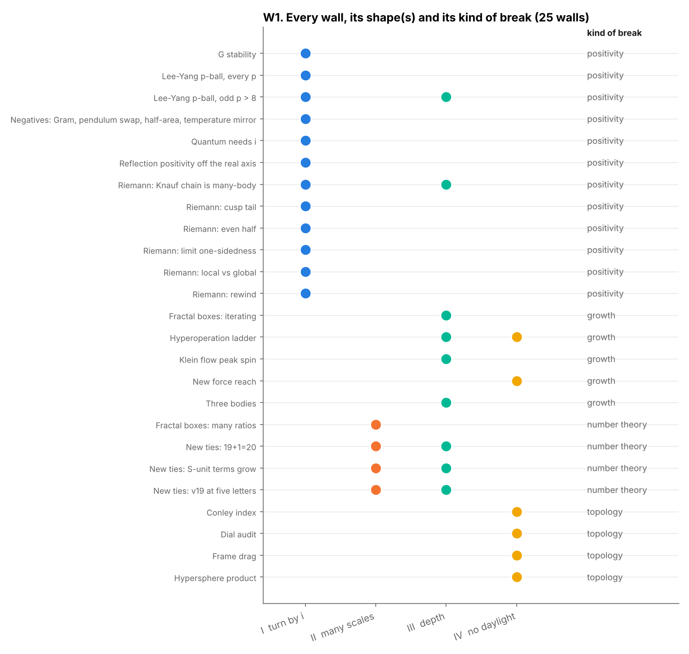
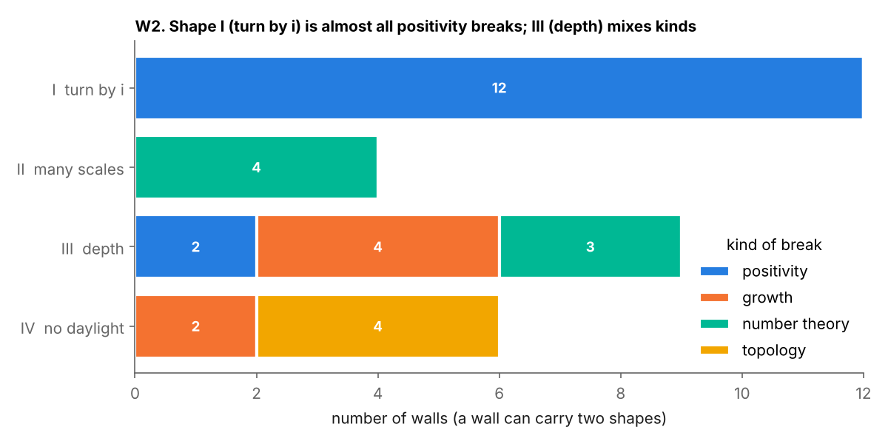
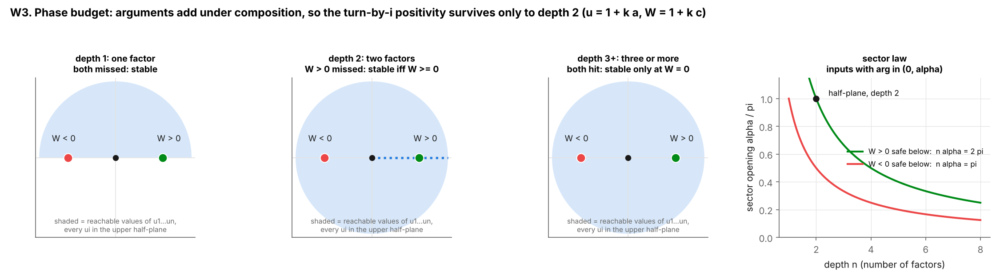
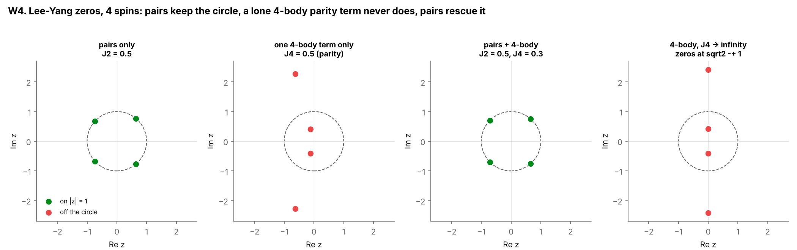
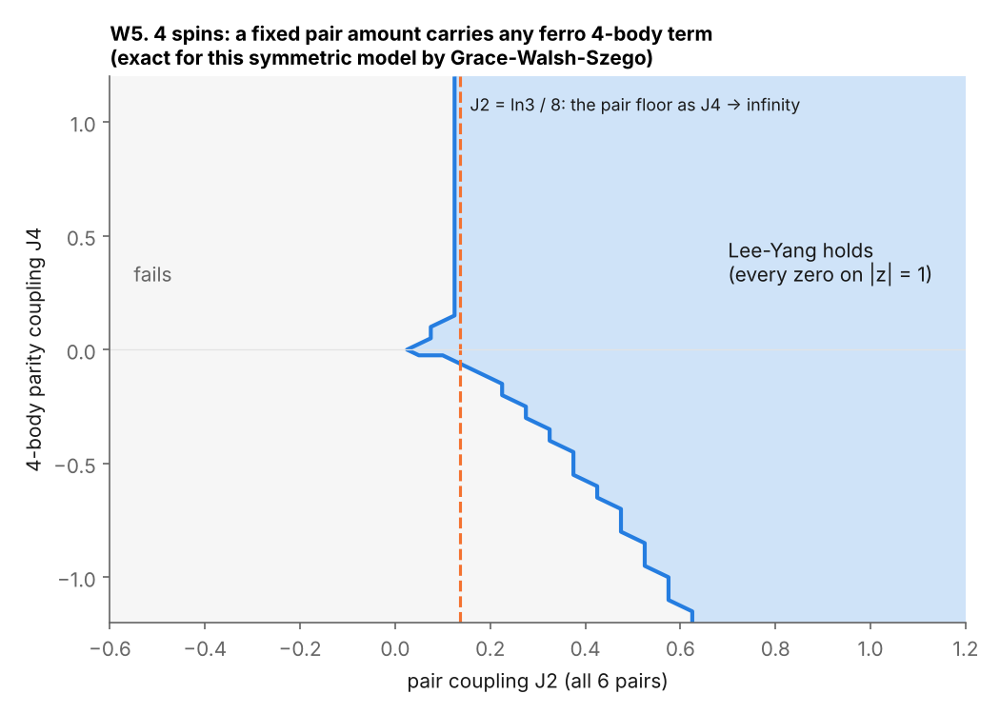
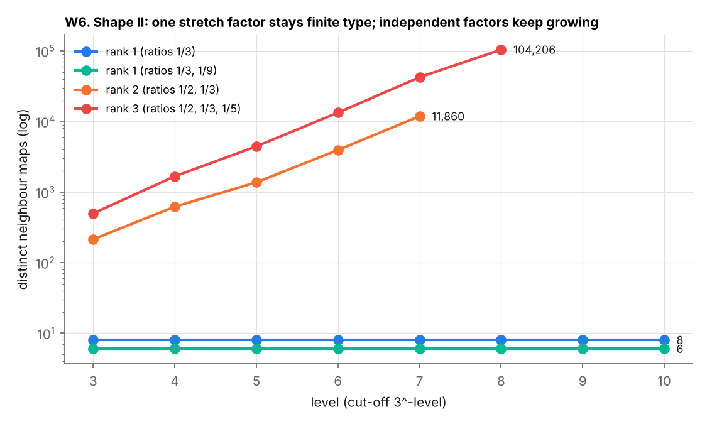

# Wall shapes (DRAFT)

> **Names:** some words or symbols on this page (rung, wall) also mean something else in standard math, physics or computing, or inside this project. [NAMING-COLLISIONS.md](../../NAMING-COLLISIONS.md) says which meaning is in play.

**Status: DRAFT, Nov 27 2026.** Brennan asked: gather every wall the model has hit, and see whether the shapes of the walls hint at a new idea.

## The answer first

The 25 walls fall into four shapes. One idea links the two biggest shapes (turn by i, and depth). Under the model's own law, phases add when you compose. So positivity that survives the turn by i survives only two compositions, and only on the identity's side of the −1/k wall. That is a short theorem (below). It explains why every rescue we have used so far is a two-part rescue: Hermite–Biehler, the Pólya multiplier, the two-spin link, and the RP link window.

On the Lee–Yang side the same statement is already known. Ruelle (Ann. of Math. 2010) proved that a Lee–Yang property that holds at all high temperatures forces ferromagnetic pair interactions. That theorem explains our Riemann chain wall: Knauf's chain is many-body, so its circle has to fail on the hot side, and chain-fix measured the failure there (circle only above a threshold near β ≈ 2, while RH sits at β = 3/2). It does not prove the circle fails at 3/2.

**Verdict.** This is a clear organizing idea with one small new theorem in our language. It is not a breakthrough. I don't think it is a version bump, but that is your call. It points to two concrete leads (end of page).

## 1. The walls, where each stopped, and what kind of break

The full table is in `walls.py` / `walls.json`, with picture W1. Breaks: 12 positivity, 5 growth, 4 number theory, 4 topology.

| Wall | Where it stopped | Dial | Break | Shape | Who proved the stop |
|---|---|---|---|---|---|
| New ties (19+1=20) | Every length reduces to Conj. 21.2; each size closed, no bound for all lengths | s | number theory | II, III | sizes: ours (Baker-type + LLL); all lengths open |
| New ties, S-unit terms | n letters give an n-term S-unit equation; counts grow with n | s | number theory | II, III | Evertse–Schlickewei–Schmidt 2002 |
| New ties, v19 | 19-adic valuation unbounded at five letters | s | number theory | II, III | ours |
| Riemann: local vs global | elliptic object right locally, no global positivity | k | positivity | I | ours |
| Riemann: rewind | backward heat flow below t = 0 loses real zeros | t | positivity | I | Rodgers–Tao 2020 |
| Riemann: even half | odd half keeps zeros on the line, even half pushes them off | k | positivity | I | ours (numerical) |
| Riemann: Knauf chain | many-body; circle only above a threshold near β = 2 | p | positivity | I, III | chain: Knauf 1993; threshold: ours; why: Ruelle 2010 |
| Riemann: limit one-sidedness | equivalent in strength to RH | k | positivity | I | known (de Branges, Lagarias) |
| Riemann: cusp tail | best lead, no proof | k | positivity | I | open |
| Lee–Yang p-ball, odd p > 8 | no uniform near zone (gammas in the numerator) | p | positivity | I, III | even p: Pólya; p ≤ 8: ours |
| Lee–Yang p-ball, every p | Hermite–Biehler start unproved | p | positivity | I | open |
| RP off the real axis | holds for real k, negative at k = −i | k | positivity | I | ours |
| Klein flow | peak spin grows with grid (151 → 233 → 313.8) | d | growth | III | ours (numerical) |
| Frame drag | exact rewrite of Kerr | k | topology | IV | ours |
| Quantum needs i | no path measure at imaginary k | k | positivity | I | Cameron 1960 |
| Fractal boxes, iterating | half-exponential, not unique | s | growth | III | known (Kneser) |
| Fractal boxes, many ratios | finite type only for one ratio | s | number theory | II | Ngai–Wang 2001; counts ours |
| Hyperoperation ladder | commutative + associative only at rungs 1, 2 | r | growth | III, IV | classical |
| Hypersphere product | only dimensions 1, 2, 4, 8 | p | topology | IV | Hurwitz 1898, Adams 1960 |
| Conley | index can't read stability (parity law) | k | topology | IV | ours |
| Dial audit | scalar laws carry only κ = d − k²/4 | k, d | topology | IV | ours |
| New force | hold doesn't pick l_D; strength set by particle content | d | growth | IV | ours |
| G | no stability theorem | k | positivity | I | open |
| Three bodies | pairs closed form, three not | k | growth | III | Poincaré |
| Negatives (Gram, swap, ½-area, mirror) | each failed or was RH-strength | k | positivity | I | ours |

## 2. The four shapes

- **I. Turn by i (12 walls).** Positivity proved on the real k axis is false or unknown at imaginary k. The rescue that keeps coming back is the even/odd split with Hermite–Biehler.
- **II. Many scales (4 walls).** Walls appear when there are two or more independent stretch factors (rank ≥ 2). With one factor, the same questions are solved. W6 shows this with our own maps: neighbour types stay at 8 (or 6) for one ratio, and grow to 11,860 (rank 2) and 104,206 (rank 3). This is known math (Ngai–Wang; Zerner), shown on our maps.
- **III. Depth (9 walls).** Each size works, the family does not: "pairs easy, triples the wall." For the positivity walls the mechanism is proved (section 3). For the others, three bodies and ladder rung 3, the match is only a count.
- **IV. No daylight (6 walls).** The law is a disguised copy of something known. With a single centre, ∘ₖ is conjugate to multiplication through u = 1 + kx. These aren't walls to break. They mark places where the dial adds nothing new.

## 3. The new idea: the phase budget (ours, proved by hand)

With u_i = 1 + k a_i and W = 1 + k c, the "n-fold composition hits c" relation is
R_n = ∏ u_i − W.

**Theorem (depth).** R_n is real stable (no zero with every a_i in the upper half-plane):
- n = 1: always;
- n = 2: exactly when W ≥ 0 (that is, c on the identity's side of −1/k);
- n ≥ 3: exactly when W = 0.

*Proof.* For k > 0, Im a > 0 exactly when Im u > 0 (for k < 0 conjugate; W is real). Arguments of upper half-plane points lie in (0, π) and add under products. One factor reaches the open upper half-plane. Two factors reach every arg in (0, 2π), which is C minus [0, ∞). Three or more reach C minus {0}. W > 0 sits at arg 0 (or 2π), W < 0 at arg π. For n = 2 the same answer comes from Brändén's multiaffine criterion: βγ − αδ = k²(1 + kc). ∎

**Sector law.** If every input has arg in (0, α), depth n misses W > 0 exactly when nα ≤ 2π, and misses W < 0 exactly when nα ≤ π. So depth n is safe if the inputs are kept in a sector n times narrower.

**Why it matters for the walls.** Every shape-I rescue is a depth-2 statement on the W ≥ 0 side:
- Hermite–Biehler is one even/odd pair.
- The two-spin Lee–Yang link maps to x1·x2 = W with W = tanh J, through the Cayley map z = (x − i)/(x + i). Ferromagnetic means W ≥ 0. (Check D5.)
- The RP link window 1 + kεE ≥ 0 is the same inequality.

Depth 3 cannot be built from stable pairs by Asano contraction (contraction keeps stability, and R_3 isn't stable).

**Novelty.** One search found no source stating this in this form. It is a two-line consequence of Brändén's criterion and of arguments adding, so it is probably folklore.

## 4. The Lee–Yang side, and what is already known

- **Pure n-body parity coupling** (ours, exact). Z = ∏(1 + z_j) + T ∏(1 − z_j), T = tanh J. In Cayley form this is ∏ x_j = −T iⁿ, the depth-n relation. On the diagonal, x is a root of xⁿ = −T iⁿ. All roots are real (every zero on |z| = 1) only for n = 2 with J > 0. So a lone 4-body term never has the circle for J ≠ 0. As J → ∞, the zeros go to |z| = √2 ∓ 1. (D6, D7, W4.)
- **Pairs rescue it, with a floor rather than domination** (ours, 4 spins). With all 6 pairs at J2 and one 4-body parity term at J4, the circle holds for any ferromagnetic J4 once J2 ≥ ln 3 / 8 ≈ 0.137 (the J4 → ∞ limit). Antiferromagnetic J4 needs J2 growing with |J4|. This model is symmetric, so the diagonal test is exact by the Grace–Walsh–Szegő theorem. (D8, D9, W5.)
- **Many-body only: fails hot, holds cold** (our numbers). With all 4-body couplings and no pairs (N = 5 to 10), the circle fails for small J4 and holds for J4 ≥ 1. (D10.)
- **Known.**
  - Lee–Yang 1952.
  - Ruelle, *Characterization of Lee–Yang polynomials*, Ann. of Math. 171 (2010): the Lee–Yang property at high temperature forces a ferromagnetic pair interaction (his Thm 9, as quoted by Lebowitz–Ruelle).
  - Lebowitz–Ruelle, *Phase transitions with four-spin interactions*, arXiv:1006.0959: the Lee–Yang property holds at low temperature when every nonzero alignment coupling has βK_A ≥ (|A| − 1) log 2. Their K_A multiplies "all spins in A equal". In spin products that indicator contains every even subset of A, pairs included. That is why it can work where our pure parity term cannot.
  - Our D6 and D10 agree with both theorems. The depth theorem is the same phenomenon stated for ∘ₖ.

## 5. Each idea, what it contributes, and what would make it a lead

1. **Phase budget (depth theorem + sector law).**
   - Contributes: one reason behind 9 walls; it ties shape I and shape III to the model's own −1/k wall.
   - Lead if: a stuck depth-3 object can have its inputs confined to a sector of opening 2π/3 or less, or can be rewritten as pairs.
2. **Ruelle explains the Knauf-chain wall.**
   - Contributes: chain-fix's "circle only above β ≈ 2" is what a theorem predicts, so a high-temperature Lee–Yang statement for the chain as it stands is ruled out in general.
   - Lead if:
     - (a) Lebowitz–Ruelle's condition, applied to the chain's alignment couplings, proves the circle above some β0. That would turn chain-fix's number into a theorem. It would not reach 3/2.
     - (b) The chain has an exact pair-type rewrite (auxiliary spins, field still linear, links ferromagnetic). By Ruelle's theorem that is the only kind of representation that could hold at every temperature, so it is the only Lee–Yang road to 3/2.
3. **Pair floor (ln 3 / 8).**
   - Contributes: shows "pairs must dominate" is the wrong picture; a fixed pair amount carries any ferromagnetic 4-body term.
   - Lead if the floor stays bounded as the number of spins grows. That would give a concrete target for (2b).
4. **Rank test.**
   - Contributes: puts the new-ties wall and the fractal-boxes wall in one class (rank ≥ 2), so no rank-1 trick will close Conjecture 21.2.
   - Lead only if: a rank-lowering map is found. The function-field analogue of S-unit equations is solved (Mason–Stothers), so that is where such a map would come from.
5. **Shape IV.** No idea. These mark where a dial carries nothing new.

## Files

- `walls.py` → `walls.json`: the catalogue.
- `depth.py` → `depth.json`: checks D1–D10.
- `rank.py` → `rank.json`: neighbour-type counts.
- `figures.py` → `figures/W1–W6`.
- `checks.py` → `checks_output.txt`: 13 of 13 pass.

All numpy and fractions; no outside solvers. Line tests and grids are sampling evidence. The symmetric-model maps are exact by Grace–Walsh–Szegő.
