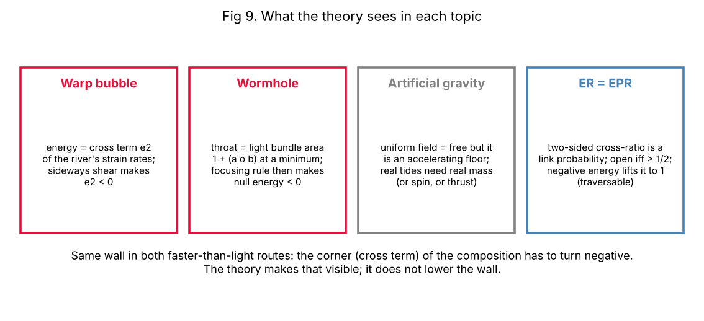
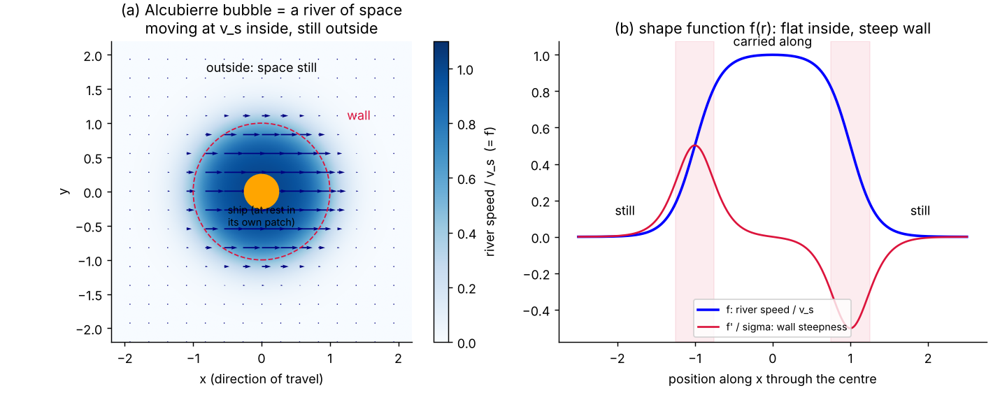
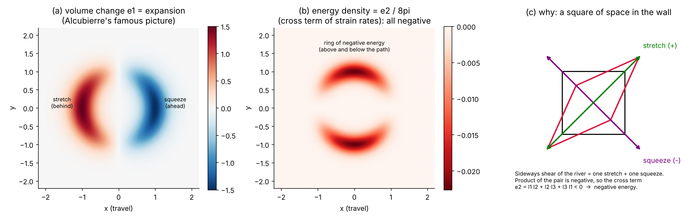
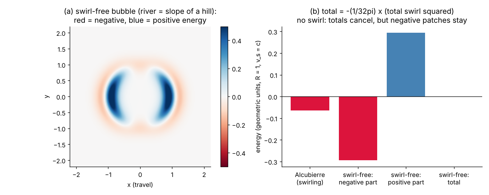
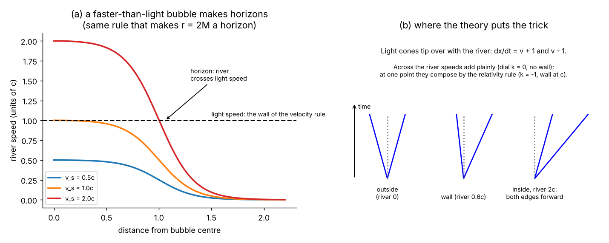
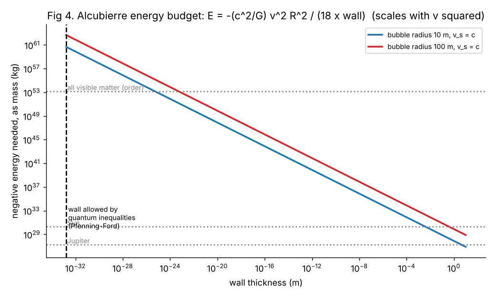
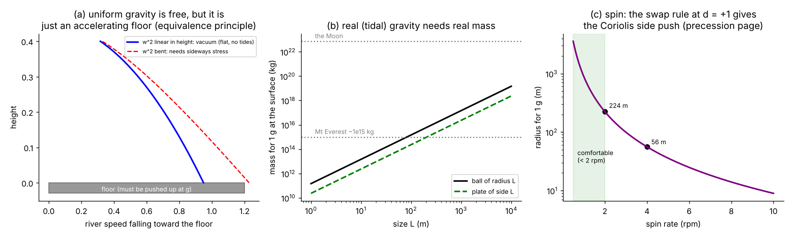
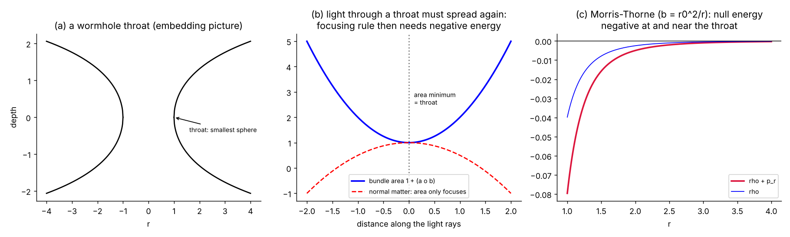
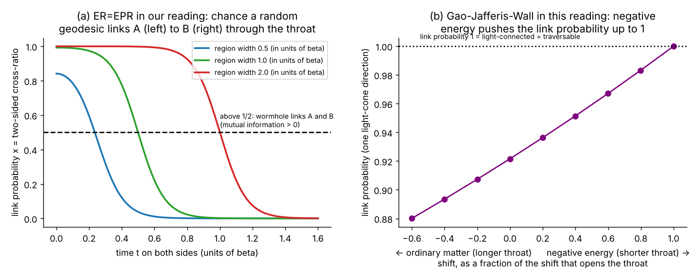

# DRAFT · Warp bubbles, wormholes and artificial gravity through the circle operation (Nov 25–26, 2026)

Asked by Brennan (voice call): "I'm kind of interested in the [Alcubierre] warp bubble ... I don't know if maybe we
could help advance faster than light travel or at least the idea of bending ... if there's a way to maybe create
artificial gravity or to bend or create a warp drive I would like to look into that." Then, on the same call: "is
there a way to generate small wormholes, or is there some work that's already been done ...?" (he said yes to adding
wormholes here).

Checks: `checks.py` → `checks_output.txt` (**26 of 26 pass**; sympy, numpy, scipy; reuses
`../general-relativity/grtools.py`). Pictures: `figures.py` → `figures/` (9 figures). Lean: `lean/WarpWormhole.lean`
(6 theorems, core Lean, Rat + grind like GRBridges; compiled into the library as `FusedAlgebra.Topics.WarpWormhole` on Nov 26, with two pre-1.0 names updated).
DRAFT: everything below reproduces known physics unless marked **ours**, and the "ours" items are readings, not
predictions.

## The result in plain words

The theory reads all three topics cleanly, but it opens no route to a warp drive, a wormhole or artificial gravity.
Both faster-than-light shapes hit the same wall, and the theory shows it as one wall: the cross term (the corner)
of a composition has to turn negative, which is exactly negative energy. A warp bubble's energy is the cross term of
its river's stretch rates, and a wormhole's throat is a place where a light bundle's area, 1 + (a ∘ b), bottoms out.
Artificial gravity sorts into "free but only an accelerating floor" or "real but needs a mountain of mass". The one
new reading worth keeping is on wormholes: in the simplest holographic wormhole the two-sided cross-ratio is a
probability that the two sides are linked; the wormhole is open exactly when it tops one half, and negative energy
pushes it to 1 exactly when the wormhole becomes traversable. That restates known results in our language; it
predicts nothing new.

*Fig 9. What the theory sees in each topic. Red: the two faster-than-light routes, both blocked by a negative cross
term. Gray: artificial gravity. Blue: the wormhole/entanglement reading, where our union rule genuinely appears.*

## Verdicts, lead by lead

| Lead | Verdict | Why |
|---|---|---|
| A softer energy budget for the warp bubble from the theory | **No lead** | Energy density = cross term e2 of the river's strain / 8π. Any bubble that carries a ship needs sideways shear, and shear's cross term is negative. Total energy = −(1/32π) × (total swirl)², a known theorem (Santiago, Schuster, Visser). |
| A different reading of the negative-energy requirement | **A clean reading, not a way out** | Negative energy = "stretch one way, squeeze the other" in the wall. The swirl-free bubble cancels the total to zero but still has negative patches (checked), and the null energy condition fails for every such drive (Santiago–Schuster–Visser). |
| Faster than light from the velocity rule | **No lead** | At one point speeds compose by the relativity rule (dial −1, wall at c). Across the river they add plainly (dial 0, no wall). The bubble uses the second; the price is shear (negative energy) and, above c, horizons at the wall, the same rule that makes r = 2M a horizon. |
| Positive-energy warp drives (2021–2024) | **Known; subluminal only** | In the theory's budget, 16πρ = (space curvature) + 2·e2: real mass adds positive curvature that can pay for the shear. Fuchs et al. 2024 do exactly this, at under light speed, with a 2.4-Jupiter-mass shell. The faster-than-light versions (Lentz, Fell–Heisenberg) were shown to have negative energy for other observers. |
| Artificial gravity | **No lead** | A perfectly uniform field is free (vacuum) but is just an accelerating floor; real tidal gravity needs real mass (1 g from a 10 m ball needs 1.5e13 kg). Spin and thrust work and are ordinary engineering; the theory gives their bookkeeping (Coriolis = swap rule at d = +1; thrust = rapidities adding). |
| Small wormholes | **No lead for making one** | Every throat needs negative null energy (Morris–Thorne; Hochberg–Visser theorem). A 1 m throat holds about 1.4 Jupiter masses of negative energy (thin shell). The real constructions (Gao–Jafferis–Wall, Maldacena–Milekhin–Popov) are quantum effects, tiny or in toy universes, and can't be used to beat light. |
| ER = EPR through our union rule | **Small lead worth stating (ours, reading)** | Two-sided cross-ratio = link probability through the throat; open iff > 1/2; decays like e^(−4πt/β); a negative-energy pulse raises it to exactly 1 at traversability. Gluing by ∘₋₁ holds, but as pure algebra (a cocycle), nothing special to wormholes. |

---

## Part 1. Warp bubbles

### 1.1 The bubble is a river (fundamental; known)

*Fig 1. (a) Alcubierre's metric, ds² = −dt² + (dx − v_s f dt)² + dy² + dz², is a river of space: inside the bubble
the river moves at v_s and carries the ship, which sits at rest in its own patch; outside the river is still. (b) The
shape function f: flat inside, a steep wall, zero outside.*

This is the same "river" form the general-relativity page used for Schwarzschild (river speed² = 2M/r, Painlevé–
Gullstrand, Hamilton–Lisle): flat space slices, clocks of the river ticking at the same rate everywhere. Only the
river's flow differs. Natário (2002) wrote all warp drives this way. Known: Alcubierre, *Class. Quantum Grav.* 11
(1994) L73; Natário, *Class. Quantum Grav.* 19 (2002) 1157.

### 1.2 The energy is the cross term of the river's stretch rates (known content; our reading)

*Fig 2. (a) The volume change e1 (Alcubierre's famous picture: space squeezes ahead, stretches behind). (b) The
energy density, which is all negative, sitting in a ring around the path. (c) Why: in the wall a little square of
space is stretched along one diagonal and squeezed along the other.*

- On any river with flat slices, the energy density measured by the river's own observers is
  **ρ = e2 / 8π**, where e2 is the **cross term of the three strain rates**, λ₁λ₂ + λ₂λ₃ + λ₃λ₁: the middle layer
  of the three-way product (1 + λ₁)(1 + λ₂)(1 + λ₃) = 1 + e1 + e2 + e3. (gr-bridges T2/T3 proved this on every
  river; check A1 confirms it reproduces Alcubierre's formula −v_s² f′² (y² + z²)/(32π r²) exactly.)
- The bubble's river points only along the direction of travel, so its strain rates are (0, +, −): **one
  stretch, one squeeze**, and their product is minus the sideways shear squared (A3). The cross term is negative,
  so the energy is negative.
- The expansion e1 (panel a) is not what costs energy: Natário's bubble has **zero expansion** everywhere, and then
  e2 = −(λ₁² + λ₂² + λ₃²)/2 ≤ 0 automatically (A4, Lean `zero_expansion_cross_term`).

**Status.** The formula is the standard ADM energy constraint in flat slicing; Santiago, Schuster and Visser write
it as ρ = (K² − tr K²)/16π, which is our e2/8π. Reading it as the corner of the circle operation applied to the
strain rates is **ours** (stated already on gr-bridges); it explains, but doesn't change anything.

### 1.3 Swirl sets the total; no swirl only hides the problem (known)

*Fig 5. (a) A swirl-free bubble (the river is the slope of a "hill", v = ∇φ with φ = v_s x f): blue rings of
positive energy, red rings of negative. (b) Totals: Alcubierre's bubble is net negative; the swirl-free one cancels
to zero, but its negative part is as big as its positive part.*

- Total energy of any flat-slice bubble = **−(1/32π) ∫ |curl v|²** (A5: closed form, grid integral and swirl
  integral agree to 0.2%). This is eq. 7.17 of Santiago, Schuster and Visser (arXiv:2105.03079, *Gen. Rel. Grav.*
  2022).
- With no swirl, the total is zero (A6: −0.294 + 0.294), so negative energy can't be removed, only balanced.
  The same paper proves every drive of this kind breaks the **null energy condition** for some observer, so no
  rearrangement of the river escapes.

### 1.4 Two composition rules, and why going faster than light makes horizons (our reading)

*Fig 3. (a) River speed against distance from the centre for v_s = 0.5c, 1c and 2c. Where it crosses light speed
(the wall of the velocity rule) a horizon forms; for v_s = 2c that is at r = 1.02 in the wall (A9). (b) Light cones
tip over with the river; inside a 2c river both edges point forward.*

- In the river, light moves at dx/dt = v + 1 and v − 1 (A7, Lean `river_light`): **across the river, speeds add
  plainly, dial k = 0**, no wall. At a single point, two velocities still compose by the relativity rule (dial
  −1, wall at c): 0.6c with 0.7c gives 0.915c (A8). The bubble never beats the local rule; it moves the frame.
- So the theory places the "trick" precisely: the ship uses the dial-0 rule between river and outside, and the
  dial-0 rule has no wall. The price is the shear in 1.2.
- Where the river exceeds c, the same rule that makes r = 2M a horizon makes horizons at the wall. A crew inside a
  faster-than-light bubble can't send signals to its own front wall, and Hawking-like radiation piles up there
  (Finazzi, Liberati, Barceló, *Phys. Rev. D* 79, 124017 (2009): superluminal bubbles are semiclassically
  unstable). Any faster-than-light travel can also be arranged into a round trip into the past, the standard
  special-relativity argument.

**Status.** Light cones tipping in a river is known (river model). "Plain sum across, relativity rule at a point"
as two settings of the one dial is **ours** as a framing.

### 1.5 How much energy (known physics, our numbers)

*Fig 4. Negative energy needed (as mass, kg) against wall thickness, for bubbles of radius 10 m and 100 m at
v_s = c. Gray lines: Jupiter, the Sun, all visible matter (order of magnitude). Dashed: the wall thickness allowed
by quantum inequalities.*

- Thin-wall law (A10): **E ≈ −(c²/G) · v_s² R² / (18 × wall thickness)**. A 100 m bubble at light speed with a 1 m
  wall needs about −7.5e29 kg (0.4 Suns); with a 1 mm wall, 380 Suns.
- Quantum field theory limits how much negative energy can sit in one place for how long; Pfenning and Ford
  (*Class. Quantum Grav.* 14 (1997) 1743) showed this forces the wall down to a few hundred Planck lengths. Then
  the same law gives about −4.6e62 kg (A11), over a billion times all the visible matter.
- Van Den Broeck (*Class. Quantum Grav.* 16 (1999) 3973) shrinks the outside of the bubble while keeping the
  inside large; his corrected estimate is "a few solar masses" of negative energy plus a similar positive amount.
  Bobrick and Martire (2021) argue the savings are smaller than claimed.

### 1.6 The positive-energy claims, in the theory's budget (known)

With curved space slices the budget becomes **16πρ = (space curvature ³R) + 2·e2**. Positive mass makes ³R
positive, so real matter can pay for the shear's negative e2. That is the whole idea behind the 2021–2024 papers:

| Paper | Claim | Status |
|---|---|---|
| Lentz, *Class. Quantum Grav.* 38 (2021) 075015 | faster-than-light soliton from plasma and EM fields, positive energy | Celmaster and Rubin (arXiv:2511.18251, Nov 2025) compute negative Eulerian energy and find derivation errors; Santiago–Schuster–Visser had shown zero-swirl drives have sometimes-negative energy |
| Fell and Heisenberg, arXiv:2104.06488 (2021) | faster-than-light, non-negative Eulerian energy, ~1e-4 solar masses | positive only for one family of observers (Santiago–Schuster–Visser) |
| Bobrick and Martire, *Class. Quantum Grav.* 38 (2021) 105009 | subluminal positive-energy warp drives in principle; any warp drive still needs propulsion | consistent with the budget above |
| Fuchs, Helmerich, Bobrick, Sellers, Melcher, Martire, *Class. Quantum Grav.* 41 (2024) 095013 | constant-velocity subluminal warp shell meeting all energy conditions | shell 10–20 m, mass 4.49e27 kg (2.4 Jupiters), shift 0.02c: a moving massive shell that drags its inside along |

**Verdict.** Under light speed, a warp shell is real physics: a heavy moving shell whose inside is carried. Above
light speed, every claimed positive-energy drive has been answered. The theory reproduces this split and adds no
new lever.

---

## Part 2. Artificial gravity

*Fig 6. (a) A river falling toward a floor. If its speed² is linear in height (blue), spacetime is empty and flat:
a uniform field with no tides, which is just an accelerating frame; the floor must be pushed up at g. Any bend
(red) needs sideways stress. (b) Mass needed for a real 1 g at the surface of a ball or plate of size L. (c) Spin:
radius for 1 g against spin rate.*

- **A uniform field is free, and that is the catch (B1–B3).** For a river w(z) that depends only on height, the
  Einstein tensor is −(w²)″/2 on the two sideways directions and zero otherwise, so empty space needs w² linear in
  height: exactly a uniform field (B2). A floor held at fixed height feels a = |w w′|/√(1 − w²) = g/√(1 − 2gz − c)
  (B3): it is accelerating. That is the equivalence principle in river language. Known (Rindler).
- **Real gravity (with tides) needs real mass (B4).** An infinite plate needs 2.3e10 kg per square metre; a 10 m
  ball needs 1.5e13 kg, a large mountain, for 1 g at its surface.
- **Spin (B5).** 1 g at 2 rpm needs a 224 m radius, at 4 rpm 56 m. The side push on anything moving in a spinning
  room (Coriolis) is the swap rule at d = +1 from the precession page.
- **Thrust (B6).** A year of 1 g thrust reaches 0.775c: 200,000 small kicks composed by the relativity rule give
  tanh(gτ/c) exactly, the rapidities adding (relativity page).

**Verdict.** No lead. The theory restates the equivalence principle neatly (uniform gravity = vacuum river =
accelerating floor), but bending space for real still costs mass, and the practical routes (spin, thrust) need no
new math.

---

## Part 3. Wormholes

### 3.1 Every throat needs negative null energy (known; our area reading)

*Fig 7. (a) A wormhole throat: the smallest sphere in a tube joining two regions. (b) Light passing through must
spread again after narrowing, so the bundle's area 1 + (a ∘ b) has a minimum; ordinary matter only ever focuses
(red dashed). (c) Morris–Thorne wormhole with b = r₀²/r: ρ + p_r, the null energy, is negative at the throat.*

- Morris–Thorne (*Am. J. Phys.* 56 (1988) 395): for a static wormhole ρ + p_r = (r b′ − b)/(8π r³) (C1, C2), which
  is negative wherever the throat flares out.
- Our reading of why (C3): a light bundle's area is (1 + a)(1 + b) = 1 + (a ∘ b), and the focusing rule
  (Raychaudhuri, as on gr-bridges J1) says a″/(1+a) + b″/(1+b) = −R_kk. At a throat the area is at a minimum, so
  R_kk = −A″/A < 0: negative null energy. Hochberg and Visser (arXiv:gr-qc/9802046, 1998) proved NEC violation at
  every throat, even time-dependent and non-symmetric ones.
- **Size and cost (C4).** A thin-shell wormhole (Visser 1989) with throat radius a holds shell mass
  −2a√(1 − 2M/a) (geometric units): for a 1 m throat, **−2.7e27 kg, about 1.4 Jupiter masses of negative energy**.

### 3.2 What has actually been built or proposed (known)

- **Gao, Jafferis, Wall** (arXiv:1608.05687; *JHEP* 12 (2017) 151): coupling the two boundaries of an eternal BTZ
  black hole produces quantum matter with negative average null energy; the wormhole becomes traversable, but it
  can't be used to violate causality. Read as quantum teleportation (Maldacena,
  Stanford, Yang 2017).
- **Maldacena, Milekhin, Popov** (arXiv:1807.04726): a 4D traversable wormhole between two magnetically charged
  black holes, held open by negative Casimir-like energy of charged fermions; can sit in the Standard Model only if
  far smaller than the electroweak scale. No causality violation.
- **Blázquez-Salcedo, Knoll, Radu** (*Phys. Rev. Lett.* 126, 101102 (2021)) claimed wormholes from ordinary Dirac and
  Maxwell fields. Danielson, Satishchandran, Wald, Weinbaum (*Phys. Rev. D* 104 (2021), arXiv:2108.13361) showed the
  metric isn't smooth enough at the throat and the fields need a hidden source there, so they are not solutions.
- **The 2022 "wormhole on a chip"** (Jafferis et al., *Nature* 612, 51 (2022), Google Sycamore): a learned, sparse
  SYK-like model showed teleportation signals with wormhole-like features. Kobrin, Schuster, Yao (arXiv:2302.07897)
  argued the learned model doesn't thermalize and its "wormhole" features are generic to small commuting models;
  the authors replied (arXiv:2303.15423). Either way, no spacetime wormhole was made: it is a simulation of a model
  that has a wormhole dual.
- **ER = EPR** (Maldacena and Susskind, arXiv:1306.0533): entangled systems are connected by (non-traversable)
  wormholes. The thermofield double (two entangled copies) is the eternal two-sided black hole (Maldacena 2003).

### 3.3 ER = EPR through our union rule (ours, reading; ingredients known)

*Fig 8. (a) In the thermofield double, the probability that a random geodesic links region A on the left to region
B on the right, through the wormhole, against time. Above 1/2 the wormhole connects them (mutual information > 0).
(b) A shift of the right side: ordinary matter (left) lowers the link probability; negative energy (right) raises it,
reaching exactly 1 when the two points become light-connected, which is traversability.*

The probability-entanglement page found that in AdS₃ the cross-ratio x of four boundary points is a real
probability: the chance that a steady random clock on one region's own (modular) time ticks while sweeping the
other. Here the same object across the throat:

- **The two-sided cross-ratio (C5, Lean `tfd_cross_ratio_split`).** For intervals of width ℓ at the same place on
  the two sides of the planar BTZ wormhole at time t on both clocks, x = sinh²(πℓ/β) / (sinh²(πℓ/β) +
  cosh²(2πt/β)). This holds because planar BTZ is Rindler-AdS₃, so the two sides are just two halves of one vacuum
  line, and the one-sided result carries over unchanged.
- **Mutual information is the log of the link odds (C6).** I(A:B) = (c/3) log(x/(1−x)) = (2c/3) log(sinh(πℓ/β) /
  cosh(2πt/β)), which is Hartman and Maldacena's result (arXiv:1303.1080). So the wormhole connects A and B at
  leading order **exactly when the link probability exceeds 1/2** (the known disconnected/connected switch).
- **The throat stretches, the link fades (C7).** At late times x falls like e^(−4πt/β), twice the black hole's
  surface-gravity rate.
- **Traversability = link probability 1 (C9).** A negative-energy shift of the right side (Gao–Jafferis–Wall's
  mechanism, modelled as a shift of one light-cone coordinate) raises x monotonically, and x = 1 exactly when the
  left and right points become light-connected through the bulk.
- **Gluing across the throat (C8, Lean `cross_ratio_cocycle`, `glue_is_union`).** Joining next-door regions B₁ and
  B₂ on the right combines link probabilities by our union rule ∘₋₁. But this is the cross-ratio cocycle, true for
  any four points: nothing special to wormholes.

**Status.** Every formula is known (cross-ratios, Hartman–Maldacena, Gao–Jafferis–Wall, Headrick's phase switch).
Reading the two-sided cross-ratio as a link probability with threshold 1/2 and traversability at 1 is **ours**,
extending the probability-entanglement reading. Only planar BTZ was checked; the compact (circle) black hole and
excited states were not.

---

## Known versus ours

| Item | Status | Source / check |
|---|---|---|
| Alcubierre metric, energy −v²f′²(y²+z²)/(32πr²) | Known | Alcubierre 1994; A1 |
| Warp drives as flows on flat slices | Known | Natário 2002 |
| Energy = e2/8π, total = −(1/32π)∫\|curl v\|², NEC violated by all such drives | Known | Santiago, Schuster, Visser, arXiv:2105.03079; A1, A5 |
| e2 as the corner (cross term) of (1+λ₁)(1+λ₂)(1+λ₃); "stretch + squeeze = negative energy" | **Ours (reading)** | A3, A4; gr-bridges T2 |
| River = dial 0 between river and coordinates, dial −1 at a point | **Ours (framing)** | A7, A8 |
| Horizons above light speed; semiclassical instability | Known | Finazzi, Liberati, Barceló 2009; A9 |
| Energy scale and Planck-thin walls | Known physics, our numbers | Pfenning–Ford 1997; A10, A11 |
| Positive-energy subluminal shells | Known | Bobrick–Martire 2021; Fuchs et al. 2024 |
| Uniform field = vacuum planar river = accelerating floor | Known (Rindler); river phrasing ours | B1–B3 |
| Throat needs negative null energy | Known | Morris–Thorne 1988; Hochberg–Visser 1998; C1, C2 |
| Throat as the minimum of 1 + (a ∘ b) | **Ours (reading)** | C3 |
| Thin-shell cost (1.4 Jupiters per metre of throat radius) | Known formula, our number | Visser 1989; C4 |
| Two-sided cross-ratio = link probability; open iff > 1/2; = 1 at traversability | **Ours (reading)** | C5, C6, C9 |

## Leads, judged on their own merits

- **Warp drive (faster than light): no lead.** The theory pins the cost on the shear's cross term and shows why no
  rearrangement of the river escapes it; that is already a theorem. Nothing here suggests a cheaper bubble.
- **Warp shell (slower than light): real, known, no new math from us.** It is a heavy moving shell.
- **Artificial gravity: no lead.** Spin and thrust are the only practical routes, and both are ordinary.
- **Small wormholes: no lead for making one.** The only consistent ones are quantum-scale and need negative energy
  from quantum fields.
- **ER = EPR link-probability reading: small, worth stating in our README** alongside the AdS₃ clock reading. It
  could fail a sharp test: the compact BTZ black hole or an excited (non-thermal) state, where modular time stops
  being geometric. It is a reformulation, not a prediction.

## Files
- `checks.py` → `checks_output.txt`, `results.json`: 26 of 26 checks pass (about 2 minutes).
- `figures.py` → `figures/fig1`–`fig9` (PNG).
- `lean/WarpWormhole.lean`: 6 theorems, core Lean 4.37.0-rc1 style (Rat + grind), imports Base; compiled into the library as `Topics/WarpWormhole` (Nov 26).
- Reuses `../general-relativity/grtools.py`.
