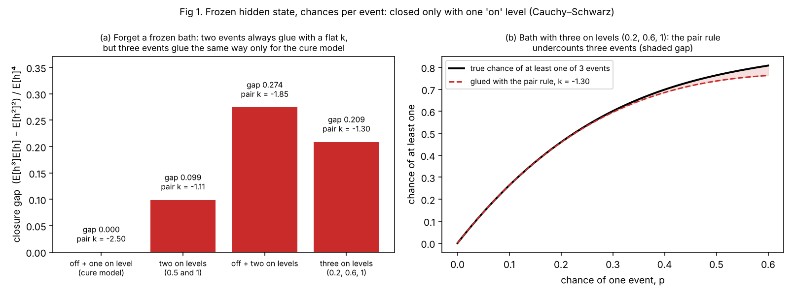
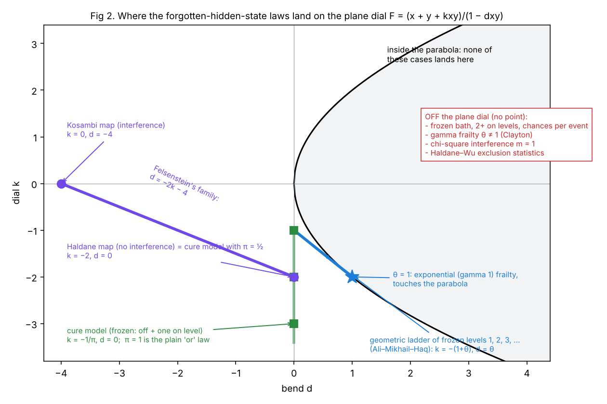
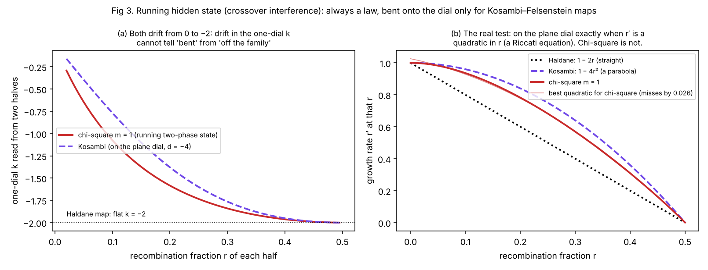
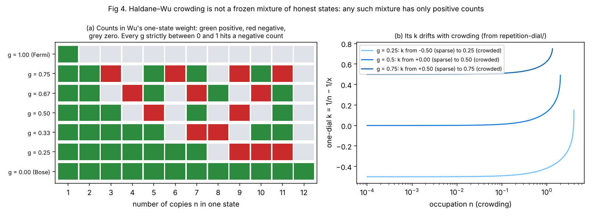

# Where k moves: a forgotten hidden state, frozen or running (DRAFT)

**Result in one sentence:** a drifting k does not by itself mean leaving our family. Forgetting a hidden state can
keep the law exact, bend it onto the plane dial, or push it off, and which one happens follows a sharp rule.
Haldane crowding is not a frozen hidden state, and neither is chi-square interference.

Status: DRAFT, not reviewed, not published. Follows lead R4 in `../closed-leads-revisit/README.md`. Builds on the
bath result in `../probability-entanglement/` (section 9), Haldane's g in `../repetition-dial/` and the plane dial in
`../lucas-weights/`.

## The question in plain words

Our "or" law glues two chances as p + q + k·pq (k = −1 for independent events). The bath result said k moves only
when a hidden state is forgotten: if a share π of people can have the event at all, two exposures of the same person
glue with k = −1/π (the **mixture cure model**). The lead asked two things:

1. Does it matter whether the hidden state is **frozen** (fixed for the person, like susceptibility) or **running**
   (changing along the line being glued, like the crossover phase along a chromosome)?
2. Haldane's crowding drifts in k. Is its hidden state frozen with many levels, or running?

The tool is the **plane dial** F(x, y) = (x + y + kxy)/(1 − dxy), which adds a bend d to the one-dial law. A law
that is "adding something underneath" (exposure, map distance) sits on the plane dial exactly when its rate,
written as a function of the chance itself, is a quadratic 1 + kx + dx². That is a Riccati equation, and it is the
test used throughout.

## Fig 1. Frozen state, chances per event: closed only with one "on" level

Let the hidden level be h, frozen for the person, and let each event hit with chance proportional to h.

- Two events always glue with a **flat** k = −E[h²]/E[h]², however many levels the bath has and whatever the doses.
  So k being flat is not enough.
- Three events glue the same way only if E[h³]E[h] = E[h²]². By the Cauchy–Schwarz inequality, the gap is always
  ≥ 0 and is zero **only** when h takes one nonzero value (plus possibly zero). That is exactly the cure model. Every
  bath with two or more "on" levels fails, and the pair rule undercounts three or more events (panel b).

This is the precise reason the old bath page found "three or more levels leave the family": what matters is the
number of **on** levels, not the number of levels.

## Fig 2. Where the forgotten-state laws land on the plane dial

- **Cure model** (frozen: off and one on level): k = −1/π, d = 0. The no-interference **Haldane map** of genetics is
  the same law at π = ½, since a recombination fraction can never pass ½.
- **Frozen state, exposures add hazard** (P(no event | h) = e^(−hΛ), two exposures add their Λ): this is always a law,
  because it is adding exposures underneath (survival analysis calls it a frailty model; its laws are the Archimedean
  copulas). It sits on the plane dial exactly when the frozen levels form a **geometric ladder** 1, 2, 3, … with
  weights (1 − θ)θⁿ⁻¹: k = −(1 + θ), d = θ. That is the Ali–Mikhail–Haq copula. Adding a cured share keeps it on the dial.
  The line touches the parabola at θ = 1, the exponential (gamma 1) frailty. Gamma frailty with θ ≠ 1 (the Clayton
  copula) is off the dial.
- **Running state, crossover interference:** map distance adds along the chromosome, so this is always a law too.
  It sits on the plane dial exactly when the coincidence (how much one crossover suppresses another nearby) is linear
  in r: **Felsenstein's 1979 family**, on the line d = −2k − 4, from Haldane (k = −2, d = 0) to **Kosambi** (k = 0, d = −4).

So the bend d has concrete existing meanings. In frailty it is the ratio θ of the geometric ladder, and in genetics it
is the strength of interference. None of these cases lands inside the parabola.

## Fig 3. Running state: drift is not the test

- **(a)** Read through the one-dial k, Kosambi drifts from 0 to −2 much like the chi-square model. Kosambi is
  a perfectly good plane-dial law; a plane law always "drifts" that way, k_eff(x) = (k + 2dx)/(1 − dx²). So the drift
  the old closures saw cannot tell "bent onto the dial" from "off the family".
- **(b)** The Riccati test can: Haldane's rate is a line in r, Kosambi's is a parabola, and the chi-square model's
  (every second crossover counts, the running two-phase state) is neither. The best quadratic misses it by 0.026.

## Fig 4. Haldane crowding is not a frozen hidden state

A frozen mixture of honest states (each with counts ≥ 0, like Bose or Fermi states) always has counts ≥ 0. Wu's
one-state weight for Haldane's g has a negative count for every g strictly between 0 and 1 (first at 3 copies for
g = ¾, 5 for g = ½, 9 for g = ¼). So no frozen hidden state, with any number of levels, produces Haldane crowding.
The semion case g = ½ has a closed form, Z = (x/2 + √(1 + x²/4))², whose rate is 1/√(1 + x²/4), a square root of a
quadratic, so it is not on the plane dial either. What is left is the reading the old page gave in words: the hidden
state is the shared room between elements, a running, collective state. We did not build that model here.

## The rule, as it stands now

| Hidden state | How events add | Result |
|---|---|---|
| Frozen, one "on" level | chances per event | exact one-dial law, k = −1/π (cure model) |
| Frozen, 2+ "on" levels | chances per event | flat k for pairs, but not a law (Cauchy–Schwarz gap) |
| Frozen, any levels | exposures add hazard | always a law; plane dial only for a geometric ladder |
| Running (interference) | map distance adds | always a law; plane dial only for linear coincidence (Kosambi–Felsenstein) |
| Running / collective (Haldane crowding) | elements share room | not a frozen mixture; not on the plane dial |

The old rule "a two-state bath keeps us in the family" becomes: **one on level keeps the one-dial law; a geometric
ladder or linear interference bends it onto the plane dial; anything else leaves**. A drifting one-dial k is not a test
of any of this; the Riccati test is.

## Is this a lead worth following?

Yes, for one reason: it gives the bend d concrete meanings, which `../functional-analysis/` left open ("what the
landscape bend q means"). Two well-studied families sit exactly on the plane dial, the Ali–Mikhail–Haq copula in survival
statistics and Felsenstein's map functions in genetics. Their data and fitted parameters are real-world measurements
of a bend. The natural next test is to take published fits of either and place them on the dial. The Haldane question is
settled as far as "frozen" goes; building its running model is a separate piece of work.

## Known versus ours

| Piece | Status |
|---|---|
| Cure model; frailty models give Archimedean copulas; Ali–Mikhail–Haq = geometric frailty; Clayton = gamma frailty | known (Boag; Berkson–Gage; Clayton; Oakes; Marshall–Olkin; Nelsen) |
| Haldane, Kosambi and Felsenstein map functions; linear coincidence gives Felsenstein's family; chi-square model | known (Haldane 1919; Kosambi 1944; Felsenstein 1979; Foss et al. 1993; Zhao–Speed–McPeek 1995) |
| Wu's statistics; negative single-state probabilities for exclusion statistics | known (Haldane 1991; Wu 1994; Polychronakos 1996) |
| Closure only for one "on" level, by Cauchy–Schwarz | ours as stated; an elementary step, probably folklore |
| Placing all of these on one plane dial (AMH line k + d = −1, Felsenstein line d = −2k − 4); Haldane map = cure model at π = ½ | ours as a reading; the math under it is known |
| "Drift is not the test, the Riccati test is"; the refined frozen/running rule | ours |

## Checks (17 of 17 pass)

`checks.py` → `checks_output.txt`, `checks.json` (sympy, numpy, mpmath; under a minute).

- A1 to A3: frozen bath, chances per event: flat pair k = −E[h²]/E[h]² for any levels; the three-event gap formula;
  Cauchy–Schwarz (gap ≥ 0 over 20 000 random baths with every level on, smallest 3·10⁻¹⁰ > 0; zero for the cure model).
- B1 to B6: frozen bath, hazard exposures: associative for a 3-level bath (gap 2·10⁻¹⁶); geometric frailty is exactly
  the plane law k = −(1 + θ), d = θ; with a cured share still plane (k = −(1 + θ)/π₀, d = θ/π₀²); gamma frailty is
  plane only at θ = 1; the AMH line touches the parabola at θ = 1; bilinear term −E[h²]/E[h]².
- C1 to C5: Haldane map r′ = 1 − 2r and Kosambi r′ = 1 − 4r² are plane laws; Felsenstein's family is the line
  d = −2k − 4 with linear coincidence; chi-square m = 1 is not plane (best quadratic misses by 0.026); a plane law's
  one-dial k drifts exactly as (k + 2dx)/(1 − dx²).
- D1 to D3: Wu's one-state counts: honest only at g = 0 and 1; the semion closed form; the k drift from 2g − 1 to g.

## Files

- `checks.py`, `checks_output.txt`, `checks.json`.
- `figures.py` → `figures/fig1-frozen-chances.png`, `fig2-where-they-land.png`, `fig3-interference.png`, `fig4-haldane.png`.

## Sources (from memory; not re-read for this page)

- Boag, J. W. (1949). Maximum likelihood estimates of the proportion of patients cured by cancer therapy. JRSS B 11.
- Berkson, J. and Gage, R. P. (1952). Survival curve for cancer patients following treatment. JASA 47.
- Clayton, D. G. (1978). A model for association in bivariate life tables. Biometrika 65.
- Ali, M. M., Mikhail, N. N. and Haq, M. S. (1978). A class of bivariate distributions including the bivariate
  logistic. J. Multivariate Anal. 8.
- Marshall, A. W. and Olkin, I. (1988). Families of multivariate distributions. JASA 83. Oakes, D. (1989). Bivariate
  survival models induced by frailties. JASA 84. Nelsen, R. B. (2006). An Introduction to Copulas. Springer.
- Haldane, J. B. S. (1919). The combination of linkage values. J. Genetics 8. Kosambi, D. D. (1944). The estimation of
  map distances from recombination values. Ann. Eugenics 12. Felsenstein, J. (1979). A mathematically tractable family
  of genetic mapping functions with different amounts of interference. Genetics 91.
- Foss, E., Lande, R., Stahl, F. W. and Steinberg, C. M. (1993). Chiasma interference as a function of genetic distance.
  Genetics 133. Zhao, H., Speed, T. P. and McPeek, M. S. (1995). Statistical analysis of crossover interference using
  the chi-square model. Genetics 139.
- Haldane, F. D. M. (1991). "Fractional statistics" in arbitrary dimensions. PRL 67. Wu, Y.-S. (1994). Statistical
  distribution for generalized ideal gas of fractional-statistics particles. PRL 73. Polychronakos, A. P. (1996).
  Probabilities and path-integral realization of exclusion statistics. Phys. Lett. B 365.
